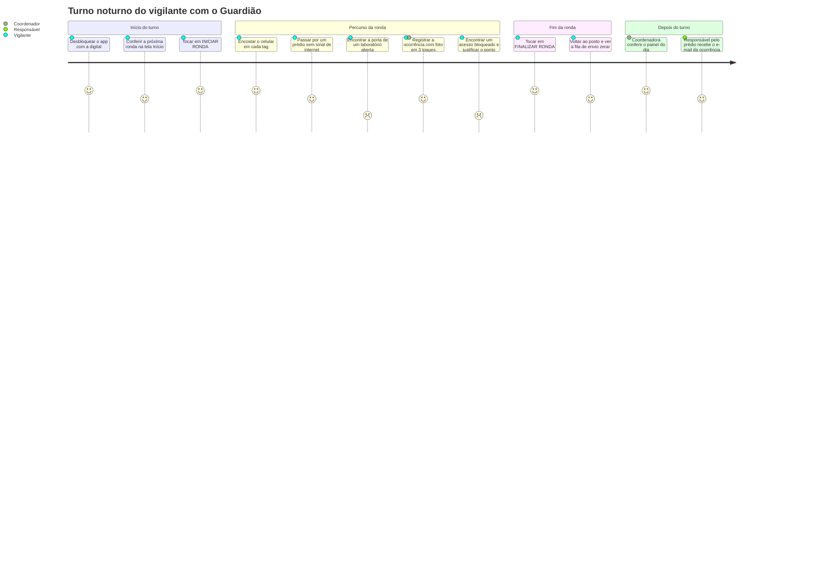
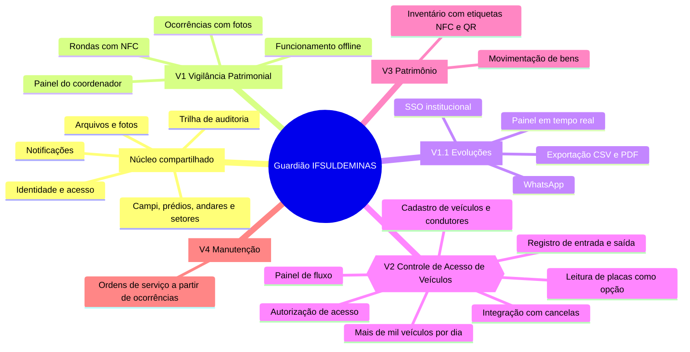

# Visão do produto

Parte da [documentação do Guardião](README.md).

| | |
|---|---|
| **Produto** | Guardião IFSULDEMINAS |
| **Codinome / repositório** | PainKiller (`G-E-I-C-I-S/PainKiller`) |
| **Equipe** | G.E.I.C.I.S |
| **Primeiro módulo (V1)** | Vigilância Patrimonial: rondas com NFC, ocorrências com fotos e painel do coordenador |
| **Release Candidate** | 06/11/2026 |
| **V1.0 em produção** | até 13/11/2026, após piloto assistido |
| **Situação deste documento** | Versão inicial (01/10/2026), revisada a cada Sprint Review |

## Sumário

1. [Contexto](#contexto)
2. [Problema](#problema)
3. [Proposta de valor](#proposta-de-valor)
4. [Objetivos e métricas de sucesso](#objetivos-e-métricas-de-sucesso)
5. [Escopo da V1](#escopo-da-v1)
6. [Fora do escopo da V1](#fora-do-escopo-da-v1)
7. [Stakeholders](#stakeholders)
8. [Personas](#personas)
9. [Jornada do vigilante](#jornada-do-vigilante)
10. [Princípios do produto](#princípios-do-produto)
11. [Visão de plataforma](#visão-de-plataforma)
12. [Premissas, restrições e riscos](#premissas-restrições-e-riscos)
13. [Documentos relacionados](#documentos-relacionados)

## Contexto

O IFSULDEMINAS (Instituto Federal do Sul de Minas Gerais) é uma instituição multicampi. Em cada campus, a vigilância patrimonial percorre prédios, andares e setores em rondas periódicas, inclusive no período noturno, para prevenir e identificar irregularidades: portas abertas, danos ao patrimônio, vazamentos, equipamentos ligados indevidamente, pessoas ou veículos suspeitos, entre outras.

Hoje, o controle dessas rondas é **manual**. A passagem do vigilante por cada local e as irregularidades encontradas dependem de anotações e de comunicação informal, sem um registro único, verificável e consultável.

O **Guardião IFSULDEMINAS** substitui esses controles manuais e dá rastreabilidade às rondas. O vigilante usa um aplicativo de celular para iniciar a ronda e aproxima o aparelho de tags NFC instaladas nos pontos de ronda. A cada leitura, o sistema registra o ponto, o horário, o vigilante e a localização aproximada. As irregularidades viram ocorrências com tipo, local, descrição, gravidade e fotos, vinculadas à ronda, ao ponto, ao horário e ao responsável. Coordenadores e responsáveis acompanham tudo num painel web e recebem as ocorrências relevantes por e-mail (e por WhatsApp quando houver integração).

> **Pendência:** o levantamento detalhado do processo atual (instrumentos usados, frequência e roteiros das rondas, quantidade de pontos por campus) será feito com a Coordenação de Vigilância durante a Sprint 0 e a Sprint 1. Este documento não presume números da instituição.

## Problema

**Declaração do problema**

| | |
|---|---|
| **O problema de** | controlar rondas e ocorrências da vigilância patrimonial por meios manuais |
| **afeta** | vigilantes, coordenadores da vigilância, responsáveis por prédios e setores e a gestão dos campi |
| **cujo impacto é** | não haver prova de que os pontos foram vistoriados, ocorrências chegarem tarde e incompletas a quem precisa agir e não existir histórico confiável para gestão e apuração |
| **uma boa solução seria** | um aplicativo simples, que comprove a passagem por leitura NFC, funcione sem internet, registre ocorrências com fotos e alimente um painel com histórico auditável |

**Problemas específicos**

| # | Problema | Consequência |
|---|---|---|
| P1 | Não há prova objetiva de passagem pelos pontos | A confirmação depende da palavra do vigilante. O coordenador não consegue distinguir uma ronda feita de uma ronda apenas anotada, e o vigilante não consegue provar o que fez |
| P2 | Horários anotados à mão | Sujeitos a esquecimento, arredondamento e preenchimento posterior |
| P3 | Ocorrências relatadas de forma informal e tardia | O coordenador e o responsável pelo prédio ficam sabendo horas depois, sem fotos e sem local preciso. Um vazamento ou uma porta aberta pode virar prejuízo maior |
| P4 | Sem visão consolidada do turno | Não se sabe, em tempo real, quais rondas foram concluídas, estão atrasadas, ficaram incompletas ou não foram realizadas |
| P5 | Histórico difícil de consultar | Responder "o que aconteceu no prédio X no mês passado?" exige reunir papéis e mensagens |
| P6 | Sem trilha de auditoria | Registros podem ser alterados ou perdidos sem deixar rastro |
| P7 | Conectividade irregular nos campi | Qualquer solução digital precisa funcionar em locais sem sinal (subsolos, áreas externas, casas de máquinas) sem perder dados |

## Proposta de valor

> Para **coordenadores da vigilância e responsáveis por prédios** do IFSULDEMINAS, que precisam saber se as rondas foram feitas e o que foi encontrado, o **Guardião** é um sistema de rondas com NFC e registro de ocorrências que **comprova a passagem** do vigilante por cada ponto e **entrega as irregularidades, com fotos, a quem precisa agir**. Diferentemente dos controles manuais, ele **funciona sem internet**, exige **no máximo 2 toques** nas tarefas principais do vigilante e mantém uma **trilha de auditoria** que permite detectar adulterações.

Para o **vigilante**, o valor é igualmente direto: menos papel, nenhum texto longo para escrever e um registro que comprova o trabalho feito.

## Objetivos e métricas de sucesso

### Objetivos

| ID | Objetivo | Problemas atacados |
|---|---|---|
| OBJ-01 | Comprovar a passagem do vigilante por cada ponto obrigatório | P1, P2 |
| OBJ-02 | Levar as ocorrências relevantes rapidamente a quem decide | P3 |
| OBJ-03 | Não perder nenhum registro, com ou sem internet | P7 |
| OBJ-04 | Ser simples de usar durante a ronda, à noite e com uma mão | P1, P2 |
| OBJ-05 | Dar visão quase em tempo real do turno e histórico confiável | P4, P5 |
| OBJ-06 | Garantir integridade, segurança e privacidade dos registros | P6 |

### Métricas de sucesso

As metas valem para o **piloto assistido** (Sprint 5, 09/11 a 13/11/2026) no campus piloto (a definir) e passam a ser acompanhadas continuamente depois da V1.0.

| ID | Métrica | Meta | Como medir | Objetivo |
|---|---|---|---|---|
| M01 | Rondas finalizadas com **todos** os pontos obrigatórios lidos por NFC (status `CONCLUIDA`) | ≥ 90% das rondas finalizadas | `ronda.status` no período do piloto: `CONCLUIDA / (CONCLUIDA + INCOMPLETA)`. A linha de base é medida nos dois primeiros dias | OBJ-01 |
| M02 | Visitas sinalizadas para revisão (geo ou tag) | ≤ 10% das visitas ao fim do piloto | `visita_ponto.status_revisao <> 'NAO_REQUER'`. Acima disso, os raios e a precisão máxima do campus precisam de calibração | OBJ-01 |
| M03 | Tempo entre o registro de uma ocorrência `CRITICA` (aparelho online) e o envio do e-mail | p95 ≤ 60 s | `notificacao.enviada_em − (ocorrencia.registrada_em_dispositivo + desvio_relogio_ms)` | OBJ-02 |
| M04 | Registros perdidos no piloto | **0** | Conciliação diária entre os eventos criados nos aparelhos (`fila_eventos`) e os recebidos (`evento_sincronizacao`), incluindo testes forçados com modo avião, app fechado e aparelho reiniciado | OBJ-03 |
| M05 | Registros duplicados após retentativas de sincronização | **0** | Consultas de unicidade no banco e testes de integração ([RNF05](02-requisitos.md#requisitos-não-funcionais)) | OBJ-03 |
| M06 | Toques por tarefa principal a partir da tela Início | **≤ 2** (iniciar ronda: 1; registrar ponto: 0 no Android; finalizar ronda completa: 1). Ocorrência expressa: ≤ 3 | Fluxos E2E no Maestro que contam os toques e observação no piloto ([RNF10](02-requisitos.md#requisitos-não-funcionais)) | OBJ-04 |
| M07 | Tempo entre encostar o celular na tag e o retorno de sucesso | p95 ≤ 1 s | Instrumentação local no app em aparelho de referência | OBJ-04 |
| M08 | Usabilidade percebida pelos vigilantes | SUS (System Usability Scale) ≥ 70 | Questionário SUS aplicado ao fim do piloto | OBJ-04 |
| M09 | Adoção no campus piloto | 100% das rondas do piloto registradas pelo app | Comparação entre as rondas planejadas (agendas) e as registradas | OBJ-05 |
| M10 | Rondas não iniciadas detectadas automaticamente | 100% marcadas como `NAO_REALIZADA` em até 5 min após `fim_previsto` | Logs do job de agendamento | OBJ-05 |
| M11 | Integridade da trilha de auditoria | 100% da cadeia de hash verificada sem quebra | Rotina de verificação do hash encadeado em `registro_auditoria` | OBJ-06 |

## Escopo da V1

A V1 entrega o módulo **Vigilância Patrimonial** completo, sobre um núcleo reaproveitável pelos módulos futuros. Os requisitos estão detalhados em [Requisitos](02-requisitos.md) e o backlog em [Backlog e roadmap](14-backlog-e-roadmap.md).

| Épico | O que entra na V1 | Requisitos |
|---|---|---|
| EP01 Fundação técnica | Monorepo, CI, ambiente Docker, design system base | RNF09, RNF12 |
| EP02 Identidade e acesso | Login individual no app e no painel, papéis, desbloqueio biométrico, bloqueio por inatividade, aviso de privacidade | RF01, RNF11, RNF14 |
| EP03 Cadastros | Campi, prédios com geofence, andares, setores, pontos de ronda, tags NFC (modo instalação no app), responsáveis, tipos de ocorrência | RF19 |
| EP04 Planejamento de rondas | Roteiros com pontos obrigatórios e ordem, agendas recorrentes por vigilante, ronda avulsa e cancelamento | RF02, RF04 |
| EP05 Execução de ronda | Rondas do turno, iniciar com 1 toque, leitura NFC automática, validação de localização, progresso, justificativa, finalização | RF02–RF10, RNF10 |
| EP06 Ocorrências | Ocorrência expressa vinculada ao local, até 5 fotos, acompanhamento de status no painel | RF11–RF14, RF15 |
| EP07 Notificações | E-mail para coordenadores e responsáveis conforme a gravidade, regras configuráveis | RF15 |
| EP08 Online-first e sincronização | Banco local cifrado, fila de eventos (outbox), motor de sincronização idempotente, upload resiliente de fotos, horário do aparelho e do servidor | RNF01–RNF07 |
| EP09 Painel e histórico | Painel do dia, detalhe da ronda com linha do tempo e mapa, histórico filtrável, revisão de visitas sinalizadas | RF07, RF16, RF17 |
| EP10 Auditoria | Trilha append-only com hash encadeado, desativação lógica, consulta no painel | RF18 |
| EP11 Qualidade, segurança e implantação | Piloto assistido, implantação em produção, distribuição do app | RNF08, RNF11, RNF13 |

**Plataformas da V1:** app para **Android com NFC** (premissa a confirmar; iOS é tecnicamente suportado), painel web responsivo para navegadores modernos e API REST hospedada na infraestrutura do IFSULDEMINAS.

## Fora do escopo da V1

| Item | Situação | Observação |
|---|---|---|
| Notificação por WhatsApp | V1.1 (dez/2026) | HU-028, prioridade Could. O adapter fica pronto, desligado por feature flag |
| Exportação de relatórios em CSV/PDF | V1.1 | Na V1, a consulta é feita no painel |
| Atualização do painel em tempo real (SSE) | V1.1 | Na V1, o painel atualiza por polling a cada 30 s |
| SSO institucional | V1.1, se disponível | Na V1, login com matrícula e senha |
| Certificate pinning e Play Integrity | V1.1 | Ver [Segurança e LGPD](11-seguranca-e-lgpd.md) |
| Publicação na App Store (iOS) | Sem data | Depende de conta Apple Developer da instituição |
| Bloqueio de aparelhos com root/jailbreak | Sem data | Na V1, o app apenas sinaliza |
| Controle de Acesso de Veículos | V2 (1º sem/2027) | Ver [Visão de plataforma](#visão-de-plataforma) |
| Patrimônio | V3 | Inventário com etiquetas NFC/QR |
| Manutenção | V4 | Ordens de serviço geradas a partir de ocorrências |
| Gestão de escalas de trabalho dos vigilantes | Não previsto | A agenda de ronda apenas atribui rondas a vigilantes |
| Integração com CFTV, alarmes ou botão de pânico | Não previsto | Pode ser avaliada como módulo futuro |
| Rastreamento contínuo de localização | **Nunca** | Princípio de privacidade (RNF14) |
| Marcação manual de ponto como visitado | **Nunca** | Regra de produto (RF08, RN01) |
| Exclusão física de registros | **Nunca** | Desativação lógica com motivo (RN14) |

## Stakeholders

| Stakeholder | Interesse principal | Envolvimento |
|---|---|---|
| Coordenação de Vigilância do campus | Saber se as rondas foram feitas, receber e tratar ocorrências, ter histórico para gestão | Cliente principal. Sugestão de PO: um representante da Coordenação (papel **a definir**). Participa das Sprint Reviews e do piloto |
| Vigilantes patrimoniais | App simples, que funcione sem internet e comprove o trabalho feito | Usuários primários. Participam das Reviews a partir da Sprint 2 e do piloto assistido. O vínculo (quadro próprio ou empresa contratada) é **a confirmar** |
| Responsáveis por prédios e setores | Ser avisados das ocorrências relevantes nos seus locais, sem excesso de notificações | Usuários do painel (consulta) e destinatários de e-mail |
| TI do IFSULDEMINAS | Sistema seguro, sustentável e hospedado na infraestrutura institucional | Administradores do sistema. Fornecem VM, domínio, SMTP e políticas de backup |
| Direção e gestão dos campi | Redução de perdas patrimoniais e evidências para tomada de decisão | Patrocínio e priorização |
| Encarregado de Dados (DPO) do IFSULDEMINAS | Conformidade com a LGPD (localização e fotos são dados pessoais) | Valida a base legal, o aviso de privacidade e a política de retenção |
| Equipe G.E.I.C.I.S | Entregar a V1 no prazo com qualidade e base para os próximos módulos | Desenvolvimento. Mantenedor do repositório: @madeiragab (único que faz merge). Membro: @Eriondoro. SM: **a definir** |
| Futuros usuários dos módulos seguintes | Controle de acesso de veículos, patrimônio e manutenção | Consultados quando cada módulo entrar no roadmap |

## Personas

> As personas abaixo são **fictícias**. Nomes, idades e histórias foram criados para orientar decisões de produto e de UX e **não representam pessoas reais** da instituição. Elas serão validadas e ajustadas com usuários reais durante o piloto.

### Persona fictícia 1 — José, vigilante do turno noturno

| | |
|---|---|
| **Papel no sistema** | `VIGILANTE` |
| **Perfil** | 47 anos, vigilante há 15 anos. Usa o celular para mensagens e ligações, mas não se considera "de tecnologia" |
| **Contexto de uso** | Turno noturno (horário ilustrativo: 19h às 7h). Rondas a pé, com lanterna numa mão, pouca luz, frio ou chuva. Alguns prédios não têm sinal. O celular é do posto e às vezes é compartilhado com o colega da troca de turno |
| **Objetivos** | Cumprir as rondas sem burocracia, comprovar que passou por todos os pontos e relatar o que viu sem escrever textos longos |
| **Frustrações** | Formulários longos, letras pequenas, aplicativos que travam sem internet e ser cobrado por algo que fez, mas não consegue provar |
| **O que o Guardião precisa oferecer** | Botões grandes, leitura NFC automática com vibração e som, tema escuro, funcionamento sem internet e ocorrência com foto em 3 toques |
| **Receio** | Sentir-se rastreado o tempo todo. Por isso, a localização é coletada **somente nos eventos** da ronda (RNF14) |
| **Frase** | "Se eu tiver que digitar muito, com a lanterna na mão, não vai funcionar." |

### Persona fictícia 2 — Marta, coordenadora da vigilância

| | |
|---|---|
| **Papel no sistema** | `COORDENADOR` |
| **Perfil** | 41 anos, coordena a equipe de vigilância de um campus. Trabalha em horário administrativo e usa computador e celular |
| **Contexto de uso** | Começa o dia querendo saber o que aconteceu à noite. Planeja os roteiros e as escalas de ronda e presta contas à direção |
| **Objetivos** | Ver rapidamente as rondas concluídas, atrasadas, incompletas e não realizadas, tratar as ocorrências e ter histórico para relatórios e apurações |
| **Frustrações** | Descobrir uma ocorrência grave só no dia seguinte e não ter como comprovar se uma ronda foi realmente feita |
| **O que o Guardião precisa oferecer** | Painel do dia, e-mail imediato para ocorrências graves, revisão de visitas sinalizadas, linha do tempo e mapa de cada ronda |
| **Frase** | "Eu preciso confiar no registro, e não só na anotação." |

### Persona fictícia 3 — Ricardo, responsável por um prédio de laboratórios

| | |
|---|---|
| **Papel no sistema** | `RESPONSAVEL` |
| **Perfil** | 52 anos, docente e responsável por um prédio com laboratórios e equipamentos caros |
| **Contexto de uso** | Não acompanha as rondas, mas precisa agir quando algo acontece no seu prédio: vazamento, porta aberta, equipamento ligado |
| **Objetivos** | Ser avisado só do que importa nos seus locais, com foto e horário, e consultar o histórico quando precisar |
| **Frustrações** | Receber avisos de outros prédios ou de assuntos sem relevância e saber de um problema só quando chega ao trabalho |
| **O que o Guardião precisa oferecer** | E-mail somente para ocorrências a partir da gravidade configurada e restritas aos seus locais, e painel de consulta restrito ao seu escopo |
| **Frase** | "Se vazou água no laboratório às 2h, eu quero saber às 2h." |

### Persona fictícia 4 — Júlia, administradora de TI

| | |
|---|---|
| **Papel no sistema** | `ADMINISTRADOR` |
| **Perfil** | 34 anos, analista de TI do instituto, responsável por sistemas internos e pela infraestrutura |
| **Contexto de uso** | Cadastra prédios, pontos, usuários e dispositivos, instala as tags NFC em campo com o modo instalação do app e mantém o servidor |
| **Objetivos** | Um sistema seguro, fácil de operar, com backups e auditoria, que respeite a LGPD e não dependa de serviços externos pagos |
| **Frustrações** | Cadastros trabalhosos, ausência de logs, dificuldade para revogar o acesso de um aparelho perdido |
| **O que o Guardião precisa oferecer** | Cadastros com desativação lógica, modo instalação de tags, revogação remota de aparelhos, trilha de auditoria e implantação com Docker Compose |
| **Frase** | "Se um celular sumir, eu preciso bloquear o acesso dele em um minuto." |

## Jornada do vigilante

A jornada abaixo representa um turno típico da persona fictícia José **com o Guardião**. As notas vão de 1 (experiência ruim) a 5 (experiência ótima). Os pontos de nota baixa são inerentes à situação encontrada (acesso bloqueado, irregularidade) e orientam o desenho das telas de exceção.

| Momento | O que o vigilante faz | O que o Guardião faz | Referências |
|---|---|---|---|
| Início do turno | Abre o app e se identifica com biometria | Desbloqueia a sessão local e mostra o cartão "Próxima ronda" | UC02, UC03, RN18 |
| Início da ronda | Toca em **INICIAR RONDA** | Registra o início com horário e localização do evento e ativa a leitura NFC | UC04, RN02, RN03 |
| Passagem pelos pontos | Encosta o celular na tag | Valida a tag e a área, vibra, toca um som e mostra ✓ com o nome do ponto | UC05, RN01, RN06 |
| Sem internet | Continua a ronda normalmente | Grava tudo cifrado no aparelho e envia quando a conexão voltar | UC11, RNF01–RNF06 |
| Irregularidade | Toca em **OCORRÊNCIA**, fotografa e toca em **ENVIAR** | Pré-preenche tipo, gravidade e local, envia e notifica quem precisa saber | UC08, UC09, UC12, RN11–RN13 |
| Ponto inacessível | Escolhe um motivo e descreve | Registra a justificativa, que não conta como visita | UC07, RN10 |
| Fim da ronda | Toca em **FINALIZAR RONDA** | Calcula o resultado (concluída ou incompleta) e mostra o resumo | UC10, RN08 |
| Troca de turno | Sai do app | Só permite sair depois de a fila de envio zerar | RN17 |

## Princípios do produto

Os princípios orientam decisões de produto, de UX e de arquitetura. Quando dois caminhos parecerem igualmente bons, vence o que respeita mais princípios, nesta ordem.

### 1. Simplicidade: a regra dos 2 toques

- As funções principais do vigilante (iniciar ronda, registrar ponto, finalizar ronda completa) exigem **no máximo 2 toques** a partir da tela Início ([RNF10](02-requisitos.md#requisitos-não-funcionais)). A leitura NFC é automática no Android (0 toques).
- A ocorrência expressa exige 3 toques: **OCORRÊNCIA** → foto → **ENVIAR**, com tipo, gravidade e local pré-preenchidos.
- Cada tela tem **uma** ação primária óbvia. Exceções (justificar, finalizar com pendências) podem ter mais passos, mas nunca escondem o caminho.
- Uso noturno e externo: tema escuro de alto contraste, alvos de toque grandes, fonte base de 18 sp e ações na metade inferior da tela. Detalhes em [UX e design system](09-ux-e-design-system.md).

### 2. Confiabilidade offline: nada se perde

- **Online-first**: com internet, envia na hora. Sem internet, guarda cifrado no aparelho e envia sozinho quando a conexão voltar.
- Online e offline usam o **mesmo caminho de escrita**: toda ação grava primeiro no banco local e entra na fila de envio na mesma transação ([ADR-0005](adr/0005-online-first-fila-local-outbox.md)).
- Um registro só é considerado enviado depois da confirmação do servidor, e reenvios nunca duplicam dados. Detalhes em [Sincronização online-first](06-sincronizacao-online-first.md).

### 3. Rastreabilidade: todo registro tem autor, local e dois horários

- Toda visita, justificativa e ocorrência guarda quem fez, em qual aparelho, onde (aproximadamente), o horário do aparelho e o horário de recebimento no servidor (RN15).
- A passagem pelo ponto só vale com leitura NFC válida (RN01). Não existe "marcar como visitado".
- Nada operacional é excluído. Cadastros são desativados com motivo, e toda alteração gera registro de auditoria com hash encadeado (RN14).

### 4. Privacidade por padrão

- A localização é coletada **somente nos eventos** (início e fim de ronda, leitura NFC, justificativa e ocorrência), nunca em rastreamento contínuo (RNF14, RN19).
- As fotos são tiradas apenas pela câmera do app, sem metadados EXIF, nunca vão para a galeria e têm acesso auditado (RN12).
- Aviso de privacidade no primeiro acesso, finalidade declarada (segurança patrimonial) e retenção definida com a instituição. Detalhes em [Segurança e LGPD](11-seguranca-e-lgpd.md).

### 5. Segurança em camadas

- App alinhado ao OWASP MASVS (nível L2 para armazenamento, criptografia e autenticação) e API alinhada ao OWASP ASVS e ao API Security Top 10 (RNF11).
- Dados locais cifrados, sessão vinculada ao aparelho, desbloqueio biométrico, revogação remota de aparelho e detecção de localização simulada.
- Tags NTAG 424 DNA com SUN validadas no servidor para dificultar clonagem ([ADR-0007](adr/0007-tags-nfc-ntag424-dna-sun.md), em proposta).

### 6. Sinalizar, não travar

- O trabalho do vigilante não para por causa de GPS impreciso ou falta de sinal: na política padrão, a visita é registrada e **sinalizada** para revisão do coordenador ([ADR-0011](adr/0011-validacao-geografica-sinaliza.md)).
- A decisão final fica com quem tem contexto (o coordenador), e todo o processo fica registrado.

### 7. Pronto para crescer

- A V1 é o primeiro módulo de uma plataforma. Identidade, locais, auditoria, notificações e arquivos ficam num núcleo compartilhado, e novos módulos entram sem reescrever o que existe (RNF09). Detalhes em [Arquitetura](04-arquitetura.md).

## Visão de plataforma

O Guardião nasce como sistema de rondas, mas a visão de longo prazo é uma **plataforma modular de monitoramento institucional** do IFSULDEMINAS. Cada módulo novo entra como um módulo da API com schema próprio no PostgreSQL e novas funcionalidades no app e no painel, reaproveitando o núcleo (`nucleo`) e assinando os eventos de domínio já publicados (por exemplo, `OcorrenciaRegistrada`).

| Módulo | Previsão (indicativa) | Escopo resumido | O que reaproveita |
|---|---|---|---|
| Vigilância Patrimonial | V1 (nov/2026) | Rondas com NFC, ocorrências com fotos, painel, notificações | Cria o núcleo |
| Evoluções da V1 | V1.1 (dez/2026) | WhatsApp, exportação CSV/PDF, SSE no painel, SSO (se disponível), certificate pinning, Play Integrity | Todo o núcleo |
| **Controle de Acesso de Veículos** | **V2 (1º sem/2027)** | Cadastro de veículos e condutores, autorização, registro de entrada e saída, leitura de placas (LPR) como opção, integração com cancelas, painel de fluxo | Identidade, locais, auditoria, notificações, arquivos, app e painel |
| Patrimônio | V3 | Inventário com etiquetas NFC/QR e movimentação de bens | Locais, leitura NFC do app, auditoria |
| Manutenção | V4 | Ordens de serviço geradas a partir de ocorrências de ronda | Ocorrências (evento `OcorrenciaRegistrada`), notificações |

### Destaque: Controle de Acesso de Veículos

O próximo módulo previsto tem um perfil de uso diferente da vigilância: **mais de mil veículos por dia**, com picos nos horários de entrada e saída de turnos e aulas. Isso significa registros frequentes e curtos na portaria, decisões de autorização em segundos e, possivelmente, integração com equipamentos (cancelas e câmeras de leitura de placas).

A V1 já prepara esse módulo ao:

- separar o núcleo compartilhado (identidade, papéis, campi e locais, auditoria, notificações, arquivos) do módulo de vigilância, com schemas distintos no PostgreSQL ([ADR-0004](adr/0004-postgresql-schemas-por-modulo-prisma.md));
- adotar um monólito modular com comunicação por serviços públicos e eventos de domínio ([ADR-0003](adr/0003-api-nestjs-monolito-modular.md));
- manter o mesmo caminho online-first no app, útil para portarias com conexão instável ([ADR-0005](adr/0005-online-first-fila-local-outbox.md));
- usar filas e jobs (BullMQ + Redis) que absorvem picos de processamento ([ADR-0013](adr/0013-filas-jobs-bullmq-redis.md)).

Os requisitos de volume, latência e integração com hardware do módulo de veículos serão levantados quando ele entrar no roadmap. Ver [Backlog e roadmap](14-backlog-e-roadmap.md).

## Premissas, restrições e riscos

### Premissas

| ID | Premissa | Situação | Impacto se não se confirmar |
|---|---|---|---|
| PR01 | Os vigilantes terão celulares **Android com NFC** (fornecidos pela instituição ou compartilhados por posto) | A confirmar | Exige compra de aparelhos ou foco no iOS (1 toque a mais na leitura e conta Apple Developer) |
| PR02 | Haverá uma **VM Linux** na infraestrutura do IFSULDEMINAS e um **domínio institucional** (`<dominio-institucional>`, a definir) | A confirmar | Atrasa homologação e produção |
| PR03 | O **SMTP institucional** poderá ser usado para notificações | A confirmar | Exige outro provedor de e-mail |
| PR04 | Haverá orçamento para tags **NTAG 424 DNA** com SUN | Em análise ([ADR-0007](adr/0007-tags-nfc-ntag424-dna-sun.md) em proposta) | Uso de NTAG215 com trava de escrita, com validação `NAO_VERIFICAVEL` e menor proteção contra clonagem |
| PR05 | Um **campus piloto** e um grupo de vigilantes estarão disponíveis na Sprint 5 | A definir | Sem piloto, a V1.0 vai para produção sem validação em campo |
| PR06 | A Coordenação de Vigilância indicará o **PO** e participará das Sprint Reviews | A definir | Decisões de produto ficam sem dono e o risco de retrabalho aumenta |
| PR07 | A base legal da LGPD (art. 7º, III e art. 23) será **validada pelo Encarregado de Dados (DPO)** | A validar | Pode exigir ajustes no aviso de privacidade, na retenção ou na coleta |
| PR08 | Há locais sem cobertura de rede nos campi | Assumida | Já tratada pelo funcionamento offline |

### Restrições

| ID | Restrição | Origem |
|---|---|---|
| RE01 | V1.0 em produção até **13/11/2026** (Release Candidate em 06/11/2026), com sprints de 1 semana | Cronograma acordado ([Processo Scrum](13-processo-scrum.md)) |
| RE02 | Equipe pequena, e **somente @madeiragab** faz merge | Governança do repositório ([Fluxo Git e contribuição](15-fluxo-git-e-contribuicao.md)) |
| RE03 | Hospedagem na infraestrutura do IFSULDEMINAS, com Docker Compose | Premissa de infraestrutura ([Implantação e infraestrutura](16-implantacao-e-infraestrutura.md)) |
| RE04 | Conformidade com a LGPD: localização e fotos são dados pessoais | Legal |
| RE05 | O app precisa de *development build* do Expo (o NFC não funciona no Expo Go) | Técnica ([ADR-0002](adr/0002-app-react-native-expo-development-build.md)) |
| RE06 | No iOS, a leitura NFC exige a folha de leitura do sistema (1 toque em "Ler ponto") e a distribuição depende de conta Apple Developer | Plataforma |
| RE07 | Nenhum registro operacional pode ser excluído | Regra de produto (RN14) |

### Riscos de produto

Riscos técnicos detalhados ficam em [Arquitetura](04-arquitetura.md) e em [Segurança e LGPD](11-seguranca-e-lgpd.md).

| ID | Risco | Probabilidade | Impacto | Mitigação |
|---|---|---|---|---|
| RK01 | Escopo grande para cerca de 6 semanas | Alta | Alto | Priorização MoSCoW, corte de MVP já definido (WhatsApp, exportação e SSO na V1.1), revisão do escopo em cada Sprint Review |
| RK02 | Aparelhos sem NFC ou com leitura instável | Média | Alto | Levantar os modelos disponíveis na Sprint 0, homologar aparelhos de referência e usar o leitor NFC simulado no desenvolvimento |
| RK03 | Orçamento para NTAG 424 DNA não aprovado | Média | Médio | Plano B com NTAG215 e trava de escrita, além de mais peso na validação geográfica e na revisão do coordenador |
| RK04 | GPS impreciso em ambientes internos gera muitas sinalizações | Alta | Médio | Política `SINALIZAR` por padrão, resultado `INDETERMINADO` em vez de reprovação, calibração de raios e da precisão máxima durante o piloto (métrica M02) |
| RK05 | Resistência dos vigilantes por sensação de vigilância sobre eles | Média | Alto | Localização só nos eventos, comunicação transparente, aviso de privacidade, regra dos 2 toques e participação de vigilantes nas Reviews e no piloto |
| RK06 | Atraso na liberação de infraestrutura institucional (VM, domínio, SMTP) | Média | Alto | Solicitar na Sprint 0 e manter o ambiente portável com Docker Compose |
| RK07 | Perda de registros no aparelho (bateria, reinício, troca de usuário) | Baixa | Alto | Fila persistente e cifrada, logout bloqueado com pendências (RN17), testes forçados de offline (métrica M04) |
| RK08 | E-mails de notificação atrasados ou classificados como spam | Média | Médio | Configuração de SPF/DKIM pela TI, retentativas com registro de falha e acompanhamento do status no painel |
| RK09 | Fraude: clonagem de tag, localização simulada ou relógio adulterado | Baixa | Alto | SUN validado no servidor, detecção de localização simulada, horário do servidor como referência e sinalização de desvio |
| RK10 | PO indefinido ou com pouca disponibilidade | Média | Alto | Sugestão de PO da Coordenação de Vigilância e validação assíncrona das histórias, com decisões registradas nas issues |
| RK11 | Base legal ou política de retenção não validadas a tempo | Média | Médio | Envolver o DPO na Sprint 1, aplicar minimização desde o início e manter a retenção configurável |

## Documentos relacionados

- [Requisitos](02-requisitos.md): RF, RNF, regras de negócio, estados e rastreabilidade
- [Casos de uso](03-casos-de-uso.md): atores, fluxos e diagrama de atividades da ronda
- [Arquitetura](04-arquitetura.md) e [ADRs](adr/README.md)
- [UX e design system](09-ux-e-design-system.md)
- [Segurança e LGPD](11-seguranca-e-lgpd.md)
- [Backlog e roadmap](14-backlog-e-roadmap.md)
- [Glossário](glossario.md)
