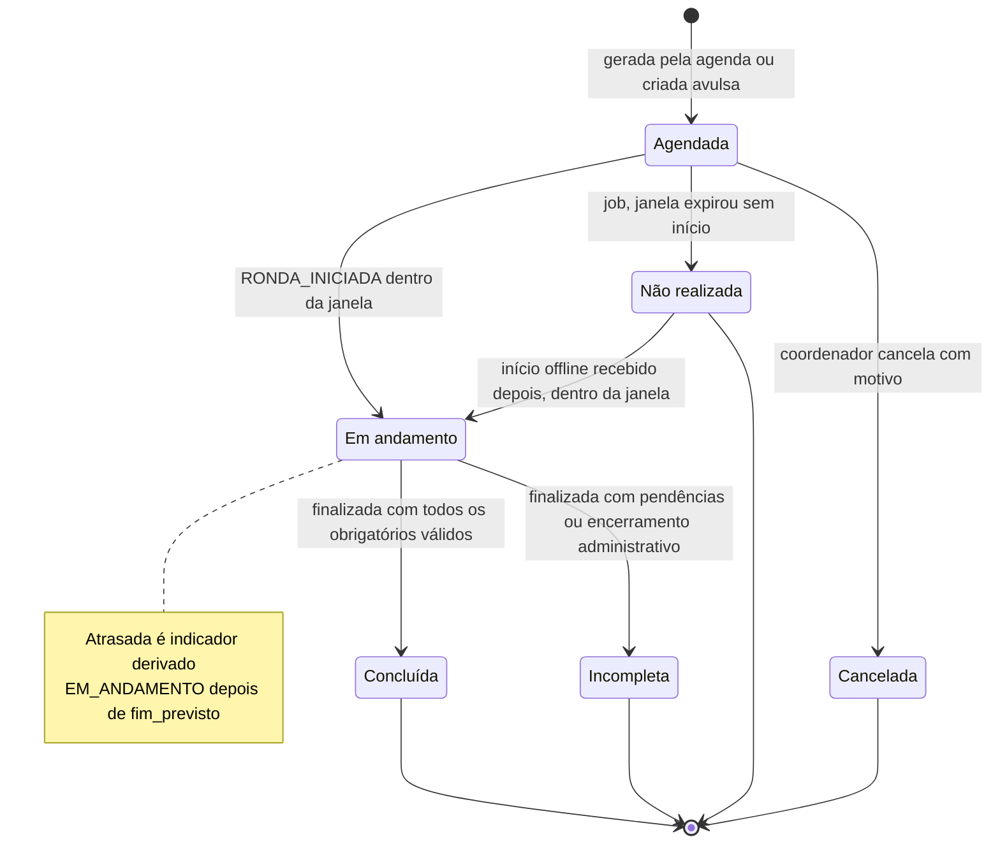
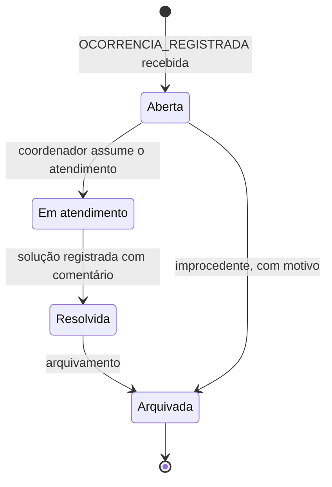
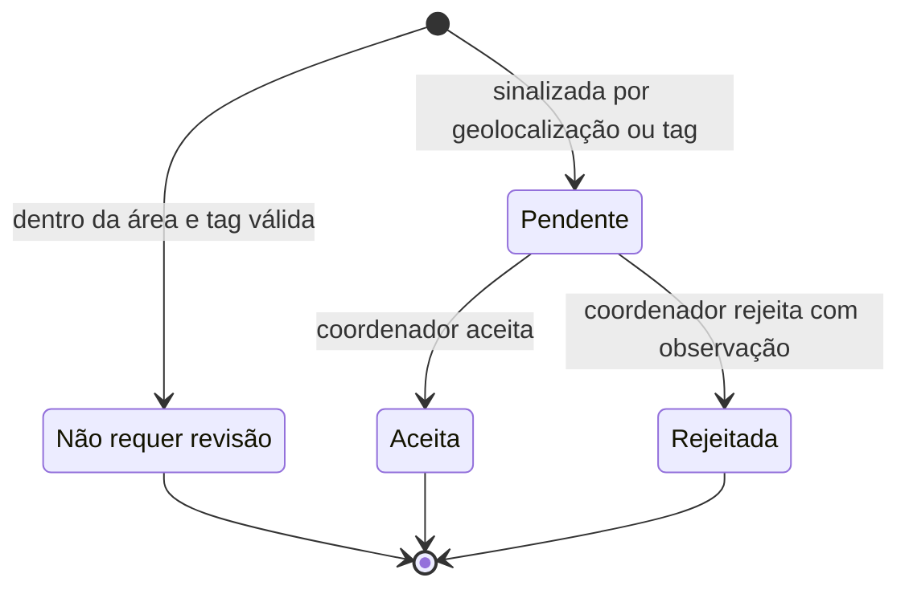

# Requisitos

Parte da [documentação do Guardião](README.md).

Este documento consolida os requisitos da V1 do Guardião IFSULDEMINAS (módulo Vigilância Patrimonial): os requisitos funcionais e não funcionais do documento "Guardião IFSULDEMINAS — Requisitos V1", os requisitos adicionais pedidos pela equipe (RNF10 a RNF14), as regras de negócio que os detalham e a rastreabilidade até casos de uso, histórias e decisões de arquitetura.

## Sumário

1. [Convenções](#convenções)
2. [Requisitos funcionais](#requisitos-funcionais)
3. [Critérios de aceitação](#critérios-de-aceitação)
4. [Requisitos não funcionais](#requisitos-não-funcionais)
5. [Regras de negócio](#regras-de-negócio)
6. [Diagramas de estado](#diagramas-de-estado)
7. [Matriz de rastreabilidade](#matriz-de-rastreabilidade)
8. [Decisões e pendências](#decisões-e-pendências)

## Convenções

| Prefixo | Significado | Onde é detalhado |
|---|---|---|
| RF | Requisito funcional | Este documento |
| RNF | Requisito não funcional | Este documento |
| RN | Regra de negócio | Este documento |
| CA | Critério de aceitação (`CAnn.m` pertence ao `RFnn`) | Este documento |
| UC | Caso de uso | [Casos de uso](03-casos-de-uso.md) |
| HU / EP | História de usuário / épico | [Backlog e roadmap](14-backlog-e-roadmap.md) |
| ADR | Registro de decisão de arquitetura | [ADRs](adr/README.md) |

**Prioridade (MoSCoW):** **Must** (obrigatório na V1), **Should** (importante, entra na V1 se o prazo permitir), **Could** (desejável, planejado para a V1.1) e **Won't** (fora do horizonte atual).

**Critérios de aceitação** seguem o formato Dado / Quando / Então e são escritos para serem verificáveis por teste automatizado ou por roteiro de teste manual. Os nomes de campos, estados e enums são os do [Modelo de dados](05-modelo-de-dados.md). Horários são gravados em UTC e exibidos em America/Sao_Paulo.

## Requisitos funcionais

O texto dos requisitos RF01 a RF19 é o do documento original.

| ID | Requisito | Prioridade | HU | UC |
|---|---|---|---|---|
| RF01 | Permitir login individual para cada vigilante e responsável. | Must | HU-005, HU-006, HU-007 | UC01, UC21 |
| RF02 | Exibir as rondas atribuídas ao vigilante durante o turno. | Must | HU-013, HU-014, HU-015 | UC03, UC17 |
| RF03 | Permitir iniciar e finalizar uma ronda, registrando data e horário. | Must | HU-016, HU-022 | UC04, UC10 |
| RF04 | Exibir os pontos obrigatórios da ronda por prédio, andar ou setor. | Must | HU-012, HU-017 | UC06, UC17 |
| RF05 | Exigir leitura de uma tag NFC instalada em cada ponto obrigatório para confirmar a passagem. | Must | HU-018 | UC05 |
| RF06 | Registrar automaticamente o ponto NFC, vigilante, data, horário e dispositivo utilizado. | Must | HU-018 | UC05 |
| RF07 | Registrar a localização aproximada do celular no momento da leitura NFC e validar se está dentro da área permitida. | Must | HU-019, HU-040 | UC05, UC15 |
| RF08 | Não permitir que um ponto obrigatório seja marcado como visitado apenas manualmente. | Must | HU-018 | UC05 |
| RF09 | Mostrar o progresso da ronda e identificar pontos ainda não visitados. | Must | HU-020 | UC06 |
| RF10 | Permitir registrar uma justificativa quando um ponto não puder ser vistoriado. | Must | HU-021 | UC07 |
| RF11 | Permitir registrar ocorrência vinculada ao ponto, prédio, andar ou setor vistoriado. | Must | HU-023 | UC08 |
| RF12 | Permitir informar tipo, descrição e nível de gravidade da ocorrência. | Must | HU-023 | UC08 |
| RF13 | Permitir tirar fotos da ocorrência pelo aplicativo e vinculá-las ao registro. | Must | HU-024, HU-031 | UC09 |
| RF14 | Salvar com a ocorrência o horário do registro, horário de recebimento no servidor, vigilante e localização aproximada. | Must | HU-023, HU-033 | UC08, UC11 |
| RF15 | Enviar a ocorrência ao coordenador ou responsável por e-mail e, quando configurado, por WhatsApp. | Must (e-mail) · Should (status da ocorrência no painel, HU-025) · Could (WhatsApp, V1.1) | HU-025, HU-026, HU-027, HU-028 | UC12, UC16 |
| RF16 | Disponibilizar painel para o coordenador consultar rondas concluídas, em andamento, atrasadas ou incompletas. | Must | HU-025, HU-034, HU-035 | UC13, UC16 |
| RF17 | Disponibilizar histórico de rondas e ocorrências por período, vigilante, prédio, andar e setor. | Must | HU-035, HU-036 | UC14 |
| RF18 | Manter trilha de auditoria das principais ações e impedir exclusões sem registro. | Must | HU-037, HU-038, HU-039 | UC20 |
| RF19 | Permitir cadastro e manutenção de prédios, setores, pontos de ronda, tags NFC e responsáveis. | Must | HU-007, HU-009, HU-010, HU-011 | UC18, UC19, UC21 |

**Itens Could planejados para a V1.1** (registrados aqui para não se perderem): notificação por WhatsApp (RF15, HU-028), exportação de relatórios em CSV/PDF e SSO institucional.

## Critérios de aceitação

### RF01 — Login individual

Prioridade Must · HU-005, HU-006, HU-007 · UC01, UC21 · RN18

| CA | Dado | Quando | Então |
|---|---|---|---|
| CA01.1 | um usuário `VIGILANTE` ativo, com aparelho não revogado e conexão disponível | informa matrícula e senha corretas no app | acessa a tela Início, a sessão fica vinculada ao aparelho (registros em `dispositivo` e `sessao`) e é gravado registro de auditoria `LOGIN` |
| CA01.2 | um usuário `COORDENADOR`, `RESPONSAVEL` ou `ADMINISTRADOR` ativo | informa matrícula e senha corretas no painel web | acessa o painel apenas com as funções e o escopo (campus ou locais) do seu papel |
| CA01.3 | qualquer usuário | informa matrícula ou senha incorreta | vê "Matrícula ou senha inválida", sem indicação de qual dado está errado, e é gravado `LOGIN_FALHOU` |
| CA01.4 | 5 tentativas de login no último minuto para o mesmo IP e matrícula | ocorre a 6ª tentativa | a API responde 429 e aplica bloqueio progressivo |
| CA01.5 | um usuário desativado (`ativo = false`) ou um aparelho revogado | tenta entrar | o acesso é negado com orientação para procurar o administrador |
| CA01.6 | um usuário `COORDENADOR` ou `RESPONSAVEL` | tenta entrar no app | vê "Use o painel web para acessar o Guardião" (o app aceita `VIGILANTE` e `ADMINISTRADOR`). Um `VIGILANTE` que tenta entrar no painel tem o acesso negado |

### RF02 — Rondas atribuídas no turno

Prioridade Must · HU-013, HU-014, HU-015 · UC03, UC17 · RN02, RN03

| CA | Dado | Quando | Então |
|---|---|---|---|
| CA02.1 | um vigilante com rondas `AGENDADA` para o turno | abre a tela Início | vê o cartão "Próxima ronda" (a de `inicio_previsto` mais próximo) e a lista das rondas do turno em ordem de horário, com roteiro, janela e status |
| CA02.2 | rondas atribuídas a outros vigilantes | o vigilante consulta suas rondas | essas rondas não aparecem (a API filtra pelo usuário autenticado) |
| CA02.3 | o aparelho sem conexão | o vigilante abre a tela Início | vê as rondas baixadas na última atualização e o horário dessa atualização |
| CA02.4 | um turno que cruza a meia-noite | o vigilante consulta as rondas depois da 0h | as rondas do dia anterior com janela ainda aberta ou `EM_ANDAMENTO` continuam na lista |
| CA02.5 | o coordenador cancelou uma ronda ou criou uma ronda avulsa para o vigilante | o app atualiza a lista com conexão | a ronda cancelada aparece como cancelada, sem opção de iniciar, e a avulsa aparece na lista |

### RF03 — Iniciar e finalizar ronda

Prioridade Must · HU-016, HU-022 · UC04, UC10 · RN02, RN03, RN08, RN15

| CA | Dado | Quando | Então |
|---|---|---|---|
| CA03.1 | uma ronda `AGENDADA` atribuída ao vigilante, dentro da janela (RN02) e sem outra ronda `EM_ANDAMENTO` | ele toca em **INICIAR RONDA** | a ronda passa a `EM_ANDAMENTO` no app imediatamente, com `iniciada_em_dispositivo`, e o evento `RONDA_INICIADA` entra na fila. Ao recebê-lo, o servidor grava `iniciada_recebido_em_servidor` |
| CA03.2 | o horário atual anterior a `inicio_previsto − tolerancia_inicio_min` | o vigilante vê a ronda | o botão fica desabilitado com o texto "Disponível a partir de HH:MM" |
| CA03.3 | o vigilante já tem uma ronda `EM_ANDAMENTO` | tenta iniciar outra | o app impede e oferece abrir a ronda em andamento (RN03) |
| CA03.4 | todos os pontos obrigatórios com visita | o vigilante toca em **FINALIZAR RONDA** | é gravado `finalizada_em_dispositivo`, o evento `RONDA_FINALIZADA` entra na fila e a ronda é exibida como concluída |
| CA03.5 | algum ponto obrigatório sem visita | o vigilante confirma "Finalizar com pendências" | a ronda fica `INCOMPLETA` (RN08) |
| CA03.6 | uma ronda finalizada sem conexão | o evento chega ao servidor | o servidor grava `finalizada_recebido_em_servidor` e preserva o horário original do aparelho |
| CA03.7 | uma ronda finalizada como concluída no app, mas com uma visita que o servidor classificou como `INVALIDA` ou `REPLAY` | o servidor processa `RONDA_FINALIZADA` | o status final é `INCOMPLETA`, e o app exibe o status do servidor na próxima atualização |

### RF04 — Pontos obrigatórios por prédio, andar ou setor

Prioridade Must · HU-012, HU-017 · UC06, UC17

| CA | Dado | Quando | Então |
|---|---|---|---|
| CA04.1 | uma ronda `EM_ANDAMENTO` | o vigilante abre a tela de execução | os pontos aparecem agrupados por prédio, andar e setor, na ordem do roteiro, com obrigatórios e opcionais identificados |
| CA04.2 | um roteiro com `exige_ordem = true` | o vigilante vê a lista | os pontos aparecem numerados e o próximo ponto da ordem fica destacado |
| CA04.3 | um roteiro com `exige_ordem = true` | o vigilante lê a tag de um ponto fora da ordem | a visita é registrada, o app avisa "Fora da ordem prevista" e a linha do tempo da ronda no painel mostra a ordem real |
| CA04.4 | um ponto com instruções cadastradas | o vigilante toca no ponto | vê a descrição e as instruções (`instrucoes`) do ponto |
| CA04.5 | o aparelho sem conexão | o vigilante abre a execução | a lista é montada a partir do pacote offline, sem diferença de comportamento |

### RF05 — Leitura NFC obrigatória

Prioridade Must · HU-018 · UC05 · RN01, RN04, RN05, RN07

| CA | Dado | Quando | Então |
|---|---|---|---|
| CA05.1 | uma ronda `EM_ANDAMENTO` e um ponto pendente com tag `ATIVA` | o vigilante encosta o celular Android na tag, sem tocar na tela | o app registra a visita e, em até 1 s, vibra, toca o som de sucesso e mostra ✓ verde com o nome do ponto em letra grande |
| CA05.2 | a tag de um ponto que não pertence ao roteiro da ronda | o vigilante encosta o celular | o app mostra "Este ponto não faz parte desta ronda", vibra longamente e não cria visita (RN05) |
| CA05.3 | um ponto já visitado nesta ronda | o vigilante encosta o celular de novo | o app mostra "Ponto já registrado" e não cria nova visita (RN04) |
| CA05.4 | uma tag não cadastrada, inativa, substituída ou de outro campus | o vigilante encosta o celular | o app mostra "Tag não reconhecida", vibra longamente e não cria visita |
| CA05.5 | um iPhone com NFC | o vigilante toca em "Ler ponto" e encosta o celular | o resultado é o mesmo de CA05.1, com 1 toque |
| CA05.6 | o NFC desligado no aparelho | o vigilante abre a tela de execução | o app mostra "Ative o NFC" com atalho para as configurações do sistema |

### RF06 — Registro automático da passagem

Prioridade Must · HU-018 · UC05 · RN01, RN15

| CA | Dado | Quando | Então |
|---|---|---|---|
| CA06.1 | uma leitura NFC aceita pelo app | a visita é gravada | o registro contém `ponto_ronda_id`, `tag_nfc_id`, `vigilante_id`, `dispositivo_id`, `lido_em_dispositivo` e `payload_nfc`, sem nenhum campo digitado pelo vigilante |
| CA06.2 | uma visita gravada no app | o evento correspondente é criado | o identificador é um UUIDv7 gerado no aparelho e é o mesmo em todas as retentativas de envio |
| CA06.3 | o evento aceito pelo servidor | o coordenador abre o detalhe da ronda | vê ponto, vigilante, aparelho, horário do aparelho e horário de recebimento no servidor de cada visita |

### RF07 — Localização aproximada e área permitida

Prioridade Must · HU-019, HU-040 · UC05, UC15 · RN06, RN19

| CA | Dado | Quando | Então |
|---|---|---|---|
| CA07.1 | uma posição com precisão ≤ `precisao_maxima_m` e distância ≤ raio do ponto | o vigilante lê a tag | a visita é registrada com `DENTRO_AREA` e `status_revisao = NAO_REQUER` |
| CA07.2 | a política `SINALIZAR` e distância − precisão > raio | o vigilante lê a tag | a visita é registrada com `FORA_AREA` e `status_revisao = PENDENTE` e aparece em "Visitas sinalizadas" no painel |
| CA07.3 | a política `BLOQUEAR` e resultado `FORA_AREA` | o vigilante lê a tag | o app não registra a visita e mostra "Você parece estar fora da área deste ponto. Aproxime-se e encoste de novo." |
| CA07.4 | uma precisão pior que `precisao_maxima_m` (padrão 100 m) | o vigilante lê a tag | a visita é registrada com `INDETERMINADO` e sinalizada |
| CA07.5 | GPS desligado, permissão negada ou nenhuma posição em 5 s | o vigilante lê a tag | a visita é registrada com `SEM_LOCALIZACAO` e sinalizada, e a leitura nunca espera mais de 5 s pela posição |
| CA07.6 | localização simulada ativa no Android | o vigilante lê a tag | a visita é registrada com `localizacao_simulada = true` e é sempre sinalizada, qualquer que seja o resultado geográfico |
| CA07.7 | um resultado geográfico calculado no app | o evento chega ao servidor | o servidor recalcula o resultado (Haversine) com os dados de cadastro vigentes, e prevalece o resultado do servidor |

### RF08 — Sem marcação manual

Prioridade Must · HU-018 · UC05 · RN01

| CA | Dado | Quando | Então |
|---|---|---|---|
| CA08.1 | qualquer tela do app ou do painel | um usuário de qualquer papel procura uma forma de marcar um ponto como visitado | essa ação não existe (verificado em revisão de UX e nos testes E2E) |
| CA08.2 | um evento `PONTO_VISITADO` sem payload NFC ou com tag que não é a tag `ATIVA` do ponto | o evento chega ao servidor | a resposta é `REJEITADO` e nenhuma visita é criada |
| CA08.3 | uma tag danificada ou ausente | o vigilante não consegue ler o ponto | a única alternativa oferecida é justificar o ponto (RN10), o que não conta como visita |
| CA08.4 | uma ronda atrasada | o coordenador faz o encerramento administrativo | nenhuma visita é criada e os pontos sem visita continuam sem visita |

### RF09 — Progresso da ronda

Prioridade Must · HU-020 · UC06 · RN08, RN10

| CA | Dado | Quando | Então |
|---|---|---|---|
| CA09.1 | uma ronda com 10 pontos obrigatórios, 7 já lidos | o vigilante olha a tela de execução | vê "7 de 10" e a barra de progresso, atualizados imediatamente após cada leitura, com ou sem conexão |
| CA09.2 | pontos ainda não visitados | o vigilante consulta a lista | os pendentes ficam visualmente destacados e podem ser filtrados com "Só pendentes" |
| CA09.3 | um ponto justificado | o vigilante consulta a lista | o ponto aparece como "Justificado", com ícone e cor distintos de "Visitado", e não soma no progresso |
| CA09.4 | todos os pontos obrigatórios com visita | a última leitura é registrada | **FINALIZAR RONDA** aparece em destaque na barra de ação |
| CA09.5 | uma ronda `EM_ANDAMENTO` depois de `fim_previsto` | o vigilante olha a tela de execução | o cabeçalho mostra "Atrasada" |

### RF10 — Justificativa de ponto não vistoriado

Prioridade Must · HU-021 · UC07 · RN10, RN19

| CA | Dado | Quando | Então |
|---|---|---|---|
| CA10.1 | um ponto pendente, sem visita | o vigilante escolhe um motivo, escreve uma descrição com 10 ou mais caracteres e salva | a justificativa é gravada com a localização do evento, `PONTO_JUSTIFICADO` entra na fila e o ponto aparece como "Justificado" |
| CA10.2 | uma descrição com menos de 10 caracteres | o vigilante tenta salvar | o botão fica desabilitado e o app indica quantos caracteres faltam |
| CA10.3 | um ponto já visitado | o vigilante abre o ponto | a opção de justificar não aparece |
| CA10.4 | um ponto justificado | o vigilante consegue ler a tag depois | a visita é registrada, o ponto passa a contar como visitado e a justificativa permanece no histórico |
| CA10.5 | uma ronda finalizada com um ponto obrigatório apenas justificado | o servidor calcula o status | a ronda fica `INCOMPLETA` |

### RF11 — Ocorrência vinculada ao local

Prioridade Must · HU-023 · UC08 · RN11

| CA | Dado | Quando | Então |
|---|---|---|---|
| CA11.1 | um ponto lido há menos de 5 minutos | o vigilante toca em **OCORRÊNCIA** | o local vem preenchido com esse ponto, e prédio, andar e setor são herdados do ponto |
| CA11.2 | nenhum ponto lido nos últimos 5 minutos | o vigilante chega à tela de confirmação | o prédio fica sem preenchimento e **ENVIAR** fica desabilitado até que um prédio seja escolhido |
| CA11.3 | um local sugerido | o vigilante troca o ponto ou escolhe outro prédio, andar ou setor | a ocorrência é gravada com o local escolhido |
| CA11.4 | uma ocorrência registrada | ela é gravada | fica vinculada à ronda `EM_ANDAMENTO` (`ronda_id`), ao vigilante e ao aparelho |

### RF12 — Tipo, descrição e gravidade

Prioridade Must · HU-023 · UC08 · RN11

| CA | Dado | Quando | Então |
|---|---|---|---|
| CA12.1 | a tela de confirmação da ocorrência | ela é aberta | o tipo vem pré-selecionado e a gravidade vem com a `gravidade_padrao` do tipo, e ambos podem ser trocados com 1 toque |
| CA12.2 | uma ocorrência sem descrição | o vigilante toca em **ENVIAR** | a ocorrência é aceita (a descrição é opcional) |
| CA12.3 | a lista de gravidades | ela é exibida | cada gravidade tem texto e cor (`BAIXA` verde, `MEDIA` amarelo, `ALTA` laranja, `CRITICA` vermelho), e a cor nunca é o único indicador |
| CA12.4 | um tipo de ocorrência desativado pelo administrador | o app baixa o pacote offline seguinte | o tipo não aparece mais na lista |
| CA12.5 | um evento `OCORRENCIA_REGISTRADA` sem tipo, gravidade ou prédio | ele chega ao servidor | a resposta é `REJEITADO` |

### RF13 — Fotos da ocorrência

Prioridade Must · HU-024, HU-031 · UC09 · RN11, RN12

| CA | Dado | Quando | Então |
|---|---|---|---|
| CA13.1 | o fluxo de ocorrência expressa | o vigilante toca em **OCORRÊNCIA** | a câmera do app abre direto, sem opção de escolher imagem da galeria |
| CA13.2 | uma ocorrência com 5 fotos | o vigilante tenta adicionar a 6ª | o botão fica desabilitado com "Máximo de 5 fotos" |
| CA13.3 | uma foto capturada | ela é processada | o lado maior tem 1600 px, o arquivo é JPEG com qualidade 80%, sem EXIF, com SHA-256 calculado, é cifrado com AES-256-GCM e nada é salvo na galeria |
| CA13.4 | uma ocorrência ainda não aceita pelo servidor | o motor de sincronização roda | as fotos não sobem. Elas sobem depois de `OCORRENCIA_REGISTRADA` ser aceita |
| CA13.5 | o reenvio da mesma foto (mesmo `fotoId` e hash) | o servidor recebe | não há duplicação e o upload é confirmado |
| CA13.6 | um upload confirmado pelo servidor | o app recebe a confirmação | o arquivo local cifrado é apagado |
| CA13.7 | as telas de câmera e de ocorrência abertas no Android | o usuário tenta capturar a tela | a captura é bloqueada |

### RF14 — Horários, vigilante e localização da ocorrência

Prioridade Must · HU-023, HU-033 · UC08, UC11 · RN15, RN19

| CA | Dado | Quando | Então |
|---|---|---|---|
| CA14.1 | uma ocorrência registrada | ela é gravada no servidor | o registro contém `registrada_em_dispositivo`, `recebido_em_servidor`, `vigilante_id`, `dispositivo_id`, `latitude`, `longitude`, `precisao_m`, `resultado_geo` e `desvio_relogio_ms` |
| CA14.2 | uma ocorrência registrada offline às 02:10 e recebida às 03:40 | o coordenador abre a ocorrência | vê os dois horários, identificados como "registrada no aparelho" e "recebida no servidor" |
| CA14.3 | o relógio do aparelho com desvio estimado acima de 5 minutos | o registro chega ao servidor | o registro é sinalizado no painel (RN15) |
| CA14.4 | nenhuma localização disponível | o vigilante registra a ocorrência | ela é gravada com `SEM_LOCALIZACAO`, sem bloquear o registro |

### RF15 — Notificação da ocorrência

Prioridade Must (e-mail) · Should (status no painel) · Could (WhatsApp, V1.1) · HU-025 a HU-028 · UC12, UC16 · RN13

| CA | Dado | Quando | Então |
|---|---|---|---|
| CA15.1 | a regra do campus com gravidade mínima `ALTA` e uma ocorrência `ALTA` | o servidor recebe a ocorrência | é criada uma `notificacao` `EMAIL` para cada coordenador ativo do campus e para cada responsável ativo do prédio ou setor com `recebe_email = true`, e os e-mails são enviados |
| CA15.2 | a mesma regra e uma ocorrência `MEDIA` | o servidor recebe a ocorrência | nenhum e-mail é enviado e a ocorrência aparece no painel |
| CA15.3 | uma ocorrência registrada offline | o servidor a recebe | o e-mail parte nesse momento e informa o horário original e o de recebimento |
| CA15.4 | um e-mail de ocorrência | ele é montado | contém tipo, gravidade, local (prédio, andar, setor e ponto), vigilante, horários, descrição e link para a ocorrência no painel. As fotos não são anexadas |
| CA15.5 | uma falha no SMTP | o envio é tentado | há novas tentativas com backoff e, quando se esgotam, a notificação fica `FALHOU`, com `ultimo_erro` visível ao administrador |
| CA15.6 | um evento de ocorrência reenviado (resultado `DUPLICADO`) | o servidor o processa | nenhuma notificação é repetida |
| CA15.7 (Should) | uma ocorrência `ABERTA` | o coordenador muda o status para `EM_ATENDIMENTO` com comentário | o status muda, é gravado `historico_status_ocorrencia` e auditoria `ALTERAR_STATUS` |
| CA15.8 (Could, V1.1) | uma ocorrência `CRITICA` com WhatsApp habilitado no campus | o servidor recebe a ocorrência | também é enviada mensagem por WhatsApp aos destinatários com `recebe_whatsapp = true` |

### RF16 — Painel do coordenador

Prioridade Must · HU-025, HU-034, HU-035 · UC13, UC16 · RN09

| CA | Dado | Quando | Então |
|---|---|---|---|
| CA16.1 | um coordenador do campus | ele abre o Painel do dia | vê as quantidades e as listas de rondas agendadas, em andamento, atrasadas, concluídas, incompletas, não realizadas e canceladas |
| CA16.2 | uma ronda `EM_ANDAMENTO` depois de `fim_previsto` | o painel é atualizado | ela aparece como **atrasada** (indicador derivado; o status continua `EM_ANDAMENTO`) |
| CA16.3 | uma ronda `AGENDADA` não iniciada até `fim_previsto` | o job de agendamento roda | a ronda passa a `NAO_REALIZADA` em até 5 minutos |
| CA16.4 | o painel aberto | novos eventos chegam ao servidor | as mudanças aparecem em até 30 s, sem recarregar a página |
| CA16.5 | um usuário `RESPONSAVEL` | ele abre o painel | vê apenas rondas e ocorrências dos seus locais, somente para consulta |
| CA16.6 | uma ronda atrasada | o coordenador faz o encerramento administrativo informando o motivo | a ronda fica `INCOMPLETA`, com `encerramento_motivo` e `encerrada_por_id`, e é gravada auditoria `ENCERRAR_RONDA` |

### RF17 — Histórico de rondas e ocorrências

Prioridade Must · HU-035, HU-036 · UC14 · RN15

| CA | Dado | Quando | Então |
|---|---|---|---|
| CA17.1 | um coordenador | filtra rondas por período, vigilante, prédio, andar e setor | vê os resultados paginados (20 por página por padrão) com o total |
| CA17.2 | um coordenador | filtra ocorrências também por gravidade, status e tipo | vê apenas as ocorrências que atendem a todos os filtros |
| CA17.3 | uma lista de resultados | ela é exibida | a ordenação é pelo horário do servidor, com o horário do aparelho exibido ao lado |
| CA17.4 | um usuário `RESPONSAVEL` | ele consulta o histórico | vê apenas os seus locais. Filtros fora do seu escopo não retornam dados |
| CA17.5 | um filtro de 90 dias no volume do piloto | a consulta é feita | a primeira página é exibida em até 2 s |

### RF18 — Trilha de auditoria e proibição de exclusões

Prioridade Must · HU-037, HU-038, HU-039 · UC20 · RN14

| CA | Dado | Quando | Então |
|---|---|---|---|
| CA18.1 | uma criação, alteração, desativação, reativação, login, revisão de visita, mudança de status, encerramento, cancelamento ou visualização de foto | a ação é concluída | é gravado `registro_auditoria` com `ocorrido_em` do servidor, usuário, papel, dispositivo, ação, entidade, dados antes e depois, IP e user agent |
| CA18.2 | a API | uma requisição `DELETE` é feita a qualquer recurso | não existe rota para exclusão |
| CA18.3 | o usuário de banco da API | tenta `UPDATE` ou `DELETE` em `registro_auditoria` | o banco recusa por falta de permissão |
| CA18.4 | um registro de auditoria alterado diretamente no banco | a rotina de verificação da cadeia roda | ela aponta o primeiro registro com hash inconsistente |
| CA18.5 | um administrador | filtra a auditoria por entidade, usuário, ação e período | vê os registros correspondentes, ordenados por `ocorrido_em` |

### RF19 — Cadastros

Prioridade Must · HU-007, HU-009, HU-010, HU-011 · UC18, UC19, UC21 · RN14

| CA | Dado | Quando | Então |
|---|---|---|---|
| CA19.1 | um administrador | cria ou edita um prédio com latitude, longitude e `raio_geofence_m` | o prédio é salvo, a ação é auditada e o mapa do painel mostra o geofence |
| CA19.2 | um administrador | desativa um cadastro | o motivo é obrigatório, o registro sai das listas de seleção, continua visível no histórico e pode ser reativado |
| CA19.3 | um ponto com tag `ATIVA` | o administrador vincula uma nova tag pelo modo instalação | o app oferece a substituição, a tag antiga fica `SUBSTITUIDA` e nunca há mais de uma tag `ATIVA` por ponto |
| CA19.4 | um coordenador | acessa os cadastros | consegue apenas consultar |
| CA19.5 | um ponto usado em roteiro ativo | o administrador tenta desativá-lo | a desativação é impedida e os roteiros afetados são listados |
| CA19.6 | uma tag NTAG 424 DNA cadastrada | o registro é gravado | a chave SUN nunca fica no banco; apenas a referência `chave_sun_ref` |
| CA19.7 | um responsável por local | ele é cadastrado | fica vinculado a um prédio ou a um setor (ao menos um) e tem preferências de e-mail e WhatsApp |

## Requisitos não funcionais

RNF01 a RNF09 vêm do documento original. RNF10 a RNF14 são requisitos adicionais pedidos pela equipe.

| ID | Requisito | Prioridade | Métrica / meta | Forma de verificação |
|---|---|---|---|---|
| RNF01 | Operar em modo online-first, enviando os dados imediatamente sempre que houver conexão. | Must | Com conexão (Wi-Fi ou 4G), envio iniciado em até 1 s após a ação e p95 ≤ 5 s entre a ação e o estado `CONFIRMADO` | Fluxos E2E (Maestro) contra homologação e medição de `recebido_em_servidor − criado_em_dispositivo` (corrigido pelo desvio) nos dados do piloto |
| RNF02 | Quando não houver conexão, armazenar os registros temporariamente no aparelho e enviá-los automaticamente na próxima conexão. | Must | Com o app aberto, 100% dos pendentes enviados em até 60 s após a volta da conexão. Em segundo plano, melhor esforço (cerca de 15 min) | Teste em aparelho real: modo avião, ronda completa com ocorrência e 3 fotos, rede reativada e tempo cronometrado |
| RNF03 | Manter os registros pendentes mesmo se o aplicativo for fechado ou o aparelho reiniciado. | Must | 0 eventos e 0 fotos perdidos após encerrar o app à força e reiniciar o aparelho com 20 ou mais eventos e 5 fotos pendentes | Roteiro de teste manual em aparelho real e testes de integração do repositório local |
| RNF04 | Criptografar os dados armazenados temporariamente no aparelho. | Must | 100% dos dados locais cifrados: banco com SQLCipher, fotos com AES-256-GCM, chave apenas no Keystore/Keychain | Extração do banco de um aparelho de teste e verificação de que não abre sem a chave, inspeção do armazenamento por fotos legíveis, checklist MASVS-STORAGE e MASVS-CRYPTO |
| RNF05 | Não duplicar registros quando houver novas tentativas de sincronização. | Must | 0 registros duplicados ao reenviar o mesmo lote várias vezes ou quando a resposta se perde | Testes de integração (Jest + Supertest + Testcontainers): mesmo lote enviado 3 vezes retorna `ACEITO` e depois `DUPLICADO`, com contagem de linhas inalterada; reenvio de foto com o mesmo `fotoId` e hash |
| RNF06 | Só considerar um registro sincronizado após confirmação do servidor. | Must | 100% dos eventos `CONFIRMADO` têm resposta `ACEITO` ou `DUPLICADO` correspondente | Testes unitários do motor de sincronização com servidor simulado que derruba a conexão depois de processar o lote |
| RNF07 | Utilizar horário do servidor para auditoria e manter também o horário original da ação quando feita offline. | Must | 100% dos registros com horário do aparelho e do servidor. Desvio acima de 5 min sinalizado | Teste com o relógio do aparelho adiantado 10 min e operação offline; verificação da ordenação de relatórios pelo horário do servidor |
| RNF08 | Ter interface simples e adequada para uso em celular durante a ronda. | Must | SUS ≥ 70 no piloto. Alvos de toque ≥ 56 dp (ação primária) e ≥ 48 dp (demais), fonte base 18 sp, contraste ≥ 4,5:1 (WCAG AA), tema escuro padrão | Checklist de UX por tela na revisão de PR, teste de usabilidade no piloto (HU-041) e questionário SUS |
| RNF09 | Manter a arquitetura preparada para inclusão futura de outros setores e do controle de acesso de veículos. | Should | Um novo módulo é adicionado sem alterar código de `vigilancia/*`. Nenhuma importação direta entre módulos de domínio fora dos serviços públicos | Regra automatizada de dependências no CI e revisão de arquitetura ([Arquitetura](04-arquitetura.md), ADR-0003, ADR-0004) |
| RNF10 | Regra dos 2 toques: as funções principais do vigilante (iniciar ronda, registrar ponto, finalizar ronda completa) devem exigir no máximo 2 toques a partir da tela inicial. A leitura NFC durante a ronda é automática (0 toques no Android). | Must | Iniciar: 1 toque. Registrar ponto: 0 toques no Android (1 no iOS). Finalizar ronda completa: 1 toque. Ocorrência expressa: 3 toques | Fluxos Maestro que contam os toques, item obrigatório no DoD das HUs do app e observação no piloto |
| RNF11 | Segurança do aplicativo: seguir o OWASP MASVS (nível L2 para armazenamento, criptografia e autenticação), com desbloqueio biométrico, sessão vinculada ao dispositivo, revogação remota de aparelho e detecção de localização simulada. | Must | Controles L2 de MASVS-STORAGE, MASVS-CRYPTO e MASVS-AUTH atendidos. Requisição de aparelho revogado recusada na próxima chamada à API. Bloqueio após 10 min de inatividade. Localização simulada sempre sinalizada | Checklist MASVS/MASTG a cada release, testes automatizados de sessão e revogação, teste manual com app de localização falsa ([Segurança e LGPD](11-seguranca-e-lgpd.md)) |
| RNF12 | Componentização: interfaces (app e painel) construídas com componentes reutilizáveis (Atomic Design) sobre design tokens compartilhados. | Should | 100% das telas compostas por componentes do design system. Nenhum valor de cor ou espaçamento fixo fora dos tokens. Todo átomo e molécula com story | Regra de lint contra literais de cor, revisão de PR e catálogo no Storybook ([UX e design system](09-ux-e-design-system.md)) |
| RNF13 | API documentada: a API REST deve publicar o contrato em OpenAPI 3.1 (Swagger UI em homologação). | Should | 100% dos endpoints com esquemas de requisição, resposta e erro (RFC 9457). Swagger UI disponível em homologação | Geração do documento no CI, validação com linter de OpenAPI e teste que falha se uma rota não estiver documentada ([API](07-api.md)) |
| RNF14 | Privacidade (LGPD): coletar a localização apenas nos eventos (início e fim de ronda, leitura NFC, justificativa, ocorrência), nunca em rastreamento contínuo. | Must | Localização coletada apenas nos 5 eventos listados e nenhuma permissão de localização em segundo plano | Revisão de código (acesso à localização apenas pelo hook de localização no evento), teste automatizado das chamadas e inspeção do manifesto Android (sem `ACCESS_BACKGROUND_LOCATION`) |

## Regras de negócio

As regras de negócio (RN) detalham o comportamento exigido pelos requisitos. Cada regra indica onde é aplicada. Quando app e servidor aplicam a mesma regra, **o servidor é a fonte de verdade** e o app aplica a regra localmente para dar retorno imediato, inclusive offline.

### RN01 — Visita somente por leitura NFC válida

Um ponto obrigatório só conta como visitado mediante **leitura NFC válida da tag `ATIVA` vinculada a ele**. Não existe botão de "marcar como visitado" em nenhuma interface.

- **Leitura válida:** no app, a tag lida está no pacote offline como tag `ATIVA` de um ponto do roteiro. No servidor, a visita tem `validacao_tag` igual a `VALIDA` ou `NAO_VERIFICAVEL` (RN07).
- Se a tag estiver danificada ou ausente, a única alternativa é justificar o ponto (RN10), o que não conta como visita.
- **Aplicação:** app (nenhum controle manual), API (`PONTO_VISITADO` exige payload NFC e tag `ATIVA` do ponto) e painel (não há ação de criar visita).
- **Relacionados:** RF05, RF08 · UC05.

### RN02 — Quem pode iniciar a ronda e quando

A ronda só pode ser iniciada pelo **vigilante a quem foi atribuída**, dentro da janela **`[inicio_previsto − tolerancia_inicio_min, fim_previsto]`**.

- `tolerancia_inicio_min` vem de `configuracao_campus` (padrão: 30 min).
- `fim_previsto` é `inicio_previsto + duracao_janela_min` nas rondas geradas por agenda, ou é informado na ronda avulsa.
- Exemplo: ronda com `inicio_previsto` 22:00, `fim_previsto` 23:00 e tolerância de 30 min pode ser iniciada entre 21:30 e 23:00.
- O app valida com o horário do aparelho corrigido pelo último desvio conhecido. O servidor revalida usando `iniciada_em_dispositivo` corrigido por `desvio_relogio_ms`, e **não** o horário de chegada, para aceitar inícios feitos offline.
- **Aplicação:** app e API · **Relacionados:** RF02, RF03 · UC04.

### RN03 — Uma ronda em andamento por vigilante

Um vigilante só pode ter **uma ronda `EM_ANDAMENTO` por vez**.

- No app, **INICIAR RONDA** fica indisponível enquanto houver outra ronda em andamento, com atalho para abri-la.
- No servidor, `RONDA_INICIADA` para um vigilante com outra ronda `EM_ANDAMENTO` recebe `REJEITADO`. Como os eventos são enviados na ordem de criação, a finalização de uma ronda feita offline sempre chega antes do início da seguinte.
- **Aplicação:** app e API · **Relacionados:** RF03 · UC04.

### RN04 — Leitura repetida não cria nova visita

Uma nova leitura de ponto já visitado na mesma ronda **não cria outra visita**. O app mostra "Ponto já registrado" e só a primeira leitura válida vale.

- O retorno é informativo (sem vibração de erro), para não confundir o vigilante.
- No banco, um índice único parcial em `visita_ponto (ronda_id, ponto_ronda_id)`, restrito às visitas que contam para a conclusão, garante a regra ([Modelo de dados](05-modelo-de-dados.md#6-restrições-que-implementam-regras-de-negócio)). Se outro evento `PONTO_VISITADO` válido chegar para o mesmo ponto e a mesma ronda, o servidor mantém a primeira visita e responde `DUPLICADO`, sem efeito. Uma leitura `INVALIDA` ou `REPLAY` anterior não impede o registro de uma leitura válida posterior.
- **Aplicação:** app, API e banco · **Relacionados:** RF05, RNF05 · UC05.

### RN05 — Tag fora do roteiro é recusada

A leitura de uma tag que **não pertence ao roteiro** da ronda em andamento é recusada no app com o aviso **"Este ponto não faz parte desta ronda"** e não gera visita.

- Nada é gravado nem enfileirado. O retorno é vibração longa e mensagem curta.
- No servidor, `PONTO_VISITADO` de ponto fora do roteiro recebe `REJEITADO`.
- **Aplicação:** app e API · **Relacionados:** RF05 · UC05.

### RN06 — Validação geográfica

Em cada leitura NFC, a posição do aparelho é comparada com a referência do ponto. A **referência** é a latitude/longitude do ponto ou, se ausente, a do prédio. A distância é calculada pela fórmula de **Haversine**.

| Parâmetro | Origem | Padrão |
|---|---|---|
| Raio de tolerância | `ponto_ronda.raio_tolerancia_m` (o cadastro sugere o `raio_geofence_m` do prédio como valor inicial) | Definido no cadastro |
| Precisão máxima aceita | `configuracao_campus.precisao_maxima_m` | 100 m |
| Tempo máximo para obter a posição | Fixo no app | 5 s |
| Política | `configuracao_campus.politica_geo` | `SINALIZAR` |

**Classificação** (`ResultadoGeo`), avaliada nesta ordem:

| Ordem | Condição | Resultado |
|---|---|---|
| 1 | Sem posição: permissão negada, GPS desligado ou tempo de 5 s esgotado | `SEM_LOCALIZACAO` |
| 2 | Precisão pior que `precisao_maxima_m` | `INDETERMINADO` |
| 3 | distância ≤ raio | `DENTRO_AREA` |
| 4 | distância − precisão > raio (fora com certeza) | `FORA_AREA` |
| 5 | Demais casos (ambíguo) | `INDETERMINADO` |

```ts
// Ilustrativo: classificação do resultado geográfico (RN06)
type ResultadoGeo = 'DENTRO_AREA' | 'FORA_AREA' | 'INDETERMINADO' | 'SEM_LOCALIZACAO';

export function classificarGeo(
  distanciaM: number | null,
  precisaoM: number | null,
  raioM: number,
  precisaoMaximaM = 100,
): ResultadoGeo {
  if (distanciaM === null || precisaoM === null) return 'SEM_LOCALIZACAO';
  if (precisaoM > precisaoMaximaM) return 'INDETERMINADO';
  if (distanciaM <= raioM) return 'DENTRO_AREA';
  if (distanciaM - precisaoM > raioM) return 'FORA_AREA';
  return 'INDETERMINADO';
}
```

Exemplos com raio de 30 m e precisão de 15 m: distância 20 m → `DENTRO_AREA`; distância 60 m → `FORA_AREA` (60 − 15 = 45 > 30); distância 40 m → `INDETERMINADO` (40 − 15 = 25 ≤ 30). Com precisão de 150 m → `INDETERMINADO`, qualquer que seja a distância.

**Efeito da política:**

| Situação | `SINALIZAR` (padrão) | `BLOQUEAR` (configurável por campus) |
|---|---|---|
| `DENTRO_AREA` | Registra a visita, `status_revisao = NAO_REQUER` | Registra a visita, `status_revisao = NAO_REQUER` |
| `FORA_AREA` | Registra a visita, `status_revisao = PENDENTE` | O app recusa a leitura e pede para o vigilante se aproximar e encostar de novo |
| `INDETERMINADO` | Registra a visita, `status_revisao = PENDENTE` | Registra a visita, `status_revisao = PENDENTE` |
| `SEM_LOCALIZACAO` | Registra a visita, `status_revisao = PENDENTE` | Registra a visita, `status_revisao = PENDENTE` |
| `localizacao_simulada = true` | Sempre `status_revisao = PENDENTE` | Sempre `status_revisao = PENDENTE` |

- O app calcula um resultado preliminar com os dados do pacote offline (retorno imediato e política `BLOQUEAR`). O servidor recalcula e **o resultado do servidor prevalece**. Se o servidor concluir `FORA_AREA` numa visita aceita pelo app, a visita é registrada e sinalizada, nunca descartada.
- Mesmo na política `BLOQUEAR`, `INDETERMINADO` e `SEM_LOCALIZACAO` não bloqueiam, para não impedir o trabalho por limitação do GPS ([ADR-0011](adr/0011-validacao-geografica-sinaliza.md)).
- **Aplicação:** app (preliminar) e API (definitiva) · **Relacionados:** RF07, RNF14 · UC05, UC15.

### RN07 — Validação criptográfica da tag (SUN)

Tags **NTAG 424 DNA** com **SUN** são validadas criptograficamente **no servidor**, que verifica o CMAC e o contador da leitura. O resultado é gravado em `validacao_tag`:

| `validacao_tag` | Quando | Conta para a conclusão? |
|---|---|---|
| `VALIDA` | CMAC correto e contador inédito para a tag | Sim |
| `INVALIDA` | CMAC incorreto ou mensagem SUN malformada | Não |
| `REPLAY` | Contador já visto para aquela tag | Não |
| `NAO_VERIFICAVEL` | Tag legada (`NTAG215_LEGADA`), sem SUN | Sim |

- Visitas `INVALIDA` ou `REPLAY` são gravadas (nada é descartado), **não contam para a conclusão**, ficam com `status_revisao = PENDENTE` e geram alerta ao coordenador no painel (visitas sinalizadas e destaque no Painel do dia).
- A unicidade é garantida por `UNIQUE(tag_nfc_id, contador_sun)` na tabela `leitura_sun`, o que tolera chegada fora de ordem quando há sincronização offline (não se exige contador crescente). A visita `REPLAY` é gravada em `visita_ponto`, mas não cria nova linha em `leitura_sun`.
- O app **não** possui chaves e não valida o SUN: ele envia o payload NFC bruto (`payload_nfc`). Na V1, o app não reflete o resultado da validação do servidor na tela de execução.
- As chaves SUN nunca ficam no banco; `tag_nfc.chave_sun_ref` aponta para o segredo no cofre ou em variável de ambiente ([ADR-0007](adr/0007-tags-nfc-ntag424-dna-sun.md), em proposta).
- **Aplicação:** API e banco · **Relacionados:** RF05, RF08, RNF05 · UC05, UC15.

### RN08 — Conclusão da ronda

- A ronda fica **`CONCLUIDA`** quando, na finalização, **todos os pontos obrigatórios** (`roteiro_ponto.obrigatorio = true`) têm visita válida (RN01, RN07).
- A ronda fica **`INCOMPLETA`** quando é finalizada com algum ponto obrigatório sem visita válida, **justificado ou não**.
- Pontos opcionais não afetam o status.
- Visitas sinalizadas por geolocalização (`FORA_AREA`, `INDETERMINADO`, `SEM_LOCALIZACAO` ou localização simulada) contam como válidas para o cálculo, já que a política `SINALIZAR` registra a visita. A decisão posterior do coordenador na revisão **não altera o status da ronda**: uma visita `REJEITADA` passa a ser exibida como indicador "com visitas rejeitadas" no painel e no histórico.
- O status final é calculado pelo **servidor** ao processar `RONDA_FINALIZADA`. O status mostrado no app é provisório até a confirmação.
- **Aplicação:** app (provisório) e API (definitivo) · **Relacionados:** RF03, RF09 · UC10.

### RN09 — Rondas não realizadas, atrasadas e encerramento administrativo

- Uma ronda **`AGENDADA` não iniciada até `fim_previsto`** passa a **`NAO_REALIZADA`**. O job de agendamento faz essa verificação a cada 5 minutos.
- Uma ronda **`EM_ANDAMENTO` depois de `fim_previsto`** aparece como **atrasada** no painel. Atrasada é um **indicador derivado**, não um status.
- O coordenador pode fazer o **encerramento administrativo** de uma ronda em andamento: ela vira `INCOMPLETA`, com `encerramento_motivo` e `encerrada_por_id`, e é gravada auditoria `ENCERRAR_RONDA`.
- O coordenador pode **cancelar** uma ronda `AGENDADA`, com motivo: ela vira `CANCELADA` e é gravada auditoria `CANCELAR_RONDA`.
- Eventos que chegarem depois do encerramento, por sincronização tardia, **continuam sendo aceitos** e ficam marcados com `recebido_apos_encerramento = true`. O status de uma ronda encerrada administrativamente ou cancelada não muda.
- **Reconciliação de início offline:** se `RONDA_INICIADA` chegar para uma ronda já marcada como `NAO_REALIZADA` e o horário do aparelho (corrigido pelo desvio) estiver dentro da janela (RN02), o servidor aceita o início e a ronda segue o fluxo normal (`EM_ANDAMENTO` e depois `CONCLUIDA` ou `INCOMPLETA`). Os registros ficam marcados com `recebido_apos_encerramento = true` e a correção é auditada. Isso evita que uma ronda realmente feita sem internet apareça como não realizada.
- **Aplicação:** API e worker (job de agendamento) · **Relacionados:** RF16 · UC10, UC13.

### RN10 — Justificativa de ponto

- A justificativa exige um **motivo** (`MotivoJustificativa`: `ACESSO_BLOQUEADO`, `AREA_INTERDITADA`, `TAG_DANIFICADA_OU_AUSENTE`, `EMERGENCIA_EM_ATENDIMENTO`, `CONDICAO_INSEGURA`, `OUTRO`) e uma **descrição com pelo menos 10 caracteres**.
- Ponto justificado **não conta como visitado** e mantém a ronda `INCOMPLETA` se for obrigatório (RN08).
- Só é possível justificar um ponto sem visita. Há no máximo uma justificativa por ponto em cada ronda (`UNIQUE(ronda_id, ponto_ronda_id)`), e ela não pode ser editada depois de salva.
- Se o vigilante conseguir ler a tag depois de justificar, a visita é registrada e passa a valer. A justificativa permanece no histórico.
- **Aplicação:** app e API · **Relacionados:** RF10 · UC07.

### RN11 — Dados obrigatórios da ocorrência

- A ocorrência exige **tipo, gravidade e prédio**. A descrição é opcional, mas recomendada.
- O **ponto** é preenchido automaticamente com o **último ponto lido nos últimos 5 minutos** e pode ser alterado. **Andar e setor são herdados do ponto**.
- A **gravidade** vem pré-selecionada com a `gravidade_padrao` do tipo.
- Cada ocorrência aceita **de 0 a 5 fotos** (RN12).
- Na V1, a ocorrência é registrada **durante uma ronda `EM_ANDAMENTO`** e fica vinculada a ela (`ronda_id`).
- A ocorrência nasce com status `ABERTA`.
- **Aplicação:** app e API · **Relacionados:** RF11, RF12, RF13 · UC08.

### RN12 — Fotos da ocorrência

- As fotos só podem vir da **câmera do app** (sem galeria).
- Processamento no aparelho: **lado maior de 1600 px**, **JPEG com qualidade de 80%**, **metadados EXIF removidos** e **hash SHA-256** registrado.
- As fotos **nunca são salvas na galeria**. Ficam cifradas (AES-256-GCM) no armazenamento privado do app até a confirmação do upload e então são apagadas do aparelho.
- O upload só começa depois que `OCORRENCIA_REGISTRADA` é aceita e é idempotente pelo `fotoId` e pelo hash. O servidor confere o hash recebido.
- O acesso às fotos no painel usa URL assinada de 5 minutos e gera auditoria `VISUALIZAR_FOTO`.
- **Aplicação:** app, API e armazenamento de objetos · **Relacionados:** RF13, RNF04 · UC09.

### RN13 — Notificação de ocorrências

- Uma ocorrência com **gravidade ≥ `gravidade_minima`** da regra de notificação do campus (padrão **`ALTA`**) dispara **e-mail** para:
  - os **coordenadores** ativos do campus, quando `notificar_coordenadores = true`;
  - os **responsáveis** ativos do prédio ou do setor da ocorrência (`responsavel_local`), quando `notificar_responsaveis = true` e `recebe_email = true`.
- Ocorrências **`CRITICA`** também geram **WhatsApp** quando o canal estiver configurado no campus e o destinatário tiver `recebe_whatsapp = true` (V1.1).
- A notificação parte quando o **servidor recebe** a ocorrência. Se ela foi registrada offline, a mensagem informa o **horário original**.
- É criada uma `notificacao` por destinatário e canal, com status `PENDENTE` → `ENVIADA` ou `FALHOU`, contagem de tentativas e último erro. Reenvios do mesmo evento (`DUPLICADO`) não geram nova notificação.
- O e-mail não anexa fotos: traz um link para a ocorrência no painel, que exige autenticação.
- **Aplicação:** API e worker (fila `notificacoes`) · **Relacionados:** RF15 · UC12.

### RN14 — Nada operacional é excluído

- Registros operacionais (**ronda, visita, justificativa, ocorrência, foto, notificação e auditoria**) **nunca são excluídos**.
- Cadastros são **desativados logicamente** (`ativo = false`) **com motivo** e podem ser reativados.
- Toda criação, alteração, desativação ou reativação gera **`registro_auditoria`**.
- A API não tem rotas `DELETE`. O usuário de banco da API não tem `DELETE` nas tabelas operacionais nem `UPDATE`/`DELETE` em `registro_auditoria`, que é append-only com hash encadeado.
- **Aplicação:** API e banco · **Relacionados:** RF18, RF19 · UC18, UC20.

### RN15 — Dois horários em todo registro

- Todo registro guarda o **horário da ação no aparelho** (`*_em_dispositivo`) e o **horário de recebimento no servidor** (`recebido_em_servidor`).
- Auditoria e relatórios **ordenam pelo horário do servidor** e exibem também o do aparelho.
- O desvio é estimado como `desvio_relogio_ms = horário do servidor − horário do aparelho`, a partir do header de envio. Se o desvio estimado passar de **5 minutos** (em módulo), o registro é **sinalizado**.
- **Aplicação:** app e API · **Relacionados:** RF03, RF06, RF14, RNF07 · UC11.

### RN16 — Confirmação do envio

- No app, um evento só fica **`CONFIRMADO`** depois que o servidor responde **`ACEITO`** ou **`DUPLICADO`** para o seu id.
- `REJEITADO` (erro de regra de negócio) deixa o evento `REJEITADO`, visível na tela de sincronização para tratamento. Erros de rede, 5xx, 429 e timeout deixam o evento em `ERRO_TEMPORARIO`, que volta a `PENDENTE` com backoff.
- **Aplicação:** app · **Relacionados:** RNF01, RNF05, RNF06 · UC11.

### RN17 — Sem logout com pendências

- Não é possível **sair (logout)** com eventos ou fotos pendentes na fila. O app pede para sincronizar antes.
- Em celular compartilhado por posto, o próximo vigilante só entra depois que a fila do anterior zerar.
- **Aplicação:** app · **Relacionados:** RNF02, RNF03 · UC01, UC11.

### RN18 — Sessão no aplicativo

- O **primeiro acesso** no aparelho é feito com **matrícula + senha** (online).
- Depois disso, o app é **desbloqueado com biometria ou PIN do aparelho** (1 toque ou olhar).
- **Bloqueio automático após 10 minutos de inatividade** (`configuracao_campus.inatividade_bloqueio_min`, padrão 10).
- Access token de 15 minutos e refresh token de 30 dias, rotativo e com detecção de reuso. A sessão é vinculada ao aparelho e pode ser revogada remotamente.
- **Aplicação:** app e API · **Relacionados:** RF01, RNF11 · UC01, UC02.

### RN19 — Localização somente nos eventos

- A localização é coletada **somente** nos eventos **início de ronda, fim de ronda, leitura NFC, justificativa e ocorrência** (RNF14).
- Não há coleta contínua, em segundo plano ou fora de uma ronda.
- **Aplicação:** app · **Relacionados:** RF07, RF14, RNF14 · UC04, UC05, UC07, UC08, UC10.

## Diagramas de estado

### Ronda (`StatusRonda`)



A transição `NAO_REALIZADA → EM_ANDAMENTO` é a reconciliação de início offline descrita em [RN09](#rn09--rondas-não-realizadas-atrasadas-e-encerramento-administrativo).

### Ocorrência (`StatusOcorrencia`)



Toda mudança de status é feita por um `COORDENADOR` do campus, grava `historico_status_ocorrencia` (status anterior, novo, usuário, comentário e horário) e gera auditoria `ALTERAR_STATUS`. O comentário é obrigatório nas transições para `RESOLVIDA` e `ARQUIVADA`.

### Revisão da visita (`StatusRevisaoVisita`)



## Matriz de rastreabilidade

Legenda dos documentos: [04](04-arquitetura.md) Arquitetura · [05](05-modelo-de-dados.md) Modelo de dados · [06](06-sincronizacao-online-first.md) Sincronização online-first · [07](07-api.md) API · [08](08-app-mobile.md) App mobile · [09](09-ux-e-design-system.md) UX e design system · [10](10-painel-web.md) Painel web · [11](11-seguranca-e-lgpd.md) Segurança e LGPD · [12](12-estrategia-de-testes.md) Estratégia de testes. As ADRs estão no [índice de ADRs](adr/README.md).

| Requisito | Regras de negócio | Casos de uso | Histórias | Documentos e ADRs |
|---|---|---|---|---|
| RF01 | RN17, RN18 | UC01, UC21 | HU-005, HU-006, HU-007 | [07](07-api.md), [11](11-seguranca-e-lgpd.md), ADR-0012 |
| RF02 | RN02, RN03 | UC03, UC17 | HU-013, HU-014, HU-015 | [08](08-app-mobile.md), [10](10-painel-web.md) |
| RF03 | RN02, RN03, RN08, RN15 | UC04, UC10 | HU-016, HU-022 | [06](06-sincronizacao-online-first.md), [08](08-app-mobile.md) |
| RF04 | RN08 | UC06, UC17 | HU-012, HU-017 | [05](05-modelo-de-dados.md), [08](08-app-mobile.md) |
| RF05 | RN01, RN04, RN05, RN07 | UC05 | HU-018 | [08](08-app-mobile.md), ADR-0007 |
| RF06 | RN01, RN15 | UC05 | HU-018 | [05](05-modelo-de-dados.md), ADR-0008 |
| RF07 | RN06, RN19 | UC05, UC15 | HU-019, HU-040 | [08](08-app-mobile.md), [10](10-painel-web.md), ADR-0011 |
| RF08 | RN01 | UC05 | HU-018 | [08](08-app-mobile.md), ADR-0007 |
| RF09 | RN08, RN10 | UC06 | HU-020 | [08](08-app-mobile.md), [09](09-ux-e-design-system.md) |
| RF10 | RN10, RN19 | UC07 | HU-021 | [08](08-app-mobile.md) |
| RF11 | RN11 | UC08 | HU-023 | [08](08-app-mobile.md) |
| RF12 | RN11 | UC08 | HU-023 | [09](09-ux-e-design-system.md) |
| RF13 | RN11, RN12 | UC09 | HU-024, HU-031 | [06](06-sincronizacao-online-first.md), ADR-0006, ADR-0014 |
| RF14 | RN15, RN19 | UC08, UC11 | HU-023, HU-033 | [05](05-modelo-de-dados.md), [06](06-sincronizacao-online-first.md) |
| RF15 | RN13 | UC12, UC16 | HU-025, HU-026, HU-027, HU-028 | [04](04-arquitetura.md), [07](07-api.md), ADR-0013 |
| RF16 | RN09 | UC13, UC16 | HU-025, HU-034, HU-035 | [10](10-painel-web.md) |
| RF17 | RN15 | UC14 | HU-035, HU-036 | [07](07-api.md), [10](10-painel-web.md) |
| RF18 | RN14 | UC20 | HU-037, HU-038, HU-039 | [05](05-modelo-de-dados.md), [11](11-seguranca-e-lgpd.md) |
| RF19 | RN14 | UC18, UC19, UC21 | HU-007, HU-009, HU-010, HU-011 | [05](05-modelo-de-dados.md), [10](10-painel-web.md), ADR-0007 |
| RNF01 | RN16 | UC11 | HU-030 | [06](06-sincronizacao-online-first.md), ADR-0005 |
| RNF02 | RN16, RN17 | UC11 | HU-029, HU-031 | [06](06-sincronizacao-online-first.md), ADR-0005 |
| RNF03 | RN17 | UC11 | HU-029 | [06](06-sincronizacao-online-first.md), ADR-0005 |
| RNF04 | RN12 | UC09, UC11 | HU-029 | [11](11-seguranca-e-lgpd.md), ADR-0006 |
| RNF05 | RN04, RN07, RN16 | UC11 | HU-030, HU-031 | [06](06-sincronizacao-online-first.md), ADR-0008 |
| RNF06 | RN16 | UC11 | HU-030 | [06](06-sincronizacao-online-first.md) |
| RNF07 | RN15 | UC11 | HU-033 | [06](06-sincronizacao-online-first.md), [05](05-modelo-de-dados.md) |
| RNF08 | — | UC03 a UC10 | HU-032, HU-041 | [09](09-ux-e-design-system.md), [12](12-estrategia-de-testes.md) |
| RNF09 | — | — | HU-001 | [04](04-arquitetura.md), ADR-0001, ADR-0003, ADR-0004 |
| RNF10 | — | UC04, UC05, UC08, UC10 | HU-016, HU-018, HU-023 | [09](09-ux-e-design-system.md), [12](12-estrategia-de-testes.md) |
| RNF11 | RN18 | UC01, UC02, UC21 | HU-008 | [11](11-seguranca-e-lgpd.md), ADR-0012 |
| RNF12 | — | — | HU-004 | [09](09-ux-e-design-system.md), ADR-0009, ADR-0010 |
| RNF13 | — | — | — (critério do DoD das histórias de API) | [07](07-api.md) |
| RNF14 | RN19 | UC04, UC05, UC07, UC08, UC10 | HU-019, HU-044 | [11](11-seguranca-e-lgpd.md) |

## Decisões e pendências

### Decisões de detalhamento

Decisões tomadas neste documento para tornar os requisitos verificáveis. Devem ser confirmadas pelo PO na Sprint Review seguinte.

| # | Decisão | Onde |
|---|---|---|
| D01 | O app aceita login de `VIGILANTE` e `ADMINISTRADOR` (modo instalação). `COORDENADOR` e `RESPONSAVEL` usam o painel web. `VIGILANTE` não acessa o painel | CA01.6 |
| D02 | Em roteiros com `exige_ordem = true`, a leitura fora de ordem é aceita com aviso, e a ordem real fica visível no painel | CA04.3 |
| D03 | Visitas sinalizadas por geolocalização contam para a conclusão. A revisão do coordenador não altera o status da ronda, que passa a ter o indicador "com visitas rejeitadas" | RN08 |
| D04 | Na política `BLOQUEAR`, só `FORA_AREA` bloqueia a leitura. `INDETERMINADO` e `SEM_LOCALIZACAO` sinalizam | RN06 |
| D05 | Ronda marcada como `NAO_REALIZADA` pode ser reconciliada quando chega um início feito offline dentro da janela | RN09 |
| D06 | Segunda leitura do mesmo ponto na mesma ronda que chegue ao servidor recebe `DUPLICADO`, sem efeito | RN04 |
| D07 | Leitura da tag depois de uma justificativa registra a visita, que passa a valer | RN10 |
| D08 | Na V1, ocorrências são registradas somente durante uma ronda em andamento | RN11 |
| D09 | E-mails de notificação não anexam fotos e trazem link autenticado para o painel | RN13 |
| D10 | Desativação de ponto usado em roteiro ativo é impedida até que ele seja retirado dos roteiros | CA19.5 |
| D11 | Comentário obrigatório para mudar uma ocorrência para `RESOLVIDA` ou `ARQUIVADA` | Diagrama da ocorrência |

### Pendências

| # | Pendência | Responsável |
|---|---|---|
| PE01 | Definir o PO e validar as decisões D01 a D11 | Coordenação de Vigilância e equipe |
| PE02 | Confirmar a tolerância de início (30 min), a precisão máxima (100 m) e a política geográfica do campus piloto | Coordenação de Vigilância |
| PE03 | Definir o tratamento de eventos pendentes em aparelho revogado (por exemplo, aparelho recuperado depois de perdido) | TI e equipe |
| PE04 | Definir a política de retenção de registros e fotos com o Encarregado de Dados (sugestão: 5 anos para registros operacionais e 2 anos para fotos não vinculadas a processo) | DPO do IFSULDEMINAS |
| PE05 | Confirmar a lista inicial de tipos de ocorrência e as gravidades padrão de cada tipo | Coordenação de Vigilância |
