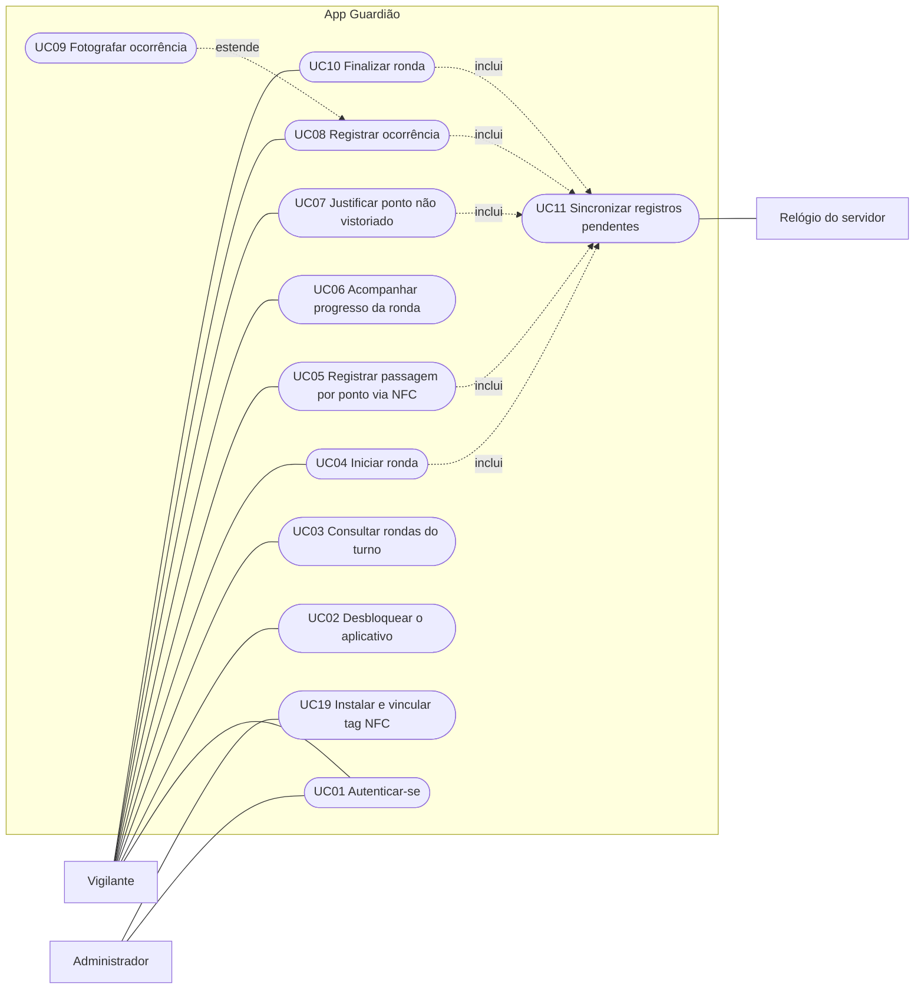
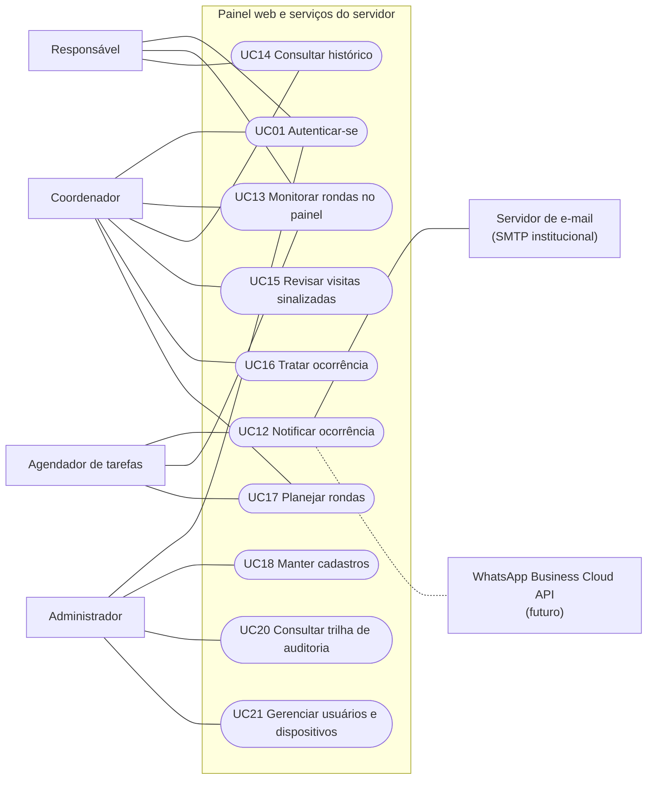
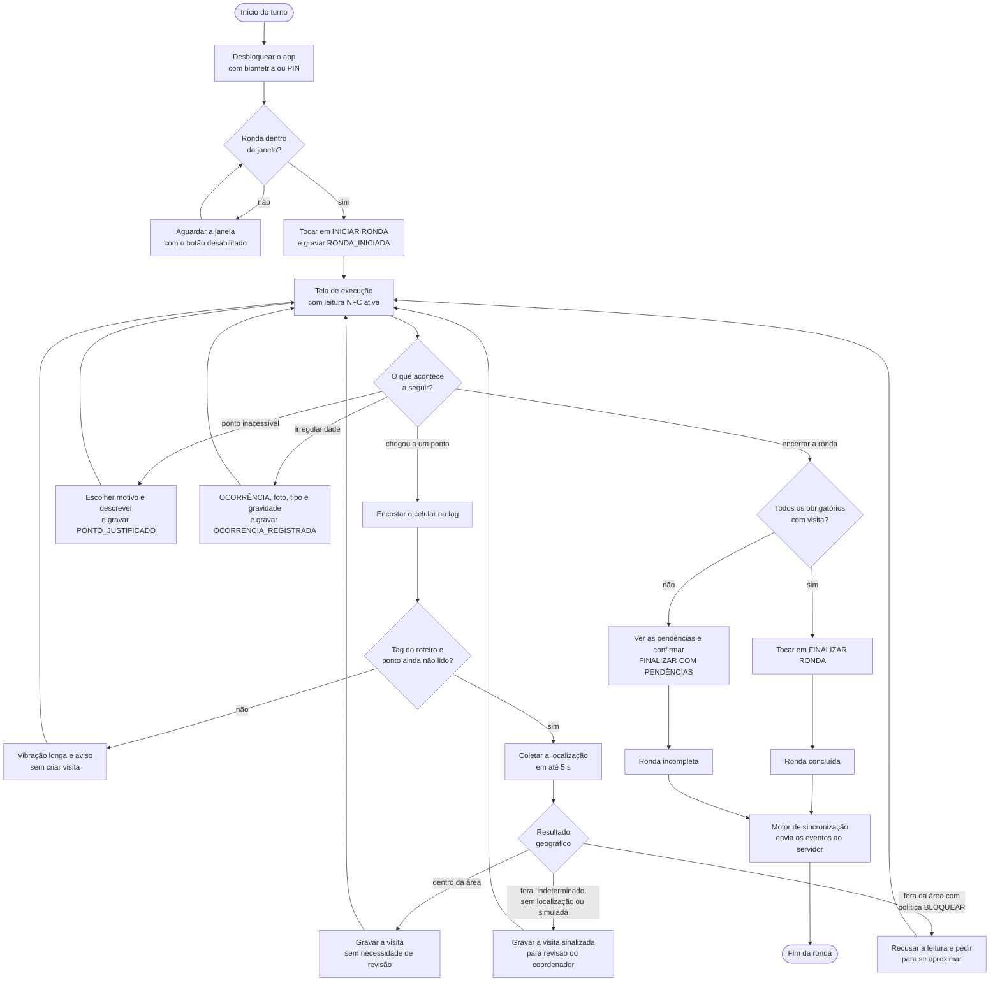

# Casos de uso

Parte da [documentação do Guardião](README.md).

Este documento descreve como cada ator interage com o Guardião na V1. Os requisitos (RF/RNF) e as regras de negócio (RN) citados estão em [Requisitos](02-requisitos.md), e as regras completas estão em [Regras de negócio](02-requisitos.md#regras-de-negócio).

## Sumário

1. [Atores](#atores)
2. [Diagramas de casos de uso](#diagramas-de-casos-de-uso)
3. [Lista de casos de uso](#lista-de-casos-de-uso)
4. [Especificações detalhadas](#especificações-detalhadas)
5. [Especificações resumidas](#especificações-resumidas)
6. [Diagrama de atividades da ronda](#diagrama-de-atividades-da-ronda)

## Atores

### Atores primários

| Ator | Papel (`PapelUsuario`) | Descrição | Canal |
|---|---|---|---|
| Vigilante | `VIGILANTE` | Vigilante patrimonial que executa as rondas: vê as rondas do turno, inicia e finaliza, lê as tags NFC, justifica pontos e registra ocorrências | App Guardião |
| Coordenador | `COORDENADOR` | Coordenador da vigilância do campus: planeja roteiros e agendas, acompanha o painel completo do campus, revisa visitas sinalizadas, trata ocorrências e recebe notificações | Painel web e e-mail |
| Responsável | `RESPONSAVEL` | Responsável por prédio ou setor: consulta o painel restrito aos seus locais e recebe notificações das ocorrências desses locais | Painel web (consulta) e e-mail |
| Administrador | `ADMINISTRADOR` | TI ou gestão do sistema: mantém cadastros, usuários, dispositivos e configurações, instala tags com o modo instalação do app e consulta a auditoria | Painel web e app (modo instalação) |

Os quatro papéis são especializações de **Usuário autenticado** e compartilham o UC01 (Autenticar-se).

### Atores secundários e de sistema

| Ator | Tipo | Participação |
|---|---|---|
| Servidor de E-mail (SMTP institucional) | Externo | Entrega os e-mails de notificação de ocorrências (UC12) |
| WhatsApp Business Cloud API | Externo (futuro, V1.1) | Entrega notificações de ocorrências `CRITICA` quando o canal estiver habilitado (UC12) |
| Agendador de tarefas | Sistema (worker) | Gera as rondas a partir das agendas (00:05 e 12:05), marca rondas `NAO_REALIZADA` a cada 5 minutos e processa as filas de notificações e de fotos |
| Relógio do servidor | Sistema | Fornece o horário de recebimento (`recebido_em_servidor`), o horário da auditoria e a base para estimar o desvio de relógio do aparelho |

A tag NFC, o GPS e a câmera do celular são recursos do aparelho e do ambiente, e não atores.

## Diagramas de casos de uso

Os diagramas usam `flowchart`: retângulos são atores, cápsulas são casos de uso, setas tracejadas indicam inclusão ou extensão e a linha tracejada sem seta indica um ator previsto para depois da V1.

### App do vigilante

### Painel web e serviços do servidor

O `Coordenador` e o `Responsável` também são **destinatários** do UC12. O `Coordenador` tem acesso de leitura aos cadastros (UC18). No diagrama, o `Agendador de tarefas` liga-se ao UC17 (geração das rondas a partir das agendas), ao UC13 (marcação de rondas não realizadas) e ao UC12 (processamento da fila de notificações).

## Lista de casos de uso

| UC | Nome | Ator primário | Requisitos | Histórias | Especificação |
|---|---|---|---|---|---|
| UC01 | Autenticar-se | Usuário autenticado (todos os papéis) | RF01 | HU-005, HU-006, HU-044 | Detalhada |
| UC02 | Desbloquear o aplicativo | Vigilante, Administrador | RNF11 | HU-008 | Resumida |
| UC03 | Consultar rondas do turno | Vigilante | RF02 | HU-015 | Resumida |
| UC04 | Iniciar ronda | Vigilante | RF03 | HU-016 | Detalhada |
| UC05 | Registrar passagem por ponto via NFC | Vigilante | RF04, RF05, RF06, RF07, RF08 | HU-018, HU-019 | Detalhada |
| UC06 | Acompanhar progresso da ronda | Vigilante | RF09 | HU-017, HU-020 | Resumida |
| UC07 | Justificar ponto não vistoriado | Vigilante | RF10 | HU-021 | Detalhada |
| UC08 | Registrar ocorrência | Vigilante | RF11, RF12, RF14 | HU-023 | Detalhada |
| UC09 | Fotografar ocorrência | Vigilante | RF13 | HU-024, HU-031 | Detalhada |
| UC10 | Finalizar ronda | Vigilante | RF03 | HU-022 | Detalhada |
| UC11 | Sincronizar registros pendentes | App (motor de sincronização) | RNF01 a RNF07 | HU-029, HU-030, HU-031, HU-032, HU-033 | Detalhada |
| UC12 | Notificar ocorrência | Agendador de tarefas (worker) | RF15 | HU-026, HU-027, HU-028 | Resumida |
| UC13 | Monitorar rondas no painel | Coordenador, Responsável | RF16 | HU-034, HU-035 | Resumida |
| UC14 | Consultar histórico | Coordenador, Responsável | RF17 | HU-036 | Resumida |
| UC15 | Revisar visitas sinalizadas | Coordenador | RF07 | HU-040 | Detalhada |
| UC16 | Tratar ocorrência | Coordenador | RF15, RF16 | HU-025 | Resumida |
| UC17 | Planejar rondas | Coordenador | RF02, RF04 | HU-012, HU-013, HU-014 | Resumida |
| UC18 | Manter cadastros | Administrador | RF19 | HU-009, HU-010, HU-011, HU-039 | Resumida |
| UC19 | Instalar e vincular tag NFC | Administrador | RF19 | HU-010 | Detalhada |
| UC20 | Consultar trilha de auditoria | Administrador | RF18 | HU-037, HU-038 | Resumida |
| UC21 | Gerenciar usuários e dispositivos | Administrador | RF01, RF19 | HU-007 | Resumida |

## Especificações detalhadas

### UC01 — Autenticar-se

| | |
|---|---|
| **Objetivo** | Identificar o usuário individualmente e abrir uma sessão vinculada ao aparelho (app) ou ao navegador (painel) |
| **Atores** | Primário: Usuário autenticado (Vigilante, Coordenador, Responsável, Administrador) · Secundário: Relógio do servidor |
| **Prioridade** | Must |
| **Requisitos** | RF01, RNF11, RNF14 (aviso de privacidade) |
| **Regras de negócio** | RN17, RN18 |
| **Histórias** | HU-005, HU-006, HU-044 |

**Pré-condições**

1. O usuário está cadastrado, ativo e vinculado a um campus (UC21).
2. No app, o aparelho tem bloqueio de tela (biometria ou PIN) configurado e não está revogado.
3. Há conexão com a API: o primeiro acesso é sempre online.

**Gatilho:** o usuário abre o app sem sessão local (primeiro acesso no aparelho, depois de um logout ou de uma revogação) ou acessa `/login` no painel web.

**Fluxo principal (app)**

1. O app exibe a tela de login com os campos matrícula e senha.
2. O usuário informa matrícula e senha e toca em **ENTRAR**.
3. O app envia `POST /api/v1/auth/login` com as credenciais e os dados do aparelho (identificador de instalação, plataforma, modelo, versão do sistema e versão do app).
4. A API aplica o limite de tentativas, confere a senha (argon2id) e verifica se o usuário está ativo, se o papel pode usar o app e se o aparelho não está revogado.
5. A API registra ou atualiza o `dispositivo`, cria a `sessao` com uma nova família de refresh token, emite o access token (15 min) e o refresh token (30 dias) e grava auditoria `LOGIN`.
6. O app guarda os tokens no armazenamento seguro do sistema, abre o banco local cifrado (na primeira execução, gera a chave AES-256 e a guarda no Keystore/Keychain) e baixa o pacote offline e as rondas do turno.
7. No primeiro acesso desse usuário no aparelho, o app exibe o aviso de privacidade e o usuário toca em **ENTENDI**.
8. O app passa a exigir biometria ou PIN do aparelho nos acessos seguintes (RN18).
9. O app exibe a tela Início.

**Fluxos alternativos**

- **FA1 — Login no painel web.** Nos passos 1 a 5, o usuário usa a página `/login`. A API aceita os papéis `COORDENADOR`, `RESPONSAVEL` e `ADMINISTRADOR`, grava auditoria `LOGIN`, e o painel abre o Painel do dia (`/`) com o menu correspondente ao papel. Os passos 6 a 8 não se aplicam.
- **FA2 — Administrador no app.** No passo 9, a tela Início também oferece o acesso ao modo instalação de tags (UC19).
- **FA3 — Pacote offline inalterado.** No passo 6, se o servidor responder que o pacote não mudou (ETag igual), o app mantém os dados locais.
- **FA4 — Aparelho compartilhado.** Para outro vigilante entrar, o anterior precisa sair pelo Perfil, e a saída só é permitida com a fila de envio vazia (RN17). Depois disso, o fluxo recomeça no passo 1.

**Exceções**

- **E1 — Credenciais inválidas.** A API responde erro, grava `LOGIN_FALHOU` e o app mostra "Matrícula ou senha inválida", sem indicar qual dado está errado. Volta ao passo 2.
- **E2 — Limite de tentativas.** A partir da 6ª tentativa em 1 minuto para o mesmo IP e matrícula, a API responde 429 com bloqueio progressivo, e o app informa quando tentar de novo.
- **E3 — Usuário inativo.** O app mostra "Acesso não permitido. Procure o administrador."
- **E4 — Aparelho revogado.** O app mostra "Este aparelho foi bloqueado. Procure o administrador." e não baixa nenhum dado.
- **E5 — Papel sem acesso ao canal.** `COORDENADOR` ou `RESPONSAVEL` no app veem "Use o painel web para acessar o Guardião". `VIGILANTE` no painel tem o acesso negado.
- **E6 — Sem conexão.** O app mostra "Conecte-se à internet para entrar pela primeira vez."
- **E7 — Aparelho sem bloqueio de tela.** O app orienta a configurar biometria ou PIN no sistema e não prossegue.

**Pós-condições**

- **Sucesso:** sessão ativa e vinculada ao aparelho, dados de referência e rondas do turno no banco local, auditoria `LOGIN` gravada.
- **Falha:** nenhuma sessão criada e tentativa registrada como `LOGIN_FALHOU`.

### UC04 — Iniciar ronda

| | |
|---|---|
| **Objetivo** | Começar uma ronda atribuída, registrando data, horário e localização do início |
| **Atores** | Primário: Vigilante · Secundário: Relógio do servidor |
| **Prioridade** | Must |
| **Requisitos** | RF03, RNF01, RNF02, RNF10, RNF14 |
| **Regras de negócio** | RN02, RN03, RN09, RN15, RN19 |
| **Histórias** | HU-016 |

**Pré-condições**

1. O vigilante está autenticado e com o app desbloqueado (UC01, UC02).
2. Existe no aparelho uma ronda `AGENDADA` atribuída a ele (UC03).
3. Não há outra ronda `EM_ANDAMENTO` para o vigilante (RN03).
4. O horário atual está dentro da janela da ronda (RN02).

Conexão com a internet **não** é necessária.

**Gatilho:** o vigilante toca em **INICIAR RONDA** no cartão "Próxima ronda" da tela Início (ou numa ronda da lista do turno).

**Fluxo principal**

1. A tela Início mostra o cartão "Próxima ronda" com o roteiro, a janela, o número de pontos e o botão **INICIAR RONDA** habilitado.
2. O vigilante toca em **INICIAR RONDA** (1 toque).
3. O app confere localmente as regras RN02 e RN03 usando o horário do aparelho corrigido pelo último desvio conhecido.
4. O app solicita a localização atual, com limite de 5 s. Se não obtiver, segue com `SEM_LOCALIZACAO`.
5. Numa única transação no banco local, o app muda a ronda para `EM_ANDAMENTO`, grava `iniciada_em_dispositivo` e a localização e enfileira o evento `RONDA_INICIADA` (id UUIDv7).
6. O app abre a tela de execução com os pontos agrupados e o progresso em 0, e ativa a leitura NFC automática (Android).
7. O motor de sincronização envia o evento imediatamente, se houver conexão (UC11).
8. A API valida a atribuição, a janela (com o horário do aparelho corrigido pelo desvio) e a RN03, muda a ronda para `EM_ANDAMENTO`, grava `iniciada_recebido_em_servidor`, gera o registro de auditoria e responde `ACEITO`.
9. O app marca o evento como `CONFIRMADO`.

**Fluxos alternativos**

- **FA1 — Sem conexão.** Nos passos 7 a 9, o evento fica `PENDENTE` e a ronda segue normalmente no aparelho. O envio acontece quando a conexão voltar (UC11).
- **FA2 — Ronda escolhida na lista.** No passo 1, o vigilante abre outra ronda do turno e toca em **INICIAR RONDA** nela. As mesmas regras se aplicam.
- **FA3 — iPhone.** No passo 6, a leitura não é contínua: a tela de execução mostra o botão **Ler ponto**, que abre a folha de leitura NFC do sistema (UC05).
- **FA4 — Início offline recebido depois da janela.** No passo 8, se a ronda já tiver sido marcada `NAO_REALIZADA` pelo job, mas o horário do aparelho (corrigido) estiver dentro da janela, o servidor aceita o início, a ronda volta ao fluxo normal e os registros ficam com `recebido_apos_encerramento = true` (RN09).

**Exceções**

- **E1 — Antes da janela.** O botão fica desabilitado com "Disponível a partir de HH:MM".
- **E2 — Janela encerrada.** Depois de `fim_previsto`, a ronda aparece como "Janela encerrada" e não pode ser iniciada.
- **E3 — Outra ronda em andamento.** O app mostra "Finalize a ronda em andamento antes de iniciar outra" e oferece abri-la.
- **E4 — Servidor rejeita o início.** Por exemplo, a ronda foi cancelada ou reatribuída enquanto o aparelho estava offline. O evento fica `REJEITADO` e aparece na tela de sincronização com a orientação "Procure o coordenador". Os registros feitos continuam guardados no aparelho.
- **E5 — NFC desligado.** No passo 6, o app mostra "Ative o NFC" com atalho para as configurações. A ronda já está iniciada.
- **E6 — Permissão de localização negada.** O início é registrado com `SEM_LOCALIZACAO`.

**Pós-condições**

- **Sucesso:** ronda `EM_ANDAMENTO` no aparelho e, depois da sincronização, no servidor, com horário do aparelho, horário do servidor e localização do evento.
- **Falha:** a ronda continua `AGENDADA` e nada é enfileirado.

### UC05 — Registrar passagem por ponto via NFC

| | |
|---|---|
| **Objetivo** | Comprovar a passagem do vigilante por um ponto de ronda com a leitura da tag NFC instalada no local |
| **Atores** | Primário: Vigilante · Secundário: Relógio do servidor |
| **Prioridade** | Must |
| **Requisitos** | RF04, RF05, RF06, RF07, RF08, RF09, RNF10, RNF14 |
| **Regras de negócio** | RN01, RN04, RN05, RN06, RN07, RN15, RN19 |
| **Histórias** | HU-018, HU-019 |

**Pré-condições**

1. Há uma ronda `EM_ANDAMENTO` e a tela de execução está aberta (UC04).
2. O NFC do aparelho está ligado.
3. O ponto pertence ao roteiro da ronda e tem uma tag `ATIVA` vinculada (UC19).

**Gatilho:** o vigilante encosta o celular na tag do ponto (Android) ou toca em **Ler ponto** e encosta o celular (iOS).

**Fluxo principal**

1. O leitor NFC detecta a tag e lê o UID e a mensagem NDEF (no caso da NTAG 424 DNA, a URL com a mensagem SUN).
2. O app localiza a tag no pacote offline e identifica o ponto.
3. O app confirma que o ponto pertence ao roteiro (RN05) e que ainda não tem visita nesta ronda (RN04).
4. O app dá o retorno de sucesso: vibração curta, som, ✓ verde e o nome do ponto em letra grande.
5. O app solicita a localização atual, com limite de 5 s, incluindo a precisão e o indicador de localização simulada.
6. O app calcula o resultado geográfico preliminar (RN06) com a referência e o raio do ponto do pacote offline.
7. Numa única transação, o app grava a visita (`lido_em_dispositivo`, UID, payload NFC, localização, precisão, resultado geográfico) e enfileira o evento `PONTO_VISITADO` (id UUIDv7).
8. O app atualiza o progresso (UC06). Se era o último ponto obrigatório pendente, **FINALIZAR RONDA** aparece em destaque.
9. O motor de sincronização envia o evento (UC11).
10. A API valida a tag (RN07), recalcula o resultado geográfico (RN06), define `status_revisao`, grava a visita com `recebido_em_servidor` e `desvio_relogio_ms` e responde `ACEITO`.
11. Se a visita foi sinalizada, ela passa a aparecer em "Visitas sinalizadas" no painel (UC15).
12. O app marca o evento como `CONFIRMADO`.

**Fluxos alternativos**

- **FA1 — Ponto já registrado.** No passo 3, se o ponto já tem visita, o app mostra "Ponto já registrado", com retorno informativo, e não cria nova visita (RN04). O fluxo termina.
- **FA2 — Ponto justificado antes.** No passo 3, se o ponto tem justificativa e ainda não tem visita, a leitura é aceita normalmente e o ponto passa a contar como visitado. A justificativa permanece no histórico.
- **FA3 — iPhone.** No gatilho, o vigilante toca em **Ler ponto** (1 toque), e o sistema abre a folha de leitura NFC. O restante do fluxo é igual.
- **FA4 — Sem conexão.** Os passos 9 a 12 acontecem quando a conexão voltar.
- **FA5 — Política `BLOQUEAR` e resultado `FORA_AREA`.** No passo 4, o retorno aguarda a localização. Se o resultado for `FORA_AREA`, o app mostra "Você parece estar fora da área deste ponto. Aproxime-se e encoste de novo.", com vibração longa, e não grava a visita.
- **FA6 — Localização indisponível ou imprecisa.** No passo 6, o resultado é `SEM_LOCALIZACAO` ou `INDETERMINADO`. A visita é registrada e sinalizada para revisão, sem aviso de erro ao vigilante.
- **FA7 — Localização simulada.** No passo 5, se o sistema indicar localização simulada, a visita é registrada com `localizacao_simulada = true` e sempre sinalizada.
- **FA8 — Fora da ordem prevista.** Se o roteiro exige ordem e o ponto não é o próximo, a visita é registrada e o app avisa "Fora da ordem prevista".

**Exceções**

- **E1 — Tag de outro roteiro.** No passo 3, o app mostra "Este ponto não faz parte desta ronda", com vibração longa, e não grava nada (RN05).
- **E2 — Tag não reconhecida.** No passo 2, se a tag não está no pacote offline (não cadastrada, inativa, substituída ou de outro campus), o app mostra "Tag não reconhecida", com vibração longa.
- **E3 — Falha de leitura.** No passo 1, se a leitura for interrompida, o app mostra "Leitura falhou. Encoste de novo e segure por 1 segundo."
- **E4 — Tag inválida ou replay no servidor.** No passo 10, a validação resulta em `INVALIDA` ou `REPLAY`: a visita é gravada, não conta para a conclusão, fica pendente de revisão e gera alerta ao coordenador no painel. O evento é `ACEITO`.
- **E5 — Evento rejeitado.** No passo 10, o servidor responde `REJEITADO` (por exemplo, o ponto foi retirado do roteiro). O evento aparece na tela de sincronização.
- **E6 — NFC desligado.** O app mostra "Ative o NFC" com atalho para as configurações.

**Pós-condições**

- **Sucesso:** visita registrada com ponto, tag, vigilante, aparelho, horários e localização, sem nenhum dado digitado. Progresso atualizado.
- **Falha:** nenhuma visita criada. O ponto continua pendente.

### UC07 — Justificar ponto não vistoriado

| | |
|---|---|
| **Objetivo** | Registrar o motivo pelo qual um ponto não pôde ser vistoriado |
| **Atores** | Primário: Vigilante · Secundário: Relógio do servidor |
| **Prioridade** | Must |
| **Requisitos** | RF09, RF10, RNF14 |
| **Regras de negócio** | RN08, RN10, RN15, RN19 |
| **Histórias** | HU-021 |

**Pré-condições**

1. Há uma ronda `EM_ANDAMENTO`.
2. O ponto não tem visita nem justificativa nesta ronda.

**Gatilho:** o vigilante toca num ponto pendente na tela de execução e escolhe **Justificar**, ou escolhe **Justificar** na lista de pendências da tela de finalização (UC10).

**Fluxo principal**

1. O vigilante toca no ponto pendente.
2. O app mostra os dados do ponto com a ação primária **Justificar**.
3. O vigilante toca em **Justificar**.
4. O app mostra a lista de motivos (`ACESSO_BLOQUEADO`, `AREA_INTERDITADA`, `TAG_DANIFICADA_OU_AUSENTE`, `EMERGENCIA_EM_ATENDIMENTO`, `CONDICAO_INSEGURA`, `OUTRO`, com textos amigáveis) e o campo de descrição.
5. O vigilante escolhe o motivo e escreve a descrição, com pelo menos 10 caracteres (o ditado do teclado do sistema pode ser usado).
6. O vigilante toca em **SALVAR JUSTIFICATIVA**.
7. O app solicita a localização (limite de 5 s) e, numa única transação, grava a justificativa e enfileira o evento `PONTO_JUSTIFICADO`.
8. O app volta à tela de execução, e o ponto aparece como "Justificado", com ícone e cor próprios, sem somar no progresso.
9. O motor de sincronização envia o evento, e a API grava a justificativa com `recebido_em_servidor` (UC11).

**Fluxos alternativos**

- **FA1 — A partir da finalização.** O fluxo começa no passo 4 e, ao salvar, volta à tela de finalização com a lista de pendências atualizada.
- **FA2 — Tag danificada ou ausente.** Se o motivo for `TAG_DANIFICADA_OU_AUSENTE`, depois de salvar o app oferece registrar uma ocorrência (UC08), o que é opcional.
- **FA3 — Leitura posterior.** Se o vigilante conseguir ler a tag depois, a visita é registrada e passa a valer (UC05, FA2).
- **FA4 — Sem conexão.** O passo 9 acontece quando a conexão voltar.

**Exceções**

- **E1 — Descrição curta.** Com menos de 10 caracteres, **SALVAR JUSTIFICATIVA** fica desabilitado e o app indica quantos caracteres faltam.
- **E2 — Ponto já visitado.** A ação **Justificar** não aparece.
- **E3 — Ponto já justificado.** O app mostra a justificativa existente, somente para leitura.
- **E4 — Cancelamento.** Se o vigilante voltar sem salvar, nada é gravado.

**Pós-condições**

- **Sucesso:** justificativa registrada com motivo, descrição, horários e localização. O ponto continua sem visita para o cálculo da conclusão (RN08).
- **Falha:** nada é gravado.

### UC08 — Registrar ocorrência

| | |
|---|---|
| **Objetivo** | Registrar uma irregularidade encontrada na ronda, vinculada ao local, com tipo, gravidade, descrição e fotos |
| **Atores** | Primário: Vigilante · Secundários: Relógio do servidor, Servidor de e-mail (por meio do UC12) |
| **Prioridade** | Must |
| **Requisitos** | RF11, RF12, RF13, RF14, RF15, RNF10, RNF14 |
| **Regras de negócio** | RN11, RN12, RN13, RN15, RN19 |
| **Histórias** | HU-023 (e HU-024 para as fotos) |

**Pré-condições**

1. Há uma ronda `EM_ANDAMENTO` (na V1, a ocorrência sempre pertence a uma ronda).
2. Os tipos de ocorrência ativos estão no pacote offline.

**Gatilho:** o vigilante toca no botão fixo **OCORRÊNCIA** da tela de execução.

**Fluxo principal (ocorrência expressa, 3 toques)**

1. O vigilante toca em **OCORRÊNCIA** (toque 1).
2. A câmera do app abre direto, e o vigilante tira a foto (toque 2), conforme o UC09.
3. O app mostra a tela única de confirmação com a miniatura da foto, o tipo pré-selecionado, a gravidade padrão do tipo e o local preenchido com o último ponto lido nos últimos 5 minutos (prédio, andar e setor herdados do ponto).
4. Opcionalmente, o vigilante troca o tipo, a gravidade ou o local, escreve uma descrição ou adiciona fotos (até 5 no total).
5. O vigilante toca em **ENVIAR** (toque 3).
6. O app solicita a localização (limite de 5 s) e, numa única transação, grava a ocorrência (status `ABERTA`, `registrada_em_dispositivo`), registra as fotos já cifradas e enfileira o evento `OCORRENCIA_REGISTRADA`.
7. O app mostra "Ocorrência registrada" e volta à tela de execução. A leitura NFC continua ativa.
8. O motor de sincronização envia o evento (UC11). A API valida os dados obrigatórios (RN11), grava a ocorrência com `recebido_em_servidor` e responde `ACEITO`.
9. Depois do `ACEITO`, as fotos são enviadas (UC09).
10. Se a gravidade atingir o mínimo da regra do campus, o servidor dispara as notificações (UC12).

**Fluxos alternativos**

- **FA1 — Sem foto.** No passo 2, o vigilante toca em **Sem foto** e vai direto à tela de confirmação.
- **FA2 — Nenhum ponto lido nos últimos 5 minutos.** No passo 3, o prédio fica em branco e **ENVIAR** fica desabilitado até o vigilante escolher um prédio (andar, setor e ponto são opcionais).
- **FA3 — Trocar o local.** No passo 4, o vigilante escolhe outro ponto do roteiro ou indica prédio, andar e setor.
- **FA4 — Sem conexão.** Os passos 8 a 10 acontecem quando a conexão voltar. A notificação informa o horário original do registro (RN13).
- **FA5 — Permissão de câmera negada.** No passo 2, o app informa como conceder a permissão e segue para a confirmação sem foto.

**Exceções**

- **E1 — Armazenamento insuficiente.** O app avisa e permite enviar a ocorrência sem a foto.
- **E2 — Evento rejeitado.** O servidor responde `REJEITADO` (por exemplo, um tipo desativado), e o evento aparece na tela de sincronização.
- **E3 — Fluxo abandonado.** Se o vigilante sair antes de **ENVIAR**, nada é gravado e as fotos temporárias são apagadas.

**Pós-condições**

- **Sucesso:** ocorrência `ABERTA` vinculada à ronda, ao ponto (se houver), ao prédio, andar e setor, ao vigilante e ao aparelho, com horários e localização. Fotos na fila de upload e notificações disparadas quando aplicável.
- **Falha:** nada é gravado.

### UC09 — Fotografar ocorrência

| | |
|---|---|
| **Objetivo** | Anexar à ocorrência fotos íntegras, tiradas no momento, sem expor dados no aparelho |
| **Atores** | Primário: Vigilante |
| **Prioridade** | Must |
| **Requisitos** | RF13, RNF02, RNF04, RNF05 |
| **Regras de negócio** | RN11, RN12 |
| **Histórias** | HU-024, HU-031 |

**Pré-condições**

1. O UC08 está em andamento.
2. O app tem permissão de câmera.
3. A ocorrência tem menos de 5 fotos.

**Gatilho:** abertura automática da câmera no fluxo expresso ou toque em **Adicionar foto** na tela de confirmação.

**Fluxo principal**

1. O app abre a própria câmera, com bloqueio de captura de tela ativo e sem opção de galeria.
2. O vigilante toca no obturador.
3. O app processa a imagem: redimensiona para lado maior de 1600 px, gera JPEG com qualidade 80%, remove os metadados EXIF e calcula o SHA-256.
4. O app cifra o arquivo com AES-256-GCM (IV aleatório), salva no armazenamento privado do app e apaga a versão sem cifra.
5. O app registra a foto (status de upload `PENDENTE`) vinculada à ocorrência e mostra a miniatura.
6. Depois que `OCORRENCIA_REGISTRADA` é aceita, o motor de sincronização envia a foto com `PUT /api/v1/ocorrencias/{ocorrenciaId}/fotos/{fotoId}` e o header `Content-SHA256`.
7. A API confere o hash, grava o arquivo no armazenamento de objetos e registra a foto com `recebido_em_servidor` e `upload_concluido = true`.
8. O app marca a foto como `CONFIRMADO` e apaga o arquivo local cifrado.

**Fluxos alternativos**

- **FA1 — Refazer.** Antes de **ENVIAR**, o vigilante descarta uma miniatura, e o arquivo correspondente é apagado.
- **FA2 — Sem conexão.** Os passos 6 a 8 acontecem quando a conexão voltar.
- **FA3 — Upload interrompido.** A foto fica `ERRO_TEMPORARIO` e volta a ser enviada com backoff. Como o envio é idempotente pelo `fotoId` e pelo hash, um reenvio de foto já recebida é apenas confirmado.

**Exceções**

- **E1 — Limite de fotos.** Com 5 fotos, **Adicionar foto** fica desabilitado com "Máximo de 5 fotos".
- **E2 — Hash divergente.** A API recusa o arquivo. O app marca a foto como `ERRO_TEMPORARIO` e tenta de novo. Se o problema persistir, a foto aparece na tela de sincronização.
- **E3 — Falha ao processar ou cifrar.** O app avisa "Não foi possível salvar a foto. Tente de novo." e nada é registrado.

**Pós-condições**

- **Sucesso:** fotos vinculadas à ocorrência no servidor, com hash conferido, sem cópia na galeria e sem arquivo restante no aparelho depois da confirmação.
- **Falha:** a ocorrência segue válida sem a foto que falhou.

### UC10 — Finalizar ronda

| | |
|---|---|
| **Objetivo** | Encerrar a ronda, registrando data, horário e localização do fim, e obter o resultado (concluída ou incompleta) |
| **Atores** | Primário: Vigilante · Secundário: Relógio do servidor |
| **Prioridade** | Must |
| **Requisitos** | RF03, RF09, RNF10, RNF14 |
| **Regras de negócio** | RN07, RN08, RN09, RN10, RN15, RN19 |
| **Histórias** | HU-022 |

**Pré-condições**

1. Há uma ronda `EM_ANDAMENTO` no aparelho.

**Gatilho:** o vigilante toca em **FINALIZAR RONDA** (em destaque quando todos os pontos obrigatórios foram lidos) ou em **Finalizar** no menu da tela de execução, quando ainda há pendências.

**Fluxo principal (ronda completa)**

1. Todos os pontos obrigatórios têm visita, e o app mostra **FINALIZAR RONDA** em destaque.
2. O vigilante toca em **FINALIZAR RONDA** (1 toque).
3. O app solicita a localização (limite de 5 s) e, numa única transação, grava `finalizada_em_dispositivo`, marca a ronda como concluída (provisoriamente) e enfileira o evento `RONDA_FINALIZADA`.
4. O app mostra o resumo: pontos visitados, ocorrências registradas, horários de início e fim e situação do envio. A ação primária é **VOLTAR AO INÍCIO**.
5. O motor de sincronização envia o evento (UC11).
6. A API calcula o status final pela RN08, considerando a validação das tags (RN07), grava `finalizada_recebido_em_servidor` e responde `ACEITO`.
7. Na próxima atualização das rondas, o app passa a exibir o status definido pelo servidor.

**Fluxos alternativos**

- **FA1 — Finalizar com pendências.** No passo 2, o vigilante toca em **Finalizar**. O app abre a tela de finalização com os pontos obrigatórios sem visita (indicando os justificados), a opção **Justificar** em cada um (UC07) e a ação **FINALIZAR COM PENDÊNCIAS**. Ao confirmar o aviso "A ronda ficará incompleta", o app segue do passo 3, com status `INCOMPLETA`.
- **FA2 — Sem conexão.** Os passos 5 a 7 acontecem quando a conexão voltar.
- **FA3 — Ronda atrasada.** Depois de `fim_previsto`, a finalização funciona normalmente. O indicador de atraso fica no histórico do painel.
- **FA4 — Fotos pendentes.** A finalização não espera o envio das fotos, que continua em segundo plano.

**Exceções**

- **E1 — Encerramento administrativo prévio.** Se o coordenador já encerrou a ronda, o servidor aceita o evento, marca os registros com `recebido_apos_encerramento = true` e mantém o status `INCOMPLETA` (RN09).
- **E2 — Tag inválida ou replay.** Se alguma visita obrigatória foi classificada como `INVALIDA` ou `REPLAY`, o servidor define `INCOMPLETA`, mesmo que o app tenha mostrado a ronda como concluída.

**Pós-condições**

- **Sucesso:** ronda `CONCLUIDA` ou `INCOMPLETA`, com horários de fim do aparelho e do servidor. A leitura NFC é desativada e o vigilante pode iniciar a próxima ronda.
- **Falha:** a ronda continua `EM_ANDAMENTO`.

### UC11 — Sincronizar registros pendentes

| | |
|---|---|
| **Objetivo** | Levar ao servidor, sem perdas e sem duplicidade, todos os registros feitos no aparelho, com ou sem internet no momento da ação |
| **Atores** | Primário: App (motor de sincronização), em nome do vigilante · Secundário: Relógio do servidor |
| **Prioridade** | Must |
| **Requisitos** | RNF01, RNF02, RNF03, RNF04, RNF05, RNF06, RNF07, RF14 |
| **Regras de negócio** | RN09, RN15, RN16, RN17 |
| **Histórias** | HU-029, HU-030, HU-031, HU-032, HU-033 |

Detalhes técnicos em [Sincronização online-first](06-sincronizacao-online-first.md) e [ADR-0005](adr/0005-online-first-fila-local-outbox.md).

**Pré-condições**

1. Há eventos `PENDENTE` (ou `ERRO_TEMPORARIO` com próxima tentativa vencida) na fila local, ou fotos com upload pendente.
2. Há uma sessão local válida no aparelho.

**Gatilhos:** ação do usuário (envio imediato), volta da conexão, app voltando ao primeiro plano, timer de 60 s enquanto houver pendências com o app aberto, tarefa em segundo plano (melhor esforço, cerca de 15 min) e o botão **Sincronizar agora** na tela de sincronização.

**Fluxo principal**

1. O motor verifica se há conexão e se não existe outro envio em curso.
2. O motor seleciona até 50 eventos pendentes em ordem de criação, respeitando as dependências (eventos de uma ronda em ordem; fotos só depois da ocorrência aceita).
3. O motor marca os eventos como `ENVIANDO`.
4. O motor garante um access token válido, renovando-o com o refresh token se necessário.
5. O motor envia `POST /api/v1/sincronizacao/eventos` com o lote e o horário de envio do aparelho no header `X-Enviado-Em-Dispositivo`.
6. Para cada evento, a API verifica se o id já existe em `evento_sincronizacao`. Se existir, o resultado é `DUPLICADO`. Se não, valida e aplica o evento numa transação, grava `recebido_em_servidor` (relógio do servidor) e o desvio estimado e registra o evento. O resultado é `ACEITO` ou, se uma regra de negócio for violada, `REJEITADO` com o código do erro.
7. A API responde com um resultado por evento.
8. O motor marca `ACEITO` e `DUPLICADO` como `CONFIRMADO` (RN16) e `REJEITADO` como `REJEITADO`, guardando o erro.
9. O motor atualiza os metadados locais (desvio do relógio e horário da última sincronização) e o indicador de sincronização (nuvem e contador de pendências).
10. O motor envia as fotos que ficaram elegíveis (UC09, passos 6 a 8).
11. Enquanto houver pendências, o motor volta ao passo 2.

**Fluxos alternativos**

- **FA1 — Sem conexão.** No passo 1, nada é enviado, e o motor aguarda o próximo gatilho.
- **FA2 — Access token expirado.** A API responde 401. O motor renova o token e reenvia o mesmo lote.
- **FA3 — Resposta perdida.** O servidor processou o lote, mas a resposta não chegou (timeout). Os eventos vão para `ERRO_TEMPORARIO`, são reenviados e recebem `DUPLICADO`, o que os confirma sem duplicar nada (RNF05, RNF06).
- **FA4 — Erro temporário.** Em falha de rede, 5xx, 429 ou timeout, os eventos ficam `ERRO_TEMPORARIO` e voltam a `PENDENTE` com backoff de 5 s, 15 s, 1 min, 5 min e 15 min (teto), com variação aleatória.
- **FA5 — App em segundo plano.** A tarefa em segundo plano executa os passos 1 a 11 quando o sistema permitir.
- **FA6 — Sincronização manual.** Na tela de sincronização, o vigilante toca em **Sincronizar agora**, e o fluxo começa no passo 1, ignorando a espera do backoff.

**Exceções**

- **E1 — Evento rejeitado.** O evento fica `REJEITADO`, não é reenviado automaticamente, permanece guardado no aparelho e aparece na tela de sincronização com uma mensagem curta e a orientação de procurar o coordenador.
- **E2 — Sessão revogada ou refresh token inválido.** O app encerra a sessão e exige novo login. Os eventos pendentes permanecem cifrados no aparelho e são enviados depois do login do mesmo usuário. Em aparelho revogado, o tratamento é uma pendência registrada em [Requisitos](02-requisitos.md#decisões-e-pendências).
- **E3 — Tentativa de logout com pendências.** O app impede a saída e oferece **Sincronizar agora** (RN17).

**Pós-condições**

- **Sucesso:** todos os eventos enviados estão `CONFIRMADO`, os registros estão no servidor com os horários do aparelho e do servidor e nenhum registro foi duplicado.
- **Falha:** os eventos permanecem na fila local, cifrados, até o próximo gatilho.

### UC15 — Revisar visitas sinalizadas

| | |
|---|---|
| **Objetivo** | Analisar visitas que o sistema não conseguiu confirmar plenamente (geolocalização, localização simulada ou tag) e registrar uma decisão |
| **Atores** | Primário: Coordenador |
| **Prioridade** | Must |
| **Requisitos** | RF07, RF16, RF18 |
| **Regras de negócio** | RN06, RN07, RN08, RN14, RN15 |
| **Histórias** | HU-040 |

**Pré-condições**

1. O coordenador está autenticado no painel (UC01).
2. Há visitas com `status_revisao = PENDENTE` no seu campus.

**Gatilho:** o coordenador acessa **Visitas sinalizadas** (`/visitas-sinalizadas`) pelo menu ou pelo alerta do Painel do dia.

**Fluxo principal**

1. O painel lista as visitas pendentes (`GET /api/v1/visitas?statusRevisao=PENDENTE`) com o motivo da sinalização (resultado geográfico, localização simulada, validação da tag, desvio de relógio), o vigilante, o ponto, a ronda e os horários do aparelho e do servidor.
2. O coordenador abre uma visita.
3. O painel mostra o mapa com a posição lida, o círculo de precisão, a referência e o raio do ponto, os dados da tag e a linha do tempo da ronda.
4. O coordenador escolhe **ACEITAR** ou **REJEITAR** e escreve uma observação.
5. O painel envia `POST /api/v1/visitas/{id}/revisao` com a decisão e a observação.
6. A API verifica o papel e o campus, grava `status_revisao`, `revisado_por_id`, `revisado_em` e `observacao_revisao` e gera auditoria `REVISAR_VISITA`.
7. A visita sai da lista de pendentes e o detalhe da ronda passa a mostrar a decisão.

**Fluxos alternativos**

- **FA1 — Filtros.** No passo 1, o coordenador filtra por motivo, prédio, vigilante ou período.
- **FA2 — Ver a ronda completa.** No passo 3, o coordenador abre o detalhe da ronda (UC13) e depois volta à revisão.
- **FA3 — Problema de tag.** Se a visita é `INVALIDA` ou `REPLAY` por defeito da tag, o coordenador registra a decisão e aciona o administrador para a substituição da tag (UC19, FA1).

**Exceções**

- **E1 — Observação ausente na rejeição.** Para **REJEITAR**, a observação é obrigatória (mínimo de 10 caracteres), e o botão fica desabilitado sem ela.
- **E2 — Revisão concorrente.** Se outro coordenador já revisou a visita, a API responde conflito, e o painel recarrega a visita com a decisão existente.
- **E3 — Sem permissão.** `RESPONSAVEL` e `ADMINISTRADOR` não veem o menu, e a API responde 403 se a rota for chamada.

**Pós-condições**

- **Sucesso:** decisão registrada e auditada. O status da ronda não muda. Uma visita `REJEITADA` passa a aparecer com o indicador "com visitas rejeitadas" no painel e no histórico (RN08).
- **Falha:** a visita continua `PENDENTE`.

### UC19 — Instalar e vincular tag NFC

| | |
|---|---|
| **Objetivo** | Associar uma tag NFC física a um ponto de ronda, em campo, com o modo instalação do app |
| **Atores** | Primário: Administrador |
| **Prioridade** | Must |
| **Requisitos** | RF05, RF19 |
| **Regras de negócio** | RN01, RN07, RN14 |
| **Histórias** | HU-010 |

**Pré-condições**

1. O administrador está autenticado no app (UC01) e há conexão: o modo instalação faz cadastro e não usa a fila offline.
2. O ponto de ronda já está cadastrado (UC18).
3. A tag NTAG 424 DNA já foi configurada com SUN pelo processo de provisionamento (scripts em `infra/scripts/`), conforme [ADR-0007](adr/0007-tags-nfc-ntag424-dna-sun.md), ou é uma tag legada NTAG215.

**Gatilho:** o administrador abre **Instalação de tags** no app.

**Fluxo principal**

1. O app abre o modo instalação, disponível apenas para `ADMINISTRADOR`, e pede para encostar a tag.
2. O administrador encosta o celular na tag já fixada no local.
3. O app lê o UID, identifica o tipo (NTAG 424 DNA ou NTAG215) e lê a mensagem NDEF.
4. O app consulta a API para saber se o UID já está vinculado.
5. O app mostra a lista de pontos com busca e filtro por prédio, andar e setor, destacando os pontos sem tag `ATIVA`.
6. O administrador escolhe o ponto e toca em **VINCULAR**.
7. O app envia `POST /api/v1/tags-nfc` com o ponto, o UID, o tipo e a leitura SUN.
8. A API verifica o papel, garante que o UID não pertence a outra tag `ATIVA` e que o ponto não tem tag `ATIVA` e, para NTAG 424 DNA, valida a leitura SUN com a chave referenciada em `chave_sun_ref`.
9. A API cria a tag com status `ATIVA` e `instalada_em` e gera auditoria `CRIAR`.
10. O app confirma com vibração e pede **Encoste de novo para testar**. A leitura de teste mostra o nome do ponto vinculado.
11. A próxima atualização do pacote offline dos vigilantes inclui a nova tag.

**Fluxos alternativos**

- **FA1 — Substituição.** No passo 5, se o ponto escolhido já tem tag `ATIVA`, o app oferece **Substituir tag**. Com a confirmação e o motivo, o app chama `POST /api/v1/tags-nfc/{id}/substituicao`: a tag antiga fica `SUBSTITUIDA`, com `desativada_em` e motivo, e a nova fica `ATIVA`.
- **FA2 — Tag legada NTAG215.** A tag é cadastrada com tipo `NTAG215_LEGADA`, e as visitas a ela terão `validacao_tag = NAO_VERIFICAVEL`. A trava de escrita da tag deve estar aplicada, conforme [ADR-0007](adr/0007-tags-nfc-ntag424-dna-sun.md).
- **FA3 — Vários pontos em sequência.** Depois do passo 10, o app volta ao passo 1 para a próxima tag.

**Exceções**

- **E1 — UID já vinculado.** O app mostra "Esta tag já está vinculada ao ponto X" e não permite um segundo vínculo. Para mover a tag, é preciso desativar o vínculo atual com motivo (UC18).
- **E2 — Leitura SUN inválida.** O app mostra "Tag não configurada corretamente. Use outra tag ou refaça a configuração."
- **E3 — Sem conexão.** O app mostra "O modo instalação precisa de internet."
- **E4 — Sem permissão.** Para outros papéis, a rota não aparece, e a API responde 403.

**Pós-condições**

- **Sucesso:** tag `ATIVA` vinculada ao ponto, com no máximo uma tag `ATIVA` por ponto, ação auditada e pacote offline atualizado.
- **Falha:** nenhum vínculo é criado.

## Especificações resumidas

### UC02 — Desbloquear o aplicativo

- **Objetivo:** reabrir com segurança uma sessão local existente, sem digitar senha.
- **Ator:** Vigilante (também Administrador).
- **Fluxo:** (1) o usuário abre o app, ou o app volta do bloqueio por inatividade; (2) o app pede biometria ou PIN do aparelho; (3) com sucesso, o app volta à última tela ou à Início; (4) depois de 10 minutos sem uso, o app bloqueia de novo. Se o refresh token estiver expirado e houver conexão, o app pede novo login (UC01). Offline, o desbloqueio local continua permitindo registrar a ronda.
- **Requisitos:** RNF11 · RN18 · HU-008.

### UC03 — Consultar rondas do turno

- **Objetivo:** saber quais rondas fazer no turno e qual é a próxima.
- **Ator:** Vigilante.
- **Fluxo:** (1) o app mostra a tela Início com o cartão "Próxima ronda" e a lista do turno; (2) com conexão, atualiza as rondas (`GET /api/v1/vigilante/rondas?data=`) e o pacote offline; (3) sem conexão, usa os dados locais e mostra o horário da última atualização; (4) o vigilante toca numa ronda para ver roteiro, janela e pontos.
- **Requisitos:** RF02 · RN02, RN03 · HU-015.

### UC06 — Acompanhar progresso da ronda

- **Objetivo:** saber, a qualquer momento, quantos pontos faltam e quais são.
- **Ator:** Vigilante.
- **Fluxo:** (1) a tela de execução mostra a barra de progresso ("7 de 10"), o tempo até `fim_previsto` e os pontos agrupados por prédio, andar e setor; (2) cada ponto mostra seu estado (pendente, visitado, justificado); (3) o filtro "Só pendentes" mostra o que falta; (4) depois de `fim_previsto`, o cabeçalho indica "Atrasada".
- **Requisitos:** RF04, RF09 · RN08, RN10 · HU-017, HU-020.

### UC12 — Notificar ocorrência

- **Objetivo:** avisar coordenadores e responsáveis sobre ocorrências relevantes logo que chegam ao servidor.
- **Atores:** Agendador de tarefas (worker, fila `notificacoes`) · Servidor de e-mail · WhatsApp Business Cloud API (V1.1) · destinatários: Coordenador e Responsável.
- **Fluxo:** (1) a API publica o evento de domínio `OcorrenciaRegistrada` ao aceitar a ocorrência; (2) o módulo de notificações avalia a regra do campus (gravidade mínima, canais, coordenadores e responsáveis); (3) cria uma `notificacao` `PENDENTE` por destinatário e canal; (4) o worker envia o e-mail pelo SMTP institucional (e o WhatsApp para `CRITICA`, quando habilitado); (5) a notificação fica `ENVIADA` ou, esgotadas as tentativas, `FALHOU`, com o último erro.
- **Requisitos:** RF15 · RN13 · HU-026, HU-027, HU-028.

### UC13 — Monitorar rondas no painel

- **Objetivo:** acompanhar o turno quase em tempo real e agir sobre atrasos.
- **Atores:** Coordenador (campus inteiro), Responsável (somente seus locais, consulta) · Agendador de tarefas (marcação de não realizadas).
- **Fluxo:** (1) o painel abre o Painel do dia com indicadores de rondas agendadas, em andamento, atrasadas, concluídas, incompletas, não realizadas e canceladas, além de ocorrências abertas e visitas sinalizadas; (2) os dados são atualizados a cada 30 s; (3) o usuário abre o detalhe de uma ronda, com linha do tempo e mapa; (4) o coordenador pode fazer o encerramento administrativo de uma ronda atrasada, informando o motivo (RN09).
- **Requisitos:** RF16 · RN09 · HU-034, HU-035.

### UC14 — Consultar histórico

- **Objetivo:** pesquisar rondas e ocorrências passadas para gestão e apuração.
- **Atores:** Coordenador, Responsável (restrito aos seus locais).
- **Fluxo:** (1) o usuário abre **Rondas** ou **Ocorrências**; (2) aplica filtros de período, vigilante, prédio, andar e setor (e, nas ocorrências, gravidade, status e tipo); (3) o painel mostra a lista paginada, ordenada pelo horário do servidor, com o horário do aparelho ao lado; (4) o usuário abre um item para ver o detalhe.
- **Requisitos:** RF17 · RN15 · HU-036.

### UC16 — Tratar ocorrência

- **Objetivo:** acompanhar uma ocorrência até a solução, com histórico de cada mudança.
- **Ator:** Coordenador.
- **Fluxo:** (1) o coordenador abre a ocorrência (lista, Painel do dia ou link do e-mail); (2) vê os dados, o mapa e as fotos (URL assinada de 5 minutos e auditoria `VISUALIZAR_FOTO`); (3) muda o status (`ABERTA` → `EM_ATENDIMENTO` → `RESOLVIDA` → `ARQUIVADA`, ou `ABERTA` → `ARQUIVADA` se improcedente) com comentário; (4) a API grava `historico_status_ocorrencia` e auditoria `ALTERAR_STATUS`.
- **Requisitos:** RF15, RF16 · RN14 · HU-025.

### UC17 — Planejar rondas

- **Objetivo:** definir o que deve ser vistoriado, por quem e quando.
- **Atores:** Coordenador · Agendador de tarefas.
- **Fluxo:** (1) o coordenador cria roteiros com pontos, ordem, obrigatoriedade, exigência de ordem e duração estimada; (2) cria agendas recorrentes por vigilante (dias da semana, hora de início, duração da janela e vigência); (3) o agendador gera, de forma idempotente, as rondas das agendas às 00:05 e às 12:05; (4) o coordenador pode criar uma ronda avulsa ou cancelar uma ronda `AGENDADA`, com motivo (auditoria `CANCELAR_RONDA`).
- **Requisitos:** RF02, RF04 · RN02, RN09 · HU-012, HU-013, HU-014.

### UC18 — Manter cadastros

- **Objetivo:** manter os dados de referência do sistema.
- **Atores:** Administrador (o Coordenador tem acesso somente de leitura).
- **Fluxo:** (1) o administrador mantém campi e configuração do campus, prédios (com geofence), andares, setores, pontos de ronda, tags NFC, responsáveis por local, tipos de ocorrência e regras de notificação; (2) cada cadastro pode ser criado, alterado, desativado com motivo e reativado, nunca excluído; (3) toda alteração gera auditoria.
- **Requisitos:** RF19 · RN14 · HU-009, HU-010, HU-011, HU-039.

### UC20 — Consultar trilha de auditoria

- **Objetivo:** saber quem fez o quê, quando e de onde, e verificar a integridade da trilha.
- **Ator:** Administrador.
- **Fluxo:** (1) o administrador abre **Auditoria**; (2) filtra por entidade, id da entidade, usuário, ação e período; (3) vê, para cada registro, o horário do servidor, o usuário, o papel, o aparelho, os dados antes e depois, o IP e o resultado da verificação do hash encadeado.
- **Requisitos:** RF18 · RN14 · HU-037, HU-038.

### UC21 — Gerenciar usuários e dispositivos

- **Objetivo:** controlar quem acessa o sistema e por quais aparelhos.
- **Ator:** Administrador.
- **Fluxo:** (1) o administrador cadastra usuários com nome, matrícula, e-mail, campus e papel; (2) redefine senhas e desativa ou reativa usuários, com motivo; (3) consulta os aparelhos registrados (modelo, versão do app, último usuário e último acesso); (4) revoga um aparelho com motivo, o que encerra as sessões vinculadas e gera auditoria `REVOGAR_DISPOSITIVO`.
- **Requisitos:** RF01, RF19, RNF11 · RN14, RN18 · HU-007.

## Diagrama de atividades da ronda

O diagrama mostra uma ronda completa no app, do início do turno ao fim da ronda. Todas as gravações locais (início, visita, justificativa, ocorrência e finalização) entram na fila de envio na mesma transação, e o motor de sincronização as envia assim que houver conexão (UC11). Para não poluir o diagrama, o envio aparece apenas uma vez, no final.

Observações:

- O status mostrado ao fim da ronda é provisório. O servidor confirma `CONCLUIDA` ou `INCOMPLETA` considerando a validação das tags (RN07, RN08).
- Na política `SINALIZAR` (padrão), o ramo "Recusar a leitura" não ocorre.
- Os textos exibidos ao vigilante nos ramos de erro estão em [UC05](#uc05--registrar-passagem-por-ponto-via-nfc) e em [UX e design system](09-ux-e-design-system.md).
