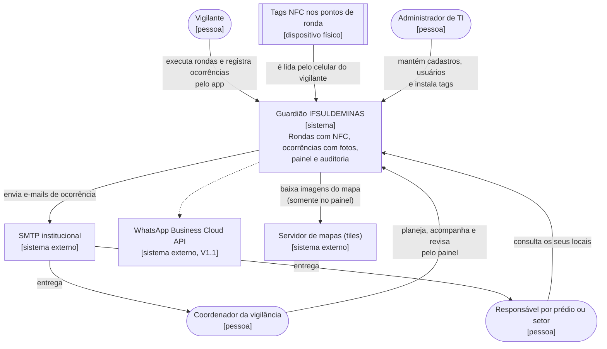
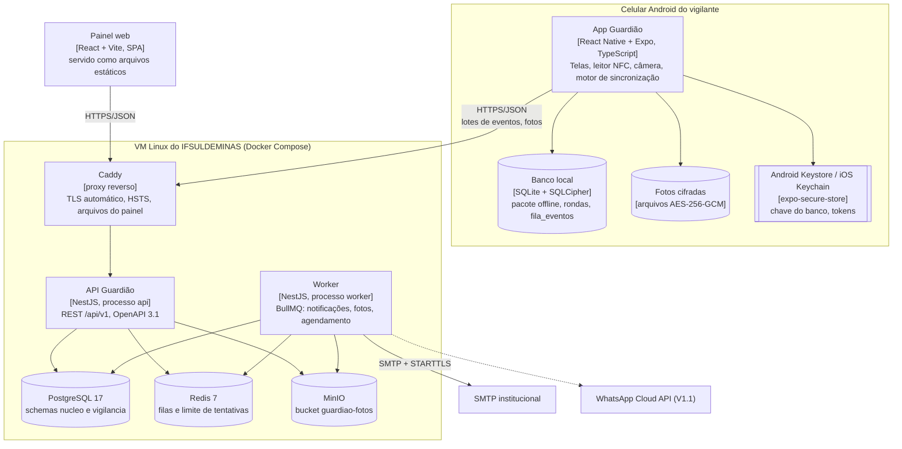
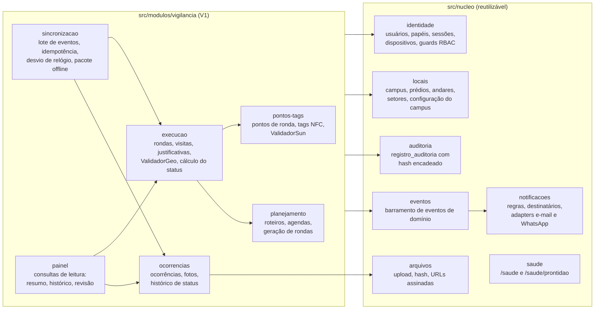
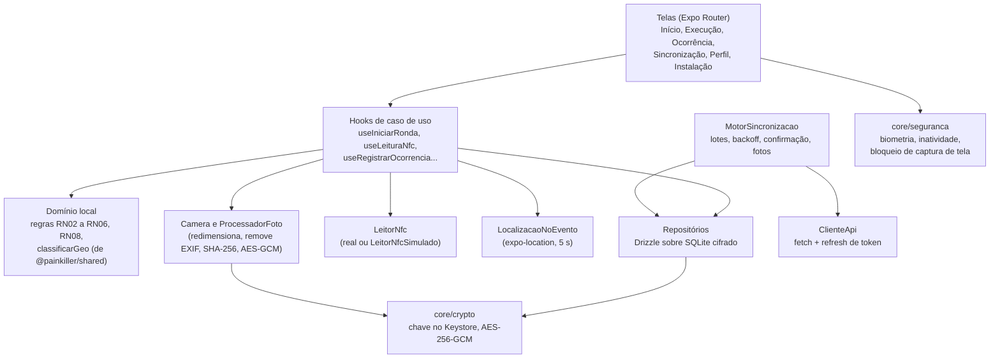
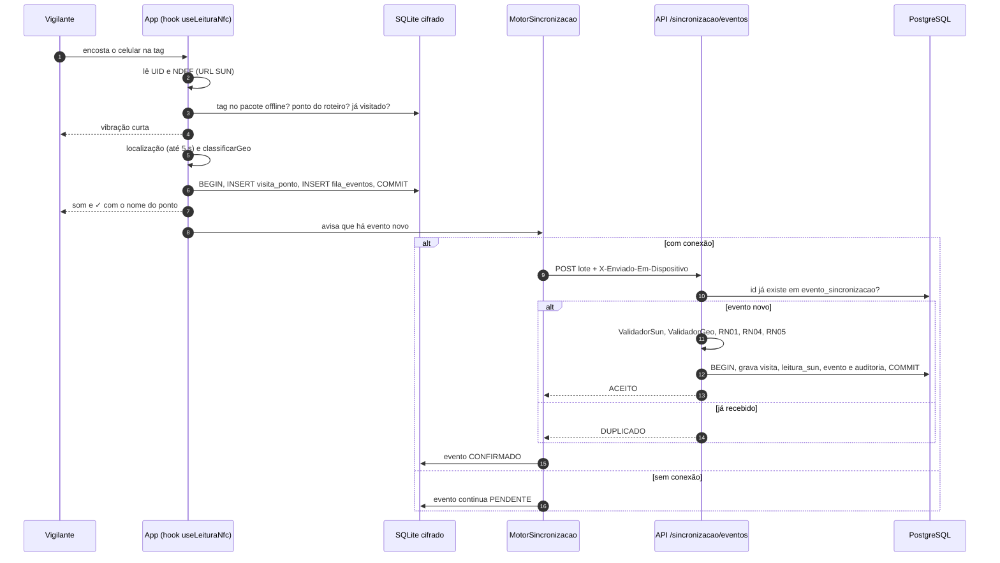
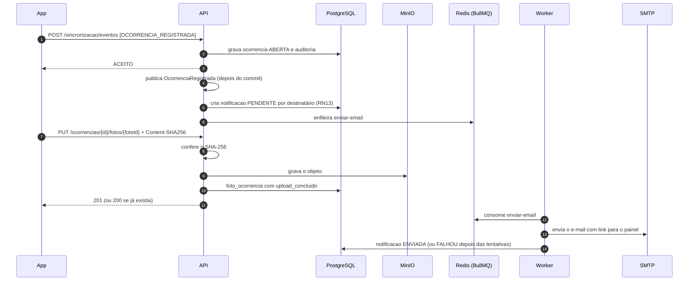
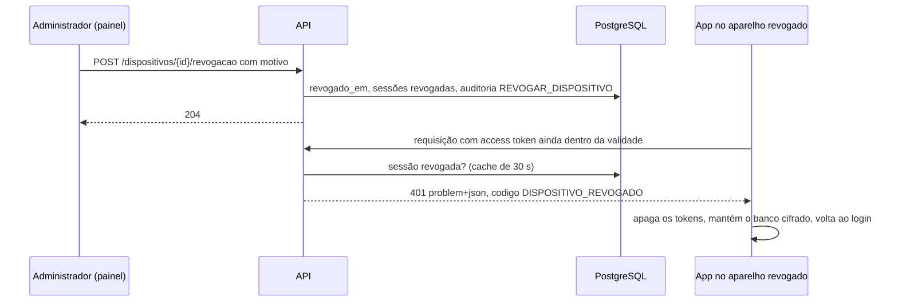

# Arquitetura de software

Parte da [documentação do Guardião](README.md).

Este documento descreve como o Guardião IFSULDEMINAS (codinome PainKiller) é estruturado: os drivers que orientam a arquitetura, o modelo C4 em três níveis, a comunicação entre módulos, as sequências críticas, o caminho de evolução para novos módulos e as decisões que atravessam todo o sistema. As decisões estruturais estão registradas como ADRs em [`adr/`](adr/README.md). A implantação física está em [16-implantacao-e-infraestrutura.md](16-implantacao-e-infraestrutura.md).

## Sumário

1. [Visão geral](#1-visão-geral)
2. [Drivers arquiteturais](#2-drivers-arquiteturais)
3. [Atributos de qualidade priorizados](#3-atributos-de-qualidade-priorizados)
4. [Modelo C4](#4-modelo-c4)
5. [Comunicação entre módulos e eventos de domínio](#5-comunicação-entre-módulos-e-eventos-de-domínio)
6. [Sequências principais](#6-sequências-principais)
7. [Evolução e modularidade (RNF09)](#7-evolução-e-modularidade-rnf09)
8. [Decisões transversais](#8-decisões-transversais)
9. [Stack tecnológica](#9-stack-tecnológica)
10. [Riscos técnicos e mitigação](#10-riscos-técnicos-e-mitigação)
11. [Premissas e pendências](#11-premissas-e-pendências)

---

## 1. Visão geral

O Guardião é formado por três aplicações mantidas num único monorepo ([ADR-0001](adr/0001-monorepo-pnpm-turborepo.md)):

| Aplicação | Pasta | Quem usa | Papel na arquitetura |
|---|---|---|---|
| App Guardião | `apps/mobile` | `VIGILANTE`; `ADMINISTRADOR` no modo instalação de tags | Executa rondas, lê tags NFC, registra justificativas e ocorrências com fotos. Grava tudo primeiro no banco local cifrado e sincroniza com a API (online-first). |
| API e worker | `apps/api` | App e painel | Monólito modular em NestJS. É a fonte de verdade: autentica, autoriza, valida tags (SUN) e localização, aplica as regras de negócio, persiste, audita e publica eventos de domínio. O mesmo código roda como worker de filas (notificações, miniaturas, agendamento). |
| Painel web | `apps/web` | `COORDENADOR`, `RESPONSAVEL`, `ADMINISTRADOR` | SPA para acompanhar rondas, tratar ocorrências, revisar visitas sinalizadas, planejar rondas, manter cadastros e consultar a auditoria. |

Pacotes compartilhados: `@painkiller/shared` (tipos, enums, schemas zod e contratos da API), `@painkiller/design-tokens` (tokens visuais do app e do painel) e `packages/config` (eslint, tsconfig e prettier).

### Princípios arquiteturais

| ID | Princípio | Consequência prática | Referência |
|---|---|---|---|
| P1 | **Caminho único de escrita no app** | Toda ação grava no SQLite cifrado e enfileira um evento na mesma transação. Online e offline executam o mesmo código. | [ADR-0005](adr/0005-online-first-fila-local-outbox.md) |
| P2 | **O servidor é a autoridade** | O app antecipa validações (roteiro, geo, duplicidade) para dar retorno imediato, mas a API refaz todas: CMAC e contador SUN, geo, janela da ronda, permissões. | RN01, RN06, RN07 |
| P3 | **Registros operacionais imutáveis** | Não existe DELETE na API. Cadastros são desativados com motivo. Toda escrita gera `registro_auditoria` com hash encadeado. | RN14, RF18 |
| P4 | **Dois relógios em todo registro** | Horário da ação no aparelho (`*_em_dispositivo`) e horário de recebimento no servidor (`recebido_em_servidor`). Auditoria ordena pelo servidor. | RN15, RNF07 |
| P5 | **Fronteiras de módulo explícitas** | `nucleo/*` é reutilizável e não conhece os módulos de domínio. `vigilancia/*` depende do `nucleo`, nunca o contrário. Módulos futuros seguem a mesma regra. | RNF09, [ADR-0003](adr/0003-api-nestjs-monolito-modular.md) |
| P6 | **Segurança por padrão** | OWASP MASVS L2 no app, privilégio mínimo no banco, segredos fora do repositório, localização só nos eventos. | RNF11, RNF14 |
| P7 | **Operação simples** | Uma VM Linux, Docker Compose e Caddy. Nenhum serviço gerenciado de nuvem é obrigatório. | [16-implantacao-e-infraestrutura.md](16-implantacao-e-infraestrutura.md) |

---

## 2. Drivers arquiteturais

### 2.1 Requisitos que mais moldam a arquitetura

| Requisito | Por que pesa na arquitetura | Resposta arquitetural |
|---|---|---|
| RF05, RF08, RN01 | A passagem pelo ponto precisa ser provada fisicamente, sem marcação manual. | Leitura NFC obrigatória, sem botão de "marcar visitado". Tags NTAG 424 DNA com SUN validadas no servidor ([ADR-0007](adr/0007-tags-nfc-ntag424-dna-sun.md)). |
| RF07, RN06 | A localização deve ser validada, mas o GPS falha dentro de prédios. | `ValidadorGeo` com o mesmo algoritmo no app e no servidor, e política padrão `SINALIZAR` ([ADR-0011](adr/0011-validacao-geografica-sinaliza.md)). |
| RNF01 a RNF07 | Há locais sem sinal (subsolos, áreas externas) e o app pode ser fechado a qualquer momento. | Outbox local cifrado, idempotência por UUIDv7, confirmação explícita do servidor ([ADR-0005](adr/0005-online-first-fila-local-outbox.md), [ADR-0006](adr/0006-armazenamento-local-cifrado.md), [ADR-0008](adr/0008-uuidv7-gerado-no-cliente.md)). |
| RF13, RN12 | Fotos são evidência e dado pessoal. | Captura só pela câmera do app, SHA-256, arquivo cifrado no aparelho, upload idempotente e armazenamento de objetos privado ([ADR-0014](adr/0014-fotos-armazenamento-objetos-minio.md)). |
| RF15, RN13 | Notificações não podem atrasar a resposta da API nem se perder em falhas de SMTP. | Eventos de domínio e fila `notificacoes` processada pelo worker, com novas tentativas ([ADR-0013](adr/0013-filas-jobs-bullmq-redis.md)). |
| RF16, RF17 | O coordenador precisa de visão do dia e histórico filtrável. | Módulo `vigilancia/painel` com consultas agregadas de leitura. O painel atualiza por polling de 30 s (SSE na V1.1). |
| RF18, RN14 | A trilha de auditoria precisa ser confiável. | Tabela append-only com hash encadeado. O usuário de banco da API não tem UPDATE/DELETE nela. |
| RNF09 | Novos módulos (veículos, patrimônio, manutenção) virão depois. | Monólito modular com schemas Postgres por módulo e eventos de domínio ([ADR-0003](adr/0003-api-nestjs-monolito-modular.md), [ADR-0004](adr/0004-postgresql-schemas-por-modulo-prisma.md)). |
| RNF10, RNF08 | O vigilante opera com uma mão, à noite, sob pressão. | Leitura NFC automática, ações primárias grandes e design system com tokens de acessibilidade ([ADR-0009](adr/0009-atomic-design-design-tokens.md)). |
| RNF11 | MASVS L2 para armazenamento, criptografia e autenticação. | SQLCipher, chaves no Keystore/Keychain, sessão vinculada ao dispositivo, revogação remota e biometria ([ADR-0006](adr/0006-armazenamento-local-cifrado.md), [ADR-0012](adr/0012-autenticacao-jwt-refresh-biometria.md)). |
| RNF13 | O contrato precisa ser publicado. | OpenAPI 3.1 gerado a partir dos controllers e dos schemas zod compartilhados; Swagger UI em homologação. |
| RNF14 | LGPD: nada de rastreamento contínuo. | Localização coletada só nos eventos (início e fim de ronda, leitura NFC, justificativa, ocorrência). Não há serviço de localização em segundo plano. |

### 2.2 Restrições

| Restrição | Origem | Efeito |
|---|---|---|
| V1.0 em produção até 13/11/2026 (Release Candidate em 06/11) | Cronograma ([14-backlog-e-roadmap.md](14-backlog-e-roadmap.md)) | Preferência por tecnologias maduras e conhecidas, sem microsserviços. WhatsApp, exportação e SSO ficam na V1.1. |
| Infraestrutura própria (VM Linux do IFSULDEMINAS) | Premissa institucional | Tudo roda em contêineres numa VM. Nada depende de serviço gerenciado de nuvem. |
| Equipe pequena; só o mantenedor faz merge | Processo ([15-fluxo-git-e-contribuicao.md](15-fluxo-git-e-contribuicao.md)) | Um único repositório, um único pipeline e uma única linguagem (TypeScript). |
| App da V1 para Android com NFC | Premissa a confirmar | Prioridade de testes e de distribuição no Android. iOS é suportado tecnicamente, com 1 toque em "Ler ponto". |
| Administração pública e LGPD | Legal | Minimização de dados, trilha de auditoria, dados hospedados na instituição ([11-seguranca-e-lgpd.md](11-seguranca-e-lgpd.md)). |
| Orçamento das tags a definir | Institucional | [ADR-0007](adr/0007-tags-nfc-ntag424-dna-sun.md) está como "Proposta", com alternativa NTAG215 travada. |

As premissas e pendências estão consolidadas na [seção 11](#11-premissas-e-pendências).

---

## 3. Atributos de qualidade priorizados

A ordem abaixo decide os conflitos: quando dois atributos competem, prevalece o de prioridade mais alta.

| Prioridade | Atributo | Por que | Táticas principais |
|---|---|---|---|
| 1 | **Confiabilidade offline** | Uma ronda perdida é uma falha de segurança patrimonial e de prova. | Outbox transacional no aparelho, persistência antes do retorno ao usuário, idempotência por id de evento, confirmação explícita (RN16), backoff com jitter, fila que sobrevive a reinício (RNF03). |
| 2 | **Segurança e integridade** | O sistema produz prova de presença; fraude ou adulteração anulam o seu valor. | SUN com CMAC e contador, validação no servidor, SQLCipher e AES-256-GCM, sessão vinculada ao dispositivo, revogação imediata, auditoria encadeada, privilégio mínimo no banco. |
| 3 | **Simplicidade de uso** | Vigilante em pé, à noite, com uma mão, muitas vezes de luvas ou lanterna. | Regra dos 2 toques (RNF10), leitura NFC automática, retorno háptico e sonoro, tema escuro de alto contraste, uma ação primária por tela. |
| 4 | **Rastreabilidade** | O coordenador precisa reconstruir quem fez o quê, onde e quando. | Dois relógios por registro, `dispositivo_id` e `vigilante_id` em todos os eventos, `evento_sincronizacao` como log, histórico de status da ocorrência, auditoria com antes e depois. |
| 5 | **Evolutividade** | Veículos, patrimônio e manutenção virão depois da V1. | Módulos com API pública, schemas por módulo, eventos de domínio, `nucleo` reutilizável, regras de dependência verificadas no CI. |

Atributos secundários: desempenho (volumes pequenos na V1), disponibilidade do servidor (atenuada pelo online-first: o app opera com o servidor fora do ar), operabilidade (uma VM, poucos componentes) e custo.

### 3.1 Cenários de qualidade

| ID | Atributo | Estímulo e ambiente | Resposta esperada | Medida |
|---|---|---|---|---|
| QA-01 | Confiabilidade offline | O vigilante faz uma ronda de 20 pontos num subsolo sem sinal. No meio da ronda o app é fechado à força e o aparelho reinicia. | Nenhum registro se perde. Ao reabrir, a ronda continua de onde parou. Com sinal, a fila é enviada sem ação do usuário. | 0 perdas e 0 duplicatas em 50 execuções do roteiro E2E de falhas; fila zerada em até 2 min após a reconexão com o app aberto. |
| QA-02 | Confiabilidade offline | A resposta do servidor se perde depois do commit (timeout) e o app reenvia o lote. | Os eventos já aplicados voltam como `DUPLICADO`; o estado no servidor não muda. | 0 registros duplicados (teste de integração com reenvio forçado). |
| QA-03 | Confiabilidade | O servidor fica fora do ar por 2 h durante a madrugada. | O app segue operando normalmente; os eventos ficam `PENDENTE`, com backoff até 15 min. As notificações saem quando o servidor volta e informam o horário original. | Fila drenada em até 15 min após a volta do servidor (ou imediatamente ao abrir o app). |
| QA-04 | Segurança e integridade | Alguém reutiliza a URL SUN de uma leitura antiga ou usa uma tag clonada. | A visita é marcada `REPLAY` ou `INVALIDA`, não conta para a conclusão e o coordenador é alertado. | 100% das reutilizações detectadas nos testes; alerta enfileirado em até 1 min após o recebimento. |
| QA-05 | Segurança | Um aparelho com sessão aberta é perdido. | O administrador revoga o aparelho; as requisições seguintes falham e o refresh é negado. Os dados locais continuam cifrados. | Revogação efetiva em até 1 min, sem esperar o fim do access token; banco copiado do aparelho ilegível sem a chave do Keystore. |
| QA-06 | Integridade | Alguém altera diretamente uma linha de `registro_auditoria` no banco. | A verificação da cadeia de hash aponta o primeiro registro adulterado. | Detecção em 100% dos casos de teste; verificação automática diária. |
| QA-07 | Simplicidade de uso | Na tela Início, o vigilante precisa iniciar a ronda do turno. | Desbloqueio biométrico e 1 toque em INICIAR RONDA. | No máximo 2 toques a partir da tela inicial (RNF10), medido no fluxo Maestro. |
| QA-08 | Simplicidade de uso | O vigilante encosta o celular na tag durante a ronda, à noite. | Retorno háptico imediato; ✓ verde, som e nome do ponto em letra grande depois da gravação local. | 0 toques no Android; ✓ em até 1 s em 95% das leituras com posição recente, limitado a ~5 s pelo timeout de localização. |
| QA-09 | Simplicidade de uso | Um vigilante que nunca usou o app recebe 15 min de treinamento no piloto. | Conclui uma ronda completa sem ajuda. | Pelo menos 90% dos vigilantes do piloto (HU-041). |
| QA-10 | Rastreabilidade | O coordenador investiga uma visita feita há três semanas. | Vê vigilante, aparelho, horário do aparelho e do servidor, resultado geo, validação da tag, revisão e trilha de auditoria. | Informação disponível no detalhe da ronda, a no máximo 3 cliques do histórico. |
| QA-11 | Rastreabilidade | Qualquer criação, alteração ou desativação de cadastro. | `registro_auditoria` com usuário, papel, dispositivo, IP, antes e depois, no horário do servidor. | 100% das rotas de escrita cobertas por teste automatizado de auditoria. |
| QA-12 | Evolutividade | A equipe adiciona o módulo `acesso-veiculos`. | Nenhum arquivo de `vigilancia/` muda; o `nucleo` muda só nos pontos de extensão (permissões, novos tipos de notificação). | Regras de dependência aprovadas no CI; diff do PR sem arquivos em `modulos/vigilancia/`. |
| QA-13 | Evolutividade | A instituição pede um novo canal de notificação. | Um novo adapter em `nucleo/notificacoes`, sem mudar os módulos que publicam eventos. | Mudança restrita a um módulo. |
| QA-14 | Desempenho (secundário) | Um lote de 50 eventos chega após um longo período offline. | O servidor aplica o lote e responde. | p95 de até 2 s por lote; `GET /painel/resumo` com p95 de até 2 s. |

### 3.2 Tensões conhecidas

- **Segurança × simplicidade:** desbloqueio biométrico (1 toque) em vez de senha a cada abertura; política geo `SINALIZAR` em vez de `BLOQUEAR`. A integridade é garantida por SUN e revisão, não por fricção na tela.
- **Rastreabilidade × privacidade:** a localização é coletada apenas nos eventos (RNF14), mesmo que um rastreamento contínuo desse mais contexto.
- **Integridade × custo:** a NTAG 424 DNA custa mais que a NTAG215; por isso a [ADR-0007](adr/0007-tags-nfc-ntag424-dna-sun.md) admite implantação mista.
- **Evolutividade × prazo:** monólito modular em vez de microsserviços; extração futura continua possível porque as fronteiras são explícitas.

---

## 4. Modelo C4

Os diagramas seguem o [modelo C4](https://c4model.com/) em três níveis: contexto, containers e componentes. Foram desenhados com `flowchart` do Mermaid para renderizar em qualquer visualizador de Markdown do GitHub.

### 4.1 Nível 1: contexto



| Elemento | Relação com o Guardião |
|---|---|
| Vigilante | Usa o app Android com NFC. Nunca acessa o painel. |
| Coordenador, Responsável, Administrador | Usam o painel web. O Administrador também usa o app no modo instalação de tags. |
| Tags NFC | NTAG 424 DNA com SUN (preferencial) ou NTAG215 travada (legada). Não armazenam dados pessoais. |
| SMTP institucional | Único canal de notificação obrigatório da V1. |
| WhatsApp Business Cloud API | Adapter pronto e desligado por feature flag até a V1.1. |
| Servidor de mapas | Tiles do OpenStreetMap (ou de um provedor configurável) usados pelo Leaflet no painel. O app não usa mapas. |

### 4.2 Nível 2: containers



| Container | Responsabilidade | Tecnologia | Escala na V1 |
|---|---|---|---|
| App Guardião | Interface do vigilante, leitura NFC, localização no evento, câmera, gravação local e sincronização | React Native + Expo (development build), Expo Router, Drizzle + `expo-sqlite` com SQLCipher, `react-native-nfc-manager` | Um app por aparelho |
| Painel web | Interface de coordenadores, responsáveis e administradores | React + Vite, TanStack Query, Tailwind CSS + shadcn/ui, Leaflet | Arquivos estáticos servidos pelo Caddy |
| Caddy | Terminação TLS, redirecionamento HTTP → HTTPS, HSTS, cabeçalhos de segurança, proxy para a API, entrega do painel | Caddy 2 | 1 instância |
| API | Autenticação, autorização, regras de negócio, persistência, auditoria, publicação de eventos de domínio, URLs assinadas das fotos | Node.js 24 LTS, NestJS, Prisma, zod | 1 contêiner (pode escalar horizontalmente, é *stateless*) |
| Worker | Processa as filas `notificacoes`, `fotos` e `agendamento` | Mesmo código da API, iniciado com `MODO=worker` | 1 contêiner |
| PostgreSQL | Fonte de verdade de todos os dados estruturados | PostgreSQL 17 | 1 instância, backup diário |
| Redis | Filas do BullMQ, contadores de limite de tentativas de login | Redis 7, AOF ligado | 1 instância |
| MinIO | Armazenamento de objetos privado para as fotos, com versionamento | MinIO (API S3) | 1 instância |

### 4.3 Nível 3: componentes da API

A API é um monólito modular ([ADR-0003](adr/0003-api-nestjs-monolito-modular.md)). Cada módulo Nest expõe um **serviço público** (a única porta de entrada para outros módulos) e publica eventos de domínio. Módulos do `nucleo` não importam nada de `modulos/*`.



| Componente | Principais classes | Dados que possui | Publica |
|---|---|---|---|
| `nucleo/identidade` | `AuthController`, `SessaoService`, `DispositivoService`, `PapeisGuard`, `EscopoGuard` | `usuario`, `sessao`, `dispositivo`, `ciencia_aviso_privacidade` | `DispositivoRevogado` |
| `nucleo/locais` | `CampusService`, `PredioService`, `ConfiguracaoCampusService` | `campus`, `configuracao_campus`, `predio`, `andar`, `setor`, `responsavel_local` | — |
| `nucleo/auditoria` | `AuditoriaService`, `InterceptorAuditoria`, `VerificadorCadeia` | `registro_auditoria` | — |
| `nucleo/notificacoes` | `RegraNotificacaoService`, `ProcessadorNotificacoes`, `AdapterEmail`, `AdapterWhatsapp` | `regra_notificacao`, `notificacao` | — |
| `nucleo/arquivos` | `ArmazenamentoObjetos`, `UrlAssinadaService` | metadados vivem no módulo dono (ex.: `foto_ocorrencia`) | — |
| `vigilancia/pontos-tags` | `PontoRondaService`, `TagNfcService`, `ValidadorSun` | `ponto_ronda`, `tag_nfc`, `leitura_sun` | — |
| `vigilancia/planejamento` | `RoteiroService`, `AgendaService`, `GeradorRondas` | `roteiro`, `roteiro_ponto`, `agenda_ronda` | — |
| `vigilancia/execucao` | `RondaService`, `VisitaService`, `ValidadorGeo`, `CalculadoraStatusRonda`, `MarcadorNaoRealizadas` | `ronda`, `ronda_ponto`, `visita_ponto`, `justificativa_ponto` | `RondaIniciada`, `VisitaRegistrada`, `VisitaSinalizada`, `RondaFinalizada`, `RondaNaoRealizada` |
| `vigilancia/ocorrencias` | `OcorrenciaService`, `FotoService`, `TiposOcorrenciaService` | `tipo_ocorrencia`, `ocorrencia`, `foto_ocorrencia`, `historico_status_ocorrencia` | `OcorrenciaRegistrada`, `StatusOcorrenciaAlterado` |
| `vigilancia/sincronizacao` | `SincronizacaoController`, `AplicadorEventos`, `PacoteOfflineService` | `evento_sincronizacao` | — |
| `vigilancia/painel` | `PainelController`, consultas SQL de leitura | nenhum (somente leitura) | — |

### 4.4 Nível 3: componentes do app

Detalhes de pastas e camadas em [08-app-mobile.md](08-app-mobile.md).



A regra principal: **telas não gravam nada direto**. Toda escrita passa por um hook de caso de uso, que chama o repositório numa transação que grava o registro e o evento da fila ([ADR-0005](adr/0005-online-first-fila-local-outbox.md)). O motor de sincronização é o único componente que fala com a API para enviar dados.

---

## 5. Comunicação entre módulos e eventos de domínio

### 5.1 Regras de dependência

| Regra | Verificação |
|---|---|
| `nucleo/*` não importa `modulos/*` | `dependency-cruiser` no CI |
| Um módulo de domínio não importa outro módulo de domínio (ex.: o futuro `acesso-veiculos` não importa `vigilancia`) | `dependency-cruiser` no CI |
| Dentro de um módulo, outros módulos só usam o serviço exportado no `index.ts` do módulo | Regra de lint `no-restricted-imports` |
| Nenhum módulo lê tabelas de outro módulo por SQL próprio; usa o serviço público | Revisão de PR (o usuário de banco é único, então a regra é de código) |
| O app e o painel só conhecem a API pelos contratos de `@painkiller/shared` | Typecheck |

### 5.2 Eventos de domínio

Os eventos são publicados **depois do commit** da transação que os origina, pelo barramento `nucleo/eventos` (implementado sobre `@nestjs/event-emitter`). Assinantes que fazem trabalho lento (e-mail, miniaturas) apenas enfileiram um job no BullMQ, para não segurar a resposta da API. Eventos de domínio são internos à API e **não se confundem** com os eventos de sincronização enviados pelo app (`TipoEvento`).

| Evento de domínio | Publicado por | Quando | Assinantes na V1 | Uso futuro previsto |
|---|---|---|---|---|
| `RondaIniciada` | execucao | `RONDA_INICIADA` aceito | painel (invalida o cache do resumo) | — |
| `VisitaRegistrada` | execucao | `PONTO_VISITADO` aceito | painel | Patrimônio (conferência de local) |
| `VisitaSinalizada` | execucao | visita com `status_revisao = PENDENTE` | painel (contador de alertas) | Notificação opcional ao coordenador |
| `RondaFinalizada` | execucao | `RONDA_FINALIZADA` aceito e status calculado | painel | Relatórios |
| `RondaNaoRealizada` | execucao (job) | job marca `NAO_REALIZADA` | painel | Notificação ao coordenador (V1.1) |
| `OcorrenciaRegistrada` | ocorrencias | `OCORRENCIA_REGISTRADA` aceito | notificacoes (RN13), painel | **Manutenção (V4)**: abrir ordem de serviço |
| `StatusOcorrenciaAlterado` | ocorrencias | mudança de status pelo coordenador | painel | Manutenção |
| `DispositivoRevogado` | identidade | revogação pelo administrador | identidade (invalida sessões em cache) | — |

O envio de um evento de domínio nunca é a única cópia da informação: o dado já está gravado no banco. Se o processo cair entre o commit e a publicação, o job `reconciliar-notificacoes` (a cada 5 minutos) cria as notificações que faltarem para ocorrências recebidas sem `notificacao` correspondente.

```ts
// Ilustrativo: envelope de evento de domínio
interface EventoDominio<T> {
  id: string;            // UUIDv7
  tipo: string;          // ex.: 'OcorrenciaRegistrada'
  ocorridoEm: Date;      // horário do servidor
  campusId: string;
  autorId: string | null;
  dados: T;
}
```

### 5.3 Filas do worker

| Fila | Jobs | Tentativas | Observação |
|---|---|---|---|
| `notificacoes` | `enviar-email`, `enviar-whatsapp` | 8, backoff exponencial a partir de 30 s | Um job por linha de `notificacao`. Ao esgotar, `status = FALHOU` com `ultimo_erro` |
| `fotos` | `gerar-miniatura` | 5 | Miniatura de 320 px para as listas do painel, guardada no MinIO ao lado do original |
| `agendamento` | `gerar-rondas` (00:05 e 12:05), `marcar-nao-realizadas` (a cada 5 min), `reconciliar-notificacoes` (a cada 5 min), `verificar-cadeia-auditoria` (03:30) | 3 | Jobs repetíveis do BullMQ, idempotentes, no fuso America/Sao_Paulo |

---

## 6. Sequências principais

### 6.1 Leitura de tag e sincronização



### 6.2 Ocorrência com foto e notificação



### 6.3 Revogação de aparelho



O access token é conferido contra a tabela de sessões em toda requisição (com cache de 30 s no processo), por isso a revogação vale em até 1 minuto, sem esperar os 15 minutos do token (QA-05).

---

## 7. Evolução e modularidade (RNF09)

### 7.1 Como um novo módulo entra

O exemplo é o módulo **Controle de Acesso de Veículos** (V2).

| Passo | O que muda | O que não muda |
|---|---|---|
| 1. Schema | Novo schema `acesso_veiculos` no PostgreSQL, com migrations no mesmo projeto Prisma (`multiSchema`) | Schemas `nucleo` e `vigilancia` |
| 2. Módulo da API | Nova pasta `src/modulos/acesso-veiculos`, importando apenas serviços públicos do `nucleo` | `src/modulos/vigilancia` |
| 3. Permissões | Novos papéis (ex.: `PORTEIRO`) registrados no catálogo de papéis do `nucleo/identidade` | Guards existentes |
| 4. Notificações | Novos tipos de regra no `nucleo/notificacoes`, se necessário | Adapters de e-mail e WhatsApp |
| 5. App | Nova área de rotas `app/(veiculos)` e feature `src/features/veiculos`, reaproveitando design system, motor de sincronização e cliente da API | Telas da vigilância |
| 6. Painel | Novas rotas `/veiculos/*` e itens de menu por papel | Telas da vigilância |
| 7. Sincronização | Novos valores de `TipoEvento` tratados por um aplicador registrado pelo módulo novo | Aplicadores da vigilância |

O módulo de sincronização da API usa um **registro de aplicadores**: cada módulo registra os tipos de evento que sabe aplicar. Assim, `sincronizacao` não precisa conhecer os módulos futuros.

### 7.2 Quando extrair um serviço

O monólito modular atende à V1 e à V2 previstas. A extração de um módulo para um serviço separado só deve ser considerada diante de pelo menos um destes sinais, e deve virar um ADR:

- volume de escrita do módulo de veículos (picos de entrada e saída) degradando o p95 da vigilância mesmo com mais réplicas da API;
- necessidade de implantação independente (por exemplo, integração com cancelas exigindo outro ciclo de release);
- equipe dedicada ao módulo, com cadência diferente.

---

## 8. Decisões transversais

| Tema | Decisão | Detalhes |
|---|---|---|
| Identificadores | UUIDv7 em todas as tabelas, gerado no app para registros criados nele e no servidor para os demais | [ADR-0008](adr/0008-uuidv7-gerado-no-cliente.md) |
| Datas e fuso | `timestamptz` em UTC no banco, ISO 8601 com `Z` na API, exibição em America/Sao_Paulo | RN15, [07-api.md](07-api.md) |
| Erros | `application/problem+json` (RFC 9457) com `codigo` estável (ex.: `RONDA_FORA_DA_JANELA`) | [07-api.md](07-api.md) |
| Validação | Schemas zod em `@painkiller/shared`, usados no painel, no app e na API (via `nestjs-zod`), que também geram o OpenAPI | RNF13 |
| Autorização | Sempre na API: guard de papel e guard de escopo (campus; para `RESPONSAVEL`, prédios e setores) | [11-seguranca-e-lgpd.md](11-seguranca-e-lgpd.md) |
| Auditoria | Interceptor grava `registro_auditoria` na mesma transação da escrita; o hash é calculado no banco por função `SECURITY DEFINER` | [05-modelo-de-dados.md](05-modelo-de-dados.md) |
| Exclusões | Não há rota `DELETE`; as permissões de banco impedem `DELETE` em tabelas operacionais | RN14 |
| Logs | JSON estruturado (pino), com `requestId`, sem senha, token, payload SUN completo, coordenadas ou nomes | [11-seguranca-e-lgpd.md](11-seguranca-e-lgpd.md) |
| Configuração | Variáveis de ambiente validadas por zod na inicialização; segredos nunca no repositório | [16-implantacao-e-infraestrutura.md](16-implantacao-e-infraestrutura.md) |
| Feature flags | Colunas em `configuracao_campus` para flags por campus (ex.: `whatsapp_habilitado`) e variáveis de ambiente para flags globais | — |
| Versionamento da API | Prefixo `/api/v1`. Mudança incompatível exige `/api/v2` ou campo opcional novo. O app informa a versão no login e a API pode exigir versão mínima (`426 Upgrade Required`) | [07-api.md](07-api.md) |
| Idioma | Somente pt-BR na V1; textos da interface centralizados para facilitar revisão | — |

---

## 9. Stack tecnológica

| Camada | Escolha | Referência | Por que | ADR |
|---|---|---|---|---|
| Linguagem | TypeScript em tudo | 5.x | Um só idioma para app, API e painel; tipos compartilhados | [ADR-0001](adr/0001-monorepo-pnpm-turborepo.md) |
| Monorepo | pnpm workspaces + Turborepo | — | Cache de tarefas, um lockfile | [ADR-0001](adr/0001-monorepo-pnpm-turborepo.md) |
| App | React Native + Expo (development build), Expo Router | SDK estável no início da Sprint 0, fixado até a V1 | NFC exige módulo nativo; builds com EAS | [ADR-0002](adr/0002-app-react-native-expo-development-build.md) |
| Banco local | `expo-sqlite` com SQLCipher + Drizzle ORM | — | Banco inteiro cifrado, migrações tipadas | [ADR-0006](adr/0006-armazenamento-local-cifrado.md) |
| NFC | `react-native-nfc-manager` | — | Leitura de NDEF e de tags ISO 14443-4 (NTAG 424 DNA) | [ADR-0007](adr/0007-tags-nfc-ntag424-dna-sun.md) |
| API | NestJS (monólito modular), Prisma, zod | Node.js 24 LTS | Módulos, injeção de dependências, ecossistema maduro | [ADR-0003](adr/0003-api-nestjs-monolito-modular.md) |
| Banco | PostgreSQL com schemas por módulo | 17 | Robusto, gratuito, permissões finas por tabela | [ADR-0004](adr/0004-postgresql-schemas-por-modulo-prisma.md) |
| Filas | BullMQ + Redis | Redis 7 | Jobs repetíveis, tentativas e backoff | [ADR-0013](adr/0013-filas-jobs-bullmq-redis.md) |
| Fotos | MinIO (API S3) | — | Objetos privados, versionamento, roda na VM | [ADR-0014](adr/0014-fotos-armazenamento-objetos-minio.md) |
| Painel | React + Vite, TanStack Query, React Router, Tailwind CSS + shadcn/ui, Leaflet | — | SPA simples, servida como arquivos estáticos | [ADR-0010](adr/0010-painel-web-react-vite-spa.md) |
| Design system | Atomic Design + `@painkiller/design-tokens`, Storybook | — | Consistência e acessibilidade entre app e painel | [ADR-0009](adr/0009-atomic-design-design-tokens.md) |
| Autenticação | JWT de acesso (15 min) + refresh rotativo (30 dias) + biometria local | — | Funciona offline depois do primeiro login | [ADR-0012](adr/0012-autenticacao-jwt-refresh-biometria.md) |
| Testes | Jest, Supertest, Testcontainers, React Native Testing Library, Vitest, Playwright, Maestro | — | Ver [12-estrategia-de-testes.md](12-estrategia-de-testes.md) | — |
| Infraestrutura | Docker Compose, Caddy, GitHub Actions, EAS Build, Uptime Kuma | — | Uma VM, operação simples | [16-implantacao-e-infraestrutura.md](16-implantacao-e-infraestrutura.md) |

As versões exatas ficam fixadas nos `package.json` e no `pnpm-lock.yaml`. Atualizações de versão maior entram por PR `chore/` com o CI verde.

---

## 10. Riscos técnicos e mitigação

| ID | Risco | Prob. | Impacto | Mitigação | Sinal de alerta |
|---|---|---|---|---|---|
| RT01 | Perda ou duplicação de eventos na sincronização | Média | Alto | Outbox transacional, UUIDv7 do cliente, `evento_sincronizacao` com chave primária no id, testes de reenvio e de queda de rede, conciliação no piloto | Divergência entre `fila_eventos` e `evento_sincronizacao` |
| RT02 | Leitura NFC instável em alguns aparelhos ou com capas metálicas | Média | Alto | Homologar aparelhos de referência; mensagem "segure por 1 segundo"; `LeitorNfcSimulado` no desenvolvimento | Falha de leitura acima de 5% no piloto |
| RT03 | Provisionamento das tags NTAG 424 DNA (chaves, SUN) mais trabalhoso que o previsto | Média | Médio | Spike na Sprint 1; script de provisionamento em `infra/scripts`; plano B com NTAG215 travada | Spike sem tag funcional até 16/10 |
| RT04 | GPS impreciso dentro de prédios | Alta | Médio | Política `SINALIZAR`, `INDETERMINADO` em vez de reprovar, raios calibráveis | Mais de 20% de visitas sinalizadas |
| RT05 | Sistema operacional encerrando a sincronização em segundo plano | Alta | Baixo | Envio imediato com o app aberto, gatilho ao voltar ao primeiro plano, timer de 60 s; segundo plano é melhor esforço | Pendências antigas na tela de sincronização |
| RT06 | Desempenho do SQLCipher em aparelhos modestos | Baixa | Médio | Índices locais, consultas pequenas, teste em aparelho de entrada | Retorno da leitura acima de 1 s |
| RT07 | Perda da chave do banco local (ex.: troca de biometria em alguns fabricantes) | Baixa | Alto | Chave guardada sem exigir autenticação biométrica a cada uso (a biometria protege a sessão, não a chave); teste de troca de digital; procedimento documentado | Relatos de banco ilegível |
| RT08 | Contenção na cadeia de hash da auditoria com escrita concorrente | Média | Médio | Hash calculado no banco sob `pg_advisory_xact_lock`; teste com 50 escritas simultâneas (HU-037) | Latência alta nas escritas |
| RT09 | SMTP institucional bloqueando ou atrasando e-mails | Média | Médio | Fila com tentativas, status visível, SPF/DKIM pela TI, Mailpit em desenvolvimento | `notificacao.status = FALHOU` recorrente |
| RT10 | Ponto único de falha (uma VM) | Média | Médio | Online-first absorve a indisponibilidade; backup diário com cópia externa e restauração testada; tempo de recuperação alvo de 4 h | Alerta do Uptime Kuma |
| RT11 | Mudanças no Expo/React Native durante o projeto | Média | Baixo | SDK fixado na Sprint 0; atualização só depois da V1 | Quebra de build no EAS |

---

## 11. Premissas e pendências

| # | Item | Tipo | Impacto | Responsável |
|---|---|---|---|---|
| AP01 | Aparelhos Android com NFC (modelos a homologar) | Premissa | App, testes | PO |
| AP02 | VM Linux com Docker, 4 vCPU, 8 GB de RAM e 200 GB de disco (estimativa para a V1) | Premissa | Implantação | TI do campus |
| AP03 | Domínio institucional e acesso ao SMTP | Premissa | Produção, notificações | TI do campus |
| AP04 | Orçamento das tags NTAG 424 DNA ([ADR-0007](adr/0007-tags-nfc-ntag424-dna-sun.md) em "Proposta") | Pendência | Força da prova de presença | PO |
| AP05 | Guarda das chaves SUN: na V1, arquivo de segredos com permissão restrita na VM; avaliar cofre institucional depois | Pendência | Segurança | Mantenedor e TI |
| AP06 | Servidor de tiles do mapa: o OpenStreetMap público tem política de uso; avaliar provedor institucional ou cache próprio se o volume crescer | Pendência | Painel | Mantenedor |
| AP07 | Tratamento de eventos pendentes de aparelho revogado (PE03 em [Requisitos](02-requisitos.md#decisões-e-pendências)) | Pendência | Sincronização | TI e equipe |
