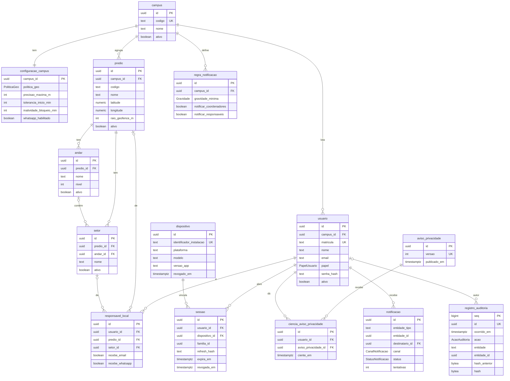
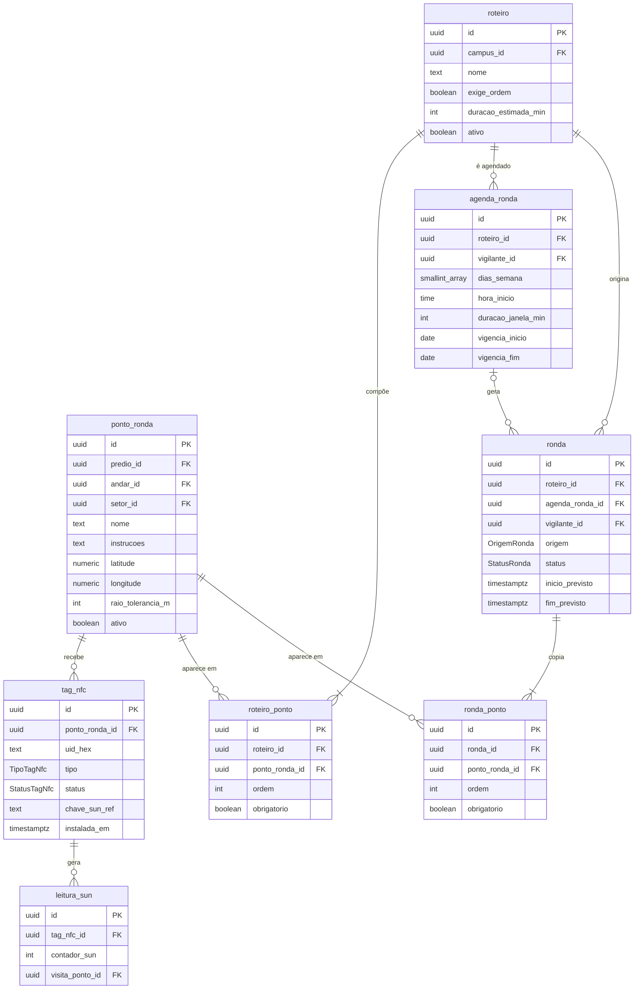
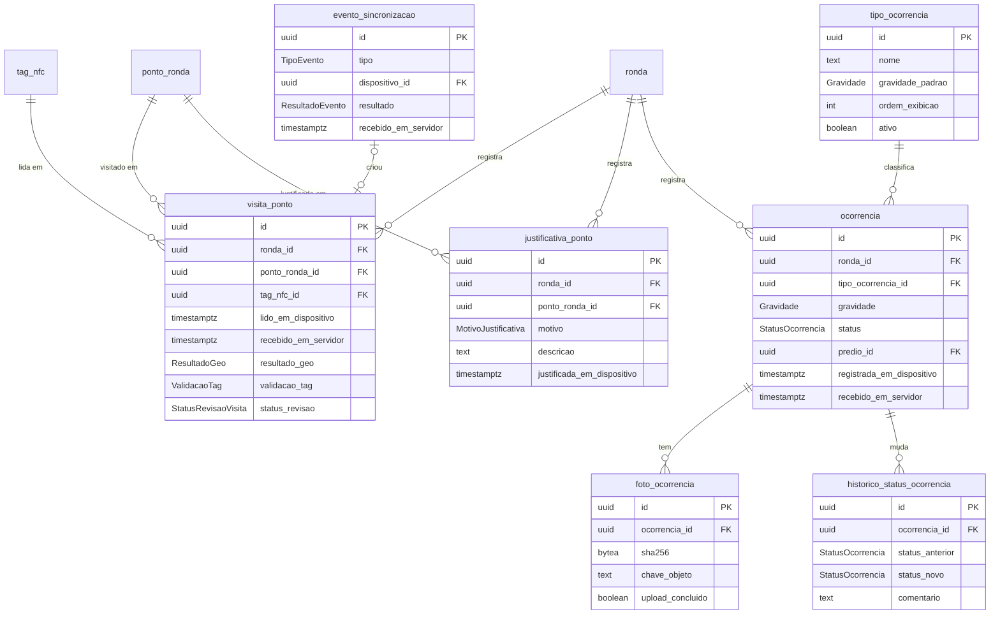
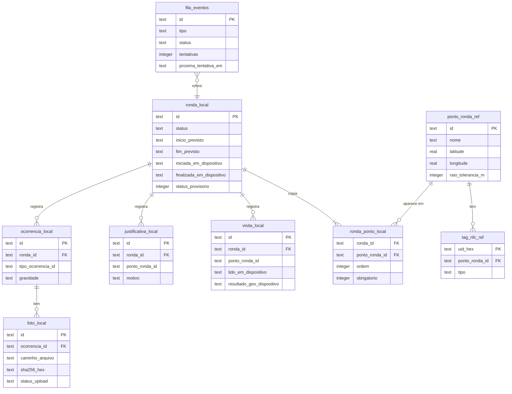

# Modelo de dados

Parte da [documentação do Guardião](README.md).

Este documento descreve os dados do Guardião IFSULDEMINAS: os schemas do PostgreSQL (`nucleo` e `vigilancia`), o dicionário de dados, os enums, os índices e restrições que garantem as regras de negócio, as permissões de banco, a trilha de auditoria com hash encadeado, o banco local do app e a política de retenção. A escolha de PostgreSQL com schemas por módulo e Prisma está no [ADR-0004](adr/0004-postgresql-schemas-por-modulo-prisma.md).

## Sumário

1. [Convenções](#1-convenções)
2. [Visão geral](#2-visão-geral)
3. [Schema `nucleo`](#3-schema-nucleo)
4. [Schema `vigilancia`](#4-schema-vigilancia)
5. [Enums](#5-enums)
6. [Restrições que implementam regras de negócio](#6-restrições-que-implementam-regras-de-negócio)
7. [Trilha de auditoria](#7-trilha-de-auditoria)
8. [Permissões de banco](#8-permissões-de-banco)
9. [Banco local do app](#9-banco-local-do-app)
10. [Pacote offline](#10-pacote-offline)
11. [Retenção e minimização](#11-retenção-e-minimização)
12. [Migrations e seeds](#12-migrations-e-seeds)
13. [Decisões de modelagem](#13-decisões-de-modelagem)

---

## 1. Convenções

| Item | Convenção | Exemplo |
|---|---|---|
| Nomes | `snake_case`, em português, sem acentos, no singular | `visita_ponto`, `raio_tolerancia_m` |
| Chave primária | `id uuid`, UUIDv7 ([ADR-0008](adr/0008-uuidv7-gerado-no-cliente.md)) | `0192f0c1-7b3e-7a10-9d0e-3f1c2a4b5c6d` |
| Chave estrangeira | `<entidade>_id` | `ronda_id`, `vigilante_id` (aponta para `nucleo.usuario`) |
| Datas e horas | `timestamptz` em UTC | `recebido_em_servidor` |
| Horário do aparelho | sufixo `_em_dispositivo` | `lido_em_dispositivo` |
| Horário do servidor | sufixo `_em_servidor` ou `_em` em registros criados só no servidor | `recebido_em_servidor`, `revisado_em` |
| Unidades | sufixo com a unidade | `_m` (metros), `_min` (minutos), `_ms` (milissegundos) |
| Coordenadas | `latitude` e `longitude` em `numeric(9,6)` (cerca de 10 cm de resolução), WGS 84 | `-21.785412` |
| Booleanos | afirmação no presente | `ativo`, `obrigatorio`, `exige_ordem` |
| Desativação lógica | `ativo boolean`, `desativado_em`, `desativado_por_id`, `motivo_desativacao` | todos os cadastros |
| Colunas de controle | `criado_em`, `atualizado_em` (servidor) em todas as tabelas | — |
| Enums | tipos `enum` do PostgreSQL com valores em `MAIUSCULAS_SEM_ACENTO`, iguais aos de `@painkiller/shared` | `EM_ANDAMENTO` |

Nenhuma tabela usa `ON DELETE CASCADE`: não há exclusão física de registros operacionais (RN14).

## 2. Visão geral

```mermaid
flowchart LR
    subgraph nucleo["Schema nucleo (compartilhado)"]
        direction TB
        n1["campus e configuracao_campus"]
        n2["predio, andar, setor"]
        n3["usuario, sessao, dispositivo"]
        n4["responsavel_local"]
        n5["regra_notificacao, notificacao"]
        n6["registro_auditoria"]
        n7["aviso_privacidade, ciencia_aviso_privacidade"]
    end
    subgraph vig["Schema vigilancia (módulo V1)"]
        direction TB
        v1["ponto_ronda, tag_nfc, leitura_sun"]
        v2["roteiro, roteiro_ponto, agenda_ronda"]
        v3["ronda, ronda_ponto"]
        v4["visita_ponto, justificativa_ponto"]
        v5["tipo_ocorrencia, ocorrencia,<br/>foto_ocorrencia, historico_status_ocorrencia"]
        v6["evento_sincronizacao"]
    end
    vig -- "referencia" --> nucleo
```



O schema `vigilancia` referencia tabelas do `nucleo` (campus, prédios, usuários, dispositivos). O contrário nunca acontece: `nucleo.notificacao` aponta para a entidade de origem de forma genérica (`entidade_tipo`, `entidade_id`), sem chave estrangeira para outro schema.

Volume estimado para a V1 num campus (ordem de grandeza, a confirmar no levantamento com a Coordenação): algumas dezenas de prédios, de 100 a 300 pontos de ronda, de 20 a 60 rondas por dia, menos de 5 mil visitas por dia e algumas dezenas de ocorrências por semana. Esses volumes cabem com folga numa instância única de PostgreSQL.

---

## 3. Schema `nucleo`

### 3.1 Diagrama



### 3.2 Dicionário de dados

Colunas de controle (`criado_em`, `atualizado_em`) e de desativação lógica (`ativo`, `desativado_em`, `desativado_por_id`, `motivo_desativacao`) existem em todos os cadastros e não são repetidas abaixo.

#### `campus`

| Coluna | Tipo | Nulo | Descrição |
|---|---|---|---|
| `id` | uuid | não | Identificador |
| `codigo` | text | não | Sigla única (ex.: `MCH` para um campus fictício). Única |
| `nome` | text | não | Nome do campus |
| `fuso_horario` | text | não | Fuso IANA para exibição e agendamento. Padrão `America/Sao_Paulo` |

#### `configuracao_campus`

Uma linha por campus, criada junto com o campus (HU-009).

| Coluna | Tipo | Padrão | Descrição |
|---|---|---|---|
| `campus_id` | uuid PK, FK | — | Campus |
| `politica_geo` | `PoliticaGeo` | `SINALIZAR` | Efeito de leitura fora da área (RN06, [ADR-0011](adr/0011-validacao-geografica-sinaliza.md)) |
| `precisao_maxima_m` | int | 100 | Precisão pior que esta gera `INDETERMINADO` |
| `tolerancia_inicio_min` | int | 30 | Antecedência permitida para iniciar a ronda (RN02) |
| `inatividade_bloqueio_min` | int | 10 | Bloqueio do app por inatividade (RN18) |
| `limite_desvio_relogio_min` | int | 5 | Desvio a partir do qual o registro é sinalizado (RN15) |
| `whatsapp_habilitado` | boolean | false | Feature flag do canal WhatsApp (V1.1) |

#### `predio`, `andar`, `setor`

| Tabela | Coluna | Tipo | Descrição |
|---|---|---|---|
| `predio` | `campus_id` | uuid FK | Campus |
| | `codigo` | text | Código curto, único no campus |
| | `nome` | text | Nome exibido |
| | `latitude`, `longitude` | numeric(9,6) | Centro de referência do prédio |
| | `raio_geofence_m` | int, > 0 | Raio da área do prédio. Sugerido como raio inicial dos pontos |
| `andar` | `predio_id` | uuid FK | Prédio |
| | `nome` | text | Ex.: "Térreo", "1º andar" |
| | `nivel` | int | Ordenação (térreo = 0, subsolo = −1) |
| `setor` | `predio_id` | uuid FK | Prédio |
| | `andar_id` | uuid FK, nulo | Andar, quando o setor fica num andar só. Deve ser do mesmo prédio (trigger) |
| | `nome` | text | Ex.: "Laboratório de Química" |

#### `usuario`

| Coluna | Tipo | Nulo | Descrição |
|---|---|---|---|
| `campus_id` | uuid FK | não | Campus de lotação, que define o escopo de acesso |
| `matricula` | text | não | Login. Única no sistema |
| `nome` | text | não | Nome completo |
| `email` | citext | não | E-mail institucional, destino das notificações |
| `telefone_whatsapp` | text | sim | Formato E.164. Usado na V1.1 |
| `papel` | `PapelUsuario` | não | Um papel por usuário na V1 |
| `senha_hash` | text | não | Hash argon2id. Nunca sai da API |
| `senha_definida_em` | timestamptz | não | Para forçar troca depois de redefinição |
| `deve_trocar_senha` | boolean | não | Verdadeiro depois de cadastro ou redefinição pelo administrador |
| `ultimo_login_em` | timestamptz | sim | Último login bem-sucedido |

#### `dispositivo` e `sessao`

| Tabela | Coluna | Tipo | Descrição |
|---|---|---|---|
| `dispositivo` | `identificador_instalacao` | text | Id gerado pelo app na primeira execução e guardado no armazenamento seguro. Único |
| | `plataforma` | text | `android` ou `ios` |
| | `modelo`, `versao_so`, `versao_app` | text | Informados a cada login |
| | `ultimo_usuario_id` | uuid FK | Último usuário que entrou no aparelho |
| | `ultimo_acesso_em` | timestamptz | Última requisição autenticada |
| | `revogado_em`, `revogado_por_id`, `motivo_revogacao` | — | Revogação remota (RNF11) |
| `sessao` | `usuario_id` | uuid FK | Dono da sessão |
| | `dispositivo_id` | uuid FK, nulo | Aparelho (nulo para sessões do painel) |
| | `familia_id` | uuid | Família de refresh tokens. Reuso revoga a família inteira |
| | `refresh_hash` | text | SHA-256 do refresh token atual. O token em si nunca é guardado |
| | `user_agent`, `ip` | text, inet | Origem da sessão |
| | `expira_em` | timestamptz | Validade do refresh (30 dias) |
| | `revogada_em`, `motivo_revogacao` | — | `LOGOUT`, `REUSO_DETECTADO`, `DISPOSITIVO_REVOGADO`, `USUARIO_DESATIVADO` |

#### `responsavel_local`

| Coluna | Tipo | Descrição |
|---|---|---|
| `usuario_id` | uuid FK | Usuário com papel `RESPONSAVEL` |
| `predio_id` | uuid FK, nulo | Prédio sob responsabilidade |
| `setor_id` | uuid FK, nulo | Setor sob responsabilidade |
| `recebe_email` | boolean | Recebe e-mail de ocorrências do local |
| `recebe_whatsapp` | boolean | Recebe WhatsApp de ocorrências `CRITICA` (V1.1) |

Restrição: `CHECK (predio_id IS NOT NULL OR setor_id IS NOT NULL)` (CA19.7). Um responsável por prédio responde por todos os setores do prédio.

#### `regra_notificacao` e `notificacao`

| Tabela | Coluna | Tipo | Descrição |
|---|---|---|---|
| `regra_notificacao` | `campus_id` | uuid FK, único | Uma regra por campus na V1 |
| | `gravidade_minima` | `Gravidade` | Padrão `ALTA` (RN13) |
| | `notificar_coordenadores` | boolean | Padrão verdadeiro |
| | `notificar_responsaveis` | boolean | Padrão verdadeiro |
| | `whatsapp_somente_critica` | boolean | Padrão verdadeiro (V1.1) |
| `notificacao` | `entidade_tipo`, `entidade_id` | text, uuid | Origem (na V1, sempre `ocorrencia`) |
| | `destinatario_id` | uuid FK | Usuário notificado |
| | `canal` | `CanalNotificacao` | `EMAIL` ou `WHATSAPP` |
| | `endereco` | text | E-mail ou telefone usado no envio (cópia do momento) |
| | `status` | `StatusNotificacao` | `PENDENTE`, `ENVIADA`, `FALHOU` |
| | `tentativas` | int | Contador de tentativas |
| | `ultimo_erro` | text, nulo | Mensagem resumida do último erro (sem dados pessoais) |
| | `enviada_em` | timestamptz, nulo | Horário do envio aceito pelo provedor |

Restrição: `UNIQUE(entidade_tipo, entidade_id, destinatario_id, canal)`, que impede notificação repetida para o mesmo destinatário (CA15.6).

#### `aviso_privacidade` e `ciencia_aviso_privacidade`

| Tabela | Coluna | Tipo | Descrição |
|---|---|---|---|
| `aviso_privacidade` | `versao` | int, único | Versão sequencial do texto |
| | `texto_markdown` | text | Texto exibido no app e no painel |
| | `publicado_em` | timestamptz | A partir de quando vale |
| `ciencia_aviso_privacidade` | `usuario_id`, `aviso_privacidade_id` | uuid FK | Quem deu ciência de qual versão. `UNIQUE(usuario_id, aviso_privacidade_id)` |
| | `ciente_em` | timestamptz | Horário do servidor |
| | `dispositivo_id` | uuid FK, nulo | Aparelho onde a ciência foi dada |

Essa tabela resolve a pendência "onde fica registrada a ciência do aviso" de [HU-044](14-backlog-e-roadmap.md#hu-044).

#### `registro_auditoria`

Detalhada na [seção 7](#7-trilha-de-auditoria).

---

## 4. Schema `vigilancia`

### 4.1 Diagrama: cadastros e planejamento



### 4.2 Diagrama: execução e ocorrências



### 4.3 Dicionário de dados

#### `ponto_ronda`

| Coluna | Tipo | Nulo | Descrição |
|---|---|---|---|
| `predio_id` | uuid FK | não | Prédio do ponto |
| `andar_id` | uuid FK | sim | Andar (do mesmo prédio) |
| `setor_id` | uuid FK | sim | Setor (do mesmo prédio) |
| `nome` | text | não | Nome curto exibido em letra grande no app (ex.: "Corredor norte") |
| `descricao` | text | sim | Descrição do local |
| `instrucoes` | text | sim | O que verificar no ponto (CA04.4) |
| `latitude`, `longitude` | numeric(9,6) | sim | Referência própria. Nulas: usa a do prédio (RN06) |
| `raio_tolerancia_m` | int, > 0 | não | Raio da validação geográfica |

#### `tag_nfc`

| Coluna | Tipo | Nulo | Descrição |
|---|---|---|---|
| `ponto_ronda_id` | uuid FK | não | Ponto onde a tag está instalada |
| `uid_hex` | text | não | UID de fábrica em hexadecimal maiúsculo (7 bytes) |
| `tipo` | `TipoTagNfc` | não | `NTAG424_DNA` ou `NTAG215_LEGADA` |
| `status` | `StatusTagNfc` | não | `ATIVA`, `INATIVA`, `SUBSTITUIDA`, `EXTRAVIADA` |
| `chave_sun_ref` | text | sim | Referência à chave SUN no arquivo de segredos (ex.: `sun/2026/lote-01/0042`). **A chave nunca fica no banco** (CA19.6). Obrigatória para `NTAG424_DNA` |
| `instalada_em` | timestamptz | não | Vínculo pelo modo instalação |
| `instalada_por_id` | uuid FK | não | Administrador que vinculou |
| `desativada_em`, `motivo_desativacao` | — | sim | Substituição, extravio ou inativação |

#### `leitura_sun`

Registra **cada contador SUN aceito** por tag, para detectar replay (RN07).

| Coluna | Tipo | Descrição |
|---|---|---|
| `tag_nfc_id` | uuid FK | Tag lida |
| `contador_sun` | int | Contador de leitura (24 bits na NTAG 424 DNA) |
| `visita_ponto_id` | uuid FK, nulo | Visita que usou o contador (nulo para a leitura de teste do modo instalação) |
| `recebida_em_servidor` | timestamptz | Horário do servidor |

Restrição: `UNIQUE(tag_nfc_id, contador_sun)`. Uma leitura com contador já registrado vira visita `REPLAY` e **não** cria linha em `leitura_sun`.

#### `roteiro`, `roteiro_ponto`, `agenda_ronda`

| Tabela | Coluna | Tipo | Descrição |
|---|---|---|---|
| `roteiro` | `campus_id` | uuid FK | Campus |
| | `nome`, `descricao` | text | Identificação do roteiro |
| | `exige_ordem` | boolean | Pontos numerados e aviso de "Fora da ordem prevista" (D02) |
| | `duracao_estimada_min` | int | Referência para a janela padrão |
| `roteiro_ponto` | `roteiro_id`, `ponto_ronda_id` | uuid FK | Ponto do roteiro. `UNIQUE(roteiro_id, ponto_ronda_id)` |
| | `ordem` | int | Ordem sugerida. `UNIQUE(roteiro_id, ordem)` |
| | `obrigatorio` | boolean | Conta para a conclusão (RN08) |
| `agenda_ronda` | `roteiro_id`, `vigilante_id` | uuid FK | O quê e quem |
| | `dias_semana` | smallint[] | 0 (domingo) a 6 (sábado) |
| | `hora_inicio` | time | Hora local do campus |
| | `duracao_janela_min` | int | `fim_previsto = inicio_previsto + duracao_janela_min` |
| | `vigencia_inicio`, `vigencia_fim` | date | Vigência (fim nulo = sem fim) |

#### `ronda`

| Coluna | Tipo | Nulo | Descrição |
|---|---|---|---|
| `campus_id` | uuid FK | não | Campus (denormalizado para filtros e escopo) |
| `roteiro_id` | uuid FK | não | Roteiro de origem |
| `agenda_ronda_id` | uuid FK | sim | Agenda que gerou (nulo em ronda avulsa) |
| `vigilante_id` | uuid FK | não | Vigilante atribuído (RN02) |
| `origem` | `OrigemRonda` | não | `AGENDA` ou `AVULSA` |
| `status` | `StatusRonda` | não | Ver [diagrama de estados](02-requisitos.md#diagramas-de-estado) |
| `inicio_previsto`, `fim_previsto` | timestamptz | não | Janela (RN02) |
| `iniciada_em_dispositivo` | timestamptz | sim | Toque em INICIAR RONDA |
| `iniciada_recebido_em_servidor` | timestamptz | sim | Chegada de `RONDA_INICIADA` |
| `inicio_latitude`, `inicio_longitude`, `inicio_precisao_m` | — | sim | Localização do início (RN19) |
| `finalizada_em_dispositivo` | timestamptz | sim | Toque em FINALIZAR |
| `finalizada_recebido_em_servidor` | timestamptz | sim | Chegada de `RONDA_FINALIZADA` |
| `fim_latitude`, `fim_longitude`, `fim_precisao_m` | — | sim | Localização da finalização |
| `dispositivo_id` | uuid FK | sim | Aparelho usado na ronda |
| `finalizada_com_pendencias` | boolean | sim | O vigilante confirmou "Finalizar com pendências" |
| `tem_visitas_rejeitadas` | boolean | não | Indicador derivado da revisão (RN08, D03) |
| `encerramento_motivo`, `encerrada_por_id`, `encerrada_em` | — | sim | Encerramento administrativo (RN09) |
| `cancelamento_motivo`, `cancelada_por_id`, `cancelada_em` | — | sim | Cancelamento (RN09) |
| `desvio_relogio_ms` | int | sim | Último desvio estimado nos eventos da ronda |

Restrições: `UNIQUE(agenda_ronda_id, inicio_previsto)` (geração idempotente das agendas, HU-013); índice único parcial `ON ronda(vigilante_id) WHERE status = 'EM_ANDAMENTO'` (RN03).

#### `ronda_ponto`

Cópia dos pontos do roteiro **no momento em que a ronda é gerada**. Alterar o roteiro depois não muda rondas já geradas nem o histórico (cenário "alteração não reescreve o passado" da [HU-012](14-backlog-e-roadmap.md#hu-012)).

| Coluna | Tipo | Descrição |
|---|---|---|
| `ronda_id`, `ponto_ronda_id` | uuid FK | `UNIQUE(ronda_id, ponto_ronda_id)` |
| `ordem` | int | Ordem copiada do roteiro |
| `obrigatorio` | boolean | Obrigatoriedade copiada do roteiro |

Rondas `AGENDADA` ainda não iniciadas são **recopiadas** quando o roteiro muda; rondas iniciadas nunca são alteradas.

#### `visita_ponto`

| Coluna | Tipo | Nulo | Descrição |
|---|---|---|---|
| `id` | uuid | não | Gerado no app (UUIDv7). É também o id do evento que a criou |
| `ronda_id`, `ponto_ronda_id` | uuid FK | não | Ronda e ponto |
| `tag_nfc_id` | uuid FK | não | Tag lida (sempre a tag `ATIVA` do ponto, CA08.2) |
| `vigilante_id`, `dispositivo_id` | uuid FK | não | Quem e com qual aparelho (RF06) |
| `lido_em_dispositivo` | timestamptz | não | Horário da leitura no aparelho |
| `recebido_em_servidor` | timestamptz | não | Horário de chegada |
| `desvio_relogio_ms` | int | não | Desvio estimado do lote (RN15) |
| `payload_nfc` | text | não | Mensagem NDEF bruta (URL SUN ou UID da legada) |
| `contador_sun` | int | sim | Contador extraído e validado (somente `NTAG424_DNA`) |
| `validacao_tag` | `ValidacaoTag` | não | `VALIDA`, `INVALIDA`, `REPLAY`, `NAO_VERIFICAVEL` (RN07) |
| `latitude`, `longitude` | numeric(9,6) | sim | Posição no evento |
| `precisao_m` | numeric(7,1) | sim | Precisão informada pelo aparelho |
| `localizacao_simulada` | boolean | não | Mock location detectado (CA07.6) |
| `distancia_m` | numeric(9,1) | sim | Distância à referência calculada no servidor |
| `resultado_geo` | `ResultadoGeo` | não | Resultado do servidor (prevalece, CA07.7) |
| `resultado_geo_dispositivo` | `ResultadoGeo` | não | Resultado preliminar do app, para comparação |
| `fora_da_ordem` | boolean | não | Leitura fora da ordem em roteiro com `exige_ordem` |
| `conta_para_conclusao` | boolean | não | Verdadeiro quando `validacao_tag` é `VALIDA` ou `NAO_VERIFICAVEL` |
| `status_revisao` | `StatusRevisaoVisita` | não | `NAO_REQUER`, `PENDENTE`, `ACEITA`, `REJEITADA` |
| `motivos_sinalizacao` | text[] | não | Ex.: `{FORA_AREA, DESVIO_RELOGIO}` |
| `revisado_por_id`, `revisado_em`, `observacao_revisao` | — | sim | Revisão do coordenador (UC15) |
| `recebido_apos_encerramento` | boolean | não | Chegou depois do encerramento administrativo (RN09) |

#### `justificativa_ponto`

| Coluna | Tipo | Descrição |
|---|---|---|
| `id` | uuid | Gerado no app |
| `ronda_id`, `ponto_ronda_id` | uuid FK | `UNIQUE(ronda_id, ponto_ronda_id)` (RN10) |
| `vigilante_id`, `dispositivo_id` | uuid FK | Autor e aparelho |
| `motivo` | `MotivoJustificativa` | Motivo escolhido |
| `descricao` | text | `CHECK (char_length(descricao) >= 10)` |
| `justificada_em_dispositivo`, `recebido_em_servidor`, `desvio_relogio_ms` | — | Horários (RN15) |
| `latitude`, `longitude`, `precisao_m`, `resultado_geo` | — | Localização do evento (RN19) |
| `recebido_apos_encerramento` | boolean | RN09 |

#### `tipo_ocorrencia`

| Coluna | Tipo | Descrição |
|---|---|---|
| `campus_id` | uuid FK, nulo | Nulo = tipo global, disponível em todos os campi |
| `nome` | text | Texto exibido |
| `gravidade_padrao` | `Gravidade` | Pré-seleção no app (RN11) |
| `ordem_exibicao` | int | O primeiro é o pré-selecionado na ocorrência expressa |
| `icone` | text | Nome do ícone do design system |

Seeds iniciais (gravidade padrão **proposta**, a confirmar pela Coordenação, PE05):

| Tipo | Gravidade padrão proposta |
|---|---|
| Porta ou janela aberta | `MEDIA` |
| Dano ao patrimônio | `ALTA` |
| Vazamento de água | `ALTA` |
| Iluminação com defeito | `BAIXA` |
| Equipamento ligado indevidamente | `MEDIA` |
| Pessoa ou veículo suspeito | `ALTA` |
| Princípio de incêndio ou fumaça | `CRITICA` |
| Outro | `MEDIA` |

#### `ocorrencia`

| Coluna | Tipo | Nulo | Descrição |
|---|---|---|---|
| `id` | uuid | não | Gerado no app |
| `campus_id`, `ronda_id` | uuid FK | não | Na V1 sempre ligada a uma ronda (D08) |
| `tipo_ocorrencia_id` | uuid FK | não | Tipo |
| `gravidade` | `Gravidade` | não | Gravidade escolhida |
| `status` | `StatusOcorrencia` | não | Nasce `ABERTA` |
| `descricao` | text | sim | Opcional (CA12.2) |
| `predio_id` | uuid FK | não | Obrigatório (RN11) |
| `andar_id`, `setor_id`, `ponto_ronda_id` | uuid FK | sim | Herdados do ponto quando houver |
| `vigilante_id`, `dispositivo_id` | uuid FK | não | Autor |
| `registrada_em_dispositivo`, `recebido_em_servidor`, `desvio_relogio_ms` | — | não | RF14, RN15 |
| `latitude`, `longitude`, `precisao_m`, `resultado_geo`, `localizacao_simulada` | — | — | Localização do evento |
| `quantidade_fotos_prevista` | smallint | não | Fotos anunciadas no evento (0 a 5), para o painel mostrar "enviando" |

#### `foto_ocorrencia`

| Coluna | Tipo | Descrição |
|---|---|---|
| `id` | uuid | Gerado no app (`fotoId`) |
| `ocorrencia_id` | uuid FK | Ocorrência |
| `sha256` | bytea | Hash calculado no app e conferido na API (RN12) |
| `tamanho_bytes`, `largura_px`, `altura_px` | int | Metadados técnicos |
| `capturada_em_dispositivo` | timestamptz | Horário da captura |
| `chave_objeto` | text | Chave no MinIO: `<campus>/<ano>/<mes>/<ocorrencia_id>/<foto_id>.jpg` |
| `chave_miniatura` | text, nulo | Miniatura de 320 px gerada pelo worker |
| `upload_concluido` | boolean | Verdadeiro depois de o objeto ser gravado e o hash conferido |
| `recebido_em_servidor` | timestamptz, nulo | Horário da conclusão do upload |

Restrições: `CHECK` por trigger de no máximo 5 fotos por ocorrência; `UNIQUE(ocorrencia_id, sha256)`.

#### `historico_status_ocorrencia`

| Coluna | Tipo | Descrição |
|---|---|---|
| `ocorrencia_id` | uuid FK | Ocorrência |
| `status_anterior`, `status_novo` | `StatusOcorrencia` | Transição validada pela máquina de estados |
| `comentario` | text | Obrigatório para `RESOLVIDA` e `ARQUIVADA` (D11) |
| `alterado_por_id` | uuid FK | Coordenador |
| `alterado_em` | timestamptz | Horário do servidor |

#### `evento_sincronizacao`

Log de todos os eventos recebidos do app. É a base da idempotência (RNF05) e da conciliação do piloto (métrica M04).

| Coluna | Tipo | Descrição |
|---|---|---|
| `id` | uuid PK | Id do evento gerado no app. A chave primária garante que o mesmo evento nunca é aplicado duas vezes |
| `tipo` | `TipoEvento` | Tipo do evento |
| `usuario_id`, `dispositivo_id` | uuid FK | Quem enviou |
| `criado_em_dispositivo` | timestamptz | Horário da ação |
| `enviado_em_dispositivo` | timestamptz | Header `X-Enviado-Em-Dispositivo` do lote |
| `recebido_em_servidor` | timestamptz | Horário de chegada |
| `desvio_relogio_ms` | int | `recebido_em_servidor − enviado_em_dispositivo` (aproximação, ignora a latência da rede) |
| `resultado` | `ResultadoEvento` | `ACEITO` ou `REJEITADO` (um reenvio não cria linha nova; ele é respondido `DUPLICADO` a partir desta) |
| `codigo_erro` | text, nulo | Código do problema quando `REJEITADO` |
| `payload` | jsonb | Corpo do evento como recebido (sem segredos) |

Eventos `REJEITADO` também ficam registrados: um reenvio do mesmo id recebe de novo `REJEITADO` com o mesmo código, sem nova tentativa de aplicação.

---

## 5. Enums

Os enums são definidos uma vez em `@painkiller/shared` e espelhados como tipos `enum` do PostgreSQL pelas migrations do Prisma.

| Enum | Valores | Usado em |
|---|---|---|
| `PapelUsuario` | `VIGILANTE`, `COORDENADOR`, `RESPONSAVEL`, `ADMINISTRADOR` | `usuario.papel` |
| `PoliticaGeo` | `SINALIZAR`, `BLOQUEAR` | `configuracao_campus` |
| `TipoTagNfc` | `NTAG424_DNA`, `NTAG215_LEGADA` | `tag_nfc.tipo` |
| `StatusTagNfc` | `ATIVA`, `INATIVA`, `SUBSTITUIDA`, `EXTRAVIADA` | `tag_nfc.status` |
| `OrigemRonda` | `AGENDA`, `AVULSA` | `ronda.origem` |
| `StatusRonda` | `AGENDADA`, `EM_ANDAMENTO`, `CONCLUIDA`, `INCOMPLETA`, `NAO_REALIZADA`, `CANCELADA` | `ronda.status` |
| `ResultadoGeo` | `DENTRO_AREA`, `FORA_AREA`, `INDETERMINADO`, `SEM_LOCALIZACAO` | visitas, justificativas, ocorrências |
| `ValidacaoTag` | `VALIDA`, `INVALIDA`, `REPLAY`, `NAO_VERIFICAVEL` | `visita_ponto.validacao_tag` |
| `StatusRevisaoVisita` | `NAO_REQUER`, `PENDENTE`, `ACEITA`, `REJEITADA` | `visita_ponto.status_revisao` |
| `MotivoJustificativa` | `ACESSO_BLOQUEADO`, `AREA_INTERDITADA`, `TAG_DANIFICADA_OU_AUSENTE`, `EMERGENCIA_EM_ATENDIMENTO`, `CONDICAO_INSEGURA`, `OUTRO` | `justificativa_ponto.motivo` |
| `Gravidade` | `BAIXA`, `MEDIA`, `ALTA`, `CRITICA` (ordenável) | ocorrências, tipos, regras |
| `StatusOcorrencia` | `ABERTA`, `EM_ATENDIMENTO`, `RESOLVIDA`, `ARQUIVADA` | `ocorrencia.status` |
| `TipoEvento` | `RONDA_INICIADA`, `PONTO_VISITADO`, `PONTO_JUSTIFICADO`, `OCORRENCIA_REGISTRADA`, `RONDA_FINALIZADA` | `evento_sincronizacao.tipo`, `fila_eventos.tipo` |
| `ResultadoEvento` | `ACEITO`, `DUPLICADO`, `REJEITADO` | resposta da sincronização (o banco só grava `ACEITO` e `REJEITADO`) |
| `CanalNotificacao` | `EMAIL`, `WHATSAPP` | `notificacao.canal` |
| `StatusNotificacao` | `PENDENTE`, `ENVIADA`, `FALHOU` | `notificacao.status` |
| `AcaoAuditoria` | `CRIAR`, `ATUALIZAR`, `DESATIVAR`, `REATIVAR`, `LOGIN`, `LOGIN_FALHOU`, `LOGOUT`, `REDEFINIR_SENHA`, `REVOGAR_DISPOSITIVO`, `SINCRONIZAR_EVENTO`, `REVISAR_VISITA`, `ALTERAR_STATUS`, `ENCERRAR_RONDA`, `CANCELAR_RONDA`, `RECONCILIAR_RONDA`, `VISUALIZAR_FOTO`, `CIENCIA_AVISO_PRIVACIDADE` | `registro_auditoria.acao` |

---

## 6. Restrições que implementam regras de negócio

| Regra | Implementação no banco | Implementação na API |
|---|---|---|
| RN01 — visita só por NFC válida | `visita_ponto.tag_nfc_id NOT NULL`, `payload_nfc NOT NULL` | `AplicadorEventos` exige payload e tag `ATIVA` do ponto |
| RN03 — uma ronda em andamento | `CREATE UNIQUE INDEX ux_ronda_em_andamento ON vigilancia.ronda (vigilante_id) WHERE status = 'EM_ANDAMENTO'` | `RondaService.iniciar` responde `REJEITADO` com `OUTRA_RONDA_EM_ANDAMENTO` |
| RN04 — leitura repetida não cria visita | `CREATE UNIQUE INDEX ux_visita_valida ON vigilancia.visita_ponto (ronda_id, ponto_ronda_id) WHERE conta_para_conclusao` | Segunda leitura válida do mesmo ponto responde `DUPLICADO` (D06) |
| RN07 — replay | `UNIQUE(tag_nfc_id, contador_sun)` em `leitura_sun` | `ValidadorSun` classifica `REPLAY` antes de inserir |
| RN08 — conclusão | — | `CalculadoraStatusRonda` usa `ronda_ponto.obrigatorio` e `visita_ponto.conta_para_conclusao` |
| RN10 — uma justificativa por ponto | `UNIQUE(ronda_id, ponto_ronda_id)` e `CHECK` de 10 caracteres | Rejeita justificativa de ponto já visitado |
| RN12 — até 5 fotos | Trigger `trg_limite_fotos` | Validação no PUT da foto |
| RN14 — nada é excluído | Sem `DELETE` concedido ao usuário da API ([seção 8](#8-permissões-de-banco)); sem `ON DELETE CASCADE` | Sem rotas `DELETE` |
| Uma tag ativa por ponto (CA19.3) | `CREATE UNIQUE INDEX ux_tag_ativa_ponto ON vigilancia.tag_nfc (ponto_ronda_id) WHERE status = 'ATIVA'` | Substituição em transação |
| UID ativo único | `CREATE UNIQUE INDEX ux_tag_ativa_uid ON vigilancia.tag_nfc (uid_hex) WHERE status = 'ATIVA'` | Erro `TAG_JA_VINCULADA` |
| Imutabilidade dos registros de campo | Trigger `trg_imutavel` em `visita_ponto`, `justificativa_ponto`, `ocorrencia` e `foto_ocorrencia` bloqueia `UPDATE` das colunas de origem (horários, ids, localização, payload). Só colunas de revisão, status e upload podem mudar | — |

Por que o índice de RN04 é parcial: se a primeira leitura de um ponto chegar `INVALIDA` ou `REPLAY`, ela fica gravada (nada é descartado), mas não impede que uma leitura válida posterior do mesmo ponto seja registrada. Isso resolve a pendência correspondente de [Backlog e roadmap](14-backlog-e-roadmap.md#14-premissas-e-pendências). Na V1 o app não mostra o resultado da validação SUN, então essa segunda leitura só acontece se o vigilante voltar ao ponto por outro motivo; o caso normal é a ronda ficar `INCOMPLETA` e o coordenador ver o alerta.

### Índices principais

| Tabela | Índice | Atende a |
|---|---|---|
| `ronda` | `(campus_id, inicio_previsto)` | Painel do dia, histórico por período |
| `ronda` | `(vigilante_id, inicio_previsto)` | Rondas do turno no app |
| `ronda` | `(status, fim_previsto) WHERE status IN ('AGENDADA','EM_ANDAMENTO')` | Job de não realizadas e indicador de atraso |
| `visita_ponto` | `(ronda_id)` | Detalhe da ronda |
| `visita_ponto` | `(status_revisao) WHERE status_revisao = 'PENDENTE'` | Visitas sinalizadas |
| `ocorrencia` | `(campus_id, recebido_em_servidor DESC)` | Lista de ocorrências |
| `ocorrencia` | `(predio_id, recebido_em_servidor DESC)` | Escopo do responsável |
| `notificacao` | `(status) WHERE status = 'PENDENTE'` | Reprocessamento |
| `registro_auditoria` | `(entidade, entidade_id)`, `(usuario_id, ocorrido_em)`, `(acao, ocorrido_em)` | Consulta da auditoria |
| `evento_sincronizacao` | `(dispositivo_id, recebido_em_servidor)` | Conciliação |

---

## 7. Trilha de auditoria

### 7.1 Estrutura de `registro_auditoria`

| Coluna | Tipo | Descrição |
|---|---|---|
| `seq` | bigint identity PK | Ordem da cadeia |
| `id` | uuid, único | Identificador público |
| `ocorrido_em` | timestamptz | Horário do servidor (RNF07) |
| `usuario_id` | uuid, nulo | Autor (nulo para jobs do sistema e falhas de login com matrícula inexistente) |
| `papel` | `PapelUsuario`, nulo | Papel no momento da ação |
| `dispositivo_id` | uuid, nulo | Aparelho, quando a ação veio do app |
| `acao` | `AcaoAuditoria` | Ação |
| `entidade` | text | Ex.: `predio`, `ronda`, `visita_ponto`, `sessao` |
| `entidade_id` | uuid, nulo | Registro afetado |
| `dados_antes`, `dados_depois` | jsonb, nulo | Estado antes e depois (sem `senha_hash`, tokens ou payload SUN) |
| `motivo` | text, nulo | Motivo informado (desativação, revogação, encerramento) |
| `ip` | inet, nulo | IP de origem |
| `user_agent` | text, nulo | Navegador ou versão do app |
| `request_id` | text, nulo | Correlação com os logs |
| `hash_anterior` | bytea | `hash` do registro de `seq` anterior (32 bytes zerados no primeiro) |
| `hash` | bytea | SHA-256 do conteúdo canônico mais `hash_anterior` |

### 7.2 Cálculo do hash

A API não calcula o hash: ela chama a função `nucleo.registrar_auditoria(...)`, definida como `SECURITY DEFINER` e dona da tabela. A função:

1. obtém `pg_advisory_xact_lock(hashtext('nucleo.registro_auditoria'))`, garantindo que duas transações não usem o mesmo `hash_anterior` (cenário "escrita concorrente" da HU-037);
2. lê o `hash` do último registro;
3. monta o conteúdo canônico: `seq|id|ocorrido_em(ISO UTC)|usuario_id|acao|entidade|entidade_id|jsonb_antes|jsonb_depois|motivo` (jsonb normalizado pelo próprio PostgreSQL, que ordena as chaves);
4. grava `hash = sha256(hash_anterior || conteudo)`.

```sql
-- Ilustrativo: verificação da cadeia (job verificar-cadeia-auditoria, 03:30)
SELECT seq
FROM (
  SELECT seq, hash, hash_anterior,
         lag(hash) OVER (ORDER BY seq) AS hash_esperado_anterior
  FROM nucleo.registro_auditoria
) r
WHERE hash_anterior <> coalesce(hash_esperado_anterior, '\x0000000000000000000000000000000000000000000000000000000000000000'::bytea)
   OR hash <> nucleo.calcular_hash_auditoria(seq)
ORDER BY seq
LIMIT 1;
```

O resultado da última verificação fica em `nucleo.verificacao_auditoria` (`verificada_em`, `ultimo_seq`, `integra`, `primeiro_seq_inconsistente`) e aparece na tela de auditoria (HU-038).

### 7.3 O que é auditado

| Ação | Exemplos |
|---|---|
| `CRIAR`, `ATUALIZAR`, `DESATIVAR`, `REATIVAR` | Qualquer cadastro (RN14) |
| `LOGIN`, `LOGIN_FALHOU`, `LOGOUT`, `REDEFINIR_SENHA` | Identidade |
| `REVOGAR_DISPOSITIVO` | Revogação de aparelho |
| `SINCRONIZAR_EVENTO` | Cada evento aceito ou rejeitado (com `entidade` = tabela criada) |
| `REVISAR_VISITA`, `ALTERAR_STATUS`, `ENCERRAR_RONDA`, `CANCELAR_RONDA`, `RECONCILIAR_RONDA` | Ações do coordenador e do sistema |
| `VISUALIZAR_FOTO` | Cada URL assinada emitida |
| `CIENCIA_AVISO_PRIVACIDADE` | Ciência do aviso (HU-044) |

---

## 8. Permissões de banco

| Papel do PostgreSQL | Uso | Permissões |
|---|---|---|
| `guardiao_owner` | Dono dos schemas; usado **somente** pelas migrations (CI/CD e implantação) | Todas, inclusive DDL |
| `guardiao_api` | API e worker | `USAGE` nos schemas; `SELECT, INSERT, UPDATE` nas tabelas de cadastro e operacionais; **nenhum `DELETE`**; em `registro_auditoria`, somente `SELECT` e `EXECUTE` em `registrar_auditoria`; sem DDL |
| `guardiao_leitura` | Consultas sob demanda do mantenedor e relatórios futuros | `SELECT` em todas as tabelas, exceto `usuario.senha_hash` e `sessao.refresh_hash` (por meio de views) |
| `guardiao_backup` | `pg_dump` | `SELECT` em tudo, sem login interativo |

```sql
-- Ilustrativo: trecho da migration de permissões (HU-037)
REVOKE ALL ON ALL TABLES IN SCHEMA nucleo, vigilancia FROM guardiao_api;
GRANT SELECT, INSERT, UPDATE ON ALL TABLES IN SCHEMA nucleo, vigilancia TO guardiao_api;
REVOKE INSERT, UPDATE ON nucleo.registro_auditoria FROM guardiao_api;
GRANT EXECUTE ON FUNCTION nucleo.registrar_auditoria TO guardiao_api;
-- Nenhum GRANT DELETE é concedido em nenhum momento.
ALTER DEFAULT PRIVILEGES FOR ROLE guardiao_owner IN SCHEMA nucleo, vigilancia
  GRANT SELECT, INSERT, UPDATE ON TABLES TO guardiao_api;
```

O teste de integração da HU-037 tenta `UPDATE`/`DELETE` em `registro_auditoria` e `DELETE` em `ronda`, `visita_ponto` e `ocorrencia` com o usuário `guardiao_api` e espera erro de permissão.

---

## 9. Banco local do app

O app usa SQLite cifrado com SQLCipher (via `expo-sqlite`) e Drizzle ORM ([ADR-0006](adr/0006-armazenamento-local-cifrado.md)). A chave AES-256 é gerada na primeira execução e guardada no Android Keystore ou iOS Keychain por meio do `expo-secure-store`. O banco guarda somente o necessário para o vigilante trabalhar offline.

### 9.1 Diagrama



### 9.2 Tabelas

| Tabela | Conteúdo | Origem |
|---|---|---|
| `campus_ref`, `predio_ref`, `andar_ref`, `setor_ref`, `ponto_ronda_ref`, `tag_nfc_ref`, `tipo_ocorrencia_ref`, `configuracao_ref` | Dados de referência do pacote offline. `tag_nfc_ref` só tem tags `ATIVA`, com `uid_hex`, `tipo` e `ponto_ronda_id`, **sem chaves SUN** | Pacote offline ([seção 10](#10-pacote-offline)) |
| `ronda_local`, `ronda_ponto_local` | Rondas do vigilante para o turno (do dia anterior ao seguinte) e a cópia dos pontos | `GET /vigilante/rondas` e alterações locais |
| `visita_local`, `justificativa_local`, `ocorrencia_local` | Registros feitos no aparelho, com os mesmos ids que terão no servidor | Ações do vigilante |
| `foto_local` | Metadados das fotos e caminho do arquivo cifrado no armazenamento privado do app (`documentDirectory/fotos/<id>.bin`), IV e tag do AES-GCM, hash, status de upload (`PENDENTE`, `ENVIANDO`, `CONFIRMADO`, `ERRO_TEMPORARIO`) | Câmera do app |
| `fila_eventos` | Outbox: `id` (UUIDv7, igual ao do registro), `tipo`, `ronda_id`, `payload` (JSON), `status` (`PENDENTE`, `ENVIANDO`, `CONFIRMADO`, `ERRO_TEMPORARIO`, `REJEITADO`), `tentativas`, `proxima_tentativa_em`, `criado_em_dispositivo`, `confirmado_em`, `codigo_erro`, `mensagem_erro` | Mesma transação de cada registro |
| `metadados` | Chave e valor: `usuario_id`, `desvio_relogio_ms`, `ultima_sincronizacao_em`, `etag_pacote_offline`, `versao_schema_local`, `aviso_privacidade_versao` | Motor de sincronização e login |

### 9.3 Regras do banco local

- **Caminho único de escrita:** registro e evento na mesma transação (`db.transaction`). Ver [06-sincronizacao-online-first.md](06-sincronizacao-online-first.md).
- **Eventos confirmados** são mantidos por 7 dias para diagnóstico e depois removidos localmente. Isso não fere a RN14, porque a cópia oficial está no servidor.
- **Rondas finalizadas e confirmadas** saem do banco local depois de 7 dias.
- **Fotos** são apagadas assim que o upload é confirmado (RN12).
- **Logout** só é permitido com a fila vazia (RN17). No logout, as tabelas de rondas e registros são limpas; o pacote offline do campus pode ser mantido.
- **Migrações locais** usam o mecanismo do Drizzle e rodam na abertura do app. Uma migração nunca apaga eventos `PENDENTE`.

---

## 10. Pacote offline

O pacote offline é o conjunto de dados de referência de que o app precisa para funcionar sem internet.

| Item | Conteúdo |
|---|---|
| Endpoint | `GET /api/v1/vigilante/pacote-offline` com `If-None-Match` ([07-api.md](07-api.md)) |
| Quando baixa | No login, ao abrir o app com conexão e a cada 30 minutos com o app aberto |
| Conteúdo | Campus e configuração (política geo, precisão máxima, tolerância, inatividade), prédios, andares e setores ativos, pontos ativos com referência e raio, tags `ATIVA` (`uid_hex`, `tipo`, `ponto_ronda_id`), tipos de ocorrência ativos, versão vigente do aviso de privacidade |
| Fora do pacote | Chaves SUN, dados de outros usuários, responsáveis, regras de notificação |
| Tamanho estimado | Menos de 200 KB comprimido para 300 pontos |
| Versão | ETag = hash do conteúdo. Resposta `304` quando nada mudou |
| Aplicação | Substituição completa das tabelas `*_ref` numa transação |

---

## 11. Retenção e minimização

A retenção definitiva depende da validação do Encarregado de Dados (pendência PE04). Até lá, vale a **proposta** abaixo, configurável.

| Dado | Onde | Retenção proposta | Depois do prazo |
|---|---|---|---|
| Rondas, visitas, justificativas, ocorrências, histórico de status | PostgreSQL | 5 anos | Anonimização do vigilante (`vigilante_id` substituído por um id de pseudônimo) mantendo os dados do local |
| Fotos de ocorrências | MinIO | 2 anos, ou enquanto houver processo administrativo vinculado | Remoção do objeto e marcação `foto_removida_em` (o metadado fica) |
| Localização (latitude, longitude, precisão) | PostgreSQL | 1 ano | Coordenadas anuladas; o `resultado_geo` permanece |
| Registros de auditoria | PostgreSQL | 5 anos | Arquivamento em armazenamento frio, sem quebrar a cadeia |
| Sessões e dispositivos | PostgreSQL | 1 ano após a última atividade | Anonimização |
| Notificações | PostgreSQL | 1 ano | Campo `endereco` anulado |
| Dados locais no aparelho | SQLite e arquivos | Até a confirmação do servidor mais 7 dias | Remoção automática |

Princípios de minimização aplicados no modelo: não há coluna de CPF; o telefone só é preenchido para quem recebe WhatsApp; a localização só existe nos cinco eventos da RN19; as fotos não têm EXIF.

---

## 12. Migrations e seeds

- O projeto Prisma fica em `apps/api/prisma`, com `previewFeatures = ["multiSchema"]` e `schemas = ["nucleo", "vigilancia"]`.
- Objetos que o Prisma não expressa (índices parciais, triggers, funções, permissões, `citext`) ficam em migrations com SQL cru revisado no PR (DoD).
- `prisma migrate deploy` roda na implantação com o usuário `guardiao_owner`. A API sobe com `guardiao_api`.
- **Seeds de desenvolvimento** (`pnpm --filter api seed`): um campus fictício, 3 prédios, 20 pontos com tags fictícias, um usuário de cada papel com senha de desenvolvimento, 2 roteiros e agendas. Nenhum dado real.
- **Seeds de produção**: os 8 tipos de ocorrência, a regra de notificação padrão e a primeira versão do aviso de privacidade. Usuários e locais reais entram pelo painel.

---

## 13. Decisões de modelagem

| # | Decisão | Motivo |
|---|---|---|
| DM01 | `ronda_ponto` copia os pontos do roteiro na geração da ronda | Alterar um roteiro não reescreve rondas em andamento nem o histórico (HU-012) |
| DM02 | Índice único parcial de visita só para leituras que contam (`conta_para_conclusao`) | Leituras `INVALIDA`/`REPLAY` ficam gravadas sem bloquear uma leitura válida posterior |
| DM03 | `leitura_sun` separada de `visita_ponto` | A unicidade do contador (RN07) não impede gravar a visita `REPLAY` |
| DM04 | Ids das visitas, justificativas, ocorrências e fotos iguais aos ids dos eventos que as criaram | Rastreabilidade direta entre `fila_eventos`, `evento_sincronizacao` e o registro |
| DM05 | `notificacao` genérica no `nucleo`, sem FK para `vigilancia` | O núcleo não conhece os módulos (RNF09) |
| DM06 | `campus_id` denormalizado em `ronda` e `ocorrencia` | Filtros de escopo e índices simples |
| DM07 | Resultado geográfico do app guardado ao lado do resultado do servidor | Calibração de raios e diagnóstico de diferenças no piloto |
| DM08 | Hash da auditoria calculado no banco | Um único ponto de cálculo, protegido por lock, independente de quantas réplicas da API existam |
