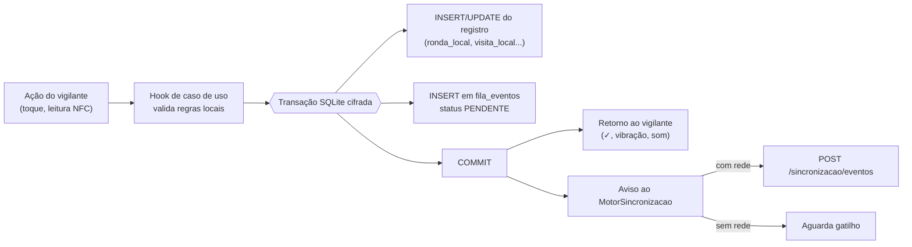
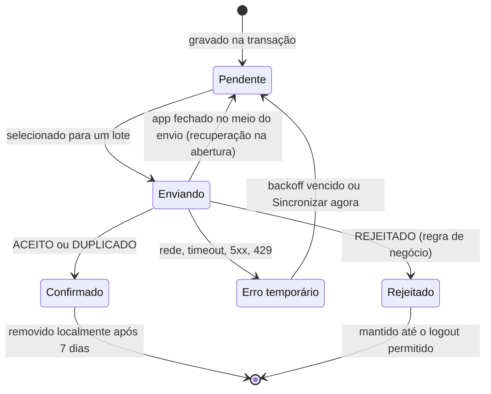
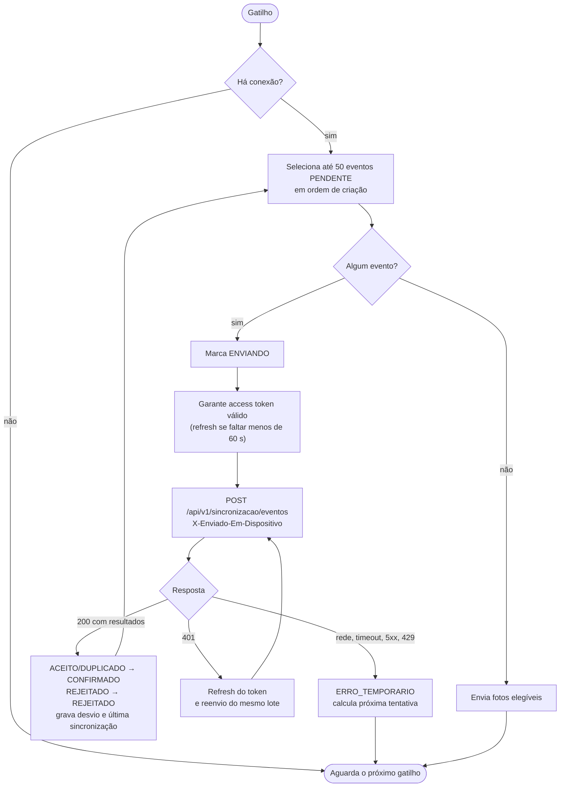
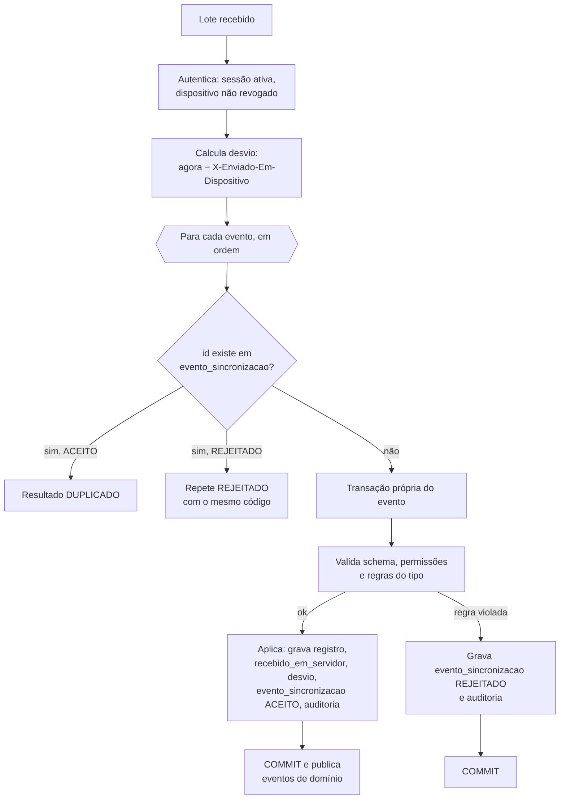
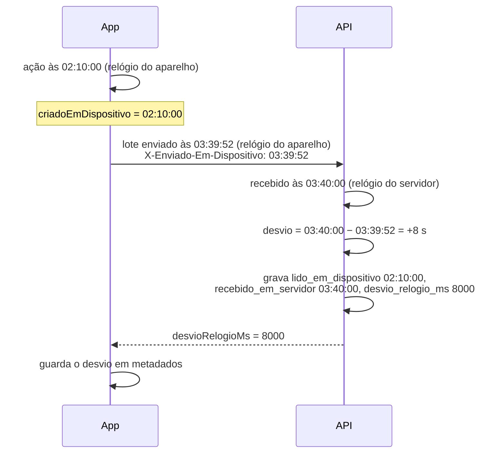

# Sincronização online-first

Parte da [documentação do Guardião](README.md).

Este documento detalha como o app do vigilante grava e envia os registros com ou sem internet, sem perder e sem duplicar nada. Ele atende a RNF01 a RNF07 e às regras RN15, RN16 e RN17 de [Requisitos](02-requisitos.md), especifica o caso de uso UC11 de [Casos de uso](03-casos-de-uso.md) e implementa as decisões dos ADRs [0005](adr/0005-online-first-fila-local-outbox.md), [0006](adr/0006-armazenamento-local-cifrado.md) e [0008](adr/0008-uuidv7-gerado-no-cliente.md).

## Sumário

1. [Princípios](#1-princípios)
2. [Caminho único de escrita](#2-caminho-único-de-escrita)
3. [Fila de eventos](#3-fila-de-eventos)
4. [Motor de sincronização](#4-motor-de-sincronização)
5. [Processamento no servidor](#5-processamento-no-servidor)
6. [Upload de fotos](#6-upload-de-fotos)
7. [Horários e desvio de relógio](#7-horários-e-desvio-de-relógio)
8. [Dados que descem do servidor](#8-dados-que-descem-do-servidor)
9. [Conflitos e autoridade](#9-conflitos-e-autoridade)
10. [Cenários de falha](#10-cenários-de-falha)
11. [Sessão, logout e aparelho revogado](#11-sessão-logout-e-aparelho-revogado)
12. [Observabilidade e conciliação](#12-observabilidade-e-conciliação)
13. [Como testar](#13-como-testar)

---

## 1. Princípios

| # | Princípio | Consequência |
|---|---|---|
| S1 | **Gravar antes de responder** | O ✓ verde só aparece depois que a visita foi gravada no banco local cifrado. Se a gravação falhar, o vigilante vê o erro. |
| S2 | **Um único caminho** | Com ou sem internet, o código é o mesmo: grava localmente e enfileira. Não existe "modo online" que chame a API direto. |
| S3 | **Online-first, não offline-only** | Com conexão, o envio começa em até 1 s (RNF01). A fila não espera timer quando há rede. |
| S4 | **Idempotência por id do cliente** | Cada evento tem um UUIDv7 gerado no aparelho, reutilizado em toda retentativa. O servidor nunca aplica o mesmo id duas vezes (RNF05). |
| S5 | **Confirmação explícita** | Um evento só sai da fila como `CONFIRMADO` quando o servidor responde `ACEITO` ou `DUPLICADO` para o seu id (RNF06, RN16). |
| S6 | **O servidor decide** | O app antecipa regras para dar retorno imediato, mas o resultado oficial (status da ronda, resultado geo, validação da tag) é o do servidor. |
| S7 | **Somente subida de fatos** | O app envia **fatos** que aconteceram (iniciei, li, justifiquei, registrei, finalizei). Não envia "estado desejado" nem edita registros já enviados. Isso elimina conflitos de edição. |

## 2. Caminho único de escrita



Exemplo de hook (ilustrativo):

```ts
// apps/mobile/src/features/ronda/hooks/useRegistrarVisita.ts (ilustrativo)
export function useRegistrarVisita() {
  const db = useBancoLocal();
  const motor = useMotorSincronizacao();

  return async (leitura: LeituraNfc, posicao: PosicaoNoEvento | null) => {
    const id = uuidv7();
    const agora = relogio.agoraDispositivo();
    await db.transaction(async (tx) => {
      await repoVisitas.inserir(tx, { id, ...montarVisita(leitura, posicao, agora) });
      await repoFila.enfileirar(tx, {
        id,                       // mesmo id do registro (DM04)
        tipo: 'PONTO_VISITADO',
        rondaId: leitura.rondaId,
        payload: montarPayloadVisita(id, leitura, posicao, agora),
        criadoEmDispositivo: agora,
      });
    });
    motor.avisarNovoEvento();      // não espera o envio
  };
}
```

## 3. Fila de eventos

### 3.1 Tipos de evento

| `TipoEvento` | Criado em | Payload principal | Depende de |
|---|---|---|---|
| `RONDA_INICIADA` | UC04 | `rondaId`, `iniciadaEmDispositivo`, localização | — |
| `PONTO_VISITADO` | UC05 | `visitaId`, `rondaId`, `pontoRondaId`, `uidHex`, `payloadNfc`, `lidoEmDispositivo`, localização, `localizacaoSimulada`, `resultadoGeoDispositivo`, `foraDaOrdem` | `RONDA_INICIADA` da mesma ronda |
| `PONTO_JUSTIFICADO` | UC07 | `justificativaId`, `rondaId`, `pontoRondaId`, `motivo`, `descricao`, `justificadaEmDispositivo`, localização | `RONDA_INICIADA` |
| `OCORRENCIA_REGISTRADA` | UC08 | `ocorrenciaId`, `rondaId`, `tipoOcorrenciaId`, `gravidade`, `descricao`, local (`predioId`, `andarId`, `setorId`, `pontoRondaId`), `registradaEmDispositivo`, localização, `fotos` (lista de `fotoId`, `sha256`, `tamanhoBytes`) | `RONDA_INICIADA` |
| `RONDA_FINALIZADA` | UC10 | `rondaId`, `finalizadaEmDispositivo`, localização, `finalizadaComPendencias` | Todos os eventos anteriores da mesma ronda |

O contrato completo (schemas zod) fica em `packages/shared/src/sincronizacao` e é publicado no OpenAPI ([07-api.md](07-api.md#7-sincronização)).

### 3.2 Estados de um evento



- Na abertura do app, eventos que ficaram `ENVIANDO` (o app foi encerrado no meio de um envio) voltam a `PENDENTE`. O reenvio é seguro por causa da idempotência.
- `REJEITADO` não é reenviado automaticamente. O registro continua no aparelho e aparece na tela de sincronização com a orientação de procurar o coordenador (HU-032). Um evento rejeitado **não bloqueia** os seguintes, exceto os da mesma ronda que dependam dele (ver 3.3).

### 3.3 Ordem e dependências

- Os eventos são enviados **em ordem de criação** (o UUIDv7 é ordenável por tempo; o desempate é `criado_em_dispositivo`).
- Eventos da mesma ronda vão sempre em ordem e, se possível, no mesmo lote.
- Se `RONDA_INICIADA` for `REJEITADO`, os demais eventos da ronda também serão rejeitados pelo servidor com `RONDA_NAO_INICIADA`. O app marca todos e mostra **um** aviso agrupado por ronda.
- As fotos só entram na fila de upload depois de a ocorrência estar `CONFIRMADO`.
- A regra RN03 (uma ronda em andamento por vez) garante que a finalização de uma ronda offline sempre é enviada antes do início da próxima.

## 4. Motor de sincronização

### 4.1 Gatilhos

| Gatilho | Comportamento |
|---|---|
| Novo evento gravado | Envio imediato se houver rede (S3) |
| Volta da conexão | `@react-native-community/netinfo` dispara o motor |
| App volta ao primeiro plano | Envio, ignorando o backoff de eventos `ERRO_TEMPORARIO` com mais de 1 minuto de espera |
| Timer | A cada 60 s enquanto houver pendências e o app estiver aberto |
| Segundo plano | `expo-background-task`, melhor esforço (o sistema decide, em geral de 15 em 15 minutos) |
| **Sincronizar agora** | Botão da tela de sincronização: ignora o backoff (FA6 do UC11) |

Apenas uma execução do motor roda por vez (trava em memória e marcador no banco para o caso de a tarefa em segundo plano coincidir com o app aberto).

### 4.2 Ciclo de envio



### 4.3 Backoff

| Tentativa | Espera base | Com *jitter* (±20%) |
|---|---|---|
| 1ª falha | 5 s | 4 a 6 s |
| 2ª | 15 s | 12 a 18 s |
| 3ª | 1 min | 48 a 72 s |
| 4ª | 5 min | 4 a 6 min |
| 5ª em diante | 15 min (teto) | 12 a 18 min |

- Uma resposta `429` com `Retry-After` substitui a espera calculada, se for maior.
- O contador de tentativas zera quando um lote é aceito.
- O *jitter* evita que vários aparelhos que voltaram para a área de cobertura ao mesmo tempo (troca de turno no posto) reenviem juntos.

### 4.4 Formato do lote

```http
POST /api/v1/sincronizacao/eventos
Authorization: Bearer <access token>
Content-Type: application/json
X-Enviado-Em-Dispositivo: 2026-10-26T02:41:07.512Z
X-Versao-App: 0.4.0
```

```json
{
  "eventos": [
    {
      "id": "0192f0c1-7b3e-7a10-9d0e-3f1c2a4b5c6d",
      "tipo": "PONTO_VISITADO",
      "criadoEmDispositivo": "2026-10-26T01:12:44.020Z",
      "dados": {
        "rondaId": "0192ef90-0000-7000-8000-000000000001",
        "pontoRondaId": "0192ef90-0000-7000-8000-0000000000aa",
        "uidHex": "04A1B2C3D4E5F6",
        "payloadNfc": "https://<dominio-institucional>/t?p=EF963FF7828658A599F3041510671E88&m=94EED9EE65337086",
        "lidoEmDispositivo": "2026-10-26T01:12:44.020Z",
        "localizacao": { "latitude": -21.785412, "longitude": -46.561230, "precisaoM": 14.0 },
        "localizacaoSimulada": false,
        "resultadoGeoDispositivo": "DENTRO_AREA",
        "foraDaOrdem": false
      }
    }
  ]
}
```

Resposta (sempre `200` quando o lote foi processado, mesmo com eventos rejeitados):

```json
{
  "recebidoEmServidor": "2026-10-26T02:41:08.103Z",
  "desvioRelogioMs": 591,
  "resultados": [
    { "id": "0192f0c1-7b3e-7a10-9d0e-3f1c2a4b5c6d", "resultado": "ACEITO" }
  ]
}
```

Um evento rejeitado traz `"resultado": "REJEITADO"`, `"codigo"` (ex.: `TAG_NAO_PERTENCE_AO_PONTO`) e `"mensagem"` curta em português, exibível ao vigilante.

## 5. Processamento no servidor



- **Uma transação por evento.** Um evento rejeitado não desfaz os anteriores do lote. Uma falha inesperada (erro 500) num evento interrompe o lote: os eventos já aplicados são devolvidos com o resultado e os demais voltam como erro temporário, para manter a ordem.
- **Concorrência.** Dois envios simultâneos do mesmo id (por exemplo, app e tarefa em segundo plano) são resolvidos pela chave primária de `evento_sincronizacao`: o segundo `INSERT` falha por conflito e o evento recebe `DUPLICADO`.
- **Eventos atrasados.** Eventos de uma ronda encerrada administrativamente continuam sendo aceitos, com `recebido_apos_encerramento = true` (RN09). Um `RONDA_INICIADA` que chega para uma ronda `NAO_REALIZADA`, dentro da janela pelo horário do aparelho corrigido, reconcilia a ronda (RN09) e gera auditoria `RECONCILIAR_RONDA`.
- **Limites.** No máximo 50 eventos e 512 KB por lote. Acima disso, `413` com `problem+json`.

### Principais códigos de rejeição

| Código | Tipo de evento | Regra |
|---|---|---|
| `RONDA_NAO_ATRIBUIDA` | `RONDA_INICIADA` | RN02 |
| `RONDA_FORA_DA_JANELA` | `RONDA_INICIADA` | RN02 |
| `RONDA_CANCELADA` | todos | RN09 |
| `OUTRA_RONDA_EM_ANDAMENTO` | `RONDA_INICIADA` | RN03 |
| `RONDA_NAO_INICIADA` | demais | Dependência de ordem |
| `PONTO_FORA_DO_ROTEIRO` | `PONTO_VISITADO`, `PONTO_JUSTIFICADO` | RN05 |
| `TAG_NAO_PERTENCE_AO_PONTO` | `PONTO_VISITADO` | RN01, CA08.2 |
| `PAYLOAD_NFC_AUSENTE` | `PONTO_VISITADO` | RF08 |
| `PONTO_JA_VISITADO` | `PONTO_JUSTIFICADO` | RN10 |
| `TIPO_OCORRENCIA_INATIVO` | `OCORRENCIA_REGISTRADA` | CA12.4 |
| `DADOS_OBRIGATORIOS_AUSENTES` | `OCORRENCIA_REGISTRADA` | RN11 |
| `VERSAO_APP_NAO_SUPORTADA` | todos | Versão mínima |

Uma leitura de tag com SUN inválido ou replay **não** é rejeitada: ela é aceita, gravada com `validacao_tag` `INVALIDA` ou `REPLAY` e sinalizada (RN07). Rejeitar faria o registro sumir do servidor; aceitar e sinalizar mantém a prova da tentativa.

## 6. Upload de fotos

| Passo | Onde | Detalhe |
|---|---|---|
| 1 | App | Foto processada (1600 px, JPEG 80%, sem EXIF), SHA-256 calculado e arquivo cifrado com AES-256-GCM (RN12) |
| 2 | App | `foto_local` com `status_upload = PENDENTE`, ligada à ocorrência |
| 3 | App | Quando `OCORRENCIA_REGISTRADA` fica `CONFIRMADO`, as fotos ficam elegíveis |
| 4 | App | Decifra em memória e envia `PUT /api/v1/ocorrencias/{ocorrenciaId}/fotos/{fotoId}` com `Content-Type: image/jpeg` e `Content-SHA256: <hex>` |
| 5 | API | Confere se a foto foi anunciada no evento, se o hash confere e se o limite de 5 não foi ultrapassado |
| 6 | API | Grava no MinIO e marca `upload_concluido`. Responde `201` (nova) ou `200` (já existia com o mesmo hash) |
| 7 | App | `CONFIRMADO` e remoção do arquivo cifrado local |

- Uma foto por requisição (no máximo cerca de 600 KB depois do processamento), uma por vez, para não disputar banda com os eventos.
- Hash divergente → `422 FOTO_HASH_DIVERGENTE`. O app tenta de novo até 3 vezes; depois, mostra a foto na tela de sincronização.
- O mesmo `fotoId` com outro hash → `409 FOTO_CONFLITO` (nunca sobrescreve).
- Fotos pendentes não impedem a finalização da ronda (FA4 do UC10), mas **impedem o logout**: elas contam como pendências (RN17), porque limpar os dados locais as perderia.

## 7. Horários e desvio de relógio



- O desvio é uma **estimativa** (inclui a latência da rede, normalmente menor que 1 s). Ele serve para sinalizar relógios errados, não para reescrever horários.
- Desvio acima de `limite_desvio_relogio_min` (5 min) sinaliza os registros do lote (`motivos_sinalizacao` inclui `DESVIO_RELOGIO`) e aparece no painel (RN15).
- O app usa o último desvio conhecido para validar a janela da ronda localmente (RN02): `agoraCorrigido = agoraDispositivo + desvio`.
- O servidor valida a janela pelo **horário do aparelho corrigido pelo desvio**, nunca pelo horário de chegada, para aceitar inícios feitos offline.
- O horário do servidor é a referência para auditoria, ordenação de listas e relatórios (RNF07).

## 8. Dados que descem do servidor

| Dado | Endpoint | Quando | Estratégia |
|---|---|---|---|
| Pacote offline | `GET /vigilante/pacote-offline` | Login, abertura com rede, a cada 30 min | ETag e substituição completa ([05](05-modelo-de-dados.md#10-pacote-offline)) |
| Rondas do turno | `GET /vigilante/rondas?de=&ate=` | Login, abertura com rede, a cada 5 min com o app aberto, depois de cada lote aceito | Mescla por id |

Regras de mescla das rondas:

- Ronda que **não existe localmente**: é inserida.
- Ronda local **sem eventos pendentes**: os campos vêm do servidor (inclusive o status definitivo, depois da finalização).
- Ronda local **com eventos pendentes**: o status local prevalece até a fila da ronda esvaziar. Só campos de planejamento (janela, cancelamento) são atualizados. Uma ronda cancelada no servidor que já está `EM_ANDAMENTO` no aparelho continua visível como "Cancelada pelo coordenador"; os eventos dela serão rejeitados e mostrados na tela de sincronização.

## 9. Conflitos e autoridade

Como o app só envia fatos novos (S7), os "conflitos" possíveis são divergências entre o que o app supôs e o que o servidor sabe.

| Situação | Quem prevalece | Efeito visível |
|---|---|---|
| App calculou `DENTRO_AREA`, servidor calculou `FORA_AREA` (cadastro do ponto mudou) | Servidor | Visita sinalizada no painel; o vigilante não é avisado |
| App mostrou ronda concluída, servidor encontrou leitura `REPLAY` | Servidor | Ronda `INCOMPLETA`; o app mostra o status do servidor na próxima atualização (CA03.7) |
| Ronda cancelada enquanto o aparelho estava offline | Servidor | Eventos `REJEITADO` com `RONDA_CANCELADA` |
| Ponto retirado do roteiro depois do início | Nenhum conflito: `ronda_ponto` é uma cópia feita na geração (DM01) | — |
| Tag substituída enquanto o aparelho estava offline | Servidor | Leitura da tag antiga rejeitada com `TAG_NAO_PERTENCE_AO_PONTO`; o vigilante pode justificar |
| Coordenador encerrou a ronda, vigilante seguiu registrando offline | Servidor mantém `INCOMPLETA` | Registros aceitos com `recebido_apos_encerramento` |

## 10. Cenários de falha

| # | Cenário | Comportamento esperado | Teste |
|---|---|---|---|
| F01 | Sem sinal durante toda a ronda | Tudo fica `PENDENTE`; envio automático ao voltar a conexão | E2E Maestro em modo avião |
| F02 | App fechado à força com 20 eventos pendentes | Na reabertura, os eventos continuam na fila e são enviados | Manual em aparelho real (RNF03) |
| F03 | Aparelho reiniciado no meio da ronda | A ronda reabre `EM_ANDAMENTO` depois do desbloqueio | Manual em aparelho real |
| F04 | Resposta perdida depois do commit no servidor | Reenvio recebe `DUPLICADO`; nenhum registro novo | Integração com proxy que derruba a resposta |
| F05 | Mesmo lote enviado 3 vezes | 1º `ACEITO`, depois `DUPLICADO`; contagem de linhas inalterada | Integração (RNF05) |
| F06 | Servidor fora do ar por 2 h | Backoff até 15 min; app segue operando; fila drenada quando o servidor volta | Integração com servidor simulado |
| F07 | Access token expirado durante o envio | Refresh e reenvio do mesmo lote | Unitário do motor |
| F08 | Refresh token expirado ou revogado | Novo login exigido; fila preservada e enviada depois do login do mesmo usuário | Integração |
| F09 | Upload de foto interrompido | `ERRO_TEMPORARIO`, reenvio com backoff, arquivo preservado | Unitário e manual |
| F10 | Relógio do aparelho adiantado 10 min | Registros com dois horários; sinalização de desvio; janela validada corretamente | Manual (RNF07) |
| F11 | Armazenamento cheio | Gravação falha com aviso claro; nada é dado como gravado sem estar | Manual |
| F12 | Bateria acaba no meio da gravação | A transação SQLite garante tudo ou nada; nunca registro sem evento | Unitário do repositório |
| F13 | Dois aparelhos com o mesmo vigilante | Permitido; RN03 é garantida no servidor (o segundo início é rejeitado) | Integração |
| F14 | Atualização do app com pendências | Migrações locais preservam a fila (HU-043) | Manual antes de cada release |

## 11. Sessão, logout e aparelho revogado

- **Offline depois do login:** o desbloqueio por biometria ou PIN funciona sem rede (RN18). O app continua gravando mesmo com o access token vencido; o refresh acontece quando houver conexão.
- **Logout:** bloqueado enquanto houver eventos ou fotos pendentes (RN17). A tela oferece **Sincronizar agora**.
- **Troca de vigilante no mesmo aparelho:** só depois do logout do anterior, ou seja, com a fila vazia.
- **Refresh negado (sessão revogada ou expirada):** o app pede login. Se o mesmo usuário entrar, a fila é enviada normalmente. Se outro usuário tentar entrar, o app recusa enquanto houver pendências do anterior.
- **Aparelho revogado com pendências:** a API recusa os lotes (`401 DISPOSITIVO_REVOGADO`). Os eventos ficam cifrados no aparelho. O tratamento definitivo é a pendência PE03 de [Requisitos](02-requisitos.md#decisões-e-pendências). Proposta: o administrador pode "reabilitar para envio" o aparelho recuperado por até 24 h, apenas para o endpoint de sincronização, com auditoria.

## 12. Observabilidade e conciliação

| Sinal | Onde | Uso |
|---|---|---|
| Contador de pendências e nuvem | Todas as telas do app | O vigilante sabe que falta enviar (HU-032) |
| Tela de sincronização | App | Lista pendentes, enviando, rejeitados e a última sincronização |
| `evento_sincronizacao` | Banco | Log de tudo o que chegou, com desvio e resultado |
| Métricas da API | Logs estruturados | Lotes por minuto, p95 de processamento, taxa de `REJEITADO` por código |
| Conciliação do piloto | Script `infra/scripts/conciliar-piloto` | Compara a exportação da `fila_eventos` dos aparelhos (tela oculta de diagnóstico, só para `ADMINISTRADOR`) com `evento_sincronizacao`: ids faltantes e duplicados (métrica M04) |

## 13. Como testar

| Nível | O que cobrir | Ferramenta |
|---|---|---|
| Unitário (app) | Motor: seleção de lotes, ordem, backoff, tratamento de cada resposta, recuperação de `ENVIANDO` | Jest com cliente de API simulado |
| Unitário (app) | Repositórios: atomicidade registro + evento | Jest com SQLite em memória |
| Integração (API) | Idempotência, ordem, rejeições, reconciliação de `NAO_REALIZADA`, concorrência do mesmo id | Jest + Supertest + Testcontainers |
| Contrato | Schemas zod compartilhados entre app e API | Typecheck e testes de schema |
| E2E | Ronda em modo avião, reconexão, conferência no painel | Maestro em aparelho físico |
| Campo | Conciliação diária no piloto | Script de conciliação |

Detalhes em [12-estrategia-de-testes.md](12-estrategia-de-testes.md).
