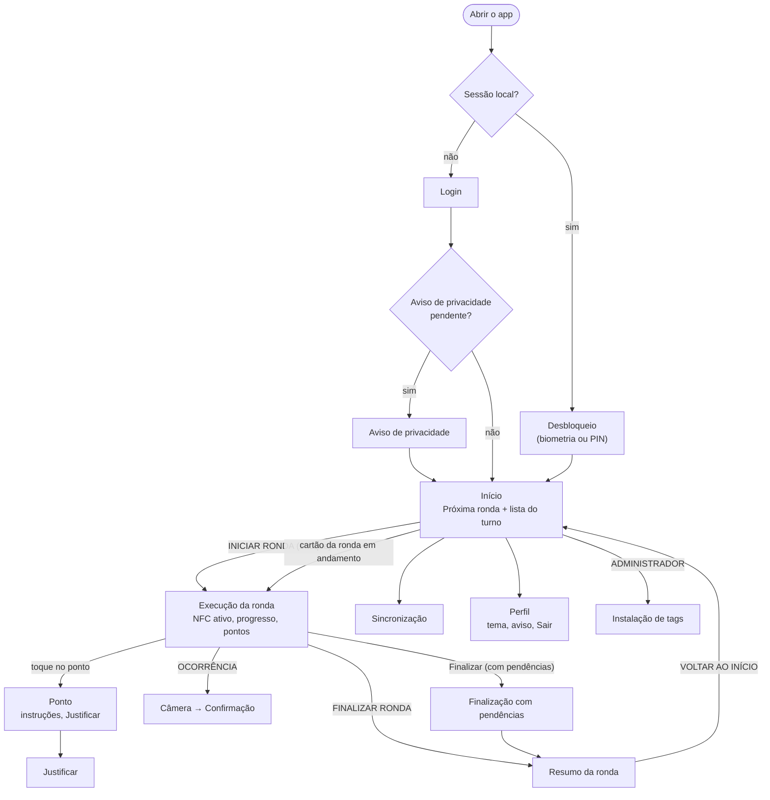
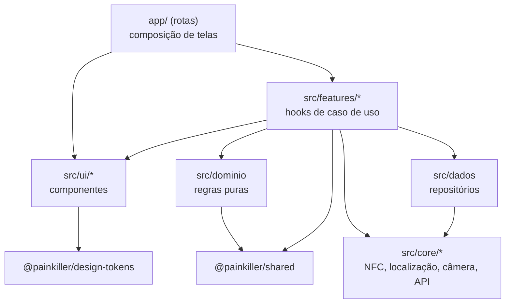

# App mobile

Parte da [documentação do Guardião](README.md).

Este documento descreve o **App Guardião**, usado pelo vigilante para executar rondas e pelo administrador para instalar tags: tecnologias, estrutura de pastas, navegação, camadas, componentização (Atomic Design), leitura NFC, localização no evento, câmera, criptografia, segurança, configuração por ambiente e builds. O porquê das escolhas está nos ADRs [0002](adr/0002-app-react-native-expo-development-build.md), [0005](adr/0005-online-first-fila-local-outbox.md), [0006](adr/0006-armazenamento-local-cifrado.md), [0007](adr/0007-tags-nfc-ntag424-dna-sun.md), [0009](adr/0009-atomic-design-design-tokens.md) e [0012](adr/0012-autenticacao-jwt-refresh-biometria.md).

## Sumário

1. [Visão geral](#1-visão-geral)
2. [Stack](#2-stack)
3. [Estrutura de pastas](#3-estrutura-de-pastas)
4. [Navegação e telas](#4-navegação-e-telas)
5. [Camadas e regras de dependência](#5-camadas-e-regras-de-dependência)
6. [Componentização (Atomic Design)](#6-componentização-atomic-design)
7. [Estado e dados](#7-estado-e-dados)
8. [Leitura NFC](#8-leitura-nfc)
9. [Localização no evento](#9-localização-no-evento)
10. [Câmera e fotos](#10-câmera-e-fotos)
11. [Criptografia e armazenamento seguro](#11-criptografia-e-armazenamento-seguro)
12. [Sessão, biometria e bloqueio](#12-sessão-biometria-e-bloqueio)
13. [Retorno ao vigilante: vibração, som e tela](#13-retorno-ao-vigilante-vibração-som-e-tela)
14. [Permissões do sistema](#14-permissões-do-sistema)
15. [Configuração por ambiente e builds](#15-configuração-por-ambiente-e-builds)
16. [Desenvolvimento sem tags e sem aparelho](#16-desenvolvimento-sem-tags-e-sem-aparelho)
17. [Testes do app](#17-testes-do-app)
18. [Desempenho e consumo de bateria](#18-desempenho-e-consumo-de-bateria)

---

## 1. Visão geral

| Item | Valor |
|---|---|
| Nome | Guardião |
| Pasta | `apps/mobile` |
| Plataforma alvo da V1 | Android com NFC (8.0 ou superior), premissa a confirmar. iOS é suportado tecnicamente (iPhone 7 ou superior), sem distribuição na V1 |
| Usuários | `VIGILANTE`; `ADMINISTRADOR` no modo instalação |
| Idioma | pt-BR |
| Orientação | Retrato |
| Tema | Escuro de alto contraste por padrão, com opção de tema claro no Perfil |
| Funciona sem internet | Sim, depois do primeiro login ([06](06-sincronizacao-online-first.md)) |

## 2. Stack

| Necessidade | Biblioteca | Observação |
|---|---|---|
| Base | React Native + Expo (development build), TypeScript estrito | O NFC exige módulo nativo, por isso não usamos o Expo Go ([ADR-0002](adr/0002-app-react-native-expo-development-build.md)) |
| Navegação | Expo Router | Rotas por arquivos em `app/` |
| Banco local | `expo-sqlite` com SQLCipher habilitado no plugin de configuração + Drizzle ORM | `useLiveQuery` do Drizzle atualiza as telas quando o banco muda |
| Armazenamento seguro | `expo-secure-store` | Chave do banco, tokens, id de instalação |
| NFC | `react-native-nfc-manager` | NDEF e ISO-DEP |
| Localização | `expo-location` | Somente no evento, primeiro plano |
| Câmera | `expo-camera` | Câmera própria, sem galeria |
| Processamento de imagem | `expo-image-manipulator` | Redimensiona e regrava o JPEG, o que descarta o EXIF |
| Hash e cifra | `react-native-quick-crypto` | SHA-256 e AES-256-GCM em código nativo |
| Biometria | `expo-local-authentication` | Biometria ou PIN do aparelho |
| Bloqueio de captura de tela | `expo-screen-capture` | Telas de câmera, ocorrência e Perfil |
| Vibração e som | `expo-haptics`, `expo-audio` | Retornos da leitura |
| Rede | `@react-native-community/netinfo` | Gatilho de sincronização |
| Segundo plano | `expo-background-task` | Sincronização de melhor esforço |
| Estado de interface | Zustand | Somente estado efêmero (ex.: leitura em andamento) |
| Ids | `uuidv7` | Ids gerados no aparelho ([ADR-0008](adr/0008-uuidv7-gerado-no-cliente.md)) |
| Validação e contratos | zod via `@painkiller/shared` | Mesmos schemas da API |
| Componentes | Próprios, sobre `@painkiller/design-tokens` | [09](09-ux-e-design-system.md) |
| Catálogo | Storybook for React Native | Um story por átomo, molécula e organismo |
| Erros em produção | Registro local de erros, exportável pela tela de diagnóstico | Sem serviço externo de telemetria na V1 |

A versão do Expo SDK é fixada na Sprint 0 e só muda depois da V1 (risco RT11 em [04](04-arquitetura.md#10-riscos-técnicos-e-mitigação)).

## 3. Estrutura de pastas

```
apps/mobile/
├── app/                          # rotas (Expo Router); só composição de telas
│   ├── _layout.tsx               # provedores: banco, sessão, tema, motor de sync
│   ├── (publico)/
│   │   ├── login.tsx
│   │   └── desbloqueio.tsx
│   ├── (vigilante)/
│   │   ├── _layout.tsx           # guarda de papel e indicador de sincronização
│   │   ├── index.tsx             # Início
│   │   ├── ronda/[id]/index.tsx  # Execução
│   │   ├── ronda/[id]/ponto/[pontoId].tsx
│   │   ├── ronda/[id]/justificar/[pontoId].tsx
│   │   ├── ronda/[id]/ocorrencia.tsx
│   │   ├── ronda/[id]/finalizar.tsx
│   │   ├── ronda/[id]/resumo.tsx
│   │   ├── sincronizacao.tsx
│   │   └── perfil.tsx
│   ├── (administrador)/
│   │   ├── instalacao.tsx        # modo instalação de tags
│   │   └── diagnostico.tsx       # exportação da fila para conciliação
│   └── aviso-privacidade.tsx
├── src/
│   ├── ui/                       # design system do app (Atomic Design)
│   │   ├── atomos/               # Texto, Botao, Icone, Selo, Campo, Indicador, Divisor
│   │   ├── moleculas/
│   │   ├── organismos/
│   │   └── templates/
│   ├── features/                 # casos de uso por área
│   │   ├── autenticacao/         # hooks, serviços, telas internas
│   │   ├── ronda/
│   │   ├── ocorrencia/
│   │   ├── sincronizacao/
│   │   └── instalacao/
│   ├── dominio/                  # regras puras (sem React, sem I/O)
│   ├── dados/
│   │   ├── banco/                # cliente SQLCipher, schema Drizzle, migrações
│   │   └── repositorios/         # acesso a dados, sempre com transação
│   ├── core/
│   │   ├── api/                  # ClienteApi, refresh de token
│   │   ├── crypto/               # chave do banco, AES-GCM, hash
│   │   ├── seguranca/            # biometria, inatividade, captura de tela, root
│   │   ├── nfc/                  # LeitorNfc, LeitorNfcSimulado, parser NDEF/SUN
│   │   ├── localizacao/          # LocalizacaoNoEvento
│   │   ├── camera/               # ProcessadorFoto
│   │   ├── relogio/              # horário do aparelho e desvio
│   │   └── config/               # leitura das variáveis por ambiente
│   └── textos/                   # textos da interface centralizados
├── assets/                       # ícones, sons de sucesso e erro, fontes
├── .maestro/                     # fluxos E2E
├── app.config.ts
├── eas.json
└── package.json
```

As pastas `src/core/crypto` e `src/core/seguranca` têm revisão obrigatória do mantenedor (`.github/CODEOWNERS`).

## 4. Navegação e telas



| Tela | Rota | Ação primária | Requisitos |
|---|---|---|---|
| Login | `/login` | ENTRAR | RF01, UC01 |
| Desbloqueio | `/desbloqueio` | Biometria automática | RN18, UC02 |
| Aviso de privacidade | `/aviso-privacidade` | ENTENDI | RNF14, HU-044 |
| Início | `/` | INICIAR RONDA | RF02, UC03, UC04 |
| Execução | `/ronda/[id]` | Leitura NFC automática; FINALIZAR RONDA quando completa | RF04 a RF09, UC05, UC06 |
| Ponto | `/ronda/[id]/ponto/[pontoId]` | Justificar (se pendente) | RF04, RF10 |
| Justificar | `/ronda/[id]/justificar/[pontoId]` | SALVAR JUSTIFICATIVA | RF10, UC07 |
| Ocorrência | `/ronda/[id]/ocorrencia` | ENVIAR | RF11 a RF14, UC08, UC09 |
| Finalização com pendências | `/ronda/[id]/finalizar` | FINALIZAR COM PENDÊNCIAS | RF03, UC10 |
| Resumo | `/ronda/[id]/resumo` | VOLTAR AO INÍCIO | UC10 |
| Sincronização | `/sincronizacao` | Sincronizar agora | HU-032, UC11 |
| Perfil | `/perfil` | Sair | RN17 |
| Instalação de tags | `/instalacao` | VINCULAR | RF19, UC19 |

Wireframes e textos de cada tela estão em [09-ux-e-design-system.md](09-ux-e-design-system.md).

## 5. Camadas e regras de dependência



| Regra | Por quê | Verificação |
|---|---|---|
| Componentes de `src/ui` não conhecem regra de negócio, repositórios nem API | Reaproveitamento e testes simples (RNF12) | `eslint-plugin-boundaries` |
| Rotas em `app/` só compõem: chamam hooks e renderizam componentes | Telas sem lógica (CONTRIBUTING) | Revisão de PR |
| Toda escrita passa por um hook de `features` que usa transação com a fila | Caminho único de escrita ([ADR-0005](adr/0005-online-first-fila-local-outbox.md)) | Lint proíbe importar repositórios em `app/` e em `ui/` |
| `src/dominio` não importa React, Expo nem nada com I/O | Regras testáveis com Jest puro | `eslint-plugin-boundaries` |
| Somente `core/api` faz `fetch` | Um só lugar para token, versão do app e erros | Lint `no-restricted-globals` para `fetch` |
| Somente `core/localizacao` chama `expo-location` | Garantir a coleta só no evento (RNF14) | Lint `no-restricted-imports` + teste |

## 6. Componentização (Atomic Design)

O app segue o Atomic Design sobre os tokens de `@painkiller/design-tokens` ([ADR-0009](adr/0009-atomic-design-design-tokens.md)). O inventário completo, com variantes e regras visuais, está em [09 · Inventário de componentes](09-ux-e-design-system.md#7-inventário-de-componentes).

| Nível | Exemplos no app | Pode conter |
|---|---|---|
| Átomos | `Texto`, `Botao`, `Icone`, `Selo`, `Campo`, `Indicador`, `Divisor` | Somente tokens |
| Moléculas | `ItemPonto`, `BarraProgresso`, `SeletorGravidade`, `SeletorMotivo`, `MiniaturaFoto`, `IndicadorSincronizacao`, `AvisoInline` | Átomos |
| Organismos | `CartaoProximaRonda`, `ListaPontosAgrupada`, `BarraAcaoRonda`, `RetornoLeitura` (sobreposição do ✓), `ListaPendenciasSync`, `FormularioOcorrencia` | Moléculas e átomos |
| Templates | `TemplateTelaVigilante` (cabeçalho, conteúdo rolável, barra de ação fixa embaixo), `TemplateFormulario`, `TemplateCamera` | Organismos, sem dados |
| Páginas | Arquivos de `app/` | Templates preenchidos por hooks |

Estrutura de cada componente:

```
src/ui/moleculas/ItemPonto/
├── ItemPonto.tsx           # componente (props tipadas, sem estado de negócio)
├── ItemPonto.estilos.ts    # estilos a partir dos tokens
├── ItemPonto.test.tsx      # React Native Testing Library
├── ItemPonto.stories.tsx   # Storybook: estados Pendente, Visitado, Justificado, Sinalizado
└── index.ts
```

Exemplo de props:

```ts
export interface ItemPontoProps {
  nome: string;
  ordem?: number;                 // exibido quando o roteiro exige ordem
  obrigatorio: boolean;
  situacao: 'PENDENTE' | 'VISITADO' | 'JUSTIFICADO';
  proximo?: boolean;              // destaque do próximo ponto esperado
  onPress?: () => void;           // abre o ponto; nunca marca como visitado (RF08)
}
```

Regras:

- Nenhuma cor, tamanho de fonte ou espaçamento literal fora dos tokens (lint contra literais, RNF12).
- Todo componente interativo tem `accessibilityRole`, `accessibilityLabel` e alvo mínimo de 48 dp (56 dp na ação primária).
- Componentes recebem textos prontos por props; os textos vêm de `src/textos`.

## 7. Estado e dados

| Tipo de dado | Onde vive | Como a tela recebe |
|---|---|---|
| Rondas, pontos, visitas, ocorrências, fila | SQLite cifrado | `useLiveQuery` do Drizzle dentro dos hooks de `features` |
| Pacote offline | SQLite cifrado (tabelas `*_ref`) | Hooks de consulta |
| Sessão (usuário, papel, expiração) | `expo-secure-store` + contexto React | `useSessao()` |
| Estado efêmero de interface (leitura em andamento, câmera aberta) | Zustand | Seletores |
| Configuração do ambiente | `app.config.ts` → `expo-constants` | `core/config` |

Não usamos cache de servidor (como TanStack Query) no app: a fonte de verdade da tela é sempre o banco local, alimentado pela sincronização. Isso faz online e offline se comportarem igual.

## 8. Leitura NFC

### 8.1 Fluxo no Android

1. Ao abrir a tela de Execução, o hook `useLeituraNfc` chama `NfcManager.registerTagEvent` com `isReaderModeEnabled: true` e as tecnologias `NfcA` e `IsoDep`. O modo leitor impede que o Android abra outro app ou o navegador ao ler a URL SUN.
2. Ao sair da tela (ou quando o app vai para segundo plano), o registro é cancelado. A leitura só fica ativa durante uma ronda `EM_ANDAMENTO`.
3. A cada tag detectada, o leitor entrega UID e mensagem NDEF ao parser (`core/nfc/parser`).
4. O parser identifica o tipo (`NTAG424_DNA` pela URL SUN, `NTAG215_LEGADA` pela ausência dela) e devolve `{ uidHex, payloadNfc }`.
5. O hook aplica as regras locais (tag no pacote, ponto do roteiro, já visitado) e segue o fluxo do UC05.
6. Leituras da mesma tag em menos de 3 s são ignoradas (o vigilante segura o celular encostado).

### 8.2 iOS

O iOS não permite leitura contínua em segundo plano dentro do app. A tela de Execução mostra o botão **Ler ponto**, que abre a folha de leitura do sistema (`NfcManager.requestTechnology`). Isso custa 1 toque por ponto (CA05.5) e está registrado como restrição RE06 em [01](01-visao-do-produto.md#restrições).

### 8.3 O app não valida o SUN

O app **não tem chaves** e não verifica CMAC nem contador. Ele envia o `payloadNfc` bruto e o servidor valida (RN07, [ADR-0007](adr/0007-tags-nfc-ntag424-dna-sun.md)). Localmente, a tag é reconhecida pelo UID, que está no pacote offline.

### 8.4 Interface do leitor

```ts
// src/core/nfc/LeitorNfc.ts (ilustrativo)
export interface LeituraNfc {
  uidHex: string;          // "04A1B2C3D4E5F6"
  payloadNfc: string;      // URL SUN ou "UID:04A1B2C3D4E5F6" na legada
  tipo: 'NTAG424_DNA' | 'NTAG215_LEGADA';
  lidaEm: Date;
}

export interface LeitorNfc {
  disponivel(): Promise<'OK' | 'SEM_NFC' | 'NFC_DESLIGADO'>;
  iniciar(aoLer: (l: LeituraNfc) => void, aoFalhar: (e: ErroNfc) => void): Promise<void>;
  parar(): Promise<void>;
}
```

`LeitorNfcReal` e `LeitorNfcSimulado` implementam a mesma interface ([seção 16](#16-desenvolvimento-sem-tags-e-sem-aparelho)).

### 8.5 Modo instalação

Disponível só para `ADMINISTRADOR`, exige conexão e não usa a fila offline (UC19). Ele lê a tag, consulta `GET /tags-nfc?uid=`, mostra os pontos com busca e chama `POST /tags-nfc`. Depois do vínculo, pede uma segunda leitura de teste.

## 9. Localização no evento

| Regra | Implementação |
|---|---|
| Só nos 5 eventos (RN19) | `LocalizacaoNoEvento.obter()` é chamado apenas pelos hooks de iniciar, visitar, justificar, registrar ocorrência e finalizar |
| Nunca em segundo plano | Somente permissão "durante o uso"; sem `ACCESS_BACKGROUND_LOCATION` no manifesto |
| Tempo máximo de 5 s | Corrida entre `getCurrentPositionAsync({ accuracy: High })` e um temporizador. Se a última posição conhecida tiver menos de 30 s e precisão até `precisao_maxima_m`, ela é usada de imediato |
| Localização simulada | `mocked` da posição no Android; gravado em `localizacaoSimulada` |
| Sem posição | Resultado `SEM_LOCALIZACAO`; o registro segue normalmente |
| Classificação | `classificarGeo` de `@painkiller/shared` (mesmo código do servidor), com distância por Haversine |

```ts
// src/core/localizacao/LocalizacaoNoEvento.ts (ilustrativo)
export async function obterPosicaoNoEvento(precisaoMaximaM: number): Promise<PosicaoNoEvento | null> {
  const recente = await Location.getLastKnownPositionAsync({ maxAge: 30_000, requiredAccuracy: precisaoMaximaM });
  if (recente) return converter(recente);
  return comTempoLimite(Location.getCurrentPositionAsync({ accuracy: Location.Accuracy.High }), 5_000)
    .then(converter)
    .catch(() => null);
}
```

Para não atrasar o ✓ (meta de 1 s em M07), a vibração curta acontece logo depois da validação local da tag; o ✓ verde e o som vêm depois da gravação, que espera a posição por no máximo 5 s. Na política `BLOQUEAR`, o retorno de sucesso só aparece depois da posição (FA5 do UC05).

## 10. Câmera e fotos

| Passo | Detalhe |
|---|---|
| Abertura | `expo-camera` em tela cheia, com `expo-screen-capture` bloqueando capturas. Sem botão de galeria |
| Captura | `takePictureAsync({ quality: 1, exif: false, skipProcessing: false })` |
| Processamento | `expo-image-manipulator`: redimensiona para lado maior de 1600 px e salva JPEG com qualidade 0,8. A regravação descarta os metadados EXIF (verificado em teste com arquivo de referência) |
| Hash | SHA-256 do JPEG final |
| Cifra | AES-256-GCM com chave própria das fotos (derivada e guardada como a do banco), IV de 12 bytes aleatório. Arquivo `fotos/<fotoId>.bin` no armazenamento privado do app |
| Limpeza | O arquivo temporário sem cifra é apagado imediatamente. Nada vai para a galeria (`MediaLibrary` não é usado) |
| Registro | `foto_local` com hash, IV, tag de autenticação, tamanho e `status_upload = PENDENTE` |
| Upload | Pelo motor de sincronização, depois de a ocorrência ser confirmada ([06 · Upload de fotos](06-sincronizacao-online-first.md#6-upload-de-fotos)) |

## 11. Criptografia e armazenamento seguro

| Segredo | Onde | Como é criado |
|---|---|---|
| Chave do banco (256 bits) | `expo-secure-store` com `keychainAccessible: WHEN_UNLOCKED_THIS_DEVICE_ONLY` | `crypto.getRandomValues` na primeira execução |
| Chave das fotos (256 bits) | Idem | Idem |
| Refresh token | Idem | Recebido no login |
| Access token | Memória e `expo-secure-store` (para a tarefa em segundo plano) | Recebido no login e no refresh |
| Id de instalação | `expo-secure-store` | UUID na primeira execução |

- Nada sensível vai para `AsyncStorage`, logs ou o `console`.
- A chave **não** exige biometria a cada uso: a biometria protege o acesso à interface. Isso evita perder o banco quando o usuário cadastra uma nova digital, o que em alguns aparelhos invalida chaves vinculadas à biometria (RT07).
- Ao detectar que o banco não abre com a chave (por exemplo, restauração de backup do sistema em outro aparelho), o app não apaga nada: mostra a orientação de procurar o administrador e registra o erro na tela de diagnóstico.
- `android:allowBackup="false"` no manifesto, para o banco e os arquivos não irem para o backup do Google.

## 12. Sessão, biometria e bloqueio

| Situação | Comportamento |
|---|---|
| Primeiro acesso | Matrícula e senha, online (UC01). Exige que o aparelho tenha bloqueio de tela configurado (E7 do UC01) |
| Aberturas seguintes | `expo-local-authentication` com biometria ou PIN do aparelho (UC02). Funciona offline |
| Inatividade | Depois de `inatividade_bloqueio_min` (padrão 10) sem toques nem leituras NFC, a próxima interação exige desbloqueio. Leitura de tag conta como interação (HU-008) |
| App em segundo plano por mais de 10 min | Desbloqueio ao voltar |
| Tokens | Access de 15 min, refresh de 30 dias, rotativo ([ADR-0012](adr/0012-autenticacao-jwt-refresh-biometria.md)) |
| Refresh negado | Novo login; fila preservada |
| Logout | Só com fila vazia (RN17) |
| Root ou depuração detectados | Na V1, o app apenas registra e informa a API no login (`dispositivo.integridade`), sem bloquear |
| Capturas de tela | Bloqueadas nas telas de câmera, ocorrência e Perfil (CA13.7) |

## 13. Retorno ao vigilante: vibração, som e tela

| Evento | Vibração | Som | Tela |
|---|---|---|---|
| Leitura aceita | Curta (`ImpactFeedbackStyle.Heavy`) | Som de sucesso curto | Sobreposição verde com ✓ e o nome do ponto em letra grande por 1,5 s |
| Ponto já registrado (RN04) | Leve | Nenhum | Aviso informativo "Ponto já registrado" |
| Tag fora do roteiro (RN05) ou não reconhecida | Longa (padrão de erro) | Som de erro | Aviso vermelho com o texto do caso |
| Fora da área com `BLOQUEAR` | Longa | Som de erro | "Você parece estar fora da área deste ponto. Aproxime-se e encoste de novo." |
| Falha de leitura | Dupla curta | Nenhum | "Leitura falhou. Encoste de novo e segure por 1 segundo." |
| Ronda completa | Dupla longa | Som de conclusão | FINALIZAR RONDA em destaque na barra de ação |

O som respeita o modo silencioso do aparelho; a vibração, não (é o retorno principal). Detalhes visuais em [09](09-ux-e-design-system.md#5-feedback-e-estados).

## 14. Permissões do sistema

| Permissão (Android) | Para quê | Quando é pedida |
|---|---|---|
| `NFC` | Leitura das tags | Declarada; não exige diálogo |
| `ACCESS_FINE_LOCATION`, `ACCESS_COARSE_LOCATION` | Localização no evento | Na primeira ronda iniciada, com explicação prévia |
| `CAMERA` | Fotos da ocorrência | Na primeira ocorrência |
| `VIBRATE` | Retorno háptico | Declarada |
| `USE_BIOMETRIC` | Desbloqueio | Declarada |
| `INTERNET`, `ACCESS_NETWORK_STATE` | Sincronização | Declaradas |

Não declaradas: `ACCESS_BACKGROUND_LOCATION`, `READ_MEDIA_IMAGES`, `WRITE_EXTERNAL_STORAGE`, `RECORD_AUDIO`. O teste de manifesto (RNF14) falha se alguma delas aparecer.

`uses-feature android.hardware.nfc required="true"` impede a instalação pela loja em aparelhos sem NFC.

## 15. Configuração por ambiente e builds

`app.config.ts` lê `APP_AMBIENTE` e define nome, identificador e URL da API:

| Ambiente | Nome exibido | Identificador | API | Leitor NFC simulado |
|---|---|---|---|---|
| `desenvolvimento` | Guardião (dev) | `br.edu.ifsuldeminas.guardiao.dev` | `http://<ip-da-maquina>:3000/api/v1` | Disponível |
| `homologacao` | Guardião (hml) | `br.edu.ifsuldeminas.guardiao.hml` | URL de homologação | Disponível só para `ADMINISTRADOR` |
| `producao` | Guardião | `br.edu.ifsuldeminas.guardiao` | `https://<dominio-institucional>/api/v1` | **Removido do build** |

Perfis do `eas.json`:

| Perfil | Uso | Saída | Distribuição |
|---|---|---|---|
| `development` | Desenvolvimento com `expo-dev-client` | APK de desenvolvimento | Interna |
| `preview` | Homologação, APK de teste das sprints | APK | Interna (link do EAS) |
| `production` | Piloto e produção | AAB e APK assinados | Trilha de teste interno do Google Play ou APK interno (HU-043) |

- O `versionCode` é incrementado automaticamente pelo EAS. A `version` acompanha a tag do repositório ([Fluxo Git · Versionamento](15-fluxo-git-e-contribuicao.md#8-versionamento)).
- O keystore de produção fica no EAS (credenciais gerenciadas), nunca no repositório.
- Detalhes de distribuição em [16-implantacao-e-infraestrutura.md](16-implantacao-e-infraestrutura.md#7-builds-e-distribuição-do-app).

## 16. Desenvolvimento sem tags e sem aparelho

- **`LeitorNfcSimulado`:** em desenvolvimento e homologação, um botão flutuante abre a lista de tags do pacote offline. Escolher uma tag dispara o mesmo `aoLer` do leitor real, com payload SUN fictício gerado por uma chave de teste conhecida pelo ambiente de desenvolvimento. O build de produção não inclui esse código (verificado em HU-043).
- **Localização simulada de desenvolvimento:** o emulador Android permite definir coordenadas; os seeds trazem pontos com coordenadas fictícias perto de um ponto de referência configurável.
- **Tags de teste:** NTAG215 baratas para testes de leitura; NTAG 424 DNA provisionadas com chaves de desenvolvimento pelo script de `infra/scripts`.
- **Aparelho físico:** obrigatório para validar NFC, câmera, biometria e localização antes de cada história ser aceita (DoD).

## 17. Testes do app

| Tipo | Ferramenta | O que cobre |
|---|---|---|
| Unitário | Jest | `src/dominio` (janela, conclusão, geo), parser NFC/SUN, motor de sincronização, repositórios com SQLite em memória |
| Componentes | React Native Testing Library | Átomos, moléculas e organismos, estados e acessibilidade |
| Visual | Storybook | Revisão manual de estados e temas |
| E2E | Maestro | Fluxos principais com contagem de toques (RNF10), modo avião, reinício |
| Manual em aparelho | Roteiros de [12](12-estrategia-de-testes.md) | NFC real, GPS, biometria, câmera, desempenho |

## 18. Desempenho e consumo de bateria

| Meta | Valor | Como |
|---|---|---|
| Abertura até a tela Início (com sessão) | até 2 s em aparelho de referência | Sem chamada de rede bloqueante na abertura |
| Leitura até o ✓ | p95 ≤ 1 s (M07) | Posição recente reaproveitada, transação curta |
| Bateria em 8 h de turno com 6 rondas | consumo do app inferior a 15% em aparelho de referência | Leitor NFC ativo só na Execução; sem GPS contínuo; sincronização em lotes |
| Tamanho do APK | até 40 MB | Sem bibliotecas de mapas no app |
