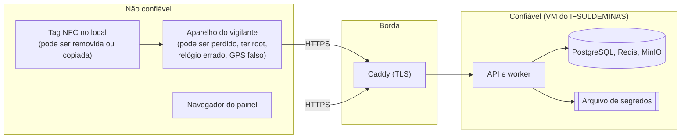
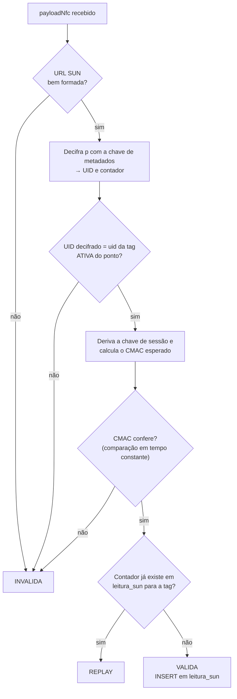

# Segurança e LGPD

Parte da [documentação do Guardião](README.md).

O Guardião produz **prova de presença** do vigilante e guarda **dados pessoais** (localização nos eventos da ronda e fotos de ocorrências). Este documento descreve o modelo de ameaças, os controles do app (OWASP MASVS), da API (OWASP ASVS e API Security Top 10), a validação criptográfica das tags (NFC SUN), a autenticação, a auditoria, a gestão de segredos, a resposta a incidentes e o tratamento de dados pessoais segundo a LGPD. Ele detalha os requisitos RNF04, RNF11 e RNF14 e as regras RN07, RN12, RN14, RN18 e RN19 de [Requisitos](02-requisitos.md).

> Vulnerabilidades devem ser reportadas de forma privada, conforme o [SECURITY.md](../SECURITY.md).

## Sumário

1. [Objetivos e escopo](#1-objetivos-e-escopo)
2. [Ativos e fronteiras de confiança](#2-ativos-e-fronteiras-de-confiança)
3. [Modelo de ameaças (STRIDE)](#3-modelo-de-ameaças-stride)
4. [Tags NFC e SUN](#4-tags-nfc-e-sun)
5. [Autenticação e sessão](#5-autenticação-e-sessão)
6. [Autorização](#6-autorização)
7. [App: OWASP MASVS](#7-app-owasp-masvs)
8. [API e painel: OWASP ASVS e API Top 10](#8-api-e-painel-owasp-asvs-e-api-top-10)
9. [Proteção dos dados](#9-proteção-dos-dados)
10. [Auditoria e integridade](#10-auditoria-e-integridade)
11. [Segredos](#11-segredos)
12. [Logs](#12-logs)
13. [Cadeia de suprimentos e repositório público](#13-cadeia-de-suprimentos-e-repositório-público)
14. [Resposta a incidentes](#14-resposta-a-incidentes)
15. [LGPD](#15-lgpd)
16. [Checklist de segurança por release](#16-checklist-de-segurança-por-release)
17. [Pendências](#17-pendências)

---

## 1. Objetivos e escopo

| Objetivo | O que significa |
|---|---|
| Integridade da prova | Uma visita só existe com leitura física de uma tag original, por um vigilante autenticado, num aparelho autorizado, com horário e localização do evento |
| Confidencialidade | Localização e fotos só são vistas por quem precisa (coordenador do campus, responsável do local) |
| Disponibilidade do registro | Nenhum registro se perde por falta de rede ou falha do servidor (online-first) |
| Rastreabilidade | Toda ação relevante tem autor, horário do servidor e trilha à prova de adulteração |
| Privacidade | Coleta mínima, finalidade declarada, sem rastreamento contínuo |

Escopo: app, API, worker, painel, banco, armazenamento de objetos, infraestrutura na VM e processo de provisionamento das tags. Fora do escopo: segurança física dos prédios, CFTV, rede institucional além da VM.

## 2. Ativos e fronteiras de confiança

| Ativo | Classificação | Onde está |
|---|---|---|
| Registros de ronda (visitas, justificativas) | Prova; integridade alta | Aparelho (temporário), PostgreSQL |
| Fotos de ocorrências | Dado pessoal possível (pessoas, placas); confidencialidade alta | Aparelho (cifradas, temporário), MinIO |
| Localização nos eventos | Dado pessoal do vigilante | Aparelho (temporário), PostgreSQL |
| Credenciais e tokens | Segredo | `expo-secure-store`, cookie `HttpOnly`, hashes no banco |
| Chaves SUN das tags | Segredo crítico | Arquivo de segredos na VM; nunca no banco, no app ou no repositório |
| Chave de assinatura JWT | Segredo crítico | Arquivo de segredos na VM |
| Trilha de auditoria | Integridade alta | PostgreSQL |
| Backups | Contêm tudo acima | Volume da VM e cópia externa, cifrados |



Consequência central: **tudo o que vem do aparelho é dado a validar**, nunca fato. O servidor refaz as validações de tag, geografia, janela, permissão e horário.

## 3. Modelo de ameaças (STRIDE)

| # | Categoria | Ameaça | Controles | Risco residual |
|---|---|---|---|---|
| T01 | Falsificação | Registrar visita sem estar no local copiando a URL de uma leitura anterior | SUN com contador; `leitura_sun` única por tag e contador → `REPLAY` (RN07) | Baixo |
| T02 | Falsificação | Clonar a tag (copiar a URL ou o UID para outra tag) | NTAG 424 DNA: a URL muda a cada leitura e só a tag original tem a chave. NTAG215 legada: clonagem possível → `NAO_VERIFICAVEL` + validação geográfica + revisão | Baixo (424) / Médio (215) |
| T03 | Falsificação | Retirar a tag do ponto e lê-la em outro lugar | Validação geográfica no servidor; instalação com fixação resistente; tag `EXTRAVIADA` gera substituição; padrão de horários na linha do tempo | Médio |
| T04 | Falsificação | Localização falsa (app de mock) | Detecção de localização simulada no Android → sempre sinalizada (CA07.6) | Médio (root pode esconder o mock) |
| T05 | Falsificação | Usar o login de outro vigilante | Senha individual + biometria ou PIN do aparelho; sessão vinculada ao aparelho; auditoria por dispositivo | Baixo |
| T06 | Adulteração | Alterar horário do aparelho para "encaixar" a ronda na janela | Horário do servidor como referência; desvio estimado e sinalizado acima de 5 min (RN15) | Baixo |
| T07 | Adulteração | Editar o banco local do app para criar visitas | Banco cifrado (SQLCipher); servidor exige payload NFC válido e tag ativa do ponto | Baixo |
| T08 | Adulteração | Alterar registros ou auditoria direto no banco | Usuário da API sem `UPDATE/DELETE` na auditoria e sem `DELETE` nas tabelas operacionais; hash encadeado verificado diariamente | Baixo |
| T09 | Repúdio | Vigilante nega ter feito (ou ter deixado de fazer) a ronda | Auditoria com usuário, aparelho, dois horários, localização e payload SUN | Baixo |
| T10 | Divulgação | Aparelho perdido com dados | SQLCipher + fotos AES-GCM + chave no Keystore; bloqueio por inatividade; revogação remota | Baixo |
| T11 | Divulgação | Acesso a fotos de outro campus ou por link vazado | Escopo por campus e local; URL assinada de 5 min; bucket privado; auditoria `VISUALIZAR_FOTO` | Baixo |
| T12 | Divulgação | IDOR: trocar o id na URL para ver dados de outro escopo | Guard de escopo em todo recurso; `404` fora do escopo; testes de autorização obrigatórios (DoD) | Baixo |
| T13 | Divulgação | Dados pessoais em logs | Logs estruturados sem nomes, coordenadas, tokens nem payload SUN completo | Baixo |
| T14 | Negação de serviço | Força bruta no login | Limite por IP + matrícula, bloqueio progressivo, argon2id | Baixo |
| T15 | Negação de serviço | Lotes enormes ou repetidos | Limites de tamanho e de taxa por dispositivo | Baixo |
| T16 | Negação de serviço | Servidor fora do ar | Online-first: o app segue funcionando; backup e restauração testados | Baixo |
| T17 | Elevação de privilégio | Vigilante chamando rotas de coordenador | Guard de papel na API; o app não é fonte de permissão | Baixo |
| T18 | Elevação de privilégio | Roubo de refresh token | Rotação com detecção de reuso (revoga a família); cookie `HttpOnly` no painel; armazenamento seguro no app | Baixo |
| T19 | Elevação de privilégio | Vazamento da chave SUN ou JWT | Fora do repositório, permissão restrita na VM, rotação documentada | Médio (impacto alto) |

## 4. Tags NFC e SUN

A escolha da NTAG 424 DNA com SUN está no [ADR-0007](adr/0007-tags-nfc-ntag424-dna-sun.md), em situação "Proposta" até a aprovação do orçamento.

### 4.1 Como funciona

A NTAG 424 DNA tem chaves AES-128 internas e o recurso **SUN** (*Secure Unique NFC*, implementado pelo SDM, *Secure Dynamic Messaging*). A cada leitura, a tag monta uma URL nova:

```
https://<dominio-institucional>/t?p=<PICCData cifrado, 32 hex>&m=<CMAC truncado, 16 hex>
```

- `p`: UID da tag e contador de leituras (`SDMReadCtr`, 24 bits), cifrados com AES-128 pela chave de metadados.
- `m`: CMAC calculado com uma chave de sessão derivada da chave de arquivo, do UID e do contador.
- Como o contador sobe a cada leitura, **duas leituras nunca produzem a mesma URL**, e só quem tem as chaves consegue gerar uma URL válida.

### 4.2 Validação no servidor (`ValidadorSun`)



- `INVALIDA` e `REPLAY` não contam para a conclusão, ficam pendentes de revisão e acendem o alerta no Painel do dia (RN07, QA-04).
- O contador não precisa ser crescente, só inédito: eventos offline podem chegar fora de ordem.
- A biblioteca de validação é implementada em `vigilancia/pontos-tags` com `node:crypto` (AES-128-ECB/CBC e CMAC), coberta por testes com os vetores de teste publicados pela NXP na nota de aplicação AN12196.

### 4.3 Chaves e provisionamento

| Item | Decisão |
|---|---|
| Chaves por tag | Diversificadas a partir de uma **chave mestra do lote** e do UID (diversificação AES-CMAC, nota de aplicação NXP AN10922). O banco guarda só a referência do lote em `chave_sun_ref` (ex.: `sun/2026/lote-01`) |
| Onde ficam as chaves mestras | Arquivo de segredos na VM (`/etc/guardiao/segredos/sun-chaves.json`, dono `root`, modo `0400`, montado só no contêiner da API como *secret* do Docker) |
| Provisionamento | Script `infra/scripts/provisionar-tags` executado pelo administrador num computador com leitor NFC USB: troca as chaves de fábrica pelas diversificadas, configura o SDM com a URL do domínio, protege as chaves de configuração e gera um CSV com UID e lote (sem chaves) |
| Arquivos sensíveis | Saídas do script com chaves vão para `infra/scripts/**/chaves/`, `*.sunkeys` e `*.tagkeys.csv`, todos bloqueados pelo `.gitignore` |
| Rotação | Uma chave mestra por lote. Se um lote for comprometido, as tags do lote são reprovisionadas ou substituídas e a referência antiga é desativada |
| Desenvolvimento | Chave de teste pública, usada pelo `LeitorNfcSimulado` e pelos testes, que nunca é aceita em produção (a API recusa a referência `sun/dev/*` quando `NODE_ENV=production`) |

### 4.4 Tags legadas (NTAG215)

Se o orçamento não aprovar a NTAG 424 DNA, o plano B é NTAG215 com a área de dados **travada contra escrita** (bits de bloqueio permanentes) depois de gravar um NDEF com o identificador do ponto. A NTAG215 não tem criptografia: o UID e o conteúdo podem ser copiados. Por isso as leituras recebem `validacao_tag = NAO_VERIFICAVEL`, contam para a conclusão, e a proteção passa a depender mais da validação geográfica, do padrão temporal e da revisão do coordenador. Uma instalação mista (424 nos pontos mais sensíveis, 215 nos demais) é permitida.

## 5. Autenticação e sessão

Decisão no [ADR-0012](adr/0012-autenticacao-jwt-refresh-biometria.md).

| Controle | Valor |
|---|---|
| Hash de senha | argon2id (memória 19 MiB, 2 iterações, paralelismo 1, recomendação OWASP), com *pepper* em segredo de ambiente |
| Política de senha | Mínimo de 10 caracteres, sem regras de composição; recusa as 10 mil senhas mais comuns e a própria matrícula |
| Primeiro acesso e redefinição | Senha temporária com troca obrigatória no primeiro uso |
| Limite de tentativas | 5 por minuto por IP + matrícula; bloqueio progressivo de 1, 5 e 15 min; `LOGIN_FALHOU` auditado |
| Access token | JWT EdDSA, 15 min, com `sid` conferido contra a sessão a cada requisição (cache de 30 s) |
| Refresh token | Opaco, 256 bits, 30 dias, guardado como SHA-256; rotação a cada uso; reuso revoga a família |
| Vínculo ao aparelho | A sessão do app guarda `dispositivo_id`; revogar o aparelho revoga as sessões (HU-007) |
| Desbloqueio local | Biometria ou PIN do aparelho (`expo-local-authentication`); o app não acessa dados biométricos |
| Inatividade | App: 10 min (configurável); painel: 30 min |
| Logout | Revoga a sessão no servidor; no app, só com a fila vazia (RN17) |
| SSO institucional | V1.1, se disponível |

## 6. Autorização

- **RBAC com escopo**, aplicado só na API: guard de papel (o que pode) e guard de escopo (campus; para `RESPONSAVEL`, prédios e setores). Matriz em [07 · Permissões](07-api.md#10-permissões-rbac).
- Recurso fora do escopo responde `404`, para não confirmar existência.
- O `ADMINISTRADOR` mantém o sistema, mas não vê rondas, ocorrências e fotos pelo painel (separação de funções).
- Todo endpoint tem teste de integração com papel sem permissão e usuário fora do escopo (DoD).
- O app esconde ações por papel apenas por usabilidade.

## 7. App: OWASP MASVS

O app segue o [OWASP MASVS](https://mas.owasp.org/MASVS/) com o perfil L2 nos grupos de armazenamento, criptografia e autenticação (RNF11). Na versão 2 do MASVS os níveis viraram perfis de teste do MASTG; a equipe usa o perfil L2 do MASTG como checklist a cada release.

| Grupo | Controle no Guardião | Verificação |
|---|---|---|
| MASVS-STORAGE | Banco SQLCipher; fotos AES-256-GCM; tokens e chaves só no `expo-secure-store`; nada sensível em `AsyncStorage`, logs ou área de transferência; `allowBackup=false`; fotos fora da galeria; captura de tela bloqueada nas telas sensíveis | Extração do armazenamento de um aparelho de teste; busca por textos sensíveis; inspeção do manifesto |
| MASVS-CRYPTO | Chaves de 256 bits geradas com gerador seguro; AES-GCM com IV único por arquivo; SHA-256 para integridade; nenhuma chave no código | Revisão de código de `core/crypto` (CODEOWNERS); testes unitários |
| MASVS-AUTH | Login no servidor; biometria só para desbloquear sessão local existente; bloqueio por inatividade; revogação remota; logout no servidor | Testes automatizados de sessão e revogação (HU-007, HU-008) |
| MASVS-NETWORK | Somente HTTPS (TLS 1.2+), `usesCleartextTraffic=false` exceto no build de desenvolvimento; certificate pinning previsto para a V1.1 | Inspeção do manifesto e da configuração de rede |
| MASVS-PLATFORM | Modo leitor NFC (sem abrir outros apps); nenhum *deep link* aceita ação sensível; WebView não usada | Revisão |
| MASVS-CODE | Dependências auditadas; versão mínima do app imposta pela API; build de produção sem código de depuração nem `LeitorNfcSimulado` | CI e HU-043 |
| MASVS-RESILIENCE | Na V1: detecção de root e depuração apenas informada à API; Play Integrity previsto para a V1.1 | Teste manual |
| MASVS-PRIVACY | Localização só nos eventos e só em primeiro plano; sem permissão de localização em segundo plano; sem SDKs de terceiros de análise ou publicidade; aviso de privacidade | Teste do manifesto; revisão de dependências |

## 8. API e painel: OWASP ASVS e API Top 10

| Risco (OWASP API Security Top 10, 2023) | Controle |
|---|---|
| API1 — Autorização por objeto quebrada | Guard de escopo em todo recurso; testes de IDOR |
| API2 — Autenticação quebrada | argon2id, limite de tentativas, tokens curtos, rotação e detecção de reuso |
| API3 — Autorização por propriedade quebrada | DTOs zod de entrada e de saída explícitos; campos não listados são descartados; `senha_hash` e afins nunca serializados |
| API4 — Consumo irrestrito de recursos | Limites de taxa, de corpo, de lote, de foto e de paginação |
| API5 — Autorização por função quebrada | Guard de papel declarativo em todas as rotas; rota sem `@Papeis` falha no teste de lint de rotas |
| API6 — Acesso irrestrito a fluxos de negócio | Revisão, encerramento e mudança de status exigem papel e escopo; ações auditadas |
| API7 — SSRF | A API não busca URLs fornecidas pelo usuário (a URL SUN é só analisada, nunca acessada) |
| API8 — Configuração incorreta | Cabeçalhos de segurança, CORS restrito, Swagger desligado em produção, mensagens de erro sem detalhes internos |
| API9 — Inventário inadequado | OpenAPI gerado e versionado; só `/api/v1` publicado |
| API10 — Consumo inseguro de APIs | Respostas do SMTP e do WhatsApp tratadas como não confiáveis; tempo limite e tentativas |

Controles do painel: CSP restritiva, access token só em memória, refresh em cookie `HttpOnly`/`SameSite=Strict`, header customizado no refresh (proteção contra CSRF), saída escapada pelo React (sem `dangerouslySetInnerHTML`).

A verificação usa o [OWASP ASVS](https://owasp.org/www-project-application-security-verification-standard/) nível 2 como referência nos capítulos de autenticação, sessão, controle de acesso, validação, criptografia, erros e logs, e proteção de dados.

## 9. Proteção dos dados

| Onde | Em trânsito | Em repouso |
|---|---|---|
| App ↔ API | HTTPS com TLS 1.2+ (Caddy, certificado automático), HSTS | — |
| Aparelho | — | SQLCipher (banco), AES-256-GCM (fotos), Keystore/Keychain (chaves) |
| API ↔ PostgreSQL, Redis, MinIO | Rede interna do Docker, sem portas expostas fora da VM | Disco da VM cifrado (LUKS), se a TI do campus oferecer; senão, os backups são sempre cifrados |
| Backups | Cópia externa por canal cifrado | Cifrados com `age` antes de sair da VM |
| E-mails | SMTP com STARTTLS | Sem fotos anexadas; só link autenticado (D09) |

## 10. Auditoria e integridade

- `registro_auditoria` é append-only, com hash encadeado SHA-256 calculado no banco ([05 · Trilha de auditoria](05-modelo-de-dados.md#7-trilha-de-auditoria)).
- Verificação diária da cadeia às 03:30, com resultado visível no painel e alerta ao mantenedor se houver quebra.
- Nada operacional é excluído; cadastros são desativados com motivo (RN14).
- O hash da cadeia mais recente pode ser exportado periodicamente (por exemplo, enviado por e-mail ao Encarregado de Dados) para servir de âncora externa. Proposta para avaliação depois da V1.

## 11. Segredos

| Segredo | Onde fica | Quem acessa | Rotação |
|---|---|---|---|
| Chave privada JWT (Ed25519) | `/etc/guardiao/segredos/jwt-ed25519.pem` (Docker secret) | API | Anual ou em incidente; a API aceita a chave anterior por 15 min durante a troca |
| *Pepper* das senhas | Docker secret | API | Só em incidente (exige redefinição de todas as senhas) |
| Chaves mestras SUN | Docker secret (`sun-chaves.json`) | API | Por lote, em incidente |
| Senhas do PostgreSQL, Redis, MinIO | Docker secrets | Contêineres correspondentes | Semestral |
| Credenciais SMTP e WhatsApp | Docker secrets | Worker | Conforme a TI |
| Chave de cifra dos backups (`age`) | Cofre da TI do campus (fora da VM) e com o mantenedor | Restauração | Anual |
| Keystore de assinatura do app | Credenciais gerenciadas do EAS | EAS Build | Nunca (troca exige nova identidade do app) |

Regras: nada disso existe no repositório (que é público); `.env.example` só com valores fictícios; secret scanning e push protection ativos no GitHub ([15 · Proteções](15-fluxo-git-e-contribuicao.md#9-proteções-configuradas-no-github)). Segredo vazado é considerado comprometido e trocado imediatamente.

## 12. Logs

| Pode registrar | Não pode registrar |
|---|---|
| `requestId`, rota, status, duração, `usuarioId`, `dispositivoId`, papel, código de erro, contadores de lote | Senhas, tokens, cookies, chaves, payload SUN completo (só os 4 primeiros caracteres de `p`), coordenadas, nomes, e-mails, telefones, conteúdo de descrições, fotos |

- Formato JSON (pino), nível `info` em produção.
- Retenção de 90 dias na VM, com rotação diária.
- O app não envia logs para fora; erros ficam numa lista local exportável pela tela de diagnóstico, já sem dados pessoais.

## 13. Cadeia de suprimentos e repositório público

| Controle | Estado |
|---|---|
| Secret scanning e push protection | Ativos |
| Dependabot alerts e security updates | Ativos; `.github/dependabot.yml` para `npm` e `github-actions` quando o `package.json` da raiz existir |
| CodeQL (JavaScript/TypeScript) | A habilitar com o código (pendência em [15](15-fluxo-git-e-contribuicao.md#9-proteções-configuradas-no-github)) |
| `pnpm audit --audit-level=high` | Job do CI; vulnerabilidade alta ou crítica bloqueia o merge |
| Lockfile | `pnpm-lock.yaml` versionado; instalação no CI com `--frozen-lockfile` |
| Actions | Fixadas por SHA de commit; permissões mínimas (`permissions: contents: read`) |
| Imagens Docker | Imagens oficiais, versões fixadas, usuário não root, varredura com Trivy no CI |
| Dados reais | Proibidos no repositório: seeds e exemplos são fictícios |

## 14. Resposta a incidentes

| Incidente | Primeira resposta (até 1 h) | Depois |
|---|---|---|
| Aparelho perdido ou roubado | Revogar o aparelho no painel | Registrar ocorrência institucional; avaliar eventos pendentes perdidos |
| Credencial de usuário comprometida | Desativar ou redefinir senha (revoga sessões) | Revisar auditoria do usuário |
| Tag removida, danificada ou suspeita de clonagem | Marcar `EXTRAVIADA` ou `INATIVA` | Instalar nova tag; revisar visitas recentes do ponto |
| Chave SUN de um lote vazada | Desativar a referência do lote (leituras passam a `INVALIDA`) | Reprovisionar ou substituir as tags do lote |
| Chave JWT ou *pepper* vazados | Trocar a chave (todas as sessões caem) | Analisar acessos na janela de exposição |
| Quebra da cadeia de auditoria | Isolar o banco, preservar evidências, comparar com o backup | Comunicar a direção e o Encarregado de Dados |
| Vazamento de dados pessoais | Conter, registrar, avisar o Encarregado de Dados imediatamente | Avaliar comunicação à ANPD e aos titulares (art. 48 da LGPD) |

Os incidentes de segurança são registrados como issue privada (*security advisory*) no GitHub, nunca como issue pública.

## 15. LGPD

> As definições abaixo são uma **proposta técnica** da equipe. A base legal, o aviso de privacidade e a retenção precisam ser validados pelo Encarregado de Dados (DPO) do IFSULDEMINAS (premissa PR07 em [01](01-visao-do-produto.md#premissas)).

### 15.1 Papéis

| Papel (LGPD) | Quem |
|---|---|
| Controlador | IFSULDEMINAS |
| Operador | Não há operador externo na V1: o sistema roda na infraestrutura da instituição. Se um provedor externo de e-mail ou o WhatsApp Business forem usados, passam a ser operadores e entram no registro de operações |
| Encarregado (DPO) | Encarregado de Dados do IFSULDEMINAS |
| Titulares | Vigilantes, coordenadores, responsáveis, administradores; eventualmente terceiros que apareçam em fotos de ocorrências |

### 15.2 Dados tratados

| Dado | Titular | Finalidade | Base legal proposta | Retenção proposta |
|---|---|---|---|---|
| Nome, matrícula, e-mail, papel | Usuários | Identificação e controle de acesso | Execução de políticas públicas e atribuições legais (art. 7º, III, e art. 23) | Enquanto houver vínculo + 5 anos |
| Telefone (WhatsApp) | Coordenadores e responsáveis que optarem | Notificação de ocorrências críticas | Idem | Enquanto houver vínculo |
| Localização nos 5 eventos da ronda | Vigilantes | Comprovar a presença no ponto (segurança patrimonial) | Idem | 1 ano (coordenadas); depois, só o resultado geo |
| Horários, aparelho e registros da ronda | Vigilantes | Prova e gestão da vigilância | Idem | 5 anos |
| Fotos de ocorrências | Terceiros eventuais | Evidência de irregularidade patrimonial | Idem | 2 anos ou enquanto houver processo vinculado |
| IP e user agent | Usuários | Segurança e auditoria | Idem; legítimo interesse de segurança da informação | 5 anos (auditoria), 90 dias (logs) |

A política de retenção detalhada e o que acontece ao fim de cada prazo estão em [05 · Retenção](05-modelo-de-dados.md#11-retenção-e-minimização).

### 15.3 Princípios aplicados

| Princípio (art. 6º) | Como o Guardião aplica |
|---|---|
| Finalidade | Uso exclusivo para segurança patrimonial e gestão da vigilância; proibido usar a localização para avaliar desempenho individual fora das rondas |
| Adequação e necessidade | Localização só nos 5 eventos (RNF14); nenhuma coleta em segundo plano; sem CPF; telefone só para quem optar |
| Livre acesso | O vigilante vê seus próprios registros no app; pedidos de acesso completo vão ao DPO, e o administrador gera o relatório pela consulta de auditoria e histórico |
| Qualidade | Dois horários e resultado de validação em cada registro; correções nunca apagam o original |
| Transparência | Aviso de privacidade no primeiro acesso, sempre disponível no Perfil, com ciência registrada por versão (HU-044) |
| Segurança e prevenção | Seções 4 a 14 deste documento |
| Não discriminação | Revisão de visitas sinalizadas é humana, com observação obrigatória para rejeitar |
| Responsabilização | Trilha de auditoria íntegra; este documento e os ADRs registram as decisões |

### 15.4 Aviso de privacidade (conteúdo mínimo)

1. Quem é o controlador e como falar com o Encarregado de Dados.
2. Quais dados o app coleta: identificação, localização **somente** ao iniciar e finalizar a ronda, ao ler uma tag, ao justificar um ponto e ao registrar uma ocorrência; fotos tiradas pelo app.
3. O que o app **não** faz: não rastreia a localização fora desses momentos, não acessa a galeria, não guarda fotos no celular depois do envio, não lê dados biométricos.
4. Para que os dados são usados e quem vê (coordenação do campus e responsáveis pelos locais).
5. Por quanto tempo são guardados.
6. Direitos do titular e como exercê-los.
7. Versão e data do aviso.

### 15.5 Relatório de impacto

Por envolver localização de servidores e possível captação de terceiros em fotos, a equipe recomenda que o DPO avalie a elaboração de um **Relatório de Impacto à Proteção de Dados Pessoais (RIPD)** antes da V1.0. Este documento e o [05](05-modelo-de-dados.md) servem de insumo técnico.

## 16. Checklist de segurança por release

Revisado no PR de release (nível 3 da DoD em [13](13-processo-scrum.md#8-definition-of-done)).

- [ ] `pnpm audit` sem vulnerabilidade alta ou crítica; alertas do Dependabot e do CodeQL tratados.
- [ ] Checklist MASVS L2 (STORAGE, CRYPTO, AUTH) revisado em aparelho físico.
- [ ] Banco extraído de um aparelho de teste não abre sem a chave.
- [ ] Manifesto sem `ACCESS_BACKGROUND_LOCATION`, `READ_MEDIA_IMAGES` e `usesCleartextTraffic` em produção.
- [ ] Build de produção sem `LeitorNfcSimulado` nem menus de depuração.
- [ ] Testes de autorização (papel e escopo) verdes para todas as rotas.
- [ ] Usuário `guardiao_api` sem `DELETE` e sem `UPDATE` na auditoria (teste de integração).
- [ ] Verificação da cadeia de auditoria íntegra.
- [ ] Swagger desligado em produção; cabeçalhos de segurança conferidos.
- [ ] Nenhum segredo no repositório (secret scanning sem alertas).
- [ ] Aviso de privacidade vigente validado (V1.0).

## 17. Pendências

| # | Pendência | Responsável |
|---|---|---|
| SEG01 | Aprovar o orçamento das NTAG 424 DNA e aceitar o ADR-0007 | PO |
| SEG02 | Validar base legal, aviso de privacidade e retenção (PE04) | Encarregado de Dados |
| SEG03 | Avaliar o RIPD | Encarregado de Dados |
| SEG04 | Definir o tratamento de eventos pendentes de aparelho revogado (PE03) | TI e equipe |
| SEG05 | Confirmar a disponibilidade de disco cifrado na VM | TI do campus |
| SEG06 | Certificate pinning e Play Integrity (V1.1) | Equipe |
