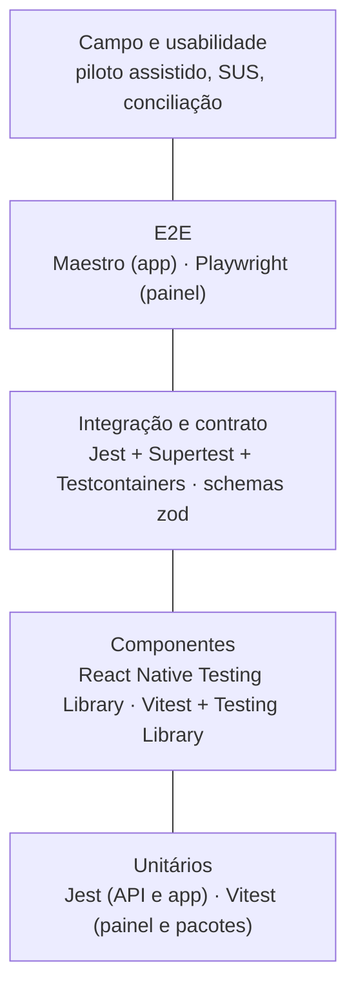

# Estratégia de testes

Parte da [documentação do Guardião](README.md).

Este documento define como o Guardião é testado: a pirâmide de testes, as ferramentas de cada camada, os testes específicos de sincronização, NFC e localização, os testes de segurança, desempenho e acessibilidade, os testes de campo e de usabilidade do piloto, os dados e ambientes de teste e os gates de qualidade que o CI aplica a todo PR. Ele é a referência para a parte de testes da [Definition of Done](13-processo-scrum.md#8-definition-of-done).

## Sumário

1. [Princípios](#1-princípios)
2. [Pirâmide e ferramentas](#2-pirâmide-e-ferramentas)
3. [Testes unitários](#3-testes-unitários)
4. [Testes de integração da API](#4-testes-de-integração-da-api)
5. [Testes de contrato](#5-testes-de-contrato)
6. [Testes de componentes](#6-testes-de-componentes)
7. [Testes E2E do app (Maestro)](#7-testes-e2e-do-app-maestro)
8. [Testes E2E do painel (Playwright)](#8-testes-e2e-do-painel-playwright)
9. [Testes de sincronização](#9-testes-de-sincronização)
10. [Testes de NFC e localização](#10-testes-de-nfc-e-localização)
11. [Testes de segurança](#11-testes-de-segurança)
12. [Desempenho](#12-desempenho)
13. [Acessibilidade](#13-acessibilidade)
14. [Testes de campo e usabilidade](#14-testes-de-campo-e-usabilidade)
15. [Dados e ambientes de teste](#15-dados-e-ambientes-de-teste)
16. [Gates de qualidade no CI](#16-gates-de-qualidade-no-ci)
17. [Bugs: severidade e fluxo](#17-bugs-severidade-e-fluxo)
18. [Rastreabilidade](#18-rastreabilidade)

---

## 1. Princípios

1. **As regras de negócio são testadas onde moram.** Funções puras do domínio (janela da ronda, conclusão, classificação geográfica, transições de status) têm testes unitários exaustivos, porque são baratos e rápidos.
2. **O banco é real nos testes de integração.** Restrições, índices parciais, triggers e permissões fazem parte das regras (RN03, RN04, RN07, RN14). Testar contra um banco falso esconderia defeitos.
3. **Cenários Gherkin viram testes.** Cada cenário de uma história tem pelo menos um teste automatizado ou um roteiro manual registrado.
4. **Hardware se testa em hardware.** NFC, câmera, biometria e GPS são validados em aparelho físico antes do aceite (DoD).
5. **A falha é um caso de teste.** Queda de rede, resposta perdida, app fechado, aparelho reiniciado e relógio errado são testados de propósito.
6. **Teste instável é bug.** Um teste intermitente é consertado ou removido no mesmo dia; não se reexecuta o CI até passar.

## 2. Pirâmide e ferramentas

| Camada | Ferramenta | Onde roda | Quantidade esperada |
|---|---|---|---|
| Unitário | Jest (API, app), Vitest (painel, `packages/*`) | CI em todo PR | Centenas; segundos |
| Componentes | React Native Testing Library, Vitest + Testing Library | CI em todo PR | Um arquivo por componente |
| Integração da API | Jest + Supertest + Testcontainers (PostgreSQL 17, Redis 7, MinIO) | CI em PR que altera `apps/api` ou `packages/shared` | Um conjunto por endpoint |
| Contrato | Schemas zod compartilhados, Spectral no OpenAPI | CI em todo PR | Toda rota |
| E2E do painel | Playwright + `@axe-core/playwright` | CI noturno e no PR de release | Fluxos principais |
| E2E do app | Maestro | Aparelho físico ou emulador, antes de aceite e no RC | Fluxos principais do vigilante |
| Manual em aparelho | Roteiros desta página | Antes do aceite das histórias com hardware | Por história |
| Campo | Piloto assistido | Sprint 5 | Rondas reais |

## 3. Testes unitários

### 3.1 Domínio compartilhado (`packages/shared`)

| Regra | Casos obrigatórios |
|---|---|
| `classificarGeo` (RN06) | Os exemplos de RN06 e da tabela da HU-019; posição nula; precisão exatamente igual à máxima; distância exatamente igual ao raio |
| Haversine | Distâncias conhecidas (0 m, 30 m, 1 km), hemisfério sul, valores próximos de ±180° |
| Janela da ronda (RN02) | Antes, no limite inferior, dentro, no limite superior, depois; desvio positivo e negativo; turno cruzando a meia-noite |
| Conclusão (RN08) | Todos obrigatórios válidos; um justificado; um `REPLAY`; um `INVALIDA` seguido de leitura válida; opcionais sem leitura; visitas sinalizadas por geo |
| Transições de ocorrência | Todas as permitidas e todas as proibidas da máquina de estados |
| Schemas de eventos | Cada tipo de evento válido e inválido (campos ausentes, UUID inválido, descrição curta) |

### 3.2 API

- `ValidadorSun` com os vetores de teste da NXP (AN12196) e casos de CMAC errado, URL truncada, UID divergente e contador repetido.
- `CalculadoraStatusRonda`, `GeradorRondas` (idempotência, vigência, dias da semana, horário de verão inexistente mas fuso configurável), `MarcadorNaoRealizadas`.
- Montagem do conteúdo canônico do hash de auditoria.
- Regras de notificação: gravidade mínima, coordenadores, responsáveis por prédio e por setor, `recebe_email` desligado.

### 3.3 App

- Motor de sincronização com cliente de API simulado: ordem, lotes de 50, backoff com *jitter* (tempo controlado), cada tipo de resposta, recuperação de `ENVIANDO`, refresh no 401, `Retry-After`.
- Repositórios com SQLite em memória: registro e evento na mesma transação; falha no meio desfaz os dois.
- Parser NFC: URL SUN, NTAG215, NDEF vazio, URL de outro domínio.
- Processador de fotos: dimensões finais, ausência de EXIF (arquivo de referência com GPS no EXIF), hash, cifra e decifra.

**Cobertura mínima** (linhas): `packages/shared` 90%, `apps/api/src/**/dominio` e serviços de regras 85%, `apps/mobile/src/dominio` e `src/features/sincronizacao` 85%, demais pastas sem meta numérica. A cobertura é um indicador, não um objetivo: o revisor confere se os cenários da história estão cobertos.

## 4. Testes de integração da API

| Aspecto | Como |
|---|---|
| Banco | Testcontainers sobe PostgreSQL 17 por arquivo de teste (ou por suíte, com *schema* limpo por teste), aplica as migrations reais e conecta com o usuário `guardiao_api` (permissões reais) |
| Redis e MinIO | Testcontainers; o worker roda no mesmo processo com filas reais |
| SMTP | Servidor SMTP de teste em memória (`smtp-server`) que captura as mensagens |
| Autenticação | Fábrica de usuários e tokens por papel e campus |
| Dados | Fábricas (`criarPredio`, `criarRondaEmAndamento`...) com dados fictícios |
| Paralelismo | Um banco por *worker* do Jest |

Casos obrigatórios para **todo endpoint**:

1. Caminho feliz com o papel correto.
2. Papel sem permissão → `403`.
3. Usuário de outro campus ou fora do escopo → `404` (ou `403` para filtro explícito).
4. Validação de entrada → `422` com `problem+json` e `codigo`.
5. Auditoria gravada para escritas (QA-11).

Casos específicos:

| Tema | Teste |
|---|---|
| Permissões de banco (HU-037) | `UPDATE`/`DELETE` em `registro_auditoria` e `DELETE` em `ronda`, `visita_ponto`, `ocorrencia` com `guardiao_api` → erro de permissão |
| Cadeia de auditoria | 50 escritas concorrentes mantêm a cadeia íntegra; alteração direta por superusuário é detectada |
| RN03 | Dois `RONDA_INICIADA` concorrentes para o mesmo vigilante: um `ACEITO`, outro `REJEITADO` |
| Tag ativa única | Substituição concorrente não deixa duas tags `ATIVA` |
| Notificação | Ocorrência `ALTA` gera um e-mail por destinatário; reenvio `DUPLICADO` não gera outro (CA15.6); falha de SMTP leva a `FALHOU` depois das tentativas |
| Fotos | Upload idempotente, hash divergente, foto não anunciada, sexta foto |
| Revogação | Requisição com access token válido depois da revogação → `401` em até o tempo do cache |

## 5. Testes de contrato

- App, API e painel importam os mesmos schemas zod de `@painkiller/shared`. Quebrar um schema quebra o typecheck dos três (cenário da HU-001).
- O job `contrato` gera o OpenAPI, valida com Spectral (regras: toda rota com resposta `4xx` documentada, exemplos presentes, `operationId` único) e compara com `apps/api/openapi.json` versionado. Mudança no contrato exige atualizar o arquivo no mesmo PR, o que torna a mudança visível na revisão.
- Testes de compatibilidade de eventos: payloads de eventos gravados por versões anteriores do app (fixtures em `apps/api/test/fixtures/eventos/v0.x`) continuam aceitos.

## 6. Testes de componentes

- Todo átomo, molécula e organismo tem teste cobrindo os estados da tabela de [09 · Inventário](09-ux-e-design-system.md#7-inventário-de-componentes).
- Verificações comuns: renderiza o texto, expõe `accessibilityRole` e `accessibilityLabel`, respeita o estado desabilitado, chama o *callback* certo.
- `Botao` primário com altura de pelo menos 56 dp e demais com 48 dp (HU-004).
- `ItemPonto` nunca expõe ação de marcar como visitado (RF08).

## 7. Testes E2E do app (Maestro)

Os fluxos ficam em `apps/mobile/.maestro/` e rodam contra um build `preview` apontando para o ambiente de teste com seeds. A leitura NFC usa o `LeitorNfcSimulado` (acionado por `testID`) nos fluxos automatizados; a leitura real é coberta pelos roteiros manuais da [seção 10](#10-testes-de-nfc-e-localização).

| Fluxo | Verifica | Contagem de toques (RNF10) |
|---|---|---|
| `login-e-aviso.yaml` | Login, aviso de privacidade, Início | — |
| `iniciar-ronda.yaml` | INICIAR RONDA a partir da Início | ≤ 1 |
| `registrar-pontos.yaml` | Leituras, ✓, progresso, ponto repetido, tag de outro roteiro | 0 por ponto |
| `finalizar-completa.yaml` | FINALIZAR RONDA a partir da Início | ≤ 2 |
| `finalizar-com-pendencias.yaml` | Justificativa e finalização com pendências | fluxo de exceção |
| `ocorrencia-expressa.yaml` | OCORRÊNCIA → foto → ENVIAR | ≤ 3 |
| `ronda-offline.yaml` | Modo avião durante toda a ronda, reconexão, contador de pendências zera | — |
| `reinicio-com-pendencias.yaml` | Encerrar o app com pendências, reabrir, desbloquear, pendências preservadas | — |
| `logout-bloqueado.yaml` | Sair com pendências é impedido | — |
| `instalacao-tag.yaml` | Modo instalação (administrador) | — |

A contagem de toques é feita com um contador de `tapOn` no próprio fluxo, que falha se a meta for ultrapassada.

## 8. Testes E2E do painel (Playwright)

| Fluxo | Papel |
|---|---|
| Login por papel e menus corretos; `VIGILANTE` recusado | Todos |
| Painel do dia atualiza sozinho depois de um evento enviado pela API de teste | Coordenador |
| Detalhe da ronda: linha do tempo, dois horários, mapa | Coordenador |
| Revisar visita: aceitar; rejeitar exige observação | Coordenador |
| Mudar status de ocorrência; responsável não vê a ação | Coordenador, Responsável |
| Encerramento administrativo | Coordenador |
| Cadastro de prédio com geofence, desativação com motivo, reativação | Administrador |
| Revogar aparelho | Administrador |
| Auditoria: filtros e antes/depois | Administrador |
| Acessibilidade (axe) em todas as páginas acima | — |

## 9. Testes de sincronização

Os cenários F01 a F14 de [06 · Cenários de falha](06-sincronizacao-online-first.md#10-cenários-de-falha) são a matriz de referência.

| Técnica | Uso |
|---|---|
| Proxy de falhas (Toxiproxy em contêiner) entre o app de teste ou o teste de integração e a API | Derrubar a conexão depois que a API processou o lote (resposta perdida), latência alta, perda de pacotes |
| Reenvio forçado | Mesmo lote 3 vezes (RNF05) |
| Servidor simulado no motor do app | Sequências de 503, 429 com `Retry-After`, 401 seguido de refresh |
| Relógio controlado | Aparelho adiantado e atrasado 10 min (RNF07) |
| Aparelho real | Modo avião, encerramento forçado, reinício, bateria crítica |

**Teste de conciliação** (usado no RC e no piloto): depois de um roteiro de teste com falhas forçadas, o script `infra/scripts/conciliar-piloto` compara a exportação da `fila_eventos` do aparelho com `evento_sincronizacao`. Critério: 0 ids faltando e 0 registros duplicados (M04, M05).

## 10. Testes de NFC e localização

### 10.1 Laboratório (por história com hardware)

| Roteiro | Passos | Esperado |
|---|---|---|
| NFC-01 Leitura básica | Encostar o aparelho na tag de um ponto pendente | ✓ em até 1 s, vibração, som |
| NFC-02 Distância e tempo | Aproximar a 0, 1, 2 e 4 cm; encostar por 0,2 s e por 1 s | Registro de quais distâncias e tempos funcionam no aparelho de referência |
| NFC-03 Capa e superfícies | Com capa comum, com capa grossa; tag em parede, metal e vidro | Registro de limitações; tags em metal exigem modelo *on-metal* |
| NFC-04 Leitura repetida | Ler a mesma tag 5 vezes seguidas | Uma visita; "Ponto já registrado" |
| NFC-05 Replay | Copiar a URL SUN de uma leitura e enviá-la em outro evento (ferramenta de teste) | `REPLAY` no servidor, alerta no painel |
| NFC-06 Clone | Gravar a URL SUN numa NTAG215 e ler | `REPLAY` ou `INVALIDA` (UID diferente) |
| NFC-07 NFC desligado | Desligar o NFC com a Execução aberta | "Ative o NFC" |
| NFC-08 Outros apps | Ler a tag fora do app e com o app em primeiro plano | No app, nenhum navegador ou app externo abre |
| GEO-01 Dentro da área | Ler a tag ao lado do ponto, ao ar livre | `DENTRO_AREA` |
| GEO-02 Interior | Ler em ambiente interno, longe de janelas | Registro do resultado (insumo para calibração) |
| GEO-03 Sem GPS | GPS desligado | `SEM_LOCALIZACAO` em até 5 s, visita registrada |
| GEO-04 Mock | App de localização falsa ativo | `localizacaoSimulada = true`, sinalizada |
| GEO-05 Política BLOQUEAR | Campus com `BLOQUEAR`, leitura a 200 m | Leitura recusada com orientação |

### 10.2 Homologação de aparelhos

Antes do piloto, cada modelo de aparelho candidato passa por NFC-01 a NFC-04, GEO-01 a GEO-03, biometria, câmera e uma ronda completa offline. O resultado fica numa tabela de aparelhos homologados no repositório (`docs/` ou issue fixada).

### 10.3 Calibração no piloto

Para cada ponto do campus piloto, o time registra 3 leituras de referência (horário diurno e noturno) e compara `distancia_m` e `precisao_m` com o raio configurado. Pontos com mais de 30% de leituras sinalizadas têm o raio revisto com o PO (risco R07).

## 11. Testes de segurança

| Teste | Quando |
|---|---|
| Testes de autorização por papel e escopo (todo endpoint) | Todo PR |
| `pnpm audit`, Dependabot, CodeQL, secret scanning | Todo PR e contínuo |
| Varredura das imagens Docker (Trivy) | Todo PR que muda Dockerfile e semanalmente |
| Checklist MASVS L2 com o MASTG em aparelho físico | Sprint 4 (RC) e a cada release |
| Extração do banco local e tentativa de abertura sem a chave | RC |
| Busca por segredos e dados pessoais nos logs de um ciclo completo | RC |
| Varredura dinâmica do painel e da API em homologação (OWASP ZAP, modo *baseline*) | RC |
| Teste de força bruta no login (limite e bloqueio) | Integração |
| Reuso de refresh token | Integração |

## 12. Desempenho

| Cenário | Meta | Ferramenta |
|---|---|---|
| Lote de 50 eventos | p95 ≤ 2 s (QA-14) | k6 contra homologação |
| 30 aparelhos enviando lotes ao mesmo tempo (troca de turno) | Sem erro 5xx; p95 ≤ 3 s | k6 |
| `GET /painel/resumo` | p95 ≤ 2 s | k6 |
| Histórico com filtro de 90 dias | Primeira página em até 2 s (CA17.5) | k6 com volume sintético de 1 ano |
| Leitura até o ✓ no app | p95 ≤ 1 s (M07) | Instrumentação local em aparelho de referência |
| Abertura do app até a Início | ≤ 2 s | Medição manual com cronômetro de tela |

O volume sintético usa o gerador de dados do seed com fatores multiplicativos (ex.: 60 rondas/dia × 365 dias).

## 13. Acessibilidade

- Painel: `@axe-core/playwright` sem violações sérias ou críticas; navegação por teclado nos fluxos principais.
- App: testes de componente verificam papéis e rótulos; roteiro manual com TalkBack nas telas Início, Execução e Ocorrência; fonte do sistema em 200%.
- Contraste: script de `packages/design-tokens` no CI ([09 · Tokens](09-ux-e-design-system.md#6-design-tokens)).

## 14. Testes de campo e usabilidade

### 14.1 Piloto assistido (HU-041)

| Item | Definição |
|---|---|
| Quando | 10/11 a 12/11/2026, em produção, restrito ao campus piloto |
| Quem | Vigilantes do campus piloto escolhidos com o PO; um integrante do time acompanha cada ronda observada |
| Orientação | Até 30 min por vigilante (meta de aprendizado em 15 min, QA-09) |
| Observação | Formulário por ronda: toques por tarefa, dúvidas, erros, leituras falhas, tempo da ronda, trechos sem sinal |
| Conciliação | Diária, com o script de conciliação |
| Bugs | Viram issue `tipo:bug` até o fim do dia, com prioridade do PO |
| Encerramento | Questionário SUS e conversa curta com cada vigilante |

### 14.2 SUS (System Usability Scale)

Questionário de 10 itens com escala de 1 a 5, aplicado em português ao fim do piloto. Meta: média ≥ 70 (M08). Resultados abaixo de 70 viram itens de UX priorizados para a V1.1.

### 14.3 Métricas coletadas no piloto

M01 a M11 de [01 · Métricas de sucesso](01-visao-do-produto.md#métricas-de-sucesso), com destaque para M02 (visitas sinalizadas ≤ 10%), M04 (0 perdas), M05 (0 duplicatas), M06 (toques) e M07 (tempo até o ✓).

## 15. Dados e ambientes de teste

| Ambiente | Para quê | Dados |
|---|---|---|
| Local | Desenvolvimento e testes automatizados | Seeds fictícios; Testcontainers nos testes |
| CI | Testes automatizados | Bancos descartáveis por execução |
| Homologação | Aceite do PO, E2E, desempenho, APK de teste | Seeds fictícios + cadastros de teste; nunca dados pessoais reais |
| Produção | Piloto e uso real | Dados reais; testes só com usuários e pontos marcados como teste e desativados depois |

Regras:

- Nomes fictícios ("Vig-01", "P1", "Corredor norte") em seeds, fixtures, prints e PRs.
- Nada de fotos de pessoas reais em fixtures: as imagens de teste são geradas (padrões geométricos).
- As tags de teste usam a chave SUN de desenvolvimento, recusada em produção.

## 16. Gates de qualidade no CI

Workflow `ci.yml` em todo PR para `develop` e `main`:

| Job | O que faz | Bloqueia o merge? |
|---|---|---|
| `lint` | ESLint (inclui regras de fronteira de camadas e literais de estilo) e Prettier | Sim |
| `typecheck` | `tsc --noEmit` em todos os workspaces | Sim |
| `test` | Unitários e componentes (Turborepo, com cache) e cobertura mínima | Sim |
| `test-integracao` | Integração da API com Testcontainers | Sim, quando há mudança em `apps/api` ou `packages/shared` |
| `contrato` | Geração e validação do OpenAPI | Sim |
| `build` | Build da API, do painel e checagem do app (`expo export` para verificar o bundle) | Sim |
| `seguranca` | `pnpm audit --audit-level=high`, Trivy nas imagens | Sim |
| `dependencias` | `dependency-cruiser` com as regras de [04 · Regras de dependência](04-arquitetura.md#51-regras-de-dependência) | Sim |
| `e2e-painel` | Playwright | Só no PR de release (e noturno em `develop`) |

Depois da HU-002, esses jobs entram como **status checks obrigatórios** nos rulesets de `develop` e `main` ([15 · Proteções](15-fluxo-git-e-contribuicao.md#9-proteções-configuradas-no-github)).

## 17. Bugs: severidade e fluxo

| Severidade (template de bug) | Exemplos | Prioridade padrão | Prazo |
|---|---|---|---|
| Crítica | Perda de registro, duplicidade, falha de segurança, ronda impossível | `prioridade:urgente` | Hotfix imediato |
| Alta | Leitura NFC falhando num modelo homologado, e-mail não enviado | `prioridade:must` | Na sprint corrente |
| Média | Há contorno (ex.: filtro do histórico errado) | `prioridade:should` | Próxima sprint |
| Baixa | Cosmético | `prioridade:could` | Backlog |

Todo bug corrigido ganha um teste automatizado que falhava antes da correção, quando tecnicamente possível.

## 18. Rastreabilidade

- Testes citam o critério que cobrem no nome: `it('CA05.3 · leitura repetida não cria nova visita', ...)`.
- Fluxos Maestro e Playwright citam a história no cabeçalho do arquivo (`# HU-018`).
- O relatório de testes do RC lista os critérios de aceitação Must sem teste automatizado e o roteiro manual que os cobre.
