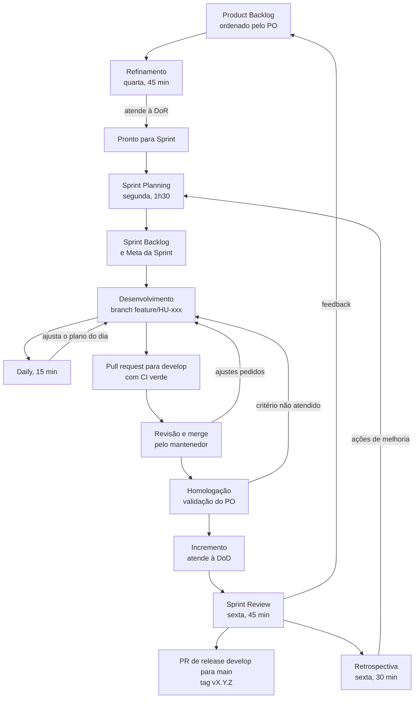
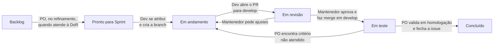
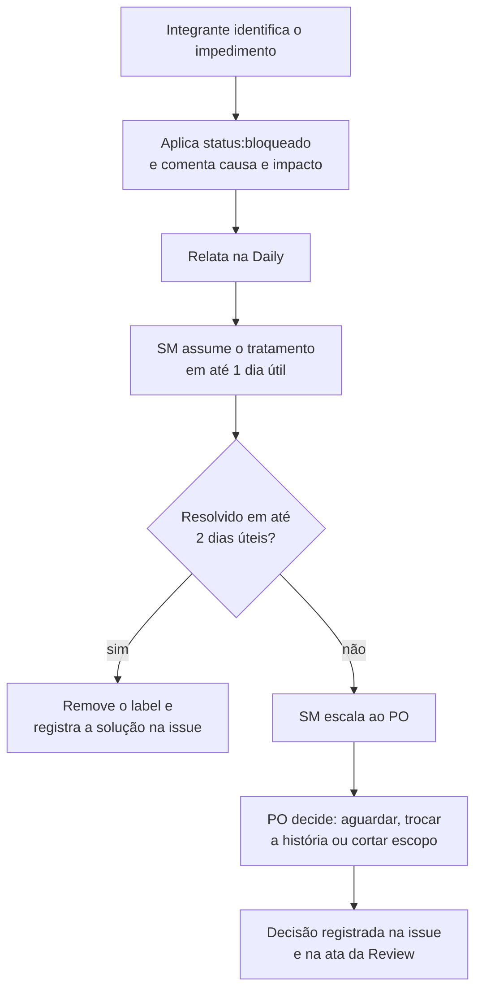
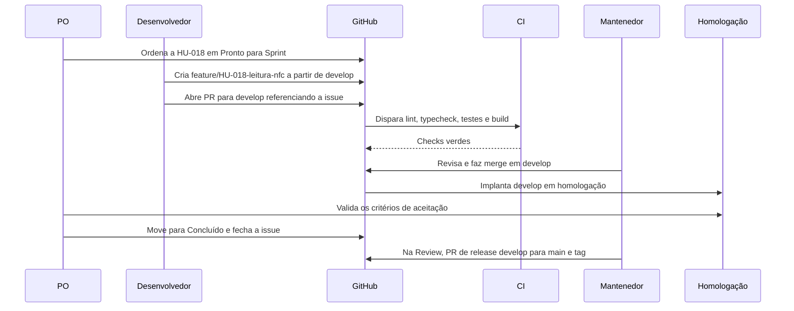

# Processo Scrum

Parte da [documentação do Guardião](README.md).

Este documento descreve como a equipe G.E.I.C.I.S organiza o trabalho no PainKiller (Guardião IFSULDEMINAS): papéis, eventos, quadro, critérios de pronto, estimativas, métricas, riscos e a ligação com o fluxo Git. O conteúdo do backlog, as metas de cada sprint e o cronograma estão em [Backlog e roadmap](14-backlog-e-roadmap.md). Branches, commits e pull requests estão detalhados em [Fluxo Git e contribuição](15-fluxo-git-e-contribuicao.md).

## Sumário

1. [Por que Scrum com sprints de 1 semana](#1-por-que-scrum-com-sprints-de-1-semana)
2. [Papéis e responsabilidades](#2-papéis-e-responsabilidades)
3. [Artefatos e compromissos](#3-artefatos-e-compromissos)
4. [Eventos](#4-eventos)
5. [Calendário das sprints](#5-calendário-das-sprints)
6. [Quadro no GitHub Projects](#6-quadro-no-github-projects)
7. [Definition of Ready](#7-definition-of-ready)
8. [Definition of Done](#8-definition-of-done)
9. [Estimativas](#9-estimativas)
10. [Métricas](#10-métricas)
11. [Convenção de labels](#11-convenção-de-labels)
12. [Comunicação e gestão de impedimentos](#12-comunicação-e-gestão-de-impedimentos)
13. [Gestão de riscos](#13-gestão-de-riscos)
14. [Modelos de ata](#14-modelos-de-ata)
15. [Conexão com o fluxo Git](#15-conexão-com-o-fluxo-git)
16. [Pendências do processo](#16-pendências-do-processo)

---

## 1. Por que Scrum com sprints de 1 semana

A V1 precisa estar em produção até **13/11/2026**. Entre 01/10 e 13/11 há **30 dias úteis**, já descontados os feriados de 12/10 (Nossa Senhora Aparecida) e 02/11 (Finados). O backlog da V1 soma **172 pontos** (ver [capacidade e risco do cronograma](14-backlog-e-roadmap.md#10-capacidade-e-risco-do-cronograma)). Nesse cenário, a equipe adota Scrum com sprints de 1 semana pelos motivos abaixo.

| Motivo | Como a sprint semanal ajuda |
|---|---|
| Prazo curto e escopo grande | Um desvio aparece em dias, não em semanas. O [plano de corte](14-backlog-e-roadmap.md#11-plano-de-corte) pode ser acionado já na Review da Sprint 1. |
| Usabilidade só se valida com quem usa | A Review semanal mostra o incremento à Coordenação de Vigilância e, a partir da Sprint 2, a um vigilante real. Ajustes de RNF08 (interface para uso durante a ronda) e RNF10 (regra dos 2 toques) entram na sprint seguinte. |
| Riscos técnicos concentrados | NFC em aparelho real, validação SUN das tags, sincronização sem perda nem duplicidade e criptografia local precisam funcionar cedo. Cada Review exige demonstração em aparelho, não em slide. |
| Dependências externas | Tags NFC, máquinas virtuais, domínio, SMTP institucional e validação da LGPD dependem de outras áreas do IFSULDEMINAS. A cadência semanal dá uma data fixa para cobrar respostas e decidir alternativas. |
| Um único mantenedor faz merge | Sprints curtas forçam PRs pequenos e contínuos e evitam a fila de revisão no fim do prazo. |

Alguns elementos de Kanban complementam o Scrum: limite de trabalho em andamento (WIP) no quadro e medição de lead time e cycle time.

### Adaptações ao calendário

- **Sprint 0 com 7 dias úteis** (quinta 01/10 a sexta 09/10). Ela é mais longa porque concentra a fundação técnica e o trabalho de preparação que não vira ponto: quadro, labels, proteção de branches, ADRs e solicitações de infraestrutura.
- **Sprints 1 e 4 com 4 dias úteis.** As segundas-feiras 12/10 e 02/11 são feriado, então a Sprint Planning passa para a terça-feira e a capacidade cai cerca de 20%.
- **Timeboxes proporcionais.** O Guia do Scrum define limites máximos para sprints de um mês (8 h de Planning, 4 h de Review, 3 h de Retrospectiva). Para 1 semana, o time usa 1h30, 45 min e 30 min.
- **Sprint 5 de piloto e estabilização.** A última sprint antes da V1.0 tem menos pontos de desenvolvimento e mais trabalho operacional: implantação, distribuição do app, piloto assistido em campo e correções.

---

## 2. Papéis e responsabilidades

| Papel | Quem | Responsabilidades | Não faz |
|---|---|---|---|
| **Product Owner (PO)** | A definir. Sugestão: representante da Coordenação de Vigilância. | Mantém a Meta do Produto. Ordena o Product Backlog. Escreve as histórias e os critérios de aceitação com o time. Decide escopo e cortes (MoSCoW). Valida os critérios de aceitação em homologação e move o card para **Concluído**. Aprova as releases. Faz a ponte com a Coordenação de Vigilância, a TI e o Encarregado de Dados (DPO). | Não define como implementar. Não aceita história que não cumpre a Definition of Done. |
| **Scrum Master (SM)** | A definir. | Facilita os eventos e protege os timeboxes. Remove impedimentos e cobra dependências externas. Acompanha as métricas e o registro de riscos. Garante que DoR e DoD sejam aplicadas. Conduz a Retrospectiva e registra as atas. Protege o time de demandas fora da sprint. | Não é gerente do time. Não atribui tarefas. Não faz o aceite funcional. |
| **Time de Desenvolvimento** | Integrantes da equipe G.E.I.C.I.S alocados ao projeto. A composição fica registrada no quadro. | Estima e planeja a sprint. Implementa, testa e documenta. Abre PRs pequenos para `develop` e revisa os PRs dos colegas. Atualiza o quadro todo dia. Demonstra o incremento na Review. | Não faz merge em `develop` nem em `main`. |
| **Mantenedor/Integrador** | **@madeiragab** | É o **único que faz merge** nas branches `develop` e `main`. Faz a revisão final de todo PR. Configura a proteção de branches e os checks obrigatórios. Abre e mescla o PR de release `develop` → `main` e cria as tags `vX.Y.Z`. Cuida da saúde do CI e da integração. Conduz hotfixes. Zela pela coerência arquitetural e pelos [ADRs](adr/README.md) junto com o time. | Não substitui o PO no aceite funcional. Não mescla o próprio PR sem a aprovação de outro integrante. |

Regras complementares:

- **PO e SM são pessoas diferentes.** O mantenedor também não deve acumular o papel de SM: ele já é o gargalo natural do fluxo de merge.
- **PRs do próprio mantenedor** precisam da aprovação de pelo menos mais um integrante antes do merge.
- **Enquanto PO e SM não forem nomeados** (pendência com prazo até a Review da Sprint 0, em 09/10), a ordem do backlog segue o [Backlog e roadmap](14-backlog-e-roadmap.md), a facilitação dos eventos é feita em rodízio pelo time e o aceite das histórias acontece na Review, junto com a Coordenação de Vigilância.

### Partes interessadas

| Parte interessada | Interesse | Como participa |
|---|---|---|
| Coordenação de Vigilância | Rastreabilidade das rondas, tratamento de ocorrências (papel `COORDENADOR`) | Reviews semanais, definição dos roteiros do piloto, indicação do PO |
| Vigilantes | Aplicativo simples e rápido durante a ronda (papel `VIGILANTE`) | Review a partir da Sprint 2 (um vigilante convidado) e piloto assistido na Sprint 5 |
| Responsáveis por prédios e setores | Receber ocorrências dos seus locais (papel `RESPONSAVEL`) | Consultados sobre o conteúdo das notificações (Sprint 4) |
| TI do IFSULDEMINAS | Infraestrutura, domínio, SMTP, administração do sistema (papel `ADMINISTRADOR`) | Atende às solicitações de infraestrutura e participa da implantação |
| Encarregado de Dados (DPO) | Conformidade com a LGPD | Valida a base legal, o aviso de privacidade e a retenção (ver [Segurança e LGPD](11-seguranca-e-lgpd.md)) |
| Gestão do campus | Orçamento de tags NFC e aparelhos | Decide a compra das tags (ADR-0007, ainda "Proposta") |

### Matriz de responsabilidades (RACI)

R = responsável por executar · A = aprova e responde pelo resultado · C = consultado · I = informado.

| Atividade | PO | SM | Time | Mantenedor |
|---|---|---|---|---|
| Definir e comunicar a Meta do Produto | A/R | C | C | C |
| Ordenar o Product Backlog | A/R | I | C | C |
| Escrever histórias e critérios de aceitação | A/R | I | C | C |
| Estimar com planning poker | I | C | A/R | C |
| Definir a Meta da Sprint | A | C | R | C |
| Implementar, testar e documentar | I | I | A/R | C |
| Revisar pull requests | I | I | R | A/R |
| Fazer merge em `develop` e `main` | I | I | I | A/R |
| Validar critérios de aceitação em homologação | A/R | I | C | I |
| Facilitar eventos e proteger timeboxes | C | A/R | C | C |
| Tratar impedimentos | C | A/R | C | C |
| Publicar release (PR `develop` → `main`, tag) | A | I | C | R |
| Manter o registro de riscos | C | A/R | C | C |

---

## 3. Artefatos e compromissos

| Artefato | Compromisso | Onde fica | Quem mantém |
|---|---|---|---|
| Product Backlog | **Meta do Produto** | GitHub Projects (visão "Backlog") e [Backlog e roadmap](14-backlog-e-roadmap.md) | PO |
| Sprint Backlog | **Meta da Sprint** | GitHub Projects (iteração da sprint) | Time |
| Incremento | **Definition of Done** | Branch `develop`, implantada em homologação e promovida a `main` com tag ao fim da sprint | Time e mantenedor |

### Meta do Produto

> Até 13/11/2026, colocar em produção a V1.0 do Guardião IFSULDEMINAS com o módulo de Vigilância Patrimonial, substituindo os controles manuais de ronda por registros rastreáveis (passagem comprovada por NFC, ocorrências com fotos e painel do coordenador), que funcionam com ou sem internet e servem de base para os próximos módulos da plataforma.

Indicadores de que a Meta do Produto foi atingida:

- Todos os pontos obrigatórios dos roteiros do campus piloto com tag NFC ativa.
- Zero registros perdidos e zero duplicados na conciliação entre o app e o servidor durante o piloto.
- Iniciar ronda, registrar ponto e finalizar ronda completa com no máximo 2 toques a partir da tela Início (RNF10), observado em campo.
- Ocorrências com gravidade igual ou acima da mínima do campus notificadas por e-mail aos destinatários corretos.
- Coordenação acompanhando as rondas do dia pelo painel, sem planilhas.

### Meta da Sprint

Cada sprint tem uma meta única, escrita na Planning e fixada na descrição da iteração no GitHub Projects. A meta orienta as trocas de escopo durante a sprint: uma história pode sair da sprint, mas a meta se mantém. As metas iniciais de cada sprint estão em [Planejamento por sprint](14-backlog-e-roadmap.md#7-planejamento-por-sprint).

### Incremento

O incremento é a soma das histórias que atendem à [Definition of Done](#8-definition-of-done). Ele está sempre em `develop`, implantado em homologação. Na Review, o que foi aceito é promovido para `main` pelo PR de release, com tag de versão (ver [conexão com o fluxo Git](#15-conexão-com-o-fluxo-git)). Uma história que não atende à DoD não entra na contagem de pontos nem é demonstrada como pronta.

---

## 4. Eventos

| Evento | Dia | Duração | Participantes | Entradas | Saídas |
|---|---|---|---|---|---|
| **Sprint** | Segunda a sexta (Sprint 0: quinta a sexta da semana seguinte) | 1 semana | Todo o Time Scrum | Meta do Produto, backlog ordenado | Incremento que atende à DoD |
| **Sprint Planning** | Segunda (terça quando segunda é feriado) | 1h30 | PO, SM, Time, mantenedor | Itens em "Pronto para Sprint", velocidade recente, capacidade da semana (dias úteis e ausências), ações da última Retrospectiva, riscos | Meta da Sprint, Sprint Backlog (issues com `sprint:N` e iteração), plano inicial e riscos da semana |
| **Daily** | Todo dia útil | 15 min | Time (SM facilita; PO opcional) | Quadro atualizado, burndown | Plano do dia, impedimentos registrados |
| **Refinamento** | Quarta | 45 min | PO, Time, SM | Topo do backlog para as próximas 1 ou 2 sprints, dúvidas abertas | Histórias que atendem à DoR, estimativas, histórias divididas |
| **Sprint Review** | Sexta | 45 min | PO, Coordenação de Vigilância, vigilante convidado (a partir da Sprint 2), Time, SM, mantenedor | Incremento em homologação, Meta da Sprint, métricas | Feedback, backlog ajustado, decisão sobre a release da sprint |
| **Retrospectiva** | Sexta, logo após a Review | 30 min | PO, SM, Time, mantenedor | Dados da sprint, ações da retrospectiva anterior | Até 3 ações de melhoria, com dono e prazo |
| **Release da sprint** (não é evento do Scrum) | Sexta, após a Review | 15 min | Mantenedor (PO aprova) | Itens aceitos na Review | PR `develop` → `main` mesclado, tag `vX.Y.Z`, notas de versão |

A Daily pode ser presencial ou assíncrona no Discord/WhatsApp. No formato assíncrono, cada integrante publica até as 10h:

```text
Ontem: HU-018 - leitura NFC registrando visita no banco local (PR #42 em revisão)
Hoje: HU-018 - retorno com vibração e som, testes no aparelho
Impedimentos: nenhum
```

Tempo de eventos por semana: 1h30 + 5 × 15 min + 45 min + 45 min + 30 min = **4h45**, cerca de 12% de uma semana de 40 h.

### Ciclo da sprint



### Pautas

**Sprint Planning (1h30)**

1. Capacidade da semana: dias úteis, ausências e ações da retrospectiva anterior (10 min).
2. PO apresenta a proposta de Meta da Sprint e os itens do topo do backlog (15 min).
3. Time seleciona os itens, confirma estimativas e quebra cada história em tarefas, como checklist na issue (45 min).
4. Riscos e dependências da semana (10 min).
5. Compromisso com a Meta da Sprint e registro da ata (10 min).

**Refinamento (45 min)**

1. PO apresenta as histórias candidatas às próximas 1 ou 2 sprints.
2. Time esclarece dúvidas, revisa os critérios de aceitação e identifica dependências.
3. Planning poker das histórias novas ou alteradas.
4. Histórias que atendem à DoR vão para "Pronto para Sprint".

**Sprint Review (45 min)**

1. Meta da Sprint e resultado (5 min).
2. Demonstração em aparelho real e no painel de homologação (25 min). Quem desenvolveu demonstra.
3. Feedback da Coordenação e do vigilante convidado, com ajustes no backlog (10 min).
4. Métricas e decisão sobre a release da sprint (5 min).

**Retrospectiva (30 min)**

1. Revisão das ações da retrospectiva anterior (5 min).
2. Coleta no formato Começar/Parar/Continuar (10 min).
3. Agrupamento e votação (5 min).
4. Até 3 ações, cada uma com dono, prazo e forma de verificação (10 min).

---

## 5. Calendário das sprints

| Sprint | Período | Dias úteis | Planning | Refinamento | Review e Retrospectiva | Versão |
|---|---|---|---|---|---|---|
| Sprint 0 | 01/10 – 09/10/2026 | 7 | qui 01/10 | qua 07/10 | sex 09/10 | `v0.1.0` |
| Sprint 1 | 13/10 – 16/10/2026 | 4 | ter 13/10 | qua 14/10 | sex 16/10 | `v0.2.0` |
| Sprint 2 | 19/10 – 23/10/2026 | 5 | seg 19/10 | qua 21/10 | sex 23/10 | `v0.3.0` |
| Sprint 3 | 26/10 – 30/10/2026 | 5 | seg 26/10 | qua 28/10 | sex 30/10 | `v0.4.0` |
| Sprint 4 | 03/11 – 06/11/2026 | 4 | ter 03/11 | qua 04/11 | sex 06/11 (Release Candidate) | `v1.0.0-rc.1` |
| Sprint 5 | 09/11 – 13/11/2026 | 5 | seg 09/11 | qua 11/11 | sex 13/11 (go/no-go da V1.0) | `v1.0.0` |

Observações:

- Nas Sprints 1 e 4, Planning e Refinamento ficam em dias seguidos. Nessas semanas o Refinamento é curto e trata apenas da sprint seguinte.
- Na Sprint 4, a Review é a demonstração do **Release Candidate** (06/11).
- Na Sprint 5, o Refinamento trata do backlog da V1.1 e a Review de 13/11 é a reunião de **go/no-go** da V1.0 (critérios em [Plano de releases](14-backlog-e-roadmap.md#12-plano-de-releases)).
- A numeração de versões segue a proposta do [Plano de releases](14-backlog-e-roadmap.md#12-plano-de-releases) e precisa estar alinhada ao [Fluxo Git e contribuição](15-fluxo-git-e-contribuicao.md).

---

## 6. Quadro no GitHub Projects

O trabalho é controlado em GitHub Issues e em um projeto do GitHub Projects com as colunas abaixo.

| Coluna | Significado | Quem move o card para cá | Limite de WIP |
|---|---|---|---|
| **Backlog** | Item registrado, ainda não necessariamente refinado | Qualquer integrante cria a issue. O PO ordena. | — |
| **Pronto para Sprint** | Item que atende à [DoR](#7-definition-of-ready) | PO, no Refinamento | Equivalente a até 2 sprints de trabalho |
| **Em andamento** | Alguém está trabalhando. A branch existe. | Desenvolvedor, ao se atribuir à issue e criar a branch | 2 itens por pessoa |
| **Em revisão** | PR aberto para `develop`, com CI verde | Desenvolvedor, ao abrir o PR | 5 itens no total |
| **Em teste** | PR mesclado em `develop` e implantado em homologação | Mantenedor, ao fazer o merge (ou a automação "Pull request merged") | — |
| **Concluído** | Critérios de aceitação validados e DoD completa | PO, após validar em homologação | — |



### Regras do quadro

- **Título das issues de história:** `HU-018 · Vigilante registra a passagem encostando o celular na tag`. O ID e o texto vêm do [Backlog e roadmap](14-backlog-e-roadmap.md).
- **Épicos** são issues com o label `tipo:epico`. As histórias são vinculadas a eles como sub-issues.
- **Campos do projeto:** Status (as colunas acima), Sprint (campo de iteração semanal), Pontos (número), Prioridade (Must, Should, Could), Épico (EP01 a EP11) e Área.
- **Visões:** "Quadro da sprint" (board filtrado pela iteração atual), "Backlog" (tabela ordenada pelo PO), "Por épico" (agrupada pelo campo Épico) e "Roadmap" (layout de roadmap por iteração).
- **A issue só é fechada pelo PO**, quando o card vai para Concluído. Por isso o PR referencia a issue sem palavra de fechamento automático (por exemplo, `Refs #57`), e não `Closes #57`.
- **Bloqueios** não são uma coluna. O card continua onde está e recebe o label `status:bloqueado` (ver [impedimentos](#12-comunicação-e-gestão-de-impedimentos)).
- **Defeito encontrado em "Em teste"** em história da própria sprint: o card volta para "Em andamento" com um comentário que descreve o problema. Defeito em algo já concluído vira uma nova issue `tipo:bug`.
- **WIP estourado em "Em revisão"** (mais de 5 itens): o time para de puxar itens novos e ajuda na revisão por pares, e o mantenedor prioriza revisão sobre código novo.
- **O quadro é atualizado antes da Daily.** Card parado há mais de 2 dias úteis na mesma coluna é assunto obrigatório da Daily.

---

## 7. Definition of Ready

Uma história só vai para **Pronto para Sprint** quando todos os itens abaixo estão marcados.

- [ ] Título no padrão `HU-xxx · resumo` e labels `tipo:`, `area:` e `prioridade:` aplicados.
- [ ] Escrita no formato "Como <papel>, quero <ação>, para <benefício>" ou, se técnica, como tarefa técnica com objetivo explícito.
- [ ] De 2 a 5 critérios de aceitação em Gherkin (Dado/Quando/Então), concretos e testáveis.
- [ ] Requisitos (RF/RNF), regras de negócio (RN) e casos de uso (UC) ligados.
- [ ] Estimada pelo time com planning poker e com no máximo 8 pontos. Histórias de 13 pontos são divididas antes de entrar na sprint.
- [ ] Dependências identificadas: já concluídas ou planejadas antes, na mesma sprint.
- [ ] Se houver tela: esboço ou referência no design system e contagem de toques prevista para as funções principais do vigilante (RNF10).
- [ ] Se houver endpoint novo ou alterado: contrato esboçado (rota, payload, erros em `application/problem+json`) conforme [API](07-api.md).
- [ ] Dados e recursos de teste disponíveis: tags NFC físicas ou o `LeitorNfcSimulado`, aparelho Android com NFC, usuários de seed.
- [ ] Impacto em segurança e LGPD avaliado: dados pessoais, localização, fotos, permissões por papel.
- [ ] Cabe em uma sprint e o PO está disponível para tirar dúvidas durante a sprint.

---

## 8. Definition of Done

A DoD tem três níveis. Uma história só conta pontos quando cumpre o nível 1. O incremento da sprint precisa do nível 2. As releases RC e V1.0 exigem também o nível 3.

### Nível 1: história

**Código, revisão e integração**

- [ ] Código segue os padrões do monorepo: lint e typecheck sem erros, sem `any` sem justificativa, sem código comentado.
- [ ] PR para `develop` com descrição, referência à issue e checklist da DoD preenchido.
- [ ] **PR revisado e mesclado pelo mantenedor (@madeiragab)** em `develop`, com a revisão por pares de outro integrante quando o autor é o próprio mantenedor.
- [ ] **CI verde:** lint, typecheck, testes, build e auditoria de dependências.

**Testes** (ver [Estratégia de testes](12-estrategia-de-testes.md))

- [ ] Testes unitários para cada regra de negócio nova ou alterada, cobrindo os cenários Gherkin da história.
- [ ] Testes de integração (Jest + Supertest + Testcontainers) para cada endpoint novo ou alterado, incluindo os casos de permissão negada.
- [ ] Fluxo E2E com Maestro criado ou atualizado quando a história altera um fluxo principal do vigilante.
- [ ] Teste em aparelho Android físico com NFC quando a história envolve NFC, câmera, localização ou biometria.
- [ ] Teste sem conexão (modo avião, depois reconexão) quando a história grava dados no app.

**Aceite**

- [ ] **Critérios de aceitação validados pelo PO** em homologação.

**Interface** (quando houver UI)

- [ ] **Regra dos 2 toques respeitada:** iniciar ronda, registrar ponto e finalizar ronda completa com no máximo 2 toques a partir da tela Início (leitura NFC com 0 toques no Android). A contagem fica registrada no PR.
- [ ] Telas montadas com componentes do design system e design tokens, sem estilos soltos. Componentes novos com story no Storybook (RNF12).
- [ ] Alvos de toque de pelo menos 56 dp na ação primária e 48 dp nas demais, tema escuro de alto contraste e fonte grande do sistema verificados (ver [UX e design system](09-ux-e-design-system.md)).

**Segurança e privacidade** (ver [Segurança e LGPD](11-seguranca-e-lgpd.md))

- [ ] **Nenhuma pendência de segurança:** nenhum segredo no código ou no histórico, nenhum dado sensível em logs ou AsyncStorage, `pnpm audit` sem vulnerabilidade alta ou crítica, alertas do Dependabot e do CodeQL tratados.
- [ ] Autorização aplicada na API com guards por papel e por escopo (campus ou local), com teste.
- [ ] Localização coletada somente nos eventos (RNF14).
- [ ] Criação, alteração ou desativação de registro gera `registro_auditoria` (RN14). Nenhum endpoint de exclusão física.

**Documentação**

- [ ] **Documentação atualizada:** contrato OpenAPI 3.1 dos endpoints (RNF13), documentos de `docs/` afetados, ADR novo quando houver decisão de arquitetura e entrada no `CHANGELOG.md`.
- [ ] Migrations do Prisma versionadas, com o SQL cru de triggers e permissões revisado.

### Nível 2: incremento da sprint

- [ ] Todas as histórias contadas cumprem o nível 1.
- [ ] `develop` implantada em homologação e estável: `GET /api/v1/saude/prontidao` respondendo, login e fluxo principal verificados.
- [ ] Incremento demonstrado na Review.
- [ ] Nenhum bug `prioridade:must` aberto nas histórias da sprint.
- [ ] PR de release `develop` → `main` mesclado pelo mantenedor, com tag e notas de versão no `CHANGELOG.md`.

### Nível 3: Release Candidate e V1.0

- [ ] Fluxo E2E completo (login → iniciar ronda → ler pontos → ocorrência com foto → finalizar → sincronizar após período offline) verde em aparelho físico.
- [ ] Checklist do OWASP MASVS (nível L2 para armazenamento, criptografia e autenticação) revisado.
- [ ] Backup e restauração testados e monitoramento ativo (V1.0).
- [ ] Aviso de privacidade validado pelo Encarregado de Dados (V1.0).
- [ ] Notas de versão publicadas e critérios do [Plano de releases](14-backlog-e-roadmap.md#12-plano-de-releases) atendidos.

---

## 9. Estimativas

O time estima em **story points** com a sequência de Fibonacci **1, 2, 3, 5, 8, 13**, usando **planning poker**. Os pontos medem esforço, complexidade e incerteza em relação a histórias de referência, não horas.

### Histórias de referência

| Pontos | Significado | Referência no backlog |
|---|---|---|
| 1 | Ajuste pequeno, sem incerteza | HU-044 · Aviso de privacidade no primeiro acesso |
| 2 | Pequeno e conhecido | HU-003 · Ambiente local com Docker Compose |
| 3 | Uma tela ou endpoint com regras simples | HU-016 · Vigilante inicia a ronda com 1 toque |
| 5 | Várias partes (API, tela, regras) com alguma incerteza | HU-009 · Cadastrar campus, prédios, andares e setores |
| 8 | Complexo, com risco técnico ou hardware envolvido | HU-018 · Leitura NFC; HU-029 · Banco local cifrado e fila |
| 13 | Grande demais para uma sprint de 1 semana | Deve ser dividida antes de entrar em "Pronto para Sprint" |

### Como o planning poker funciona

1. O PO lê a história e os critérios de aceitação.
2. O time tira dúvidas, com timebox de 5 minutos por história.
3. Cada integrante escolhe uma carta em segredo (1, 2, 3, 5, 8, 13, "?" para "não sei" e "pausa") e todos revelam ao mesmo tempo. Pode ser feito com cartas físicas ou com uma ferramenta online.
4. Se os valores estiverem a mais de uma carta de distância, quem votou o maior e quem votou o menor explicam o raciocínio, e o time vota de novo.
5. Depois de duas rodadas sem consenso, o time adota o **maior valor** em discussão.
6. Muitos "?" indicam falta de informação: a história volta para refinamento ou vira um spike.

### Outras regras

- Os pontos do [Backlog e roadmap](14-backlog-e-roadmap.md) são a estimativa inicial. Reestimativas acontecem no Refinamento e ficam registradas na issue.
- **Spikes** (investigações técnicas) têm timebox em horas e não recebem pontos. Exemplo: provisionamento das tags NTAG 424 DNA com SUN.
- **Bugs de histórias da sprint atual** não são estimados: corrigi-los faz parte de concluir a história. Bugs de itens já concluídos são estimados como qualquer item do backlog.
- Nenhuma história com 13 pontos ou mais entra numa sprint de 1 semana.

---

## 10. Métricas

| Métrica | Definição | Fonte | Quando | Para que serve |
|---|---|---|---|---|
| **Velocidade** | Soma dos pontos das histórias em "Concluído" na sprint (só histórias inteiras, que cumprem a DoD) | Campo Pontos + iteração no GitHub Projects | Fim de cada sprint | Planejar a próxima sprint |
| **Ritmo por dia útil** | Velocidade ÷ dias úteis da sprint | Calculado | Fim de cada sprint | Comparar sprints de 4, 5 e 7 dias e projetar o restante da V1 |
| **Burndown da sprint** | Pontos restantes da sprint a cada dia | Insights do GitHub Projects ou planilha atualizada na Daily | Diário | Perceber cedo que a Meta da Sprint está em risco |
| **Burnup da release** | Pontos concluídos acumulados contra os 172 pontos da V1 | Insights do GitHub Projects | Semanal (Review) | Mostrar à Coordenação a tendência até o RC e a V1.0 |
| **Lead time** | Tempo entre a criação da issue e "Concluído" | Datas das issues | Semanal | Medir a previsibilidade do fluxo |
| **Cycle time** | Tempo entre "Em andamento" e "Concluído". Meta: até 3 dias úteis para histórias de até 5 pontos | Histórico de status no Projects | Semanal | Achar gargalos (revisão, teste, aceite) |
| **Tempo de revisão** | Tempo entre a abertura do PR e o merge. Meta: até 1 dia útil | GitHub (pull requests) | Semanal | Acompanhar o gargalo do mantenedor único |
| **Taxa de bugs** | Bugs abertos na sprint ÷ histórias concluídas na sprint | Labels `tipo:bug` e `sprint:` | Fim de cada sprint | Medir a qualidade do que é entregue |
| **Defeitos escapados** | Bugs encontrados depois de "Concluído": em homologação, no piloto ou em produção | `tipo:bug` com referência à história de origem | Fim de cada sprint | Avaliar se a DoD está funcionando |
| **Cumprimento da Meta da Sprint** | Meta atingida: sim, parcialmente ou não | Ata da Review | Fim de cada sprint | Avaliar a qualidade do planejamento |

Regras de uso:

- **Ritmo necessário** = pontos restantes da V1 ÷ dias úteis restantes. Ele é comparado ao ritmo real em toda Review e alimenta o [plano de corte](14-backlog-e-roadmap.md#11-plano-de-corte).
- As métricas servem para o time se planejar e melhorar. Nunca são usadas para avaliar ou comparar pessoas.
- Os números de cada sprint ficam registrados na ata da Review.

---

## 11. Convenção de labels

Toda issue tem exatamente um label `tipo:`, pelo menos um `area:` e um `prioridade:`. O label `sprint:` é aplicado quando a issue entra numa sprint. Os labels `status:` são opcionais e indicam condições que não são colunas do quadro.

### `tipo:`

| Label | Uso | Cor sugerida |
|---|---|---|
| `tipo:epico` | Épico EP01 a EP11, com as histórias como sub-issues | `#3E4B9E` |
| `tipo:historia` | História de usuário (HU) | `#1D76DB` |
| `tipo:tarefa-tecnica` | História técnica ou tarefa sem valor direto para o usuário final | `#5319E7` |
| `tipo:bug` | Defeito | `#D73A4A` |
| `tipo:spike` | Investigação com timebox | `#FBCA04` |
| `tipo:documentacao` | Mudança só em documentação | `#0075CA` |
| `tipo:debito-tecnico` | Melhoria interna adiada de forma consciente | `#BFD4F2` |

### `area:`

| Label | Uso |
|---|---|
| `area:mobile` | App Guardião (`apps/mobile`) |
| `area:api` | API e worker (`apps/api`) |
| `area:web` | Painel do coordenador (`apps/web`) |
| `area:banco` | Modelo de dados, migrations, permissões do PostgreSQL |
| `area:design-system` | `packages/design-tokens` e componentes base |
| `area:infra` | Docker, Caddy, CI, EAS Build, ambientes, backups |
| `area:seguranca` | Autenticação, criptografia, MASVS, LGPD |
| `area:docs` | Documentação em `docs/` e na raiz |

### `prioridade:`

| Label | Uso | Cor sugerida |
|---|---|---|
| `prioridade:must` | Obrigatório para a V1 (MoSCoW). Em bugs: bloqueia a DoD ou a release. | `#B60205` |
| `prioridade:should` | Importante, mas pode sair se faltar capacidade. Em bugs: corrigir na sprint seguinte. | `#D93F0B` |
| `prioridade:could` | Desejável, previsto para depois da V1. Em bugs: cosmético. | `#FEF2C0` |
| `prioridade:urgente` | Incidente em produção. Segue o fluxo de `hotfix/...`. | `#000000` |

### `sprint:`

`sprint:0`, `sprint:1`, `sprint:2`, `sprint:3`, `sprint:4`, `sprint:5` e `sprint:v1.1`. O label complementa o campo de iteração do Projects e permite filtrar a sprint nas listas de issues e PRs.

### `status:`

| Label | Uso |
|---|---|
| `status:triagem` | Issue nova, aplicada automaticamente pelos templates. O PO (ou o SM) classifica e remove o label. |
| `status:bloqueado` | Há um impedimento. A issue tem um comentário com a causa e quem está tratando. |
| `status:precisa-refinamento` | Falta informação para atender à DoR. |
| `status:aguardando-terceiros` | Depende de alguém de fora do time: TI, compras, DPO, Coordenação. |
| `status:em-risco` | O item pode não terminar na sprint. Sinalizado na Daily. |

---

## 12. Comunicação e gestão de impedimentos

### Canais

| Canal | Uso | Regra |
|---|---|---|
| GitHub Issues | Histórias, bugs, decisões de escopo, impedimentos | Decisão que não está no GitHub não foi tomada. Decisões combinadas em outro canal são registradas na issue em até 1 dia útil. |
| Pull requests | Discussão de código e de implementação | Comentários objetivos, sugestões com o motivo |
| GitHub Discussions (categoria "Atas") | Atas de Planning, Review e Retrospectiva | Publicadas no mesmo dia do evento |
| Discord ou WhatsApp do time | Daily assíncrona, avisos rápidos, combinados do dia | Nada de credenciais, dados pessoais ou fotos de ocorrências |
| E-mail institucional | Comunicação formal com Coordenação de Vigilância, TI e DPO | Cópia para o PO e o SM. O resultado é registrado na issue correspondente. |
| Sprint Review | Demonstração e feedback da Coordenação e dos vigilantes | Toda sexta, com agenda fixa |

### Fluxo de um impedimento

1. Quem encontra o impedimento aplica `status:bloqueado` na issue e comenta a causa, o impacto e o que já foi tentado.
2. O impedimento é relatado na Daily (ou na hora, se bloquear mais de uma pessoa).
3. O SM assume o tratamento em até **1 dia útil**.
4. Se não for resolvido em **2 dias úteis**, o SM escala para o PO, que leva o assunto à Coordenação de Vigilância ou à área responsável.
5. O PO decide entre aguardar, trocar a história por outra da sprint ou acionar o plano de corte.



### Dependências externas e datas-limite

As dependências abaixo estão fora do controle do time. A data-limite é a última data em que o item precisa estar disponível para não afetar o cronograma. Itens sem resposta até a data-limite viram impedimento.

| Dependência | Necessária para | Data-limite | Quem cobra |
|---|---|---|---|
| Nomeação do PO e do SM | Todos os eventos | 09/10 (Review da Sprint 0) | Equipe G.E.I.C.I.S |
| Aparelhos Android com NFC para desenvolvimento e teste | HU-010 (Sprint 1), HU-018 (Sprint 2) | 13/10 | PO |
| Amostras de tags NFC (NTAG 424 DNA ou, como alternativa, NTAG215) | HU-010 (Sprint 1), HU-018 (Sprint 2) | 13/10 | PO |
| Ambiente de homologação (VM ou alternativa provisória) | Coluna "Em teste" a partir da Sprint 1 | 13/10 | Mantenedor |
| Vigilante convidado para as Reviews | Review da Sprint 2 | 23/10 | PO |
| Acesso ao SMTP institucional | HU-026 (Sprint 4) | 30/10 | Mantenedor |
| Lote de tags para os roteiros do campus piloto | Instalação antes do piloto | 30/10 | PO |
| Conta de distribuição (Expo/EAS e Google Play Console, ou decisão por APK interno) | HU-043 (Sprint 5) | 30/10 | Mantenedor |
| VM de produção, domínio institucional e DNS | HU-042 (Sprint 5) | 03/11 | Mantenedor |
| Campus piloto, roteiros e vigilantes do piloto definidos | HU-041 (Sprint 5) | 06/11 | PO |
| Texto do aviso de privacidade validado pelo Encarregado de Dados | Aceite final de HU-044 e início do piloto | 06/11 | PO |

---

## 13. Gestão de riscos

O registro abaixo é a linha de base. A versão viva fica numa issue fixada, "Registro de riscos", revisada em toda Planning (5 minutos) e em toda Review. Probabilidade e impacto usam a escala Baixa, Média, Alta.

| ID | Risco | Prob. | Impacto | Mitigação | Gatilho | Dono |
|---|---|---|---|---|---|---|
| R01 | Escopo maior que a capacidade: 172 pontos em 30 dias úteis, com 41 pontos na Sprint 4, que tem 4 dias | Alta | Alto | Medir o ritmo real nas Sprints 0 e 1, aplicar o [plano de corte](14-backlog-e-roadmap.md#11-plano-de-corte) em níveis, manter PRs pequenos | Ritmo real abaixo de 85% do ritmo necessário em uma Review | PO |
| R02 | Atraso na compra ou entrega das tags NTAG 424 DNA (ADR-0007 ainda "Proposta") | Média | Alto | Desenvolver com o `LeitorNfcSimulado`; alternativa de NTAG215 com trava de escrita (validação `NAO_VERIFICAVEL`); pedir amostras logo na Sprint 0 | Tags indisponíveis em 13/10 | PO |
| R03 | Falta de aparelhos Android com NFC para teste e para o piloto | Média | Alto | Levantar na Sprint 0 os modelos disponíveis; testar em pelo menos 2 modelos diferentes | Nenhum aparelho disponível no início da Sprint 2 | SM |
| R04 | Infraestrutura institucional (VM, domínio, SMTP, TLS) não liberada a tempo | Média | Alto | Solicitação formal na Sprint 0; homologação em ambiente provisório; roteiro de implantação pronto antes (ver [Implantação e infraestrutura](16-implantacao-e-infraestrutura.md)) | VM de produção indisponível em 03/11 | Mantenedor |
| R05 | Gargalo de revisão com um único mantenedor fazendo merge | Alta | Médio | PRs pequenos, revisão por pares antes da revisão final, janela diária de revisão, limite de 5 itens em "Em revisão" | PR esperando mais de 1 dia útil | Mantenedor e SM |
| R06 | Defeitos na sincronização offline (perda ou duplicidade de registros) | Média | Alto | Caminho único de escrita (ADR-0005), idempotência por id do evento, testes de reenvio e queda de rede, conciliação no piloto | Qualquer divergência na conciliação entre app e servidor | Time |
| R07 | Baixa precisão do GPS dentro de prédios, gerando excesso de visitas sinalizadas | Alta | Médio | Política padrão `SINALIZAR` (ADR-0011); calibrar `raio_tolerancia_m` e `precisao_maxima_m` no piloto | Mais de 20% das visitas do piloto com revisão pendente | PO |
| R08 | PO ou Coordenação indisponíveis para Reviews e aceite | Média | Alto | Agenda fixa às sextas; validação assíncrona em homologação; PO substituto indicado | Aceite pendente há mais de 2 dias úteis | SM |
| R09 | Validação da LGPD pelo Encarregado de Dados atrasar | Média | Médio | Enviar o texto do aviso na Sprint 1; piloto com versão preliminar aprovada pelo PO | Sem retorno até 06/11 | PO |
| R10 | Capacidade reduzida nas semanas com feriado e por ausências | Alta | Médio | Planejar com dias úteis reais e ausências conhecidas; revisar a carga da Sprint 4 na Planning de 03/11 | Ausência não prevista na semana | SM |
| R11 | Atraso na distribuição do app (conta da loja, revisão do Google Play) | Baixa | Médio | APK interno como alternativa; build de teste já na Sprint 2 | Conta não criada até 30/10 | Mantenedor |
| R12 | Baixa adesão dos vigilantes ao app | Média | Alto | Regra dos 2 toques, vigilante nas Reviews desde a Sprint 2, orientação curta no piloto | Queixas recorrentes ou rondas não iniciadas no piloto | PO |
| R13 | Vulnerabilidade grave descoberta perto do RC | Baixa | Alto | Segurança na DoD, Dependabot e CodeQL contínuos, checklist do MASVS na Sprint 4 | Alerta alto ou crítico aberto | Mantenedor |

Os riscos específicos do cronograma (sequenciamento, carga por sprint e plano de corte) estão detalhados em [Capacidade e risco do cronograma](14-backlog-e-roadmap.md#10-capacidade-e-risco-do-cronograma).

---

## 14. Modelos de ata

As atas ficam no GitHub Discussions do repositório, na categoria "Atas", com o título no padrão `Planning · Sprint 2 · 19/10/2026`. O SM publica cada ata no mesmo dia do evento.

### Sprint Planning

```markdown
# Planning · Sprint N · dd/mm/2026

**Participantes:**
**Período:** dd/mm a dd/mm/2026 · **Dias úteis:** X · **Ausências previstas:**
**Ritmo de referência:** X pontos por dia útil (média das últimas sprints)

**Meta da Sprint:**

| Issue | História | Pontos | Responsável inicial |
|---|---|---|---|
| #__ | HU-xxx · ... | | |

**Total planejado:** __ pontos
**Riscos e dependências da semana:**
**Ações da última retrospectiva incorporadas:**
**Decisões:**
```

### Sprint Review

```markdown
# Review · Sprint N · dd/mm/2026

**Participantes (inclusive convidados):**
**Meta da Sprint atingida?** Sim / Parcialmente / Não. Motivo:

| História | Demonstrada | Aceita pelo PO |
|---|---|---|
| HU-xxx | sim/não | sim/não |

**Não concluído (volta ao backlog):**
**Feedback da Coordenação e dos vigilantes:**
**Mudanças no backlog:**
**Métricas:** planejado __ pts · concluído __ pts · ritmo __ pts/dia útil · ritmo necessário __ pts/dia útil · bugs abertos __
**Plano de corte:** nenhum nível acionado / nível __ acionado (itens: )
**Release:** PR develop → main #__ · tag v_._._
```

### Retrospectiva (Começar/Parar/Continuar)

```markdown
# Retrospectiva · Sprint N · dd/mm/2026

**Participantes:**
**Ações da retrospectiva anterior:** (feita / não feita, com comentário)

## Começar
-

## Parar
-

## Continuar
-

## Ações (no máximo 3)

| Ação | Dono | Prazo | Como saberemos que funcionou |
|---|---|---|---|
| | | | |
```

---

## 15. Conexão com o fluxo Git

O quadro e o Git contam a mesma história. Cada coluna corresponde a um estado da branch e do PR, conforme o [Fluxo Git e contribuição](15-fluxo-git-e-contribuicao.md) e o [CONTRIBUTING.md](../CONTRIBUTING.md).

| Coluna | Estado no Git |
|---|---|
| Pronto para Sprint | Ainda não há branch. |
| Em andamento | Branch `feature/HU-018-leitura-nfc` criada a partir de `develop`, com commits no padrão Conventional Commits em português, por exemplo `feat(mobile): leitura automática de tag NFC (HU-018)`. |
| Em revisão | PR aberto para `develop`, referenciando a issue (`Refs #<n>`), com checklist da DoD e CI verde. |
| Em teste | PR mesclado por @madeiragab em `develop` e versão implantada em homologação. |
| Concluído | PO validou. A história entra no próximo PR de release `develop` → `main`. |



Pontos de contato entre o processo e o Git:

- **Uma história, uma branch, um PR** sempre que possível. Histórias de 8 pontos podem ter mais de um PR, cada um deixando `develop` funcional.
- **Commits e PRs citam o ID da história** (`HU-018`). Isso liga o código ao backlog e à rastreabilidade de requisitos.
- **Somente @madeiragab faz merge.** O tempo de revisão é acompanhado como métrica (ver [Métricas](#10-métricas)).
- **Release por sprint:** na sexta, depois da Review, o mantenedor abre e mescla o PR `develop` → `main` só com o que foi aceito e cria a tag da versão (ver [Calendário das sprints](#5-calendário-das-sprints)). Se algo mesclado em `develop` não foi aceito, ele é desligado por feature flag ou revertido antes da release.
- **Hotfix:** a partir do piloto, um incidente em produção vira issue `tipo:bug` com `prioridade:urgente`, branch `hotfix/...` a partir de `main`, PR para `main` mesclado pelo mantenedor e atualização de `develop` em seguida.

---

## 16. Pendências do processo

| Pendência | Responsável | Prazo |
|---|---|---|
| Nomear o Product Owner (sugestão: representante da Coordenação de Vigilância) | Equipe G.E.I.C.I.S e Coordenação de Vigilância | 09/10/2026 |
| Nomear o Scrum Master | Equipe G.E.I.C.I.S | 09/10/2026 |
| Definir a composição do Time de Desenvolvimento e registrar no quadro | Equipe G.E.I.C.I.S | 09/10/2026 |
| Criar o projeto no GitHub Projects com colunas, campos, visões e labels deste documento | Mantenedor | 09/10/2026 |
| Configurar a proteção das branches `develop` e `main` (merge só pelo mantenedor, checks obrigatórios) | Mantenedor | 09/10/2026 |
| Habilitar o GitHub Discussions com a categoria "Atas" | Mantenedor | 09/10/2026 |
| Combinar o canal (Discord ou WhatsApp) e o horário da Daily | Time | 02/10/2026 |
