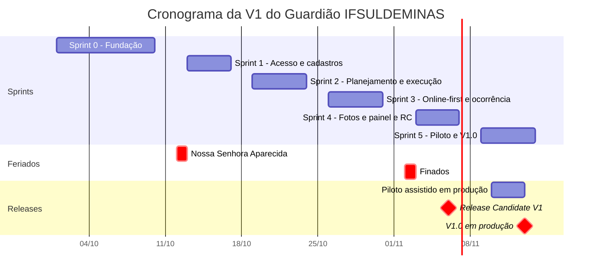
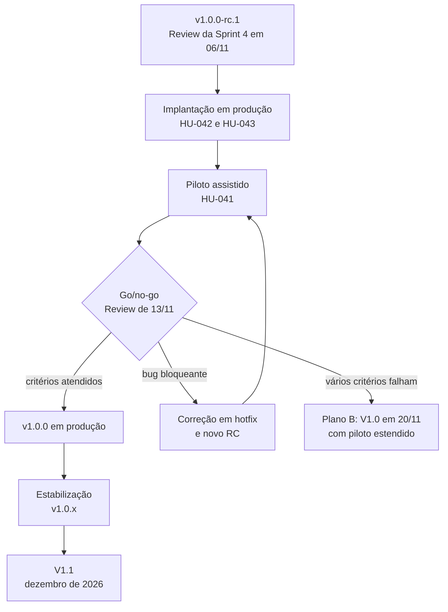
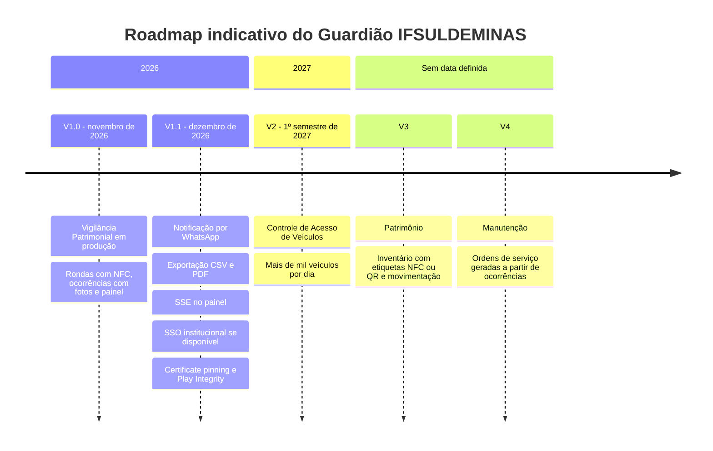

# Backlog e roadmap

Parte da [documentação do Guardião](README.md).

Este documento reúne o Product Backlog da V1 do Guardião IFSULDEMINAS (módulo Vigilância Patrimonial): Meta do Produto, épicos, as 44 histórias com critérios de aceitação, o planejamento por sprint, o cronograma, a análise de capacidade, o plano de corte, o plano de releases e o roadmap depois da V1. O modo de trabalho do time (papéis, eventos, DoR, DoD, labels) está em [Processo Scrum](13-processo-scrum.md).

## Sumário

1. [Meta do Produto](#1-meta-do-produto)
2. [Como ler este backlog](#2-como-ler-este-backlog)
3. [Épicos](#3-épicos)
4. [Visão geral das histórias](#4-visão-geral-das-histórias)
5. [Rastreabilidade dos requisitos](#5-rastreabilidade-dos-requisitos)
6. [Histórias detalhadas](#6-histórias-detalhadas)
7. [Planejamento por sprint](#7-planejamento-por-sprint)
8. [Cronograma](#8-cronograma)
9. [Dependências e sequenciamento](#9-dependências-e-sequenciamento)
10. [Capacidade e risco do cronograma](#10-capacidade-e-risco-do-cronograma)
11. [Plano de corte](#11-plano-de-corte)
12. [Plano de releases](#12-plano-de-releases)
13. [Roadmap pós-V1](#13-roadmap-pós-v1)
14. [Premissas e pendências](#14-premissas-e-pendências)

---

## 1. Meta do Produto

> Até 13/11/2026, colocar em produção a V1.0 do Guardião IFSULDEMINAS com o módulo de Vigilância Patrimonial, substituindo os controles manuais de ronda por registros rastreáveis (passagem comprovada por NFC, ocorrências com fotos e painel do coordenador), que funcionam com ou sem internet e servem de base para os próximos módulos da plataforma.

Os indicadores que mostram se a meta foi atingida estão em [Processo Scrum](13-processo-scrum.md#meta-do-produto). A visão completa do produto está em [Visão do produto](01-visao-do-produto.md).

---

## 2. Como ler este backlog

- **Formato das histórias:** "Como <papel>, quero <ação>, para <benefício>". As histórias técnicas aparecem como **tarefa técnica**, com o objetivo explícito.
- **Critérios de aceitação** em Gherkin, com as palavras-chave em português (Cenário, Esquema do Cenário, Exemplos, Dado, Quando, Então, E). Para virar arquivo `.feature`, basta acrescentar `# language: pt` no topo. Nomes como "P1", "Corredor norte" ou "Vig-01" são **dados fictícios de teste**, não locais nem pessoas reais.
- **Requisitos:** IDs de [Requisitos](02-requisitos.md) (RF e RNF). As regras de negócio (RN) estão em [Requisitos · Regras de negócio](02-requisitos.md#regras-de-negócio) e os casos de uso (UC) em [Casos de uso](03-casos-de-uso.md).
- **Pontos:** estimativa inicial em story points (Fibonacci). A reestimativa segue as regras de [Estimativas](13-processo-scrum.md#9-estimativas).
- **Prioridade:** MoSCoW. Must é obrigatório para a V1, Should pode sair se faltar capacidade, Could fica para depois da V1.
- **Sprint:** Sprint 0 a Sprint 5 (V1) ou V1.1.
- **No GitHub:** cada história é uma issue com o título `HU-018 · Vigilante registra a passagem encostando o celular na tag` e os labels de [Convenção de labels](13-processo-scrum.md#11-convenção-de-labels). Cada épico é uma issue `tipo:epico` com as histórias como sub-issues.

---

## 3. Épicos

| Épico | Nome | Descrição | Requisitos | Histórias | Pontos |
|---|---|---|---|---|---|
| EP01 | Fundação técnica | Monorepo, CI, ambiente local com Docker e base do design system | RNF09, RNF12, RNF13 | HU-001 a HU-004 | 13 |
| EP02 | Identidade e acesso | Login no app e no painel, papéis, sessão vinculada ao dispositivo, biometria e bloqueio por inatividade | RF01, RF19, RNF11 | HU-005 a HU-008 | 14 |
| EP03 | Cadastros | Campus, prédios com geofence, andares, setores, pontos de ronda, tags NFC, responsáveis e tipos de ocorrência | RF19 | HU-009 a HU-011 | 16 |
| EP04 | Planejamento de rondas | Roteiros com pontos obrigatórios, agendas recorrentes, geração automática, rondas avulsas e cancelamento | RF02, RF04 | HU-012 a HU-014 | 12 |
| EP05 | Execução de ronda | Rondas do turno, início com 1 toque, leitura NFC automática, validação geográfica, progresso, justificativa e finalização | RF02 a RF10, RNF10, RNF14 | HU-015 a HU-022 | 31 |
| EP06 | Ocorrências | Ocorrência expressa vinculada ao local, fotos pela câmera do app e tratamento do status no painel | RF11 a RF16 | HU-023 a HU-025 | 13 |
| EP07 | Notificações | E-mail de ocorrências relevantes, regras por campus e, depois da V1, WhatsApp | RF15 | HU-026 a HU-028 | 16 (8 na V1) |
| EP08 | Online-first e sincronização | Banco local cifrado, fila de eventos (outbox), motor de sincronização, envio de fotos, tela de status e horários | RNF01 a RNF08 | HU-029 a HU-033 | 25 |
| EP09 | Painel e histórico | Painel do dia, detalhe da ronda com linha do tempo e mapa, histórico com filtros e revisão de visitas sinalizadas | RF07, RF16, RF17 | HU-034 a HU-036, HU-040 | 18 |
| EP10 | Auditoria | Trilha append-only com hash encadeado, consulta no painel e desativação lógica | RF18 | HU-037 a HU-039 | 10 |
| EP11 | Qualidade, segurança e implantação | Piloto assistido, produção, distribuição do app e aviso de privacidade | RNF08, RNF11, RNF14 | HU-041 a HU-044 | 12 |
| | **Total** | | | **44 histórias** | **180 (172 na V1)** |

Por prioridade: **Must 164 pontos**, **Should 8 pontos** (HU-014, HU-025, HU-038) e **Could 8 pontos** (HU-028, na V1.1).

---

## 4. Visão geral das histórias

| ID | História | Épico | Requisitos | Pontos | Prioridade | Sprint |
|---|---|---|---|---|---|---|
| [HU-001](#hu-001) | Configurar monorepo (pnpm + Turborepo) com apps e pacotes | EP01 | — | 3 | Must | Sprint 0 |
| [HU-002](#hu-002) | Pipeline de CI (lint, typecheck, testes, build) no GitHub Actions | EP01 | — | 3 | Must | Sprint 0 |
| [HU-003](#hu-003) | Ambiente local com Docker Compose (Postgres, Redis, MinIO, Mailpit) | EP01 | — | 2 | Must | Sprint 0 |
| [HU-004](#hu-004) | Design tokens + átomos do design system (mobile e web) | EP01 | RNF12 | 5 | Must | Sprint 0 |
| [HU-005](#hu-005) | Vigilante entra no app com matrícula e senha | EP02 | RF01 | 5 | Must | Sprint 1 |
| [HU-006](#hu-006) | Coordenador/responsável/admin entra no painel web | EP02 | RF01 | 3 | Must | Sprint 1 |
| [HU-007](#hu-007) | Admin cadastra usuários e define papéis | EP02 | RF01, RF19 | 3 | Must | Sprint 1 |
| [HU-008](#hu-008) | Desbloqueio biométrico e bloqueio por inatividade | EP02 | RNF11 | 3 | Must | Sprint 1 |
| [HU-009](#hu-009) | Cadastrar campus, prédios (com geofence), andares e setores | EP03 | RF19 | 5 | Must | Sprint 0 |
| [HU-010](#hu-010) | Cadastrar pontos de ronda e vincular tags NFC (modo instalação no app) | EP03 | RF19 | 8 | Must | Sprint 1 |
| [HU-011](#hu-011) | Cadastrar responsáveis por local e tipos de ocorrência | EP03 | RF19 | 3 | Must | Sprint 1 |
| [HU-012](#hu-012) | Coordenador cria roteiros com pontos obrigatórios e ordem | EP04 | RF04 | 5 | Must | Sprint 2 |
| [HU-013](#hu-013) | Coordenador agenda rondas recorrentes por vigilante e turno | EP04 | RF02 | 5 | Must | Sprint 2 |
| [HU-014](#hu-014) | Coordenador atribui ronda avulsa ou cancela ronda | EP04 | RF02 | 2 | Should | Sprint 2 |
| [HU-015](#hu-015) | Vigilante vê as rondas do turno na tela inicial | EP05 | RF02 | 3 | Must | Sprint 2 |
| [HU-016](#hu-016) | Vigilante inicia a ronda com 1 toque | EP05 | RF03, RNF10 | 3 | Must | Sprint 2 |
| [HU-017](#hu-017) | Vigilante vê os pontos agrupados por prédio/andar/setor | EP05 | RF04 | 3 | Must | Sprint 2 |
| [HU-018](#hu-018) | Vigilante registra a passagem encostando o celular na tag | EP05 | RF05, RF06, RF08 | 8 | Must | Sprint 2 |
| [HU-019](#hu-019) | Localização aproximada validada na leitura | EP05 | RF07 | 5 | Must | Sprint 2 |
| [HU-020](#hu-020) | Vigilante vê o progresso e os pontos pendentes | EP05 | RF09 | 3 | Must | Sprint 3 |
| [HU-021](#hu-021) | Vigilante justifica ponto não vistoriado | EP05 | RF10 | 3 | Must | Sprint 3 |
| [HU-022](#hu-022) | Vigilante finaliza a ronda | EP05 | RF03 | 3 | Must | Sprint 3 |
| [HU-023](#hu-023) | Vigilante registra ocorrência expressa vinculada ao local | EP06 | RF11, RF12, RF14 | 5 | Must | Sprint 3 |
| [HU-024](#hu-024) | Vigilante tira até 5 fotos da ocorrência | EP06 | RF13 | 5 | Must | Sprint 4 |
| [HU-025](#hu-025) | Coordenador acompanha e altera o status da ocorrência | EP06 | RF15, RF16 | 3 | Should | Sprint 4 |
| [HU-026](#hu-026) | Coordenadores e responsáveis recebem e-mail de ocorrência relevante | EP07 | RF15 | 5 | Must | Sprint 4 |
| [HU-027](#hu-027) | Admin configura regras de notificação | EP07 | RF15 | 3 | Must | Sprint 4 |
| [HU-028](#hu-028) | Notificação por WhatsApp | EP07 | RF15 | 8 | Could | V1.1 |
| [HU-029](#hu-029) | Banco local cifrado e fila de eventos (outbox) | EP08 | RNF02, RNF03, RNF04 | 8 | Must | Sprint 3 |
| [HU-030](#hu-030) | Motor de sincronização com backoff, idempotência e confirmação | EP08 | RNF01, RNF05, RNF06 | 8 | Must | Sprint 3 |
| [HU-031](#hu-031) | Upload de fotos resiliente e idempotente | EP08 | RNF02, RNF05 | 5 | Must | Sprint 4 |
| [HU-032](#hu-032) | Tela de status de sincronização | EP08 | RNF08 | 2 | Must | Sprint 4 |
| [HU-033](#hu-033) | Registro do horário do aparelho e do servidor, com desvio | EP08 | RNF07 | 2 | Must | Sprint 3 |
| [HU-034](#hu-034) | Painel do dia (concluídas, em andamento, atrasadas, incompletas, não realizadas) | EP09 | RF16 | 5 | Must | Sprint 4 |
| [HU-035](#hu-035) | Detalhe da ronda com linha do tempo e mapa | EP09 | RF16, RF17 | 5 | Must | Sprint 4 |
| [HU-036](#hu-036) | Histórico com filtros de rondas e ocorrências | EP09 | RF17 | 5 | Must | Sprint 5 |
| [HU-037](#hu-037) | Trilha de auditoria append-only com hash encadeado | EP10 | RF18 | 5 | Must | Sprint 4 |
| [HU-038](#hu-038) | Consulta da auditoria no painel | EP10 | RF18 | 3 | Should | Sprint 5 |
| [HU-039](#hu-039) | Desativação lógica com motivo (sem exclusão física) | EP10 | RF18 | 2 | Must | Sprint 1 |
| [HU-040](#hu-040) | Revisão de visitas sinalizadas (geo/tag) | EP09 | RF07 | 3 | Must | Sprint 4 |
| [HU-041](#hu-041) | Piloto assistido em campo com vigilantes | EP11 | RNF08 | 3 | Must | Sprint 5 |
| [HU-042](#hu-042) | Implantação em produção (servidor, TLS, backups, monitoramento) | EP11 | — | 5 | Must | Sprint 5 |
| [HU-043](#hu-043) | Distribuição do app (EAS Build, APK interno / Play teste interno) | EP11 | — | 3 | Must | Sprint 5 |
| [HU-044](#hu-044) | Aviso de privacidade (LGPD) no primeiro acesso | EP11 | RNF14 | 1 | Must | Sprint 1 |

---

## 5. Rastreabilidade dos requisitos

A coluna "Histórias" lista onde cada requisito é entregue. "Transversal" indica um requisito garantido pela [Definition of Done](13-processo-scrum.md#8-definition-of-done) em todas as histórias, e não por uma história própria.

| Requisito | Resumo | Histórias |
|---|---|---|
| RF01 | Login individual | HU-005, HU-006, HU-007 |
| RF02 | Rondas atribuídas no turno | HU-013, HU-014, HU-015 |
| RF03 | Iniciar e finalizar ronda | HU-016, HU-022 |
| RF04 | Pontos obrigatórios por prédio, andar ou setor | HU-012, HU-017 |
| RF05 | Leitura NFC obrigatória em cada ponto | HU-018 (tags instaladas em HU-010) |
| RF06 | Registro automático de ponto, vigilante, horário e dispositivo | HU-018 |
| RF07 | Localização aproximada e validação da área | HU-019, HU-040 |
| RF08 | Sem marcação manual de ponto | HU-018 |
| RF09 | Progresso e pontos não visitados | HU-020 |
| RF10 | Justificativa de ponto não vistoriado | HU-021 |
| RF11 | Ocorrência vinculada ao local | HU-023 |
| RF12 | Tipo, descrição e gravidade da ocorrência | HU-023 |
| RF13 | Fotos da ocorrência | HU-024, HU-031 |
| RF14 | Horários, vigilante e localização da ocorrência | HU-023, HU-033 |
| RF15 | Envio da ocorrência por e-mail e WhatsApp | HU-026, HU-027, HU-025 (status), HU-028 (WhatsApp, V1.1) |
| RF16 | Painel de rondas por situação | HU-034, HU-035, HU-025 |
| RF17 | Histórico por período, vigilante e local | HU-035, HU-036 |
| RF18 | Trilha de auditoria e sem exclusões | HU-037, HU-038, HU-039 |
| RF19 | Cadastros | HU-007, HU-009, HU-010, HU-011 |
| RNF01 | Online-first | HU-030 |
| RNF02 | Armazenamento local sem conexão | HU-029, HU-031 |
| RNF03 | Pendências sobrevivem ao fechamento e ao reinício | HU-029, HU-043 |
| RNF04 | Dados locais criptografados | HU-029, HU-024 (fotos) |
| RNF05 | Sem duplicidade nas novas tentativas | HU-030, HU-031 |
| RNF06 | Sincronizado só com confirmação do servidor | HU-030 |
| RNF07 | Horário do servidor e horário original | HU-033 |
| RNF08 | Interface simples para o celular | HU-032, HU-041 e transversal |
| RNF09 | Arquitetura preparada para novos módulos | Transversal (HU-001, ADR-0003, ADR-0004) |
| RNF10 | Regra dos 2 toques | HU-016, HU-022, HU-024, HU-041 e transversal |
| RNF11 | Segurança do app (OWASP MASVS) | HU-005, HU-007, HU-008, HU-019, HU-029 |
| RNF12 | Componentização | HU-004 e transversal |
| RNF13 | API documentada em OpenAPI 3.1 | Transversal (DoD) |
| RNF14 | Privacidade (LGPD) | HU-044, HU-019 |

---

## 6. Histórias detalhadas

As histórias estão agrupadas por épico.

### EP01 · Fundação técnica

<a id="hu-001"></a>
#### HU-001 · Configurar monorepo (pnpm + Turborepo) com apps e pacotes

| Épico | Requisitos | Referências | Pontos | Prioridade | Sprint |
|---|---|---|---|---|---|
| EP01 | — | ADR-0001, RNF09 | 3 | Must | Sprint 0 |

**Tarefa técnica.** Objetivo: criar a estrutura canônica do monorepo (`apps/mobile`, `apps/api`, `apps/web`, `packages/shared`, `packages/design-tokens`, `packages/config`, `infra/`, `docs/`) com pnpm workspaces e Turborepo, para que app, API e painel compartilhem tipos, enums e configurações desde o primeiro dia (ver [Arquitetura](04-arquitetura.md)).

```gherkin
Cenário: instalação a partir de um clone limpo
  Dado um clone novo do repositório em uma máquina com Node.js 24 LTS e pnpm
  Quando executo "pnpm install" na raiz
  Então as dependências de todos os workspaces são instaladas sem erro
  E existe um único arquivo "pnpm-lock.yaml" na raiz

Cenário: tarefas orquestradas pelo Turborepo
  Dado o monorepo instalado
  Quando executo "pnpm turbo run lint typecheck test build"
  Então as tarefas rodam em apps/mobile, apps/api, apps/web e nos pacotes de packages/
  E uma segunda execução sem alterações é atendida pelo cache

Cenário: contrato compartilhado entre app, API e painel
  Dado o enum StatusRonda exportado por "@painkiller/shared"
  Quando um valor do enum é removido
  Então o typecheck falha em todo workspace que ainda usa esse valor

Cenário: padrões de código comuns
  Dado as configurações de ESLint, Prettier e TypeScript de packages/config
  Quando um arquivo de qualquer workspace viola uma regra de lint
  Então "pnpm lint" falha indicando o arquivo e a linha
```

<a id="hu-002"></a>
#### HU-002 · Pipeline de CI (lint, typecheck, testes, build) no GitHub Actions

| Épico | Requisitos | Referências | Pontos | Prioridade | Sprint |
|---|---|---|---|---|---|
| EP01 | — | [Estratégia de testes](12-estrategia-de-testes.md) | 3 | Must | Sprint 0 |

**Tarefa técnica.** Objetivo: garantir que todo PR para `develop` ou `main` passe automaticamente por lint, typecheck, testes, build e auditoria de dependências no GitHub Actions, e que a proteção de branch impeça o merge quando algo falhar.

```gherkin
Cenário: PR com todas as verificações verdes
  Dado um PR aberto para develop
  Quando o workflow de CI é executado
  Então os jobs de lint, typecheck, testes e build terminam com sucesso
  E o PR fica liberado para a revisão do mantenedor

Cenário: teste quebrado bloqueia o merge
  Dado um PR em que um teste unitário falha
  Quando o workflow de CI é executado
  Então o check obrigatório fica vermelho
  E a proteção da branch develop impede o merge

Cenário: testes de integração com banco real
  Dado um PR que altera apps/api
  Quando o CI executa os testes de integração
  Então um PostgreSQL 17 descartável é criado com Testcontainers
  E os testes rodam contra ele sem depender de serviços externos

Cenário: dependência vulnerável
  Dado uma dependência com vulnerabilidade de severidade alta ou crítica
  Quando o CI executa "pnpm audit"
  Então o job de segurança falha e aponta o pacote afetado
```

<a id="hu-003"></a>
#### HU-003 · Ambiente local com Docker Compose (Postgres, Redis, MinIO, Mailpit)

| Épico | Requisitos | Referências | Pontos | Prioridade | Sprint |
|---|---|---|---|---|---|
| EP01 | — | ADR-0013, ADR-0014, [Implantação e infraestrutura](16-implantacao-e-infraestrutura.md) | 2 | Must | Sprint 0 |

**Tarefa técnica.** Objetivo: subir com um comando os serviços de que a API depende (PostgreSQL 17, Redis 7, MinIO e Mailpit), com dados de desenvolvimento, para que qualquer integrante rode o sistema localmente em minutos.

```gherkin
Cenário: serviços no ar com um comando
  Dado o Docker instalado e o arquivo .env criado a partir do .env.example
  Quando executo o Docker Compose de desenvolvimento em infra/docker
  Então os serviços postgres, redis, minio e mailpit ficam saudáveis em até 60 segundos
  E o .env.example não contém nenhum segredo real

Cenário: banco preparado
  Dado os serviços no ar
  Quando executo as migrations do Prisma e os seeds
  Então os schemas nucleo e vigilancia existem
  E os oito tipos de ocorrência iniciais estão cadastrados

Cenário: armazenamento de fotos
  Dado o MinIO no ar
  Então o bucket "guardiao-fotos" existe com versionamento ligado

Cenário: e-mails não saem da máquina
  Dado a API configurada com o SMTP do Mailpit
  Quando uma notificação por e-mail é disparada
  Então a mensagem aparece na interface do Mailpit
  E nenhuma mensagem é entregue a destinatários reais
```

<a id="hu-004"></a>
#### HU-004 · Design tokens + átomos do design system (mobile e web)

| Épico | Requisitos | Referências | Pontos | Prioridade | Sprint |
|---|---|---|---|---|---|
| EP01 | RNF12 | ADR-0009, [UX e design system](09-ux-e-design-system.md) | 5 | Must | Sprint 0 |

**Tarefa técnica.** Objetivo: publicar o pacote `@painkiller/design-tokens` (cores, tipografia, espaçamentos e raios, incluindo as cores de gravidade) e os átomos do design system no app (Texto, Botao, Icone, Selo, Campo, Indicador, Divisor) e no painel (sobre o shadcn/ui), para que todas as telas da V1 sejam montadas com componentes reutilizáveis e consistentes.

```gherkin
Cenário: token único para app e painel
  Dado a cor da gravidade CRITICA definida em "@painkiller/design-tokens"
  Quando o valor do token é alterado no pacote
  Então o Selo de gravidade muda no app e no painel sem alteração nos componentes

Cenário: tema padrão para uso noturno
  Dado o app aberto pela primeira vez
  Então o tema escuro de alto contraste é aplicado
  E o texto base usa 18 sp

Cenário: alvos de toque
  Dado o átomo Botao
  Quando ele é renderizado na variante primária
  Então a área de toque tem pelo menos 56 dp de altura
  E nas demais variantes tem pelo menos 48 dp

Cenário: contraste mínimo
  Dado os pares de cor de texto e fundo dos temas claro e escuro
  Então todos têm contraste de pelo menos 4,5:1

Cenário: componente documentado e testado
  Dado qualquer átomo do app
  Então ele tem pasta própria com componente, estilos, teste, story do Storybook e index
  E o teste com React Native Testing Library passa no CI
```

### EP02 · Identidade e acesso

<a id="hu-005"></a>
#### HU-005 · Vigilante entra no app com matrícula e senha

| Épico | Requisitos | Referências | Pontos | Prioridade | Sprint |
|---|---|---|---|---|---|
| EP02 | RF01 | RN18, UC01, ADR-0012 | 5 | Must | Sprint 1 |

**Como** vigilante, **quero** entrar no aplicativo com minha matrícula e senha, **para** acessar as minhas rondas com uma sessão vinculada ao meu celular.

```gherkin
Cenário: primeiro acesso com credenciais válidas
  Dado um usuário VIGILANTE ativo com matrícula e senha cadastradas
  Quando ele informa matrícula e senha na tela de login e toca em ENTRAR
  Então a API devolve um token de acesso de 15 minutos e um refresh token de 30 dias
  E o aparelho é registrado como dispositivo e a sessão fica vinculada a ele
  E o app abre a tela Início

Cenário: credenciais inválidas
  Dado um vigilante que digita a senha errada
  Quando ele toca em ENTRAR
  Então o app mostra "Matrícula ou senha inválida" sem indicar qual campo está errado
  E a tentativa é registrada na auditoria com a ação LOGIN_FALHOU

Cenário: limite de tentativas
  Dado 5 tentativas de login falhas no mesmo minuto para o mesmo IP e a mesma matrícula
  Quando uma nova tentativa é feita
  Então a API responde 429 em application/problem+json
  E o app informa quanto tempo falta para tentar de novo

Cenário: usuário desativado
  Dado um usuário com o cadastro desativado
  Quando ele tenta entrar com a senha correta
  Então o acesso é recusado com a mensagem "Acesso não permitido. Procure o administrador."

Cenário: tokens protegidos no aparelho
  Dado um login bem-sucedido
  Então os tokens ficam somente no expo-secure-store
  E nenhum token ou senha aparece no AsyncStorage ou nos logs
```

<a id="hu-006"></a>
#### HU-006 · Coordenador/responsável/admin entra no painel web

| Épico | Requisitos | Referências | Pontos | Prioridade | Sprint |
|---|---|---|---|---|---|
| EP02 | RF01 | UC01, ADR-0012, [Painel web](10-painel-web.md) | 3 | Must | Sprint 1 |

**Como** coordenador, responsável ou administrador, **quero** entrar no painel web com minha matrícula e senha, **para** acompanhar e gerenciar somente o que o meu papel permite.

```gherkin
Cenário: coordenador entra no painel
  Dado um usuário COORDENADOR ativo
  Quando ele entra com matrícula e senha em /login
  Então o painel abre na rota / com o Painel do dia do seu campus
  E o menu lateral mostra Rondas, Ocorrências, Visitas sinalizadas e Planejamento

Cenário: responsável vê apenas os seus locais
  Dado um usuário RESPONSAVEL vinculado ao prédio "P1"
  Quando ele entra no painel
  Então ele vê somente rondas e ocorrências dos locais sob sua responsabilidade
  E os menus de Planejamento e Cadastros não aparecem

Cenário: autorização aplicada na API
  Dado um RESPONSAVEL autenticado
  Quando ele chama GET /api/v1/rondas filtrando um prédio fora da sua responsabilidade
  Então a API responde 403 em application/problem+json

Cenário: vigilante não usa o painel
  Dado um usuário VIGILANTE
  Quando ele tenta entrar no painel
  Então o acesso é recusado com a orientação de usar o aplicativo

Cenário: reuso de refresh token
  Dado um refresh token que já foi trocado por outro
  Quando ele é apresentado de novo em POST /api/v1/auth/refresh
  Então toda a família de sessões é revogada
  E o usuário volta para /login
```

<a id="hu-007"></a>
#### HU-007 · Admin cadastra usuários e define papéis

| Épico | Requisitos | Referências | Pontos | Prioridade | Sprint |
|---|---|---|---|---|---|
| EP02 | RF01, RF19 | UC21, RN14 | 3 | Must | Sprint 1 |

**Como** administrador, **quero** cadastrar usuários, definir seus papéis e gerenciar os aparelhos vinculados, **para** que cada pessoa acesse somente o que lhe cabe e um celular perdido possa ser bloqueado na hora.

```gherkin
Cenário: cadastrar um vigilante
  Dado um ADMINISTRADOR autenticado no painel
  Quando ele cadastra nome, matrícula, e-mail, campus e o papel VIGILANTE
  Então o usuário é criado ativo
  E a criação é registrada na auditoria com a ação CRIAR

Cenário: matrícula duplicada
  Dado um usuário já cadastrado com a matrícula "20230001"
  Quando o administrador tenta cadastrar outro usuário com a mesma matrícula
  Então a API recusa por conflito e o formulário mostra "Matrícula já cadastrada"

Cenário: permissões por papel nos cadastros
  Dado um COORDENADOR autenticado
  Quando ele abre /cadastros/locais
  Então ele consegue consultar, mas os botões de criar, editar e desativar não aparecem
  E uma chamada direta a POST /api/v1/predios feita por ele recebe 403

Cenário: revogar um aparelho extraviado
  Dado um dispositivo registrado com sessões ativas
  Quando o administrador revoga o dispositivo informando o motivo "Aparelho extraviado"
  Então todas as sessões daquele aparelho são revogadas
  E a próxima chamada do app à API recebe 401 e o app volta para a tela de login
  E a ação é registrada na auditoria como REVOGAR_DISPOSITIVO
```

Notas: esta história também aplica o controle de acesso por papel nos endpoints de cadastro criados em [HU-009](#hu-009) (ADMINISTRADOR edita, COORDENADOR consulta). A redefinição de senha (`POST /usuarios/{id}/redefinicao-senha`) faz parte do escopo.

<a id="hu-008"></a>
#### HU-008 · Desbloqueio biométrico e bloqueio por inatividade

| Épico | Requisitos | Referências | Pontos | Prioridade | Sprint |
|---|---|---|---|---|---|
| EP02 | RNF11 | RN18, UC02, ADR-0012 | 3 | Must | Sprint 1 |

**Como** vigilante, **quero** desbloquear o app com a biometria ou o PIN do celular, **para** voltar à ronda com 1 toque, sem digitar senha e sem deixar dados expostos se eu largar o aparelho.

```gherkin
Cenário: desbloqueio depois do primeiro acesso
  Dado um vigilante que já fez login neste aparelho
  Quando ele abre o app
  Então a tela de desbloqueio pede a biometria ou o PIN do sistema
  E após a confirmação a tela Início abre sem pedir matrícula e senha

Cenário: bloqueio por inatividade
  Dado o app aberto sem interação por 10 minutos
  Quando o vigilante volta a usar o app
  Então o app exige biometria ou PIN antes de mostrar qualquer dado

Cenário: leitura de tag conta como interação
  Dado uma ronda EM_ANDAMENTO
  Quando o vigilante lê uma tag NFC
  Então o contador de inatividade é reiniciado

Cenário: aparelho sem bloqueio de tela
  Dado um aparelho sem biometria nem PIN configurados
  Quando o vigilante conclui o primeiro login
  Então o app orienta a configurar o bloqueio de tela do celular antes de continuar
```

Notas: o tempo de inatividade vem de `configuracao_campus.inatividade_bloqueio_min` (padrão 10 minutos).

### EP03 · Cadastros

<a id="hu-009"></a>
#### HU-009 · Cadastrar campus, prédios (com geofence), andares e setores

| Épico | Requisitos | Referências | Pontos | Prioridade | Sprint |
|---|---|---|---|---|---|
| EP03 | RF19 | UC18, RN06, [Modelo de dados](05-modelo-de-dados.md) | 5 | Must | Sprint 0 |

**Como** administrador, **quero** cadastrar o campus, os prédios com sua área geográfica (geofence), os andares e os setores, **para** que pontos, rondas e ocorrências fiquem ligados a locais reais e a validação de localização tenha referência.

```gherkin
Cenário: cadastrar prédio com geofence
  Dado um campus ativo
  Quando o administrador cadastra o prédio "P1" com código, latitude, longitude e raio de 80 m
  Então o prédio é criado ativo
  E o mapa do cadastro mostra o círculo da geofence

Cenário: coordenadas inválidas
  Dado o formulário de prédio
  Quando o administrador informa latitude 95 ou raio igual a zero
  Então a API recusa com erro de validação em application/problem+json indicando o campo
  E o prédio não é criado

Cenário: hierarquia de locais
  Dado o prédio "P1" com o andar "Térreo" e o prédio "P2"
  Quando o administrador tenta criar um setor no prédio "P2" usando o andar "Térreo" do "P1"
  Então o cadastro é recusado com a mensagem "O andar não pertence a este prédio"

Cenário: código de prédio único no campus
  Dado o prédio de código "P1" no campus
  Quando o administrador cadastra outro prédio com o código "P1" no mesmo campus
  Então o cadastro é recusado por conflito

Cenário: configuração padrão do campus
  Dado um campus recém-cadastrado
  Então a configuração do campus é criada com política SINALIZAR, precisão máxima de 100 m e tolerância de início de 30 min
  E com bloqueio por inatividade de 10 min, gravidade mínima de notificação ALTA e WhatsApp desabilitado
```

Notas: na Sprint 0 ainda não existe login. A história entrega o modelo de locais do schema `nucleo`, a API e as telas de cadastro, executados apenas no ambiente local. O controle de acesso por papel chega na Sprint 1, com [HU-006](#hu-006) e [HU-007](#hu-007), antes de qualquer exposição em homologação.

<a id="hu-010"></a>
#### HU-010 · Cadastrar pontos de ronda e vincular tags NFC (modo instalação no app)

| Épico | Requisitos | Referências | Pontos | Prioridade | Sprint |
|---|---|---|---|---|---|
| EP03 | RF19 | UC18, UC19, RN01, RN07, ADR-0007 | 8 | Must | Sprint 1 |

**Como** administrador, **quero** cadastrar os pontos de ronda e vincular cada tag NFC encostando o celular nela no modo instalação do app, **para** que cada ponto obrigatório tenha exatamente uma tag ativa, sem digitar códigos.

```gherkin
Cenário: cadastrar ponto de ronda
  Dado o prédio "P1" ativo
  Quando o administrador cadastra o ponto "Corredor norte" no prédio "P1" com raio de tolerância de 30 m e sem coordenadas próprias
  Então o ponto é criado ativo
  E a referência geográfica do ponto passa a ser a do prédio "P1"

Cenário: vincular tag no modo instalação
  Dado um ADMINISTRADOR no modo instalação do app
  Quando ele encosta uma tag ainda não cadastrada e escolhe o ponto "Corredor norte"
  Então a tag é registrada com UID, tipo e status ATIVA, vinculada ao ponto
  E o app confirma com vibração e o nome do ponto

Cenário: substituir a tag de um ponto
  Dado o ponto "Corredor norte" com uma tag ATIVA
  Quando o administrador vincula uma nova tag ao mesmo ponto e confirma a substituição
  Então a tag anterior passa a SUBSTITUIDA
  E somente a nova tag fica ATIVA para o ponto

Cenário: tag já vinculada a outro ponto
  Dado uma tag ATIVA vinculada ao ponto "Escada leste"
  Quando o administrador tenta vinculá-la ao ponto "Corredor norte"
  Então o app recusa com a mensagem "Esta tag já está vinculada ao ponto Escada leste"

Cenário: modo instalação restrito e sem segredos no app
  Dado um usuário VIGILANTE autenticado no app
  Então a tela de instalação de tags não fica disponível para ele
  E nenhuma chave SUN é enviada ao app ou devolvida pela API, só a referência chave_sun_ref fica no servidor
```

Notas: a gravação das chaves SUN nas tags NTAG 424 DNA usa os scripts de provisionamento de `infra/scripts`. Enquanto as tags não chegam, o desenvolvimento usa o `LeitorNfcSimulado`.

<a id="hu-011"></a>
#### HU-011 · Cadastrar responsáveis por local e tipos de ocorrência

| Épico | Requisitos | Referências | Pontos | Prioridade | Sprint |
|---|---|---|---|---|---|
| EP03 | RF19 | UC18, RN13, RN14 | 3 | Must | Sprint 1 |

**Como** administrador, **quero** cadastrar os responsáveis por prédio ou setor e manter a lista de tipos de ocorrência, **para** que as notificações cheguem às pessoas certas e o vigilante escolha entre tipos padronizados.

```gherkin
Cenário: responsável por prédio
  Dado um usuário RESPONSAVEL ativo
  Quando o administrador o vincula ao prédio "P1" com o recebimento de e-mail ligado
  Então ele passa a constar entre os destinatários das ocorrências do prédio "P1"

Cenário: vínculo sem local
  Dado o formulário de responsável por local
  Quando o administrador salva sem informar prédio nem setor
  Então o cadastro é recusado com a mensagem "Informe um prédio ou um setor"

Cenário: tipos iniciais
  Dado uma instalação nova do sistema
  Então existem os tipos Porta ou janela aberta, Dano ao patrimônio, Vazamento de água, Iluminação com defeito, Equipamento ligado indevidamente, Pessoa ou veículo suspeito, Princípio de incêndio ou fumaça e Outro
  E cada tipo tem uma gravidade padrão

Cenário: alterar a gravidade padrão de um tipo
  Dado o tipo "Vazamento de água"
  Quando o administrador altera a gravidade padrão desse tipo
  Então, após a atualização do pacote offline, a ocorrência expressa desse tipo já vem com a nova gravidade pré-selecionada

Cenário: desativar um tipo
  Dado um tipo de ocorrência usado em ocorrências antigas
  Quando o administrador o desativa informando o motivo
  Então o tipo deixa de aparecer no app após a atualização do pacote offline
  E as ocorrências antigas continuam exibindo o tipo
```

### EP04 · Planejamento de rondas

<a id="hu-012"></a>
#### HU-012 · Coordenador cria roteiros com pontos obrigatórios e ordem

| Épico | Requisitos | Referências | Pontos | Prioridade | Sprint |
|---|---|---|---|---|---|
| EP04 | RF04 | UC17, RN01, RN08 | 5 | Must | Sprint 2 |

**Como** coordenador, **quero** montar roteiros escolhendo os pontos de ronda, quais são obrigatórios e a ordem sugerida, **para** padronizar o que cada ronda deve cobrir.

```gherkin
Cenário: criar roteiro
  Dado pontos ativos com tag ATIVA nos prédios "P1" e "P2"
  Quando o coordenador cria o roteiro "Noturna P1 e P2" com duração estimada de 60 min e oito pontos ordenados
  Então o roteiro é salvo com a ordem de 1 a 8
  E cada ponto fica marcado como obrigatório ou opcional, conforme a escolha

Cenário: roteiro sem ponto obrigatório
  Dado um roteiro em edição sem nenhum ponto obrigatório
  Quando o coordenador tenta salvar
  Então o painel recusa com a mensagem "Inclua pelo menos um ponto obrigatório"

Cenário: ponto sem tag ativa
  Dado um ponto sem tag ATIVA
  Quando o coordenador o inclui como obrigatório
  Então o painel alerta "Ponto sem tag ativa: não poderá ser registrado na ronda"

Cenário: alteração não reescreve o passado
  Dado um roteiro com rondas já realizadas e uma ronda EM_ANDAMENTO
  Quando o coordenador altera os pontos do roteiro
  Então a ronda em andamento e o histórico continuam mostrando os pontos que valiam quando foram geradas
  E as rondas geradas depois da alteração usam a nova lista
```

Notas: com `exige_ordem` ligado, o app exibe os pontos na ordem do roteiro e destaca o próximo esperado. Uma leitura fora de ordem é aceita com o aviso "Fora da ordem prevista" e a ordem real aparece no painel (decisão D02 em [Requisitos](02-requisitos.md#decisões-e-pendências)). O último cenário é garantido pela cópia dos pontos em `ronda_ponto` na geração de cada ronda (DM01 em [Modelo de dados](05-modelo-de-dados.md#13-decisões-de-modelagem)).

<a id="hu-013"></a>
#### HU-013 · Coordenador agenda rondas recorrentes por vigilante e turno

| Épico | Requisitos | Referências | Pontos | Prioridade | Sprint |
|---|---|---|---|---|---|
| EP04 | RF02 | UC17, RN09, ADR-0013 | 5 | Must | Sprint 2 |

**Como** coordenador, **quero** agendar rondas recorrentes por vigilante, dias da semana e horário, **para** que as rondas de cada turno apareçam sozinhas no app, sem planilha.

```gherkin
Cenário: criar agenda recorrente
  Dado o roteiro "Noturna P1 e P2" e um vigilante ativo
  Quando o coordenador agenda de segunda a sexta às 22:00, com janela de 60 min, a partir de hoje
  Então a agenda é salva como vigente

Cenário: geração automática das rondas
  Dado uma agenda vigente para hoje às 22:00
  Quando o job de agendamento roda às 00:05 ou às 12:05
  Então existe uma ronda AGENDADA com início previsto às 22:00 e fim previsto às 23:00
  E uma nova execução do job no mesmo dia não cria ronda duplicada

Cenário: ronda não realizada
  Dado uma ronda AGENDADA cujo fim previsto passou sem que ela fosse iniciada
  Quando o job de verificação roda, a cada 5 minutos
  Então a ronda passa a NAO_REALIZADA
  E o evento de domínio RondaNaoRealizada é publicado

Cenário: fim da vigência
  Dado uma agenda com vigência encerrada ontem
  Quando o job de agendamento roda
  Então nenhuma ronda é gerada para essa agenda
```

<a id="hu-014"></a>
#### HU-014 · Coordenador atribui ronda avulsa ou cancela ronda

| Épico | Requisitos | Referências | Pontos | Prioridade | Sprint |
|---|---|---|---|---|---|
| EP04 | RF02 | UC17 | 2 | Should | Sprint 2 |

**Como** coordenador, **quero** atribuir uma ronda avulsa a um vigilante ou cancelar uma ronda agendada, **para** responder a situações fora da rotina.

```gherkin
Cenário: ronda avulsa
  Dado um roteiro ativo e um vigilante ativo
  Quando o coordenador cria uma ronda avulsa para hoje, das 15:00 às 16:00
  Então a ronda AGENDADA aparece no app do vigilante na próxima atualização das rondas do turno

Cenário: cancelar ronda agendada
  Dado uma ronda AGENDADA
  Quando o coordenador a cancela informando o motivo
  Então a ronda passa a CANCELADA e sai da lista do vigilante
  E a ação é registrada na auditoria como CANCELAR_RONDA

Cenário: ronda em andamento não é cancelada
  Dado uma ronda EM_ANDAMENTO
  Quando o coordenador tenta cancelá-la
  Então a API recusa por conflito
  E o painel sugere o encerramento administrativo
```

### EP05 · Execução de ronda

<a id="hu-015"></a>
#### HU-015 · Vigilante vê as rondas do turno na tela inicial

| Épico | Requisitos | Referências | Pontos | Prioridade | Sprint |
|---|---|---|---|---|---|
| EP05 | RF02 | UC03, RNF10 | 3 | Must | Sprint 2 |

**Como** vigilante, **quero** ver na tela inicial a próxima ronda e as demais rondas do meu turno, **para** saber o que fazer sem procurar.

```gherkin
Cenário: próxima ronda em destaque
  Dado duas rondas AGENDADA atribuídas ao vigilante hoje, às 22:00 e às 23:30
  Quando ele abre a tela Início
  Então o cartão "Próxima ronda" mostra a ronda das 22:00 com o nome do roteiro, o horário e a quantidade de pontos
  E o botão INICIAR RONDA aparece no cartão

Cenário: somente as rondas do próprio vigilante
  Dado rondas atribuídas a outros vigilantes no mesmo dia
  Quando o vigilante consulta as rondas do turno
  Então a API devolve apenas as rondas atribuídas ao usuário do token

Cenário: sem conexão
  Dado as rondas do turno já baixadas no aparelho
  Quando o aparelho está sem internet
  Então a tela Início mostra as rondas a partir do banco local
  E informa o horário da última atualização

Cenário: nenhuma ronda no turno
  Dado nenhuma ronda atribuída ao vigilante hoje
  Quando ele abre a tela Início
  Então o app mostra "Nenhuma ronda para este turno"
```

<a id="hu-016"></a>
#### HU-016 · Vigilante inicia a ronda com 1 toque

| Épico | Requisitos | Referências | Pontos | Prioridade | Sprint |
|---|---|---|---|---|---|
| EP05 | RF03, RNF10 | RN02, RN03, RN19, UC04 | 3 | Must | Sprint 2 |

**Como** vigilante, **quero** iniciar a ronda com 1 toque a partir da tela inicial, **para** começar o trabalho sem perder tempo com o celular.

```gherkin
Cenário: iniciar dentro da janela
  Dado uma ronda AGENDADA atribuída ao vigilante com início previsto às 22:00 e tolerância de 30 min
  Quando às 21:40 ele toca em INICIAR RONDA na tela Início
  Então a ronda passa a EM_ANDAMENTO com o horário de início do aparelho registrado
  E a tela de execução da ronda abre
  E a ação exigiu exatamente 1 toque a partir da tela Início

Cenário: antes da janela
  Dado a mesma ronda
  Quando o vigilante abre a tela Início às 21:20
  Então o botão INICIAR RONDA fica desabilitado com o aviso "Disponível a partir de 21:30"

Cenário: outra ronda em andamento
  Dado o vigilante com uma ronda EM_ANDAMENTO
  Quando ele tenta iniciar outra ronda
  Então o app mostra "Finalize a ronda em andamento antes de iniciar outra"

Cenário: início sem internet
  Dado o aparelho sem conexão
  Quando o vigilante inicia a ronda
  Então o evento RONDA_INICIADA fica PENDENTE na fila local, com a localização do momento
  E a execução da ronda segue normalmente

Cenário: o servidor confere a regra
  Dado um evento RONDA_INICIADA para uma ronda atribuída a outro vigilante
  Quando o servidor processa o evento
  Então o resultado do evento é REJEITADO
```

Notas: esta é a primeira história que grava eventos no app. Ela cria a versão inicial da fila local e do envio para `POST /api/v1/sincronizacao/eventos`, já no caminho único de escrita (ADR-0005). Criptografia, persistência garantida, backoff e idempotência completas chegam na Sprint 3 com [HU-029](#hu-029) e [HU-030](#hu-030) (ver [Dependências e sequenciamento](#9-dependências-e-sequenciamento)).

<a id="hu-017"></a>
#### HU-017 · Vigilante vê os pontos agrupados por prédio/andar/setor

| Épico | Requisitos | Referências | Pontos | Prioridade | Sprint |
|---|---|---|---|---|---|
| EP05 | RF04 | UC05, RN01 | 3 | Must | Sprint 2 |

**Como** vigilante, **quero** ver os pontos da ronda agrupados por prédio, andar e setor, **para** me orientar no percurso e saber onde ainda preciso passar.

```gherkin
Cenário: agrupamento dos pontos
  Dado uma ronda EM_ANDAMENTO com pontos nos prédios "P1" e "P2"
  Quando a tela de execução abre
  Então os pontos aparecem agrupados por prédio, depois por andar e por setor, na ordem do roteiro
  E cada ponto mostra a situação Pendente, Visitado ou Justificado

Cenário: instruções do ponto
  Dado um ponto com instruções cadastradas
  Quando o vigilante toca no item do ponto
  Então as instruções aparecem
  E não existe nenhuma opção para marcar o ponto como visitado manualmente

Cenário: lista disponível sem internet
  Dado o pacote offline já baixado
  Quando o aparelho está sem conexão
  Então a lista agrupada é exibida completa a partir do banco local

Cenário: fonte grande do sistema
  Dado o celular configurado com fonte grande
  Quando a tela de execução abre
  Então os nomes dos pontos quebram linha sem cortar o texto
  E os alvos de toque continuam com pelo menos 48 dp
```

<a id="hu-018"></a>
#### HU-018 · Vigilante registra a passagem encostando o celular na tag

| Épico | Requisitos | Referências | Pontos | Prioridade | Sprint |
|---|---|---|---|---|---|
| EP05 | RF05, RF06, RF08 | RN01, RN04, RN05, RN07, UC05, ADR-0007 | 8 | Must | Sprint 2 |

**Como** vigilante, **quero** registrar a passagem por um ponto apenas encostando o celular na tag NFC, **para** comprovar a vistoria sem digitar nem tocar na tela.

```gherkin
Cenário: leitura válida no Android
  Dado uma ronda EM_ANDAMENTO e o ponto "Corredor norte" pendente, com tag ATIVA
  Quando o vigilante encosta o celular na tag, sem tocar na tela
  Então uma visita é registrada com ponto, tag, vigilante, dispositivo e horário do aparelho
  E o app vibra, emite som e mostra o sinal verde de confirmação com o nome do ponto em letra grande

Cenário: ponto já registrado
  Dado o ponto "Corredor norte" já visitado nesta ronda
  Quando o vigilante lê a mesma tag de novo
  Então o app mostra "Ponto já registrado"
  E nenhuma nova visita é criada

Cenário: tag de outro roteiro
  Dado uma tag ATIVA de um ponto que não pertence ao roteiro da ronda em andamento
  Quando o vigilante a lê
  Então o app vibra longamente e mostra "Este ponto não faz parte desta ronda"
  E nenhuma visita é criada

Cenário: contador SUN repetido
  Dado uma tag NTAG424_DNA cujo contador SUN já foi recebido pelo servidor
  Quando o servidor recebe um PONTO_VISITADO com esse mesmo contador para essa tag
  Então a leitura é classificada como REPLAY e não conta para a conclusão da ronda
  E o coordenador recebe um alerta no painel

Cenário: não existe marcação manual
  Dado qualquer tela da ronda em execução
  Então não há botão nem gesto que marque um ponto como visitado
  E a API rejeita um PONTO_VISITADO sem os dados da leitura NFC
```

Notas: no iOS a leitura exige 1 toque em "Ler ponto", porque o sistema obriga a abrir a folha de leitura. A validação SUN (CMAC e contador) é feita sempre no servidor. Tags NTAG215 legadas recebem `NAO_VERIFICAVEL`.

<a id="hu-019"></a>
#### HU-019 · Localização aproximada validada na leitura

| Épico | Requisitos | Referências | Pontos | Prioridade | Sprint |
|---|---|---|---|---|---|
| EP05 | RF07 | RN06, RN19, RNF11, RNF14, ADR-0011 | 5 | Must | Sprint 2 |

**Como** coordenador, **quero** que cada leitura NFC registre a localização aproximada do celular e indique se ela estava dentro da área do ponto, **para** identificar leituras suspeitas sem impedir o trabalho do vigilante.

```gherkin
Esquema do Cenário: classificação da leitura com a política SINALIZAR
  Dado um ponto com raio de tolerância de <raio> m e o campus com precisão máxima de 100 m
  Quando o vigilante lê a tag a <distancia> m da referência do ponto, com precisão de <precisao> m
  Então o resultado geográfico da visita é <resultado>
  E o status de revisão da visita é <revisao>

  Exemplos:
    | raio | distancia | precisao | resultado     | revisao    |
    | 30   | 12        | 8        | DENTRO_AREA   | NAO_REQUER |
    | 30   | 150       | 20       | FORA_AREA     | PENDENTE   |
    | 30   | 45        | 40       | INDETERMINADO | PENDENTE   |
    | 30   | 200       | 180      | INDETERMINADO | PENDENTE   |

Cenário: falta de localização não impede a leitura
  Dado o GPS do aparelho desligado
  Quando o vigilante lê a tag de um ponto pendente
  Então em no máximo 5 segundos a visita é registrada com resultado SEM_LOCALIZACAO
  E a visita fica com revisão PENDENTE

Cenário: localização simulada
  Dado o Android informando localização simulada
  Quando o vigilante lê a tag dentro do raio do ponto
  Então a visita é registrada com localizacao_simulada verdadeiro e revisão PENDENTE

Cenário: campus com política BLOQUEAR
  Dado o campus configurado com a política BLOQUEAR
  Quando o vigilante lê a tag e o resultado é FORA_AREA
  Então o app recusa a leitura com o aviso "Você parece estar fora da área deste ponto. Aproxime-se e encoste de novo."
  E nenhuma visita é criada

Cenário: localização só no evento
  Dado uma ronda EM_ANDAMENTO
  Quando o vigilante caminha entre dois pontos sem registrar nada
  Então o app não solicita a localização do aparelho
```

Notas: a referência é a latitude e longitude do ponto ou, na falta delas, a do prédio, com distância calculada por Haversine. O app calcula o resultado para dar o retorno imediato, mas o resultado gravado é o do `ValidadorGeo` do servidor.

<a id="hu-020"></a>
#### HU-020 · Vigilante vê o progresso e os pontos pendentes

| Épico | Requisitos | Referências | Pontos | Prioridade | Sprint |
|---|---|---|---|---|---|
| EP05 | RF09 | RN08, RN09, RN10, UC06 | 3 | Must | Sprint 3 |

**Como** vigilante, **quero** ver o progresso da ronda e quais pontos ainda faltam, **para** não esquecer nenhum ponto obrigatório.

```gherkin
Cenário: progresso da ronda
  Dado uma ronda com 8 pontos obrigatórios e 3 já visitados
  Quando o vigilante olha a tela de execução
  Então a barra de progresso mostra "3 de 8"
  E os 5 pontos pendentes aparecem destacados

Cenário: ponto justificado não conta como visitado
  Dado um ponto obrigatório justificado
  Quando o vigilante olha a tela de execução
  Então o ponto aparece como Justificado
  E não entra na contagem de pontos visitados

Cenário: ronda atrasada
  Dado uma ronda EM_ANDAMENTO cujo fim previsto já passou
  Então o cabeçalho da ronda mostra o indicador "Atrasada"
  E a ronda continua aceitando leituras

Cenário: mesmo progresso com e sem internet
  Dado o aparelho sem conexão durante a ronda
  Quando o vigilante lê novos pontos
  Então o progresso é atualizado na hora, a partir do banco local
```

<a id="hu-021"></a>
#### HU-021 · Vigilante justifica ponto não vistoriado

| Épico | Requisitos | Referências | Pontos | Prioridade | Sprint |
|---|---|---|---|---|---|
| EP05 | RF10 | RN10, RN19, UC07 | 3 | Must | Sprint 3 |

**Como** vigilante, **quero** registrar uma justificativa quando não conseguir vistoriar um ponto, **para** explicar a pendência à coordenação sem travar a ronda.

```gherkin
Cenário: justificar um ponto
  Dado o ponto "Almoxarifado" pendente em uma ronda EM_ANDAMENTO
  Quando o vigilante escolhe o motivo ACESSO_BLOQUEADO, descreve "Porta trancada e sem chave no posto" e confirma
  Então a justificativa é registrada com motivo, descrição, horário do aparelho e localização do momento
  E o ponto passa a aparecer como Justificado

Cenário: descrição curta
  Dado a tela de justificativa
  Quando a descrição tem menos de 10 caracteres
  Então o botão de confirmar fica desabilitado e o app indica quantos caracteres faltam, por exemplo "Faltam 4 caracteres"

Cenário: ponto já visitado
  Dado um ponto com visita registrada nesta ronda
  Quando o vigilante abre o item do ponto
  Então a opção de justificar não aparece

Cenário: leitura depois da justificativa
  Dado um ponto justificado nesta ronda
  Quando o vigilante consegue ler a tag do ponto
  Então a visita é registrada e o ponto passa a Visitado
  E a justificativa continua no histórico da ronda
```

<a id="hu-022"></a>
#### HU-022 · Vigilante finaliza a ronda

| Épico | Requisitos | Referências | Pontos | Prioridade | Sprint |
|---|---|---|---|---|---|
| EP05 | RF03 | RN08, RN17, RNF10, UC10 | 3 | Must | Sprint 3 |

**Como** vigilante, **quero** finalizar a ronda com 1 toque quando todos os pontos forem lidos, ou confirmar a finalização com pendências, **para** encerrar o trabalho com o registro correto.

```gherkin
Cenário: finalizar ronda completa
  Dado uma ronda EM_ANDAMENTO com todos os pontos obrigatórios visitados
  Quando o vigilante toca em FINALIZAR RONDA, que aparece em destaque
  Então o evento RONDA_FINALIZADA é registrado com o horário do aparelho
  E a ronda fica CONCLUIDA

Cenário: no máximo 2 toques a partir da tela Início
  Dado uma ronda EM_ANDAMENTO completa e o app na tela Início
  Quando o vigilante toca no cartão da ronda e depois em FINALIZAR RONDA
  Então a ronda é finalizada com 2 toques

Cenário: finalizar com pendências
  Dado uma ronda com um ponto obrigatório não visitado e outro justificado
  Quando o vigilante pede para finalizar
  Então a tela de finalização lista as duas pendências e pede confirmação
  E depois da confirmação a ronda fica INCOMPLETA

Cenário: o servidor recalcula o resultado
  Dado uma ronda que o app mostrava completa, mas com uma leitura classificada como REPLAY pelo servidor
  Quando o servidor processa RONDA_FINALIZADA
  Então a ronda fica INCOMPLETA
  E o painel mostra o ponto sem visita válida

Cenário: finalizar sem internet
  Dado o aparelho sem conexão
  Quando o vigilante finaliza a ronda
  Então o evento fica PENDENTE na fila e o app volta para a tela Início
  E o indicador de sincronização mostra as pendências
```

### EP06 · Ocorrências

<a id="hu-023"></a>
#### HU-023 · Vigilante registra ocorrência expressa vinculada ao local

| Épico | Requisitos | Referências | Pontos | Prioridade | Sprint |
|---|---|---|---|---|---|
| EP06 | RF11, RF12, RF14 | RN11, RN15, RN19, UC08 | 5 | Must | Sprint 3 |

**Como** vigilante, **quero** registrar uma ocorrência expressa já vinculada ao local onde estou, **para** comunicar uma irregularidade em poucos segundos sem interromper a ronda.

```gherkin
Cenário: ocorrência expressa durante a ronda
  Dado uma ronda EM_ANDAMENTO e o ponto "Corredor norte" do prédio "P1" lido há 2 minutos
  Quando o vigilante toca em OCORRÊNCIA, confere o tipo e a gravidade pré-selecionados e toca em ENVIAR
  Então a ocorrência é registrada ABERTA e vinculada à ronda, ao ponto "Corredor norte" e ao prédio, andar e setor do ponto
  E guarda vigilante, dispositivo, localização aproximada e horário do aparelho

Cenário: local sem leitura recente
  Dado que a última leitura de ponto foi há mais de 5 minutos
  Quando o vigilante abre a ocorrência expressa
  Então o ponto vem vazio
  E o vigilante precisa escolher o prédio antes de enviar

Cenário: campos obrigatórios
  Dado a tela da ocorrência sem prédio informado
  Então o botão ENVIAR fica desabilitado
  E tipo, gravidade e prédio são obrigatórios, enquanto a descrição é opcional

Cenário: gravidade padrão do tipo
  Dado o tipo "Vazamento de água" com gravidade padrão ALTA
  Quando o vigilante troca o tipo para "Vazamento de água"
  Então a gravidade passa a ALTA, e o vigilante ainda pode alterá-la

Cenário: horário do aparelho e do servidor
  Dado uma ocorrência registrada sem internet às 23:10
  Quando ela chega ao servidor às 23:40
  Então ficam gravados o horário do aparelho, 23:10, e o de recebimento no servidor, 23:40
```

Notas: as fotos entram na Sprint 4 com [HU-024](#hu-024). Até lá, o fluxo é OCORRÊNCIA → tela única → ENVIAR (2 toques). O tipo pré-selecionado é o primeiro pela ordem de exibição do cadastro de tipos.

<a id="hu-024"></a>
#### HU-024 · Vigilante tira até 5 fotos da ocorrência

| Épico | Requisitos | Referências | Pontos | Prioridade | Sprint |
|---|---|---|---|---|---|
| EP06 | RF13 | RN11, RN12, RNF04, RNF10, UC09, ADR-0006 | 5 | Must | Sprint 4 |

**Como** vigilante, **quero** fotografar a ocorrência pelo próprio app, com até 5 fotos, **para** que a coordenação veja a situação sem que as imagens fiquem guardadas no meu celular.

```gherkin
Cenário: câmera abre direto na ocorrência expressa
  Dado uma ronda EM_ANDAMENTO
  Quando o vigilante toca em OCORRÊNCIA, tira a foto e toca em ENVIAR
  Então a ocorrência é registrada com uma foto usando 3 toques

Cenário: tratamento da foto
  Dado uma foto capturada pela câmera do app
  Então ela é redimensionada para 1600 px no lado maior e salva em JPEG com qualidade de 80%
  E os metadados EXIF são removidos e o hash SHA-256 é registrado
  E o arquivo fica cifrado com AES-256-GCM e não aparece na galeria do aparelho

Cenário: limite de fotos
  Dado uma ocorrência com 5 fotos
  Então a opção de adicionar foto fica desabilitada com o aviso "Máximo de 5 fotos"

Cenário: sem acesso à galeria
  Dado a tela de captura de fotos
  Então não existe opção para escolher imagem da galeria

Cenário: captura de tela bloqueada
  Dado a tela de foto ou de ocorrência aberta no Android
  Quando o usuário tenta capturar a tela
  Então a captura é bloqueada
```

<a id="hu-025"></a>
#### HU-025 · Coordenador acompanha e altera o status da ocorrência

| Épico | Requisitos | Referências | Pontos | Prioridade | Sprint |
|---|---|---|---|---|---|
| EP06 | RF15, RF16 | UC16, RN14 | 3 | Should | Sprint 4 |

**Como** coordenador, **quero** acompanhar as ocorrências e alterar o status de cada uma, **para** saber o que está sendo tratado e registrar a solução.

```gherkin
Cenário: lista e detalhe
  Dado ocorrências ABERTA no campus
  Quando o coordenador abre /ocorrencias
  Então ele vê a lista com tipo, gravidade, local, vigilante, horários do aparelho e do servidor e status
  E ao abrir uma ocorrência vê as fotos por links temporários de 5 minutos, com cada acesso registrado como VISUALIZAR_FOTO

Cenário: mudança de status válida
  Dado uma ocorrência ABERTA
  Quando o coordenador muda o status para EM_ATENDIMENTO com o comentário "Equipe de manutenção acionada"
  Então o histórico de status registra o status anterior, o novo, o usuário, o comentário e o horário
  E a auditoria registra ALTERAR_STATUS

Cenário: transição não permitida
  Dado uma ocorrência RESOLVIDA
  Quando alguém tenta voltá-la para ABERTA
  Então a API recusa a transição

Cenário: arquivar como improcedente
  Dado uma ocorrência ABERTA
  Quando o coordenador a arquiva
  Então o comentário com o motivo é obrigatório
  E o status passa a ARQUIVADA

Cenário: responsável apenas consulta
  Dado um RESPONSAVEL vendo uma ocorrência do seu prédio
  Então a ação de alterar status não aparece
  E a API recusa com 403 uma alteração feita por ele
```

### EP07 · Notificações

<a id="hu-026"></a>
#### HU-026 · Coordenadores e responsáveis recebem e-mail de ocorrência relevante

| Épico | Requisitos | Referências | Pontos | Prioridade | Sprint |
|---|---|---|---|---|---|
| EP07 | RF15 | RN13, RN15, UC12, ADR-0013 | 5 | Must | Sprint 4 |

**Como** coordenador ou responsável por um local, **quero** receber por e-mail as ocorrências relevantes, **para** agir rápido mesmo sem estar com o painel aberto.

```gherkin
Cenário: ocorrência de gravidade ALTA
  Dado a regra padrão do campus com gravidade mínima ALTA e o RESPONSAVEL do prédio "P1" com e-mail ligado
  Quando o servidor recebe uma ocorrência ALTA no prédio "P1"
  Então os coordenadores do campus e o responsável do prédio recebem um e-mail
  E o e-mail traz tipo, gravidade, local, horários e um link para a ocorrência no painel, sem anexar fotos
  E cada envio fica registrado como notificação com status ENVIADA

Cenário: gravidade abaixo do mínimo
  Dado a mesma regra
  Quando o servidor recebe uma ocorrência MEDIA
  Então nenhum e-mail é enviado

Cenário: ocorrência registrada sem internet
  Dado uma ocorrência CRITICA registrada sem conexão às 23:10 e recebida pelo servidor às 23:40
  Quando a notificação é enviada
  Então ela parte às 23:40 e informa que o registro foi feito às 23:10, sem conexão

Cenário: falha no servidor de e-mail
  Dado o SMTP institucional indisponível
  Quando uma notificação é processada
  Então ela é tentada de novo pela fila de notificações
  E, se as tentativas se esgotarem, fica FALHOU com o último erro visível no detalhe da ocorrência

Cenário: sem notificação duplicada
  Dado uma ocorrência cujo evento foi reenviado pelo app e recebeu DUPLICADO
  Então nenhum e-mail adicional é enviado
```

<a id="hu-027"></a>
#### HU-027 · Admin configura regras de notificação

| Épico | Requisitos | Referências | Pontos | Prioridade | Sprint |
|---|---|---|---|---|---|
| EP07 | RF15 | RN13, RN14 | 3 | Must | Sprint 4 |

**Como** administrador, **quero** configurar as regras de notificação do campus, **para** decidir a partir de qual gravidade e para quem os avisos são enviados.

```gherkin
Cenário: reduzir a gravidade mínima
  Dado a regra do campus com gravidade mínima ALTA
  Quando o administrador altera a gravidade mínima para MEDIA
  Então a próxima ocorrência MEDIA recebida pelo servidor gera e-mail

Cenário: notificar apenas coordenadores
  Dado uma regra com a notificação de responsáveis desligada
  Quando chega uma ocorrência ALTA
  Então somente os coordenadores do campus são notificados

Cenário: WhatsApp ainda indisponível
  Dado o campus com WhatsApp desabilitado
  Quando o administrador abre /cadastros/notificacoes
  Então o canal WhatsApp aparece desabilitado com o aviso "Disponível a partir da V1.1"

Cenário: alteração auditada
  Dado uma regra de notificação existente
  Quando o administrador a altera
  Então a auditoria registra ATUALIZAR com os dados antes e depois
```

<a id="hu-028"></a>
#### HU-028 · Notificação por WhatsApp

| Épico | Requisitos | Referências | Pontos | Prioridade | Sprint |
|---|---|---|---|---|---|
| EP07 | RF15 | RN13, UC12 | 8 | Could | V1.1 |

**Como** coordenador, **quero** receber as ocorrências CRITICA também por WhatsApp, **para** ser avisado mesmo longe do e-mail.

```gherkin
Cenário: ocorrência crítica com canal habilitado
  Dado o campus com WhatsApp habilitado e um coordenador com telefone e recebimento por WhatsApp ligado
  Quando o servidor recebe uma ocorrência CRITICA
  Então o coordenador recebe a mensagem pelo modelo aprovado na WhatsApp Business Cloud API
  E o e-mail continua sendo enviado normalmente

Cenário: adaptador desligado
  Dado o adaptador de WhatsApp desligado por feature flag
  Quando chega uma ocorrência CRITICA
  Então apenas o e-mail é enviado

Cenário: destinatário sem telefone
  Dado um responsável com recebimento por WhatsApp ligado e sem telefone cadastrado
  Quando chega uma ocorrência CRITICA do seu prédio
  Então nenhuma mensagem de WhatsApp é tentada para ele
  E o painel aponta o cadastro incompleto

Cenário: falha na API do WhatsApp
  Dado a API do WhatsApp respondendo com erro temporário
  Quando a notificação é processada
  Então ela é tentada de novo com espera crescente, sem atrasar o e-mail
```

### EP08 · Online-first e sincronização

<a id="hu-029"></a>
#### HU-029 · Banco local cifrado e fila de eventos (outbox)

| Épico | Requisitos | Referências | Pontos | Prioridade | Sprint |
|---|---|---|---|---|---|
| EP08 | RNF02, RNF03, RNF04 | RN17, UC11, ADR-0005, ADR-0006, ADR-0008, [Sincronização online-first](06-sincronizacao-online-first.md) | 8 | Must | Sprint 3 |

**Tarefa técnica.** Objetivo: completar o caminho único de escrita do app. Toda ação grava no SQLite cifrado com SQLCipher e enfileira o evento em `fila_eventos` na mesma transação. A chave AES-256 fica no Android Keystore ou no iOS Keychain, via `expo-secure-store`, e nenhum registro se perde com o app fechado ou o aparelho reiniciado.

```gherkin
Cenário: registro e evento na mesma transação
  Dado uma ronda EM_ANDAMENTO
  Quando o vigilante lê a tag de um ponto
  Então a visita local e o evento PONTO_VISITADO são gravados na mesma transação
  E, se a gravação falhar, nenhum dos dois fica salvo

Cenário: pendências sobrevivem ao reinício
  Dado 12 eventos PENDENTE na fila e o aparelho sem internet
  Quando o app é encerrado à força e o aparelho é reiniciado
  Então os 12 eventos continuam na fila depois do desbloqueio
  E são enviados quando a conexão voltar

Cenário: banco ilegível fora do app
  Dado o arquivo do banco local copiado do aparelho
  Quando alguém tenta abri-lo sem a chave
  Então o conteúdo não é legível
  E a chave existe apenas no expo-secure-store, acessível só com o aparelho desbloqueado

Cenário: identificadores gerados no aparelho
  Dado qualquer registro criado no app
  Então ele recebe um UUIDv7 gerado no aparelho, o mesmo id usado no servidor

Cenário: saída bloqueada com pendências
  Dado eventos ainda não confirmados na fila
  Quando o vigilante toca em Sair no perfil
  Então o app impede a saída e oferece sincronizar antes
```

<a id="hu-030"></a>
#### HU-030 · Motor de sincronização com backoff, idempotência e confirmação

| Épico | Requisitos | Referências | Pontos | Prioridade | Sprint |
|---|---|---|---|---|---|
| EP08 | RNF01, RNF05, RNF06 | RN09, RN16, UC11, ADR-0005 | 8 | Must | Sprint 3 |

**Tarefa técnica.** Objetivo: construir o Motor de Sincronização. Ele envia a fila em lotes ordenados para `POST /api/v1/sincronizacao/eventos`, trata a resposta de cada evento, repete com backoff e só confirma o que o servidor aceitou, sem nunca duplicar registros.

```gherkin
Cenário: envio imediato com internet
  Dado o aparelho com conexão
  Quando um evento é gravado na fila
  Então ele é enviado ao servidor em seguida, sem esperar o timer
  E fica CONFIRMADO quando o servidor responde ACEITO

Cenário: lotes em ordem
  Dado 120 eventos PENDENTE acumulados sem internet
  Quando a conexão volta
  Então os eventos são enviados em lotes de até 50, na ordem de criação
  E cada evento recebe o seu próprio resultado ACEITO, DUPLICADO ou REJEITADO

Cenário: reenvio sem duplicidade
  Dado um lote que o servidor gravou, mas cuja resposta se perdeu numa queda de rede
  Quando o app reenvia o mesmo lote
  Então o servidor responde DUPLICADO para cada evento, sem criar registros novos
  E o app marca os eventos como CONFIRMADO

Cenário: erro temporário e backoff
  Dado o servidor respondendo 503
  Quando o envio falha
  Então os eventos ficam ERRO_TEMPORARIO e voltam a PENDENTE
  E as novas tentativas acontecem após cerca de 5 s, 15 s, 1 min, 5 min e depois a cada 15 min, com variação aleatória

Cenário: confirmação somente com resposta do servidor
  Dado um evento ENVIANDO quando a conexão cai antes da resposta
  Então o evento volta a PENDENTE
  E nunca é marcado como CONFIRMADO sem resposta do servidor
```

Notas: também fazem parte do escopo os gatilhos de envio (ação do usuário, volta da conexão, app em primeiro plano, timer de 60 s e `expo-background-task`), o refresh do token em caso de 401 antes do reenvio e a aceitação de eventos tardios com `recebido_apos_encerramento = true` (RN09).

<a id="hu-031"></a>
#### HU-031 · Upload de fotos resiliente e idempotente

| Épico | Requisitos | Referências | Pontos | Prioridade | Sprint |
|---|---|---|---|---|---|
| EP08 | RNF02, RNF05 | RN12, UC09, UC11, ADR-0014 | 5 | Must | Sprint 4 |

**Tarefa técnica.** Objetivo: enviar as fotos das ocorrências de forma resiliente e idempotente por `PUT /api/v1/ocorrencias/{ocorrenciaId}/fotos/{fotoId}`, só depois de a ocorrência ser aceita, e apagar o arquivo cifrado local depois da confirmação.

```gherkin
Cenário: foto só depois da ocorrência
  Dado uma ocorrência com 2 fotos cujo evento ainda não foi aceito
  Então nenhuma foto é enviada
  E as fotos começam a subir assim que o servidor responde ACEITO para a ocorrência

Cenário: envio idempotente
  Dado uma foto já recebida pelo servidor
  Quando o app reenvia a mesma foto com o mesmo fotoId e o mesmo hash
  Então o servidor confirma o recebimento sem criar outro registro

Cenário: integridade conferida
  Dado um envio cujo conteúdo não corresponde ao header Content-SHA256
  Então o servidor recusa o arquivo
  E o app tenta de novo a partir do arquivo local

Cenário: queda de conexão no meio do envio
  Dado uma foto ENVIANDO quando a internet cai
  Então ela fica ERRO_TEMPORARIO e é reenviada com backoff
  E o arquivo cifrado local é preservado até a confirmação

Cenário: limpeza após a confirmação
  Dado uma foto confirmada pelo servidor
  Então o arquivo cifrado local é apagado
  E a foto fica marcada no servidor como upload concluído
```

<a id="hu-032"></a>
#### HU-032 · Tela de status de sincronização

| Épico | Requisitos | Referências | Pontos | Prioridade | Sprint |
|---|---|---|---|---|---|
| EP08 | RNF08 | RN16, UC11 | 2 | Must | Sprint 4 |

**Como** vigilante, **quero** ver de forma discreta se há registros pendentes e, quando eu precisar, a lista do que falta enviar, **para** ter certeza de que o meu trabalho chegou ao servidor.

```gherkin
Cenário: indicador sempre visível
  Dado 3 eventos e 2 fotos pendentes
  Então todas as telas do app mostram o ícone de nuvem com o contador 5
  E o indicador não bloqueia nenhuma ação

Cenário: tela de sincronização
  Dado pendências na fila
  Quando o vigilante toca no indicador
  Então a tela de sincronização lista os itens pendentes, em envio e rejeitados
  E mostra o horário da última sincronização bem-sucedida

Cenário: item rejeitado exige atenção
  Dado um evento REJEITADO pelo servidor
  Então ele aparece em destaque com o motivo e a orientação "Avise a coordenação"

Cenário: sincronizar agora
  Dado eventos aguardando a próxima tentativa
  Quando o vigilante toca em "Sincronizar agora" com internet
  Então o envio é feito na hora, sem esperar o intervalo do backoff
```

<a id="hu-033"></a>
#### HU-033 · Registro do horário do aparelho e do servidor, com desvio

| Épico | Requisitos | Referências | Pontos | Prioridade | Sprint |
|---|---|---|---|---|---|
| EP08 | RNF07 | RN15 | 2 | Must | Sprint 3 |

**Tarefa técnica.** Objetivo: garantir a regra de horários. Todo registro guarda o horário da ação no aparelho e o de recebimento no servidor, o servidor estima o desvio de relógio do aparelho e sinaliza desvios acima de 5 minutos.

```gherkin
Cenário: dois horários em cada registro
  Dado uma visita feita sem internet às 23:10 pelo relógio do aparelho
  Quando ela chega ao servidor às 23:40
  Então lido_em_dispositivo é 23:10 e recebido_em_servidor é 23:40

Cenário: desvio de relógio sinalizado
  Dado um aparelho com o relógio 8 minutos atrasado
  Quando ele envia um lote com o header X-Enviado-Em-Dispositivo
  Então o servidor grava desvio_relogio_ms de aproximadamente 480000
  E os registros do lote ficam sinalizados por desvio acima de 5 minutos

Cenário: ordenação pelo horário do servidor
  Dado registros com horários do aparelho fora de ordem
  Quando o coordenador consulta a auditoria ou o histórico
  Então a lista é ordenada pelo horário do servidor e mostra também o horário do aparelho

Cenário: fuso de exibição
  Dado os horários gravados em UTC no banco
  Então o app e o painel os exibem no fuso America/Sao_Paulo
```

### EP09 · Painel e histórico

<a id="hu-034"></a>
#### HU-034 · Painel do dia (concluídas, em andamento, atrasadas, incompletas, não realizadas)

| Épico | Requisitos | Referências | Pontos | Prioridade | Sprint |
|---|---|---|---|---|---|
| EP09 | RF16 | RN07, RN09, UC13, [Painel web](10-painel-web.md) | 5 | Must | Sprint 4 |

**Como** coordenador, **quero** ver numa só tela como estão as rondas do dia, **para** agir rápido em atrasos, falhas e ocorrências graves.

```gherkin
Cenário: indicadores do dia
  Dado rondas do dia no campus com status variados
  Quando o coordenador abre o Painel do dia
  Então ele vê a quantidade de rondas concluídas, em andamento, atrasadas, incompletas e não realizadas

Cenário: ronda atrasada
  Dado uma ronda EM_ANDAMENTO cujo fim previsto passou há 10 minutos
  Então ela é contada em Atrasadas e não em Em andamento
  E aparece na lista com o tempo de atraso

Cenário: alertas que pedem ação
  Dado visitas com revisão PENDENTE, leituras INVALIDA ou REPLAY e ocorrências ALTA ou CRITICA abertas
  Então o painel mostra um contador para cada tipo de alerta, com link para a lista correspondente

Cenário: atualização automática
  Dado o Painel do dia aberto
  Quando uma ronda é finalizada no app e sincronizada
  Então o painel mostra a mudança em até 30 segundos, sem recarregar a página

Cenário: escopo do usuário
  Dado um RESPONSAVEL do prédio "P1"
  Quando ele abre o Painel do dia
  Então os indicadores consideram somente rondas e ocorrências dos seus locais
```

<a id="hu-035"></a>
#### HU-035 · Detalhe da ronda com linha do tempo e mapa

| Épico | Requisitos | Referências | Pontos | Prioridade | Sprint |
|---|---|---|---|---|---|
| EP09 | RF16, RF17 | RN09, RN15, UC13, UC14 | 5 | Must | Sprint 4 |

**Como** coordenador, **quero** ver o detalhe de uma ronda com a linha do tempo e o mapa das leituras, **para** entender exatamente o que aconteceu e tomar decisões sobre ela.

```gherkin
Cenário: linha do tempo
  Dado uma ronda finalizada
  Quando o coordenador abre o detalhe da ronda
  Então a linha do tempo mostra início, visitas, justificativas, ocorrências e finalização, ordenados pelo horário do servidor
  E cada item exibe também o horário do aparelho e os selos de resultado geográfico e de validação da tag

Cenário: mapa das leituras
  Dado visitas com localização
  Então o mapa mostra cada leitura e o círculo de tolerância do ponto ou do prédio
  E as visitas sem localização aparecem listadas fora do mapa

Cenário: encerramento administrativo
  Dado uma ronda EM_ANDAMENTO atrasada
  Quando o coordenador a encerra informando o motivo "Vigilante deslocado para atendimento"
  Então a ronda passa a INCOMPLETA, com o motivo e quem encerrou
  E a auditoria registra ENCERRAR_RONDA

Cenário: evento recebido depois do encerramento
  Dado uma ronda encerrada administrativamente
  Quando chega por sincronização uma visita registrada antes do encerramento
  Então a visita é aceita e marcada como recebida após o encerramento
  E a linha do tempo destaca essa marcação
```

<a id="hu-036"></a>
#### HU-036 · Histórico com filtros de rondas e ocorrências

| Épico | Requisitos | Referências | Pontos | Prioridade | Sprint |
|---|---|---|---|---|---|
| EP09 | RF17 | RN15, UC14 | 5 | Must | Sprint 5 |

**Como** coordenador, **quero** consultar o histórico de rondas e ocorrências com filtros, **para** responder a questionamentos e acompanhar a rotina ao longo do tempo.

```gherkin
Cenário: filtros de rondas
  Dado rondas de vários dias, vigilantes e prédios
  Quando o coordenador filtra o período de 01/11 a 07/11, o vigilante "Vig-01" e o prédio "P1"
  Então a lista mostra somente as rondas que atendem a todos os filtros
  E os filtros de andar e setor também estão disponíveis

Cenário: filtros de ocorrências
  Dado ocorrências de vários tipos e gravidades
  Quando o coordenador filtra por gravidade CRITICA e status ABERTA nos últimos 30 dias
  Então a lista mostra somente as ocorrências que atendem aos filtros

Cenário: paginação
  Dado 45 rondas que atendem ao filtro
  Quando a lista é exibida com 20 itens por página
  Então há 3 páginas e o total informado é 45

Cenário: escopo do responsável
  Dado um RESPONSAVEL do prédio "P1"
  Quando ele consulta o histórico sem filtro de prédio
  Então só aparecem rondas e ocorrências dos seus locais
```

<a id="hu-040"></a>
#### HU-040 · Revisão de visitas sinalizadas (geo/tag)

| Épico | Requisitos | Referências | Pontos | Prioridade | Sprint |
|---|---|---|---|---|---|
| EP09 | RF07 | RN06, RN07, UC15, ADR-0011 | 3 | Must | Sprint 4 |

**Como** coordenador, **quero** revisar as visitas sinalizadas pela validação geográfica ou pela validação da tag, **para** decidir se cada leitura suspeita é aceitável e deixar isso registrado.

```gherkin
Cenário: fila de revisão
  Dado visitas com revisão PENDENTE no campus
  Quando o coordenador abre /visitas-sinalizadas
  Então cada visita aparece com o motivo da sinalização, o vigilante, o ponto, os horários e a posição no mapa

Cenário: aceitar uma visita
  Dado uma visita PENDENTE por resultado FORA_AREA
  Quando o coordenador a aceita com a observação "Leitura confirmada com o vigilante"
  Então a revisão fica ACEITA, com quem revisou e quando
  E a auditoria registra REVISAR_VISITA

Cenário: rejeitar exige observação
  Dado uma visita PENDENTE
  Quando o coordenador tenta rejeitá-la sem observação
  Então o painel exige a observação antes de confirmar

Cenário: decisão não altera o status da ronda
  Dado uma ronda CONCLUIDA com uma visita sinalizada
  Quando o coordenador rejeita a visita
  Então a ronda mantém o status CONCLUIDA
  E o detalhe da ronda e o histórico mostram a visita como rejeitada

Cenário: responsável não revisa
  Dado um RESPONSAVEL autenticado
  Quando ele tenta revisar uma visita
  Então a API recusa com 403
```

### EP10 · Auditoria

<a id="hu-037"></a>
#### HU-037 · Trilha de auditoria append-only com hash encadeado

| Épico | Requisitos | Referências | Pontos | Prioridade | Sprint |
|---|---|---|---|---|---|
| EP10 | RF18 | RN14, RN15, UC20, [Segurança e LGPD](11-seguranca-e-lgpd.md) | 5 | Must | Sprint 4 |

**Tarefa técnica.** Objetivo: completar a trilha de auditoria. A tabela `registro_auditoria` passa a ser append-only, com hash encadeado (SHA-256 do hash anterior mais o conteúdo), sem permissão de UPDATE ou DELETE para o usuário de banco da API, cobrindo as ações de `AcaoAuditoria` e com verificação de integridade da cadeia.

```gherkin
Cenário: tabela somente de inclusão
  Dado o usuário de banco usado pela API
  Quando ele tenta executar UPDATE ou DELETE em registro_auditoria
  Então o banco nega a operação por falta de permissão

Cenário: adulteração detectada
  Dado uma cadeia de 1.000 registros de auditoria
  Quando um registro do meio é alterado diretamente no banco por um superusuário
  Então a verificação de integridade aponta o primeiro registro com hash inconsistente

Cenário: ações cobertas
  Dado as ações de login, login falho, logout, revogação de dispositivo, sincronização, revisão de visita, alteração de status, encerramento e cancelamento de ronda e visualização de foto
  Quando cada uma delas acontece
  Então ela gera um registro com horário do servidor, usuário, papel, dispositivo, IP, user agent, entidade e ação

Cenário: escrita concorrente
  Dado 50 ações auditadas executadas ao mesmo tempo
  Então a cadeia de hashes continua íntegra, sem dois registros apontando para o mesmo anterior

Cenário: registros operacionais sem exclusão
  Dado o usuário de banco da API
  Quando ele tenta executar DELETE em ronda, visita_ponto ou ocorrencia
  Então o banco nega a operação
```

<a id="hu-038"></a>
#### HU-038 · Consulta da auditoria no painel

| Épico | Requisitos | Referências | Pontos | Prioridade | Sprint |
|---|---|---|---|---|---|
| EP10 | RF18 | UC20 | 3 | Should | Sprint 5 |

**Como** administrador, **quero** consultar a trilha de auditoria no painel com filtros, **para** responder a questionamentos e investigar incidentes sem acessar o banco.

```gherkin
Cenário: filtros da auditoria
  Dado registros de auditoria de vários usuários e ações
  Quando o administrador filtra pela entidade predio, pela ação DESATIVAR e por um período
  Então a lista mostra só os registros correspondentes, do mais recente para o mais antigo pelo horário do servidor

Cenário: antes e depois
  Dado um registro da ação ATUALIZAR
  Quando o administrador o abre
  Então os dados antes e depois aparecem lado a lado, com os campos alterados destacados

Cenário: acesso restrito
  Dado um COORDENADOR autenticado
  Quando ele tenta acessar /auditoria
  Então o acesso é negado e a API responde 403

Cenário: situação da cadeia
  Dado a última verificação de integridade concluída
  Então a tela informa se a cadeia está íntegra ou qual é o primeiro registro inconsistente
```

<a id="hu-039"></a>
#### HU-039 · Desativação lógica com motivo (sem exclusão física)

| Épico | Requisitos | Referências | Pontos | Prioridade | Sprint |
|---|---|---|---|---|---|
| EP10 | RF18 | RN14, UC18 | 2 | Must | Sprint 1 |

**Como** administrador, **quero** desativar cadastros informando o motivo, em vez de excluí-los, **para** manter o histórico íntegro e saber quem desativou o quê.

```gherkin
Cenário: desativar um prédio
  Dado o prédio "P1" ativo
  Quando o administrador o desativa com o motivo "Prédio em reforma"
  Então o prédio fica inativo, some das listas de seleção e continua visível no histórico
  E a auditoria registra DESATIVAR com o motivo

Cenário: motivo obrigatório
  Dado o diálogo de desativação
  Quando o administrador tenta confirmar sem motivo
  Então a desativação é recusada

Cenário: não existe exclusão
  Dado qualquer recurso de cadastro da API
  Quando alguém envia uma requisição DELETE para ele
  Então a API responde com erro 4xx e o registro continua existindo

Cenário: reativação
  Dado um prédio inativo
  Quando o administrador o reativa
  Então ele volta às listas de seleção e a auditoria registra REATIVAR

Cenário: auditoria dos cadastros desde a Sprint 1
  Dado qualquer criação, alteração ou desativação de cadastro
  Então um registro de auditoria é gravado com os dados antes e depois
```

Notas: esta história cria a gravação básica em `registro_auditoria` para os cadastros. O encadeamento por hash, as permissões restritas no banco e a cobertura das demais ações chegam com [HU-037](#hu-037), na Sprint 4.

### EP11 · Qualidade, segurança e implantação

<a id="hu-041"></a>
#### HU-041 · Piloto assistido em campo com vigilantes

| Épico | Requisitos | Referências | Pontos | Prioridade | Sprint |
|---|---|---|---|---|---|
| EP11 | RNF08 | RNF10, RNF01 a RNF06 | 3 | Must | Sprint 5 |

**Como** Product Owner, **quero** acompanhar vigilantes reais usando o app em rondas de verdade, **para** validar a usabilidade e a confiabilidade antes de liberar a V1.0.

```gherkin
Cenário: piloto preparado
  Dado o campus piloto e os roteiros do piloto definidos com o PO
  E todos os pontos desses roteiros com tag ATIVA instalada e testada
  Quando o piloto começa
  Então cada vigilante participante recebeu uma orientação de até 30 minutos e tem o app instalado no aparelho de uso

Cenário: regra dos 2 toques observada em campo
  Dado um integrante do time acompanhando a ronda
  Quando o vigilante inicia a ronda, registra os pontos e finaliza
  Então o observador anota o número de toques de cada ação
  E nenhuma das funções principais passa de 2 toques a partir da tela Início

Cenário: operação sem internet em campo
  Dado pelo menos uma ronda do piloto feita sem conexão em parte do percurso
  Quando a conexão volta
  Então a conciliação entre a fila do app e o servidor mostra zero registros perdidos e zero duplicados

Cenário: problemas viram issues
  Dado um problema encontrado no piloto
  Então ele é registrado como issue tipo:bug, com a prioridade definida pelo PO, até o fim do dia

Cenário: decisão de go/no-go
  Dado o fim do piloto
  Quando o time apresenta os resultados na Review de 13/11
  Então o PO decide sobre a liberação da V1.0 com base nos critérios de go/no-go do plano de releases
```

<a id="hu-042"></a>
#### HU-042 · Implantação em produção (servidor, TLS, backups, monitoramento)

| Épico | Requisitos | Referências | Pontos | Prioridade | Sprint |
|---|---|---|---|---|---|
| EP11 | — | RNF11, [Implantação e infraestrutura](16-implantacao-e-infraestrutura.md) | 5 | Must | Sprint 5 |

**Tarefa técnica.** Objetivo: colocar o ambiente de produção no ar na VM Linux do IFSULDEMINAS, com Docker Compose e Caddy (TLS automático), backups, monitoramento e segredos fora do repositório.

```gherkin
Cenário: acesso somente por HTTPS
  Dado o domínio institucional apontado para o servidor
  Quando alguém acessa a API ou o painel por HTTP
  Então é redirecionado para HTTPS, com certificado válido e HSTS ativo

Cenário: prontidão verificada
  Dado a implantação concluída
  Quando GET /api/v1/saude/prontidao é chamado
  Então a resposta indica banco, Redis e armazenamento disponíveis

Cenário: backup e restauração testados
  Dado o backup diário com pg_dump, retenção de 30 dias e cópia externa
  Quando o backup mais recente é restaurado num ambiente separado
  Então os dados restaurados conferem com a origem e o procedimento fica registrado

Cenário: monitoramento com alerta
  Dado o Uptime Kuma monitorando GET /api/v1/saude
  Quando a API fica fora do ar
  Então o alerta chega ao mantenedor em até 5 minutos

Cenário: segredos e privilégios
  Dado o servidor de produção
  Então nenhum segredo está no repositório
  E a API usa um usuário de banco sem DELETE nas tabelas operacionais e sem UPDATE ou DELETE na auditoria
```

<a id="hu-043"></a>
#### HU-043 · Distribuição do app (EAS Build, APK interno / Play teste interno)

| Épico | Requisitos | Referências | Pontos | Prioridade | Sprint |
|---|---|---|---|---|---|
| EP11 | — | RNF03, ADR-0002, [App mobile](08-app-mobile.md) | 3 | Must | Sprint 5 |

**Tarefa técnica.** Objetivo: gerar e distribuir o app Guardião com EAS Build para os aparelhos do piloto e da produção (APK interno ou trilha de teste interno do Google Play), com configuração por ambiente.

```gherkin
Cenário: build de produção
  Dado a tag da versão criada em main
  Quando o build de produção é gerado no EAS Build
  Então o app é assinado, aponta para a API de produção e exibe a versão correspondente à tag

Cenário: instalação nos aparelhos
  Dado um vigilante do piloto com aparelho Android com NFC
  Quando ele segue o link de distribuição interna
  Então o app é instalado sem depender da loja pública

Cenário: nada de desenvolvimento no build de produção
  Dado o build de produção
  Então o leitor NFC simulado, os menus de depuração e os logs detalhados não estão presentes

Cenário: atualização preserva as pendências
  Dado um aparelho com eventos e fotos pendentes
  Quando uma nova versão do app é instalada por cima
  Então o banco local e a fila continuam íntegros e as pendências são enviadas
```

<a id="hu-044"></a>
#### HU-044 · Aviso de privacidade (LGPD) no primeiro acesso

| Épico | Requisitos | Referências | Pontos | Prioridade | Sprint |
|---|---|---|---|---|---|
| EP11 | RNF14 | RN19, [Segurança e LGPD](11-seguranca-e-lgpd.md) | 1 | Must | Sprint 1 |

**Como** vigilante, **quero** ser informado no primeiro acesso sobre quais dados meus o app coleta e por quê, **para** usar o sistema com transparência sobre localização e fotos.

```gherkin
Cenário: aviso no primeiro acesso
  Dado um usuário que entra pela primeira vez no app
  Então o aviso de privacidade aparece antes da tela Início
  E explica a finalidade, a coleta de localização só nos eventos, o uso das fotos, a retenção e o contato do Encarregado de Dados
  E a ciência fica registrada com usuário, data e versão do aviso

Cenário: nova versão do aviso
  Dado um usuário que já deu ciência na versão 1 do aviso
  Quando a versão 2 é publicada
  Então o aviso aparece de novo no próximo acesso

Cenário: aviso disponível a qualquer momento
  Dado um usuário autenticado
  Quando ele abre o Perfil
  Então encontra o aviso de privacidade vigente
```

Notas: o texto final depende da validação do Encarregado de Dados (DPO). A história pode ser aceita na Sprint 1 com um texto preliminar aprovado pelo PO, mas o piloto só começa com o texto validado.

---

## 7. Planejamento por sprint

### Resumo

| Sprint | Período | Dias úteis | Meta | Histórias | Pontos |
|---|---|---|---|---|---|
| Sprint 0 | 01/10 – 09/10/2026 | 7 | Fundação: monorepo, CI, ambiente Docker, design system base, modelo de dados | 5 | **18** |
| Sprint 1 | 13/10 – 16/10/2026 | 4 | Acesso e cadastros (login app/painel, usuários, locais, pontos, tags) | 8 | **28** |
| Sprint 2 | 19/10 – 23/10/2026 | 5 | Planejamento e execução de ronda (roteiros, agendas, iniciar, NFC, geo) | 8 | **34** |
| Sprint 3 | 26/10 – 30/10/2026 | 5 | Online-first (fila cifrada, motor de sync) + progresso, justificativa, finalização e ocorrência | 7 | **32** |
| Sprint 4 | 03/11 – 06/11/2026 | 4 | Fotos, notificações por e-mail, painel e auditoria → Release Candidate (06/11) | 10 | **41** |
| Sprint 5 | 09/11 – 13/11/2026 | 5 | Piloto assistido, histórico e estabilização → V1.0 em produção (13/11) | 5 | **19** |
| **Total V1** | | **30** | | **43** | **172** |
| V1.1 | dezembro de 2026 (indicativa) | — | Itens Could e melhorias pós-V1 | 1 | 8 |

### Sprint 0 · 01/10 a 09/10/2026 · 7 dias úteis

**Meta da Sprint:** qualquer integrante clona o repositório, sobe o ambiente com um comando, vê o CI validar o seu PR e cadastra campus, prédios, andares e setores sobre o modelo de dados do núcleo.

| História | Pontos | Prioridade |
|---|---|---|
| [HU-001](#hu-001) · Configurar monorepo (pnpm + Turborepo) com apps e pacotes | 3 | Must |
| [HU-002](#hu-002) · Pipeline de CI (lint, typecheck, testes, build) no GitHub Actions | 3 | Must |
| [HU-003](#hu-003) · Ambiente local com Docker Compose (Postgres, Redis, MinIO, Mailpit) | 2 | Must |
| [HU-004](#hu-004) · Design tokens + átomos do design system (mobile e web) | 5 | Must |
| [HU-009](#hu-009) · Cadastrar campus, prédios (com geofence), andares e setores | 5 | Must |
| **Total** | **18** | |

Trabalho sem pontos desta sprint: criar o GitHub Projects, os labels e a proteção das branches; publicar os ADRs iniciais; pedir aparelhos, amostras de tags, ambiente de homologação e acessos institucionais (ver [Dependências externas](13-processo-scrum.md#dependências-externas-e-datas-limite)); nomear PO e SM.

Demonstração na Review: clone limpo até o ambiente no ar; PR com CI verde e PR com CI vermelho; catálogo de átomos no Storybook; cadastro de um prédio com geofence.

### Sprint 1 · 13/10 a 16/10/2026 · 4 dias úteis (12/10 é feriado)

**Meta da Sprint:** vigilante e coordenador entram nos seus canais com segurança, e o administrador cadastra usuários, pontos de ronda e tags NFC, deixando o campus pronto para planejar rondas.

| História | Pontos | Prioridade |
|---|---|---|
| [HU-005](#hu-005) · Vigilante entra no app com matrícula e senha | 5 | Must |
| [HU-006](#hu-006) · Coordenador/responsável/admin entra no painel web | 3 | Must |
| [HU-007](#hu-007) · Admin cadastra usuários e define papéis | 3 | Must |
| [HU-008](#hu-008) · Desbloqueio biométrico e bloqueio por inatividade | 3 | Must |
| [HU-010](#hu-010) · Cadastrar pontos de ronda e vincular tags NFC (modo instalação no app) | 8 | Must |
| [HU-011](#hu-011) · Cadastrar responsáveis por local e tipos de ocorrência | 3 | Must |
| [HU-039](#hu-039) · Desativação lógica com motivo (sem exclusão física) | 2 | Must |
| [HU-044](#hu-044) · Aviso de privacidade (LGPD) no primeiro acesso | 1 | Must |
| **Total** | **28** | |

Demonstração na Review: login no app de um aparelho real, desbloqueio por biometria e bloqueio por inatividade; login no painel com papéis diferentes; vinculação de uma tag no modo instalação; desativação de um prédio com motivo e o registro correspondente na auditoria.

### Sprint 2 · 19/10 a 23/10/2026 · 5 dias úteis

**Meta da Sprint:** o coordenador planeja um roteiro e uma agenda, e o vigilante executa a ronda gerada, registrando os pontos por NFC com validação de localização.

| História | Pontos | Prioridade |
|---|---|---|
| [HU-012](#hu-012) · Coordenador cria roteiros com pontos obrigatórios e ordem | 5 | Must |
| [HU-013](#hu-013) · Coordenador agenda rondas recorrentes por vigilante e turno | 5 | Must |
| [HU-014](#hu-014) · Coordenador atribui ronda avulsa ou cancela ronda | 2 | Should |
| [HU-015](#hu-015) · Vigilante vê as rondas do turno na tela inicial | 3 | Must |
| [HU-016](#hu-016) · Vigilante inicia a ronda com 1 toque | 3 | Must |
| [HU-017](#hu-017) · Vigilante vê os pontos agrupados por prédio/andar/setor | 3 | Must |
| [HU-018](#hu-018) · Vigilante registra a passagem encostando o celular na tag | 8 | Must |
| [HU-019](#hu-019) · Localização aproximada validada na leitura | 5 | Must |
| **Total** | **34** | |

Demonstração na Review, com o primeiro vigilante convidado: ronda completa em homologação, com tags reais (ou NTAG215 de teste), retorno por vibração e som, leitura repetida e tag de outro roteiro recusadas.

### Sprint 3 · 26/10 a 30/10/2026 · 5 dias úteis

**Meta da Sprint:** a ronda funciona de ponta a ponta com ou sem internet. O vigilante acompanha o progresso, justifica, finaliza e registra ocorrências, e nada se perde nem se duplica na sincronização.

| História | Pontos | Prioridade |
|---|---|---|
| [HU-020](#hu-020) · Vigilante vê o progresso e os pontos pendentes | 3 | Must |
| [HU-021](#hu-021) · Vigilante justifica ponto não vistoriado | 3 | Must |
| [HU-022](#hu-022) · Vigilante finaliza a ronda | 3 | Must |
| [HU-023](#hu-023) · Vigilante registra ocorrência expressa vinculada ao local | 5 | Must |
| [HU-029](#hu-029) · Banco local cifrado e fila de eventos (outbox) | 8 | Must |
| [HU-030](#hu-030) · Motor de sincronização com backoff, idempotência e confirmação | 8 | Must |
| [HU-033](#hu-033) · Registro do horário do aparelho e do servidor, com desvio | 2 | Must |
| **Total** | **32** | |

Demonstração na Review: ronda inteira em modo avião, com justificativa e ocorrência; reinício do aparelho com pendências; reconexão e conferência no banco de que não houve perda nem duplicidade.

### Sprint 4 · 03/11 a 06/11/2026 · 4 dias úteis (02/11 é feriado)

**Meta da Sprint:** fechar o escopo do piloto. Ocorrências com fotos, e-mails para quem precisa saber, painel do dia, detalhe e revisão de visitas, e auditoria íntegra, tudo publicado como **Release Candidate em 06/11**.

| História | Pontos | Prioridade |
|---|---|---|
| [HU-024](#hu-024) · Vigilante tira até 5 fotos da ocorrência | 5 | Must |
| [HU-025](#hu-025) · Coordenador acompanha e altera o status da ocorrência | 3 | Should |
| [HU-026](#hu-026) · Coordenadores e responsáveis recebem e-mail de ocorrência relevante | 5 | Must |
| [HU-027](#hu-027) · Admin configura regras de notificação | 3 | Must |
| [HU-031](#hu-031) · Upload de fotos resiliente e idempotente | 5 | Must |
| [HU-032](#hu-032) · Tela de status de sincronização | 2 | Must |
| [HU-034](#hu-034) · Painel do dia (concluídas, em andamento, atrasadas, incompletas, não realizadas) | 5 | Must |
| [HU-035](#hu-035) · Detalhe da ronda com linha do tempo e mapa | 5 | Must |
| [HU-037](#hu-037) · Trilha de auditoria append-only com hash encadeado | 5 | Must |
| [HU-040](#hu-040) · Revisão de visitas sinalizadas (geo/tag) | 3 | Must |
| **Total** | **41** | |

Demonstração na Review: fluxo completo do RC em aparelho físico, do login à ocorrência com foto e ao e-mail recebido; Painel do dia atualizando sozinho; revisão de uma visita fora da área; verificação da cadeia de auditoria.

Esta é a sprint de maior carga com menos dias úteis. Veja a análise e o rebalanceamento recomendado em [Capacidade e risco do cronograma](#10-capacidade-e-risco-do-cronograma).

### Sprint 5 · 09/11 a 13/11/2026 · 5 dias úteis

**Meta da Sprint:** validar o Guardião em campo com vigilantes reais, corrigir o que o piloto revelar e colocar a **V1.0 em produção em 13/11**.

| História | Pontos | Prioridade |
|---|---|---|
| [HU-036](#hu-036) · Histórico com filtros de rondas e ocorrências | 5 | Must |
| [HU-038](#hu-038) · Consulta da auditoria no painel | 3 | Should |
| [HU-041](#hu-041) · Piloto assistido em campo com vigilantes | 3 | Must |
| [HU-042](#hu-042) · Implantação em produção (servidor, TLS, backups, monitoramento) | 5 | Must |
| [HU-043](#hu-043) · Distribuição do app (EAS Build, APK interno / Play teste interno) | 3 | Must |
| **Total** | **19** | |

Roteiro da semana:

| Dia | Atividades |
|---|---|
| seg 09/11 | Planning. Implantação do RC em produção (HU-042). Build e distribuição do app (HU-043). |
| ter 10/11 | Orientação dos vigilantes e início do piloto assistido em produção, com escopo restrito ao campus piloto (HU-041). |
| qua 11/11 | Piloto. Correções em `hotfix/...` com novos RCs, se necessário. Histórico e consulta de auditoria no painel (HU-036, HU-038). Refinamento do backlog da V1.1. |
| qui 12/11 | Piloto. Conciliação dos dados do app com o servidor. Teste de restauração do backup. |
| sex 13/11 | Review com go/no-go. Se aprovada, tag `v1.0.0` e liberação da V1.0. Retrospectiva da release. |

### V1.1 (indicativa: dezembro de 2026)

| Item | Pontos | Prioridade |
|---|---|---|
| [HU-028](#hu-028) · Notificação por WhatsApp | 8 | Could |
| Exportação CSV/PDF, SSE no painel, SSO institucional (se disponível), certificate pinning e Play Integrity | a estimar | Could |

---

## 8. Cronograma

As sprints aparecem na seção "Sprints", os feriados em destaque e os marcos de release como losangos.



| Marco | Data | Evento |
|---|---|---|
| Início do projeto | 01/10/2026 (quinta) | Planning da Sprint 0 |
| Feriado | 12/10/2026 (segunda) | Nossa Senhora Aparecida. Sprint 1 começa na terça. |
| Feriado | 02/11/2026 (segunda) | Finados. Sprint 4 começa na terça. |
| **Release Candidate V1** | **06/11/2026** (sexta) | Review da Sprint 4, tag `v1.0.0-rc.1` |
| Piloto assistido | 10/11 a 12/11/2026 | Produção assistida no campus piloto |
| **V1.0 em produção** | **13/11/2026** (sexta) | Review da Sprint 5 (go/no-go), tag `v1.0.0` |

---

## 9. Dependências e sequenciamento

O caminho crítico vai da fundação até o piloto, passando por cadastro de pontos e tags, execução da ronda por NFC e sincronização. Os nós com borda grossa estão no caminho crítico.

```mermaid
flowchart LR
    hu001["HU-001 Monorepo"] --> hu002["HU-002 CI"]
    hu001 --> hu004["HU-004 Design system"]
    hu003["HU-003 Docker local"] --> hu009["HU-009 Locais"]
    hu009 --> hu010["HU-010 Pontos e tags"]
    hu005["HU-005 Login no app"] --> hu010
    hu005 --> hu008["HU-008 Biometria"]
    hu010 --> hu012["HU-012 Roteiros"]
    hu012 --> hu013["HU-013 Agendas"]
    hu013 --> hu015["HU-015 Rondas do turno"]
    hu015 --> hu016["HU-016 Iniciar ronda"]
    hu016 --> hu018["HU-018 Leitura NFC"]
    hu018 --> hu019["HU-019 Validação geo"]
    hu018 --> hu029["HU-029 Banco cifrado e fila"]
    hu029 --> hu030["HU-030 Motor de sync"]
    hu030 --> hu023["HU-023 Ocorrência"]
    hu023 --> hu024["HU-024 Fotos"]
    hu024 --> hu031["HU-031 Upload de fotos"]
    hu023 --> hu026["HU-026 E-mail"]
    hu019 --> hu040["HU-040 Revisão de visitas"]
    hu030 --> hu034["HU-034 Painel do dia"]
    hu031 --> rc["RC 06/11"]
    hu034 --> rc
    rc --> hu042["HU-042 Produção"]
    hu042 --> hu041["HU-041 Piloto"]
    hu041 --> v10["V1.0 13/11"]
    classDef critico stroke-width:4px
    class hu009,hu010,hu012,hu013,hu015,hu016,hu018,hu029,hu030,hu023,hu024,hu031,rc,hu042,hu041,v10 critico
```



### Ajustes de sequenciamento

O calendário canônico tem algumas dependências que cruzam sprints. O time as trata assim:

| Situação | Tratamento |
|---|---|
| HU-009 (cadastros de locais, Sprint 0) vem antes do login e dos papéis (HU-006 e HU-007, Sprint 1) | Na Sprint 0, os cadastros rodam apenas no ambiente local. O controle de acesso por papel é aplicado na Sprint 1 por [HU-007](#hu-007), antes da exposição em homologação. |
| HU-016 e HU-018 (Sprint 2) já gravam eventos, mas a fila cifrada e o motor de sincronização (HU-029 e HU-030) são da Sprint 3 | A Sprint 2 cria uma versão inicial da fila local e do envio, já no caminho único de escrita (ADR-0005), sem atalho de chamada direta à API. A Sprint 3 acrescenta SQLCipher, garantias de persistência, backoff, idempotência e confirmação. Esse esforço extra na Sprint 2 está dentro das estimativas de HU-016 e HU-018. |
| HU-039 (Sprint 1) precisa gravar auditoria, mas a trilha completa (HU-037) é da Sprint 4 | HU-039 cria a gravação básica em `registro_auditoria`. HU-037 acrescenta o hash encadeado, as permissões restritas e a cobertura das demais ações. Para que a cadeia comece íntegra, HU-037 calcula os hashes dos registros já existentes na migração. |
| HU-023 (ocorrência, Sprint 3) vem antes das fotos (HU-024, Sprint 4) | Na Sprint 3, a ocorrência expressa não tem a etapa da câmera. A Sprint 4 insere a câmera no fluxo, que passa a ter 3 toques. |
| HU-036 (Must) e HU-038 (Should) ficam depois do RC de 06/11 | O RC é o escopo completo do piloto em campo, que depende do app, do Painel do dia, do detalhe da ronda e da revisão. Histórico e consulta de auditoria são funções do painel que não afetam o piloto. Elas entram na V1.0, em 13/11. |

---

## 10. Capacidade e risco do cronograma

### Carga por sprint

| Sprint | Dias úteis | Pontos | Pontos por dia útil | Acumulado | % da V1 |
|---|---|---|---|---|---|
| Sprint 0 | 7 | 18 | 2,6 | 18 | 10% |
| Sprint 1 | 4 | 28 | 7,0 | 46 | 27% |
| Sprint 2 | 5 | 34 | 6,8 | 80 | 47% |
| Sprint 3 | 5 | 32 | 6,4 | 112 | 65% |
| Sprint 4 | 4 | 41 | 10,3 | 153 | 89% |
| Sprint 5 | 5 | 19 | 3,8 | 172 | 100% |
| **Total** | **30** | **172** | **5,7 (média)** | | |

### Leitura dos números

1. **O escopo é grande para o prazo.** São 172 pontos em 30 dias úteis, com média de 5,7 pontos por dia útil. A velocidade real do time ainda não é conhecida e só será medida ao fim das Sprints 0 e 1.
2. **A Sprint 4 é o ponto crítico.** Ela concentra 41 pontos (24% da V1) em 4 dias úteis, um ritmo de 10,3 pontos por dia, 1,8 vez a média. Além disso, termina no Release Candidate. Qualquer atraso acumulado nas Sprints 2 e 3 cai sobre ela.
3. **A Sprint 1 também está acima da média** (7,0 pontos por dia), com um feriado e com a história mais arriscada do início, HU-010 (tags NFC, 8 pontos).
4. **A Sprint 0 tem poucos pontos,** mas carrega trabalho sem pontos: quadro, ADRs e solicitações. O ritmo dela não deve ser usado sozinho como referência.
5. **A Sprint 5 tem menos pontos,** mas a maior incerteza operacional: implantação, distribuição e piloto em campo.

### Ritmo necessário a cada ponto de controle

O ritmo necessário é o número de pontos restantes da V1 dividido pelos dias úteis restantes.

| Ponto de controle | Pontos restantes (plano) | Dias úteis restantes | Ritmo necessário |
|---|---|---|---|
| Review da Sprint 0 (09/10) | 154 | 23 | 6,7 pontos/dia |
| Review da Sprint 1 (16/10) | 126 | 19 | 6,6 pontos/dia |
| Review da Sprint 2 (23/10) | 92 | 14 | 6,6 pontos/dia |
| Review da Sprint 3 (30/10) | 60 | 9 | 6,7 pontos/dia |
| Review da Sprint 4 (06/11) | 19 | 5 | 3,8 pontos/dia |

**Regra de acionamento:** em cada Review, o time compara o ritmo real (pontos concluídos ÷ dias úteis decorridos) com o ritmo necessário. Se o ritmo real ficar **abaixo de 85% do necessário**, o PO aciona o próximo nível do [plano de corte](#11-plano-de-corte). A Review da Sprint 1 é o primeiro ponto de decisão e a Planning da Sprint 4 (03/11) é o último em que um corte ainda protege o RC.

### Rebalanceamento recomendado para a Sprint 4

Recomendação ao PO, a decidir na Planning da Sprint 3:

- **Mover HU-025 (Should, 3 pontos) para a Sprint 5.** A Sprint 4 cai para 38 pontos e a Sprint 5 sobe para 22. O tratamento de status da ocorrência não é necessário para o piloto, porque o e-mail (HU-026) já avisa a coordenação.
- **Antecipar trabalho de base para a Sprint 3** quando houver folga: a configuração do worker e da fila `notificacoes` (base de HU-026) e as permissões do usuário de banco (base de HU-037).
- **Garantir as dependências externas da Sprint 4** antes de 30/10: acesso ao SMTP institucional e tags do piloto (ver [Dependências externas](13-processo-scrum.md#dependências-externas-e-datas-limite)).

Outros riscos de processo (mantenedor único, infraestrutura, aparelhos) estão no [registro de riscos](13-processo-scrum.md#13-gestão-de-riscos).

---

## 11. Plano de corte

Se o ritmo ficar abaixo do esperado, o escopo sai na ordem abaixo, respeitando o MoSCoW: primeiro os itens Should, depois simplificações que não descumprem requisitos e, por último, a renegociação de escopo Must ou de data. Cada nível exige decisão do PO registrada na ata da Review.

### Nível 1: itens Should (8 pontos)

| Ordem | História | Pontos | Efeito do corte | Contorno até a entrega |
|---|---|---|---|---|
| 1 | [HU-038](#hu-038) · Consulta da auditoria no painel | 3 | O administrador não consulta a auditoria pela interface | A trilha continua sendo gravada (HU-037). Consultas sob demanda são feitas pelo mantenedor direto no banco, com registro do pedido. |
| 2 | [HU-014](#hu-014) · Ronda avulsa e cancelamento | 2 | O coordenador não cria ronda avulsa nem cancela pelo painel | Agenda com vigência de um dia para a ronda avulsa. Ronda não feita vira `NAO_REALIZADA` automaticamente (RN09). |
| 3 | [HU-025](#hu-025) · Status da ocorrência | 3 | As ocorrências ficam `ABERTA` na V1.0 | O e-mail (HU-026) e o detalhe da ronda mostram as ocorrências. O tratamento é registrado fora do sistema até a entrega. |

### Nível 2: simplificações dentro das histórias Must (cerca de 6 pontos)

Nenhuma simplificação abaixo descumpre um requisito. Todas viram itens do backlog da V1.1.

| História | Simplificação | Economia estimada |
|---|---|---|
| [HU-035](#hu-035) · Detalhe da ronda | Sem o mapa Leaflet. A linha do tempo mostra coordenadas, precisão e resultado geográfico em texto. | 2 pontos |
| [HU-027](#hu-027) · Regras de notificação | Regra padrão por campus criada por seed (gravidade mínima ALTA, e-mail, coordenadores e responsáveis), sem a tela de edição | 2 pontos |
| [HU-034](#hu-034) · Painel do dia | Indicadores e listas sem os gráficos | 1 ponto |
| [HU-004](#hu-004) · Design system | Somente os átomos usados nas telas da V1. Storybook do painel adiado. | 1 ponto |

Em paralelo, se as tags NTAG 424 DNA não chegarem a tempo, o piloto usa NTAG215 com trava de escrita (validação `NAO_VERIFICAVEL`, alternativa prevista no ADR-0007). Isso reduz o risco, embora não reduza pontos.

### Nível 3: renegociação de escopo Must ou de data

Exige decisão do PO junto com a Coordenação de Vigilância.

- **Opção A:** liberar a V1.0 em 13/11 sem [HU-036](#hu-036) (histórico com filtros), entregando-o numa versão `v1.0.1` na semana seguinte. O piloto não depende dele, e o detalhe da ronda (HU-035) cobre a consulta de uma ronda específica.
- **Opção B:** manter todo o escopo Must e adiar a V1.0 em uma semana (20/11/2026), estendendo o piloto.

### O que não sai em nenhum nível

Estas histórias formam o núcleo que justifica o produto e atende a requisitos Must de rastreabilidade, segurança e LGPD:

- Leitura NFC obrigatória e validações (HU-010, HU-018, HU-019), porque RN01 é a razão de existir do sistema.
- Online-first completo (HU-029, HU-030, HU-031, HU-032, HU-033).
- Autenticação, biometria e revogação de aparelho (HU-005, HU-006, HU-007, HU-008).
- Auditoria e desativação lógica (HU-037, HU-039).
- Ciclo da ronda e ocorrência (HU-012, HU-013, HU-015, HU-016, HU-017, HU-020, HU-021, HU-022, HU-023, HU-024).
- E-mail de ocorrência (HU-026), Painel do dia (HU-034) e revisão de visitas (HU-040).
- Aviso de privacidade (HU-044) e implantação segura (HU-042, HU-043).

---

## 12. Plano de releases

### Versões

A numeração abaixo é uma proposta e precisa estar alinhada ao [Fluxo Git e contribuição](15-fluxo-git-e-contribuicao.md). Ao fim de cada sprint, o mantenedor promove o incremento aceito de `develop` para `main` e cria a tag.

| Versão | Data | Tipo | Conteúdo | Onde roda |
|---|---|---|---|---|
| `v0.1.0` | 09/10/2026 | Incremento da Sprint 0 | Fundação e cadastro de locais | Ambiente local |
| `v0.2.0` | 16/10/2026 | Incremento da Sprint 1 | Acesso, usuários, pontos e tags, desativação lógica, aviso de privacidade | Homologação |
| `v0.3.0` | 23/10/2026 | Incremento da Sprint 2 | Roteiros, agendas e execução da ronda com NFC e validação geográfica | Homologação e APK de teste |
| `v0.4.0` | 30/10/2026 | Incremento da Sprint 3 | Online-first completo, progresso, justificativa, finalização e ocorrência | Homologação e APK de teste |
| `v1.0.0-rc.1` | 06/11/2026 | **Release Candidate** | Escopo completo do piloto | Homologação e APK de RC |
| Piloto | 10/11 a 12/11/2026 | Produção assistida | RC, com correções em `v1.0.0-rc.N` se necessário | Produção, restrita ao campus piloto |
| `v1.0.0` | 13/11/2026 | **V1.0** | Todo o escopo Must e Should entregue | Produção |
| `v1.0.x` | a partir de 16/11/2026 | Correções | Hotfixes da estabilização | Produção |
| `v1.1.0` | dezembro de 2026 (indicativa) | **V1.1** | WhatsApp, exportação CSV/PDF, SSE no painel, SSO institucional (se disponível), certificate pinning, Play Integrity | Produção |

### Critérios de entrada do Release Candidate (06/11)

- Todas as histórias Must das Sprints 0 a 4 concluídas segundo a [Definition of Done](13-processo-scrum.md#8-definition-of-done).
- Fluxo E2E completo (login, iniciar ronda, ler pontos, ocorrência com foto, finalizar, sincronizar depois de um período offline) verde em aparelho Android físico.
- Teste de sincronização: uma ronda inteira em modo avião, reconexão e conciliação sem perda nem duplicidade.
- Zero bugs `prioridade:must` abertos.
- Checklist do OWASP MASVS (nível L2 em armazenamento, criptografia e autenticação) revisado.
- Contrato OpenAPI 3.1 publicado no Swagger UI de homologação.

### Critérios de go/no-go da V1.0 (13/11)

- Piloto executado com rondas reais nos roteiros definidos com o PO.
- Zero registros perdidos e zero duplicados na conciliação entre app e servidor.
- Zero bugs `prioridade:must` abertos. Bugs `prioridade:should` com plano de correção.
- Regra dos 2 toques confirmada pela observação em campo.
- E-mails de ocorrências relevantes entregues aos destinatários corretos durante o piloto.
- Backup diário rodando, restauração testada, monitoramento ativo e certificado TLS válido.
- Aviso de privacidade validado pelo Encarregado de Dados.
- Aceite formal do PO na Review de 13/11.



### Fora do escopo da V1

- Notificação por WhatsApp (HU-028, V1.1).
- Exportação de relatórios em CSV e PDF.
- SSO institucional.
- Atualização do painel por SSE (na V1 o painel usa polling de 30 segundos).
- Certificate pinning e Play Integrity.
- Distribuição para iOS, que depende de conta Apple Developer. O app é tecnicamente compatível, mas a V1 tem como alvo o Android com NFC (premissa a confirmar).
- Os módulos de Acesso de Veículos, Patrimônio e Manutenção.

---

## 13. Roadmap pós-V1

> **Atenção:** as datas depois da V1.0 são **indicativas**. Elas servem para orientar a arquitetura e as conversas com a instituição e serão revistas a cada release, conforme capacidade, orçamento e prioridades do IFSULDEMINAS.



| Versão | Previsão (indicativa) | Escopo | O que reaproveita da V1 |
|---|---|---|---|
| **V1.1** | Dezembro de 2026 | WhatsApp (HU-028), exportação CSV/PDF, SSE no painel, SSO institucional (se disponível), certificate pinning, Play Integrity e itens do plano de corte que tiverem sido adiados | Toda a base da V1 |
| **V2 · Controle de Acesso de Veículos** | 1º semestre de 2027 | Cadastro de veículos e condutores, autorização, registro de entrada e saída, leitura de placas (LPR) como opção, integração com cancelas e painel de fluxo, para mais de mil veículos por dia | Schema `nucleo` (campus, usuários, papéis, auditoria, notificações, arquivos), app e painel com o mesmo design system. Novo módulo Nest `acesso-veiculos` e novo schema no PostgreSQL. |
| **V3 · Patrimônio** | A definir | Inventário com etiquetas NFC ou QR e movimentação de bens | Leitura NFC do app, cadastro de locais, auditoria |
| **V4 · Manutenção** | A definir | Ordens de serviço geradas a partir das ocorrências de ronda | Eventos de domínio como `OcorrenciaRegistrada`, notificações e fluxo de status |

A arquitetura que permite esse crescimento (monólito modular, schemas por módulo e eventos de domínio internos) está descrita em [Arquitetura](04-arquitetura.md) e atende ao RNF09.

---

## 14. Premissas e pendências

### Premissas

- A V1 tem como alvo aparelhos **Android com NFC** (premissa a confirmar com a Coordenação de Vigilância).
- A produção roda numa **VM Linux na infraestrutura do IFSULDEMINAS**, com domínio institucional ainda a definir.
- O piloto acontece num **campus piloto a definir**, com roteiros e vigilantes escolhidos pelo PO.
- O tipo de tag (NTAG 424 DNA com SUN ou NTAG215 com trava de escrita) depende de orçamento. O ADR-0007 está como "Proposta".
- As estimativas em pontos são iniciais e serão recalibradas com a velocidade medida nas Sprints 0 e 1.

### Pendências de produto

| Pendência | Impacto | Decide | Prazo sugerido |
|---|---|---|---|
| Confirmar as decisões de detalhamento D01 a D11 de [Requisitos](02-requisitos.md#decisões-e-pendências), em especial a leitura fora de ordem (D02) e o efeito da visita rejeitada sobre a ronda (D03) | HU-012, HU-018, HU-040 | PO | Refinamento de 21/10 |
| Gravidade padrão de cada tipo de ocorrência inicial | HU-011, HU-023 | PO, com a Coordenação de Vigilância | Planning de 13/10 |
| Texto final do aviso de privacidade e prazos de retenção | HU-044, piloto | Encarregado de Dados | 06/11 |

### Pendências resolvidas na documentação

| Pendência | Resolução | Onde |
|---|---|---|
| Como o modelo guarda os pontos válidos de cada ronda | Cópia dos pontos em `ronda_ponto` na geração da ronda (DM01) | [Modelo de dados](05-modelo-de-dados.md#13-decisões-de-modelagem) |
| Leitura válida depois de uma `INVALIDA` ou `REPLAY` no mesmo ponto, e registro de `REPLAY` | Índice único parcial só para visitas que contam e tabela `leitura_sun` separada (DM02, DM03) | [Modelo de dados](05-modelo-de-dados.md#6-restrições-que-implementam-regras-de-negócio) |
| Ordem entre `DENTRO_AREA` e `INDETERMINADO` com precisão pior que a máxima | A precisão é avaliada antes da distância: o resultado é `INDETERMINADO` (RN06) | [Requisitos](02-requisitos.md#rn06--validação-geográfica) |
| Onde fica a ciência do aviso de privacidade | Tabela `nucleo.ciencia_aviso_privacidade` (usuário, versão, data, aparelho) | [Modelo de dados](05-modelo-de-dados.md#aviso_privacidade-e-ciencia_aviso_privacidade) |
