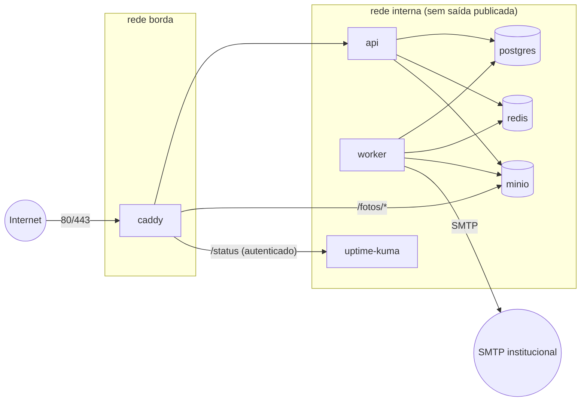
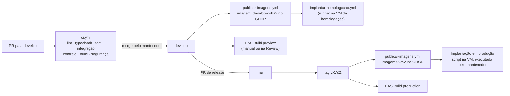

# Implantação e infraestrutura

Parte da [documentação do Guardião](README.md).

Este documento descreve os ambientes do Guardião, o servidor e os contêineres, as variáveis de ambiente, como subir o ambiente local, o pipeline de CI/CD, os builds e a distribuição do app, o proxy reverso, os backups, o monitoramento, a instalação das tags NFC em campo e os procedimentos de operação. A arquitetura lógica está em [04-arquitetura.md](04-arquitetura.md); os controles de segurança, em [11-seguranca-e-lgpd.md](11-seguranca-e-lgpd.md).

## Sumário

1. [Ambientes](#1-ambientes)
2. [Servidor](#2-servidor)
3. [Contêineres](#3-contêineres)
4. [Configuração e variáveis de ambiente](#4-configuração-e-variáveis-de-ambiente)
5. [Ambiente local](#5-ambiente-local)
6. [CI/CD](#6-cicd)
7. [Builds e distribuição do app](#7-builds-e-distribuição-do-app)
8. [Caddy](#8-caddy)
9. [Backups e restauração](#9-backups-e-restauração)
10. [Monitoramento e alertas](#10-monitoramento-e-alertas)
11. [Instalação das tags NFC](#11-instalação-das-tags-nfc)
12. [Operação do dia a dia](#12-operação-do-dia-a-dia)
13. [Checklist de entrada em produção](#13-checklist-de-entrada-em-produção)
14. [Pendências](#14-pendências)

---

## 1. Ambientes

| Ambiente | Para quê | Onde | Como é atualizado | Dados |
|---|---|---|---|---|
| Local | Desenvolvimento | Máquina de cada integrante | `pnpm dev` | Seeds fictícios |
| CI | Testes automatizados | GitHub Actions | A cada PR | Descartáveis |
| Homologação | Aceite do PO, E2E, APK de teste, Reviews | VM de homologação (ou alternativa provisória, risco R04) | A cada merge em `develop` | Fictícios |
| Produção | Piloto e uso real | VM Linux do IFSULDEMINAS | Tag de versão em `main`, implantação pelo mantenedor | Reais |

| Item | Homologação | Produção |
|---|---|---|
| Domínio | `hml.<dominio-institucional>` (a definir) | `<dominio-institucional>` (a definir) |
| Swagger UI | Ligado em `/api/docs` | Desligado |
| `LeitorNfcSimulado` | Disponível para administradores | Fora do build |
| E-mails | Mailpit (nada sai para fora) ou SMTP com lista de destinatários permitidos | SMTP institucional |
| Chave SUN de desenvolvimento | Aceita | Recusada |

## 2. Servidor

Estimativa para a V1 num campus (premissa AP02 em [04](04-arquitetura.md#11-premissas-e-pendências)):

| Recurso | Produção | Homologação |
|---|---|---|
| Sistema | Linux com suporte longo (ex.: Debian 12 ou Ubuntu Server LTS) | Igual |
| CPU | 4 vCPU | 2 vCPU |
| Memória | 8 GB | 4 GB |
| Disco | 200 GB SSD (fotos: cerca de 0,5 MB por foto) | 50 GB |
| Rede | IP com acesso externo nas portas 80 e 443 (o app usa redes móveis) | Igual |
| Software | Docker Engine e plugin Compose, `age`, `rclone`, cliente `mc` do MinIO | Igual |
| Acesso | SSH só por chave, para o mantenedor e a TI do campus; sem login de root por senha | Igual |

Endurecimento mínimo: firewall liberando só 22 (restrito à rede da TI), 80 e 443; atualizações automáticas de segurança; relógio sincronizado por NTP (o horário do servidor é a referência da auditoria, RNF07); disco cifrado se disponível (SEG05).

## 3. Contêineres

`infra/docker/docker-compose.prod.yml`:

| Serviço | Imagem | Portas publicadas | Volumes | Observações |
|---|---|---|---|---|
| `caddy` | `caddy:2` | 80, 443 | `caddy_dados`, `caddy_config`, `./Caddyfile`, `painel_dist` (somente leitura) | Único serviço exposto |
| `api` | `ghcr.io/g-e-i-c-i-s/painkiller-api:<versao>` | — | — | `MODO=api`; Docker secrets; usuário não root |
| `worker` | mesma imagem da API | — | — | `MODO=worker` |
| `migracao` | mesma imagem da API | — | — | Roda `prisma migrate deploy` com `guardiao_owner` e termina; a API só sobe depois |
| `postgres` | `postgres:17` | — | `pg_dados` | Usuários `guardiao_owner`, `guardiao_api`, `guardiao_backup` criados pelo script de inicialização |
| `redis` | `redis:7` | — | `redis_dados` | AOF ligado, senha |
| `minio` | `minio/minio` (versão fixada) | — | `minio_dados` | Bucket `guardiao-fotos` privado, versionamento ligado |
| `uptime-kuma` | `louislam/uptime-kuma:1` | — (atrás do Caddy, com autenticação) | `kuma_dados` | Monitoramento |



Regras: nenhum banco expõe porta para fora da VM; todos os serviços têm `restart: unless-stopped`, `healthcheck` e limites de memória; os logs usam o driver `json-file` com rotação (`max-size: 50m`, `max-file: 5`).

## 4. Configuração e variáveis de ambiente

A API valida todas as variáveis com zod ao iniciar e não sobe se faltar alguma. Valores secretos vêm de Docker secrets (arquivos em `/run/secrets/*`), indicados pelo sufixo `_ARQUIVO`.

| Variável | Exemplo | Segredo? | Descrição |
|---|---|---|---|
| `NODE_ENV` | `production` | não | Ambiente |
| `MODO` | `api` ou `worker` | não | Papel do processo |
| `PORTA` | `3000` | não | Porta interna da API |
| `URL_PUBLICA` | `https://<dominio-institucional>` | não | Base dos links dos e-mails e das URLs SUN |
| `DATABASE_URL_ARQUIVO` | `/run/secrets/database_url` | sim | Conexão com `guardiao_api` |
| `DATABASE_URL_MIGRACAO_ARQUIVO` | `/run/secrets/database_url_owner` | sim | Conexão com `guardiao_owner` (só no serviço `migracao`) |
| `REDIS_URL_ARQUIVO` | `/run/secrets/redis_url` | sim | Redis |
| `S3_ENDPOINT` | `http://minio:9000` | não | MinIO |
| `S3_BUCKET` | `guardiao-fotos` | não | Bucket das fotos |
| `S3_CREDENCIAIS_ARQUIVO` | `/run/secrets/s3` | sim | Chave de acesso do MinIO |
| `S3_URL_PUBLICA` | `https://<dominio-institucional>/fotos` | não | Base das URLs assinadas |
| `JWT_CHAVE_PRIVADA_ARQUIVO` | `/run/secrets/jwt_ed25519` | sim | Assinatura dos tokens |
| `SENHA_PEPPER_ARQUIVO` | `/run/secrets/pepper` | sim | *Pepper* do argon2id |
| `SUN_CHAVES_ARQUIVO` | `/run/secrets/sun_chaves` | sim | Chaves mestras dos lotes de tags |
| `SMTP_URL_ARQUIVO` | `/run/secrets/smtp_url` | sim | Servidor de e-mail |
| `SMTP_REMETENTE` | `Guardião <nao-responda@<dominio-institucional>>` | não | Remetente |
| `WHATSAPP_HABILITADO` | `false` | não | Flag global (V1.1) |
| `VERSAO_MINIMA_APP` | `1.0.0` | não | Abaixo dela, a API responde `426` |
| `CORS_ORIGEM` | `https://<dominio-institucional>` | não | Origem do painel |
| `LOG_NIVEL` | `info` | não | Nível de log |
| `TZ` | `UTC` | não | O processo roda em UTC; o fuso de exibição vem do campus |

O repositório tem só `apps/api/.env.example` e `infra/docker/.env.example`, com valores fictícios. Os arquivos reais de segredos ficam em `/etc/guardiao/segredos/` na VM (dono `root`, modo `0400`).

## 5. Ambiente local

Pré-requisitos: Node.js 24 LTS, pnpm, Docker Desktop (ou Docker Engine), Git e, para o app, Android Studio (emulador) ou um aparelho Android com o *development build* instalado.

```bash
git clone https://github.com/G-E-I-C-I-S/PainKiller.git
cd PainKiller
pnpm install
cp apps/api/.env.example apps/api/.env
docker compose -f infra/docker/docker-compose.dev.yml up -d   # Postgres, Redis, MinIO, Mailpit
pnpm --filter api prisma migrate dev                           # cria o banco e aplica as seeds
pnpm dev                                                       # sobe API, painel e Metro (app)
```

| Serviço | Endereço local | Credenciais de desenvolvimento |
|---|---|---|
| API | http://localhost:3000/api/v1 | — |
| Swagger UI | http://localhost:3000/api/docs | — |
| Painel | http://localhost:5173 | Usuários dos seeds (matrículas e senha de desenvolvimento no README de `apps/api`) |
| Mailpit | http://localhost:8025 | — |
| Console do MinIO | http://localhost:9001 | Valores do `.env.example` |
| PostgreSQL | `localhost:5432` | Valores do `.env.example` |

Para o app num aparelho físico na mesma rede: `APP_AMBIENTE=desenvolvimento` e `API_URL=http://<ip-da-maquina>:3000/api/v1`. O primeiro *development build* é gerado com `eas build --profile development --platform android` (ou `npx expo run:android` com Android Studio instalado).

Problemas comuns:

| Sintoma | Causa provável | Solução |
|---|---|---|
| API não sobe: "variável ausente" | `.env` incompleto | Comparar com `.env.example` |
| App não alcança a API | `localhost` dentro do aparelho | Usar o IP da máquina e liberar a porta 3000 no firewall |
| NFC não funciona | Expo Go em vez do *development build* | Instalar o build `development` ([ADR-0002](adr/0002-app-react-native-expo-development-build.md)) |
| Migração falha por permissão | Banco antigo de outra versão | `docker compose ... down -v` e subir de novo (só em desenvolvimento) |

## 6. CI/CD



| Workflow | Gatilho | O que faz |
|---|---|---|
| `ci.yml` | PR para `develop` ou `main` | Jobs da [estratégia de testes](12-estrategia-de-testes.md#16-gates-de-qualidade-no-ci) |
| `publicar-imagens.yml` | Push em `develop`, tag `v*` | Constrói a imagem da API (multi-stage, usuário não root), roda Trivy, publica no GHCR com a tag correspondente; empacota o `dist` do painel como artefato e dentro da imagem `painkiller-painel` |
| `implantar-homologacao.yml` | Sucesso de `publicar-imagens` em `develop` | Executado por um *self-hosted runner* na VM de homologação: `infra/scripts/implantar.sh develop-<sha>` |
| `release.yml` | Tag `v*` | Cria a GitHub Release com notas geradas e o trecho do `CHANGELOG.md` |
| `codeql.yml` | Push e semanal | Análise do CodeQL (quando habilitado) |

**Produção não tem implantação automática**: a VM de produção fica na rede institucional e o mantenedor executa a implantação depois do PR de release, conforme o [Fluxo Git](15-fluxo-git-e-contribuicao.md#7-merge-releases-e-hotfix-mantenedor).

### Implantação em produção

```bash
ssh guardiao-prod
sudo /opt/guardiao/infra/scripts/implantar.sh 1.0.0
```

O script `implantar.sh`:

1. faz um backup do banco (`backup.sh --motivo implantacao`);
2. baixa as imagens da versão (`docker compose pull`);
3. roda o serviço `migracao` e para se a migração falhar;
4. atualiza `api`, `worker` e os arquivos do painel com `docker compose up -d`;
5. espera `GET /api/v1/saude/prontidao` responder `200` por 60 s;
6. registra a versão implantada em `/opt/guardiao/VERSAO` e no log de implantações.

**Rollback:** `implantar.sh <versao-anterior>`. Migrations são escritas para serem compatíveis com a versão anterior da API (expandir, depois contrair em outra versão); se uma migração não puder ser revertida, o PR de release diz isso e o rollback exige restaurar o backup feito no passo 1.

## 7. Builds e distribuição do app

| Item | Decisão |
|---|---|
| Ferramenta | EAS Build (perfis `development`, `preview`, `production` em `apps/mobile/eas.json`) |
| Assinatura | Keystore gerenciado pelo EAS; nunca no repositório |
| Versão | `version` = tag do repositório; `versionCode` incrementado automaticamente |
| Distribuição no piloto e na V1 | **APK interno** (link de distribuição interna do EAS) ou **trilha de teste interno do Google Play**, conforme a decisão de conta (dependência externa de 30/10 em [13](13-processo-scrum.md#dependências-externas-e-datas-limite)) |
| Instalação | O administrador instala nos aparelhos do posto; aparelhos compartilhados usam o mesmo app com logins individuais |
| Atualização | Nova versão instalada por cima; a fila e o banco local são preservados (HU-043). A API força versões antigas a atualizar com `426` ([07](07-api.md#12-versionamento-e-compatibilidade)) |
| Atualizações OTA (EAS Update) | **Não usadas na V1**: toda mudança passa por build assinado e versionado, o que simplifica a rastreabilidade |
| iOS | Fora da V1 (depende de conta Apple Developer) |

Checklist do build de produção (HU-043): aponta para a API de produção; `LeitorNfcSimulado` e menus de depuração ausentes; `usesCleartextTraffic` desligado; versão igual à tag; teste de atualização por cima com pendências.

## 8. Caddy

`infra/docker/Caddyfile` (ilustrativo):

```caddy
{
    email ti-guardiao@<dominio-institucional>
}

<dominio-institucional> {
    encode zstd gzip

    header {
        Strict-Transport-Security "max-age=31536000; includeSubDomains"
        X-Content-Type-Options "nosniff"
        Referrer-Policy "no-referrer"
        Permissions-Policy "camera=(), geolocation=(), microphone=()"
        -Server
    }

    handle /api/* {
        reverse_proxy api:3000
    }

    handle /fotos/* {
        uri strip_prefix /fotos
        reverse_proxy minio:9000
    }

    handle /status* {
        basic_auth {
            mantenedor <hash-bcrypt>
        }
        reverse_proxy uptime-kuma:3001
    }

    handle {
        root * /srv/painel
        header /assets/* Cache-Control "public, max-age=31536000, immutable"
        header /index.html Cache-Control "no-cache"
        try_files {path} /index.html
        file_server
        header Content-Security-Policy "default-src 'self'; img-src 'self' data: https://tile.openstreetmap.org; connect-src 'self'; style-src 'self' 'unsafe-inline'; frame-ancestors 'none'"
    }
}
```

O Caddy obtém e renova o certificado TLS automaticamente (ACME). Se o domínio institucional exigir certificado emitido pela própria instituição, ele é montado como arquivo e configurado com a diretiva `tls`.

## 9. Backups e restauração

| O quê | Como | Frequência | Retenção | Cópia externa |
|---|---|---|---|---|
| PostgreSQL | `pg_dump -Fc` com o usuário `guardiao_backup`, cifrado com `age` | Diário às 02:00 e antes de cada implantação | 30 dias na VM | Sim, via `rclone` para o armazenamento indicado pela TI |
| Fotos (MinIO) | `mc mirror` do bucket para um diretório, cifrado com `age` por arquivo | Diário às 02:30 | Versionamento do bucket + espelho de 30 dias | Sim |
| Configuração (Caddyfile, compose, versão implantada) | Versionados no repositório; `/opt/guardiao/VERSAO` no backup | A cada implantação | — | Repositório |
| Segredos | Cópia cifrada guardada pela TI fora da VM | A cada mudança | Enquanto válidos | Cofre da TI |

| Objetivo | Meta |
|---|---|
| RPO (perda máxima de dados no servidor) | 24 h. Na prática menor: registros feitos no app depois do último backup ainda estão na fila dos aparelhos ou podem ser reenviados se a restauração for de horas recentes |
| RTO (tempo para voltar ao ar) | 4 h, com a VM disponível |

**Teste de restauração:** antes do go-live (critério da V1.0) e depois mensalmente, o mantenedor restaura o backup mais recente numa VM separada, verifica a contagem de registros, roda a verificação da cadeia de auditoria e abre fotos por amostragem. O resultado vai para o log de operações.

```bash
# Restauração (resumo)
age -d -i chave-backup.txt guardiao-AAAAMMDD.dump.age > guardiao.dump
docker compose exec -T postgres pg_restore -U guardiao_owner -d guardiao --clean --if-exists < guardiao.dump
```

## 10. Monitoramento e alertas

| Verificação | Ferramenta | Intervalo | Alerta |
|---|---|---|---|
| `GET /api/v1/saude` | Uptime Kuma | 60 s | E-mail ao mantenedor em até 5 min de falha (HU-042) |
| `GET /api/v1/saude/prontidao` (banco, Redis, MinIO) | Uptime Kuma | 60 s | Idem |
| Validade do certificado TLS | Uptime Kuma | Diário | 14 dias antes do vencimento |
| Disco acima de 80% | Script `verificar-disco.sh` (cron) | 15 min | E-mail |
| Backup diário concluído e copiado | O script de backup envia um *heartbeat* ao Uptime Kuma (*push monitor*) | Diário | Falta de *heartbeat* em 26 h |
| Cadeia de auditoria íntegra | Job `verificar-cadeia-auditoria` | Diário | E-mail ao mantenedor e destaque no painel |
| Notificações `FALHOU` | Job do worker | 15 min | Contador no painel; e-mail se mais de 5 em 1 h |
| Contêiner reiniciando em laço | `docker events` + script | Contínuo | E-mail |

O alerta por e-mail usa um SMTP diferente do que envia as notificações, quando possível, para não depender do mesmo ponto de falha.

## 11. Instalação das tags NFC

### 11.1 Preparação

1. **Levantamento com a Coordenação de Vigilância:** lista de pontos por prédio, andar e setor, com o que verificar em cada um (vira `instrucoes`).
2. **Cadastro no painel:** prédios com geofence e pontos com raio de tolerância inicial (sugestão: 30 m em áreas externas, 40 m em áreas internas, ajustados no piloto).
3. **Provisionamento das tags** (NTAG 424 DNA) com o script `infra/scripts/provisionar-tags` e o leitor USB, em ambiente controlado. Saída: CSV com UID e lote, sem chaves ([11 · Chaves](11-seguranca-e-lgpd.md#43-chaves-e-provisionamento)).
4. **Material:** tags adesivas (modelo *on-metal* para superfícies metálicas), capa de proteção ou parafuso antivandalismo, etiqueta visível com o ícone NFC e um código curto do ponto (sem nome de pessoa), celular do administrador com o app.

### 11.2 Em campo, para cada ponto

| Passo | Detalhe |
|---|---|
| 1. Posição | Altura entre 1,2 m e 1,5 m, longe de metal (exceto tag *on-metal*), protegida de chuva direta, num local que obrigue a passar pelo ponto (não visível de longe) |
| 2. Fixação | Superfície limpa e seca; adesivo + proteção; foto do local apenas para o registro interno da instalação |
| 3. Vínculo | Modo instalação do app: encostar, escolher o ponto, **VINCULAR** (UC19) |
| 4. Teste | Segunda leitura confirma o nome do ponto; ler também com um aparelho de vigilante homologado |
| 5. Coordenadas | Se o ponto precisar de referência própria (prédio grande), o administrador ajusta a posição do ponto no mapa do painel ao lado do local |
| 6. Registro | Planilha de instalação: código do ponto, UID, data, responsável, observações. A planilha não contém chaves |

### 11.3 Depois da instalação

- Uma ronda de teste completa com um vigilante, antes do piloto.
- Revisão das leituras de teste no detalhe da ronda: pontos com `FORA_AREA` ou `INDETERMINADO` em condições normais têm o raio ou a referência ajustados.
- Tags danificadas, removidas ou suspeitas viram `EXTRAVIADA`/`INATIVA` e são substituídas pelo fluxo de substituição (FA1 do UC19).

## 12. Operação do dia a dia

| Tarefa | Como | Quem |
|---|---|---|
| Implantar nova versão | `implantar.sh <versao>` ([seção 6](#implantação-em-produção)) | Mantenedor |
| Rollback | `implantar.sh <versao-anterior>` | Mantenedor |
| Ver logs | `docker compose logs -f api worker --since 1h` | Mantenedor, TI |
| Revogar aparelho perdido | Painel → Cadastros → Dispositivos → Revogar | Administrador |
| Desbloquear usuário bloqueado por tentativas | Esperar o bloqueio progressivo ou redefinir a senha no painel | Administrador |
| Reprocessar notificações `FALHOU` | Painel da ocorrência → Notificações → Reenviar (gera nova tentativa auditada) | Administrador |
| Rotacionar segredo | Atualizar o arquivo em `/etc/guardiao/segredos/`, `docker compose up -d --force-recreate api worker` | Mantenedor |
| Adicionar um campus | Painel: campus, configuração, prédios, pontos; provisionar e instalar tags | Administrador |
| Verificar integridade da auditoria sob demanda | Painel → Auditoria → Verificar agora | Administrador |
| Conciliação do piloto | `infra/scripts/conciliar-piloto` com a exportação dos aparelhos | Mantenedor |

Todas as intervenções manuais na VM ficam registradas no log de operações (arquivo versionado fora do repositório público ou issue privada).

## 13. Checklist de entrada em produção

Usado em HU-042 e no go/no-go da V1.0 ([14 · Plano de releases](14-backlog-e-roadmap.md#12-plano-de-releases)).

- [ ] Domínio e DNS apontando para a VM; HTTP redireciona para HTTPS; certificado válido; HSTS ativo.
- [ ] Segredos criados em `/etc/guardiao/segredos/` com permissão `0400`; nenhum segredo no repositório.
- [ ] Usuários do PostgreSQL criados; `guardiao_api` sem `DELETE` e sem `UPDATE` na auditoria (teste executado).
- [ ] Migrations aplicadas; seeds de produção (tipos de ocorrência, regra de notificação, aviso de privacidade validado).
- [ ] `GET /api/v1/saude/prontidao` respondendo `200`.
- [ ] Swagger desligado; CORS restrito ao domínio do painel.
- [ ] SMTP institucional enviando com SPF/DKIM configurados pela TI; e-mail de teste recebido.
- [ ] Backup diário rodando, cópia externa funcionando, **restauração testada**.
- [ ] Uptime Kuma com todos os monitores e alerta testado.
- [ ] Cadastros do campus piloto completos; tags instaladas e testadas; ronda de teste feita.
- [ ] Build de produção do app distribuído aos aparelhos do piloto.
- [ ] Contas reais criadas para vigilantes, coordenadores e responsáveis do piloto; usuários de teste desativados.

## 14. Pendências

| # | Pendência | Responsável | Data-limite |
|---|---|---|---|
| INF01 | VM de produção, domínio institucional e DNS | TI do campus / Mantenedor | 03/11/2026 |
| INF02 | VM ou alternativa de homologação | Mantenedor | 13/10/2026 |
| INF03 | Acesso ao SMTP institucional (SPF/DKIM) | TI do campus | 30/10/2026 |
| INF04 | Destino da cópia externa dos backups | TI do campus | 03/11/2026 |
| INF05 | Conta de distribuição (EAS e Google Play) ou decisão por APK interno | Mantenedor | 30/10/2026 |
| INF06 | Certificado: ACME automático ou emitido pela instituição | TI do campus | 03/11/2026 |
| INF07 | Leitor NFC USB para provisionamento das tags | PO | 13/10/2026 |
